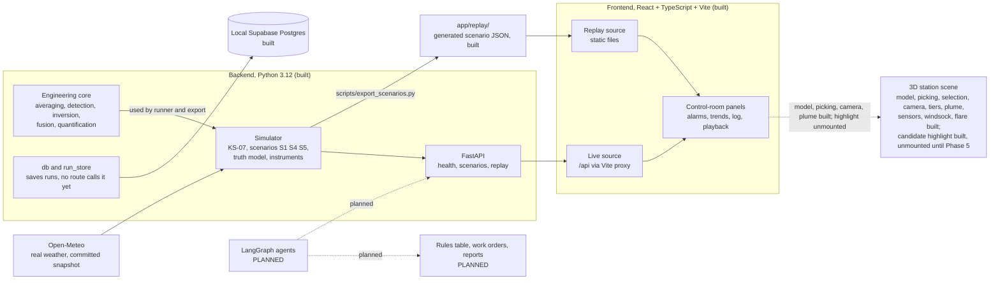

# Documentation index

PlumeTrace is an AI methane leak hunter for a simulated gas compressor station. This page is the
entry point: a picture of the whole system, how the documents are organised, then one row per page.

## System at a glance

*System at a glance: solid parts exist and are tested; dotted parts (agents, rules table, reports) are planned and not built, and the dotted link to the 3D station marks that the station view is not yet fed by agents; the 3D station is the Phase 4 baked model of the whole station with a sun, picking, selection labels, camera fly-to and quality tiers (Task 8), plus the plume heat-map and particles, sensor markers, windsock, flare and legend (Task 9); the candidate highlight is built and tested but not mounted until Phase 5, which supplies its candidates. Nothing is deployed; the replay build is built and previewed locally.*

Details of each box: [SIMULATOR](reference/SIMULATOR.md), [ENGINEERING](reference/ENGINEERING.md) and
[PHYSICS_PIPELINE](reference/PHYSICS_PIPELINE.md), [API](reference/API.md),
[DATABASE](reference/DATABASE.md), [REPLAY](reference/REPLAY.md), [FRONTEND](reference/FRONTEND.md).

## How the docs are organised

| Kind | Where | Rule |
|---|---|---|
| Reference pages | `reference/*.md` | One page per responsibility, written from the code. Updated in the same change as the code (CLAUDE.md rule 17). Each carries its own Mermaid diagrams |
| Setup and log | `LOCAL_DEVELOPMENT.md`, `WORK_LOG.md`, `OWNER_ACTIONS.md` | How to run; one row per completed task; things only the owner can do |
| Evidence | `evidence/`, `engineering/coverage.json` | Dated check output and gate reviews. Kept as history, never rewritten |
| Generated reports | `benchmark.md`, `benchmark-improvement.md`, `evidence/*.json` | Produced by scripts from a seed and a revision. Never hand-edited; the benchmark page [reference/BENCHMARK.md](reference/BENCHMARK.md) explains how to read them |
| Design and plans | `superpowers/` | The approved design and the phase plans. Owner-controlled; implementing agents do not edit them |

Diagram conventions: Mermaid is embedded inline in the reference page it explains (GitHub renders
it), 6 to 15 nodes per diagram, a one-line caption under each, planned parts labelled as planned.
The full standard and the page template are in the
[project-documentation skill](../.claude/skills/project-documentation/SKILL.md).

## Project documents, evidence and generated reports

| Document | What it covers |
|---|---|
| [LOCAL_DEVELOPMENT.md](LOCAL_DEVELOPMENT.md) | Prerequisites, pinned versions, how to run everything |
| [WORK_LOG.md](WORK_LOG.md) | One entry per completed plan task |
| [OWNER_ACTIONS.md](OWNER_ACTIONS.md) | Things only the owner can do |
| [engineering/coverage.json](engineering/coverage.json) | Engineering coverage ledger (42 concepts, Phase 1 and 2 scope): which apply, which are planned, which do not apply and why |
| [evidence/2026-11-phase-1-checks.md](evidence/2026-11-phase-1-checks.md) | Phase 1 check results (quick and full runs, audits) and the Gate 1 review list |
| [evidence/2026-11-phase-2-checks.md](evidence/2026-11-phase-2-checks.md) | Phase 2 check results (quick and full runs, audits, per-module test counts, coverage of the engineering core, benchmark determinism check) and the Gate 2 review list; local / synthetic |
| [benchmark.md](benchmark.md) | Inversion benchmark under model mismatch: accuracy, rate error, inconclusive and false-call rates (generated, synthetic data) |
| [benchmark-improvement.md](benchmark-improvement.md) | Improvement round (pre-registered 2026-11-14): Task 8 and meander-aware inversion on a fresh seed, calibration metrics, adoption verdict (generated, synthetic data) |
| [evidence/benchmark-2026-11-13.json](evidence/benchmark-2026-11-13.json) | Case-level evidence of the published benchmark run (seed 20261112, revision 23b8703, generated, synthetic data) |
| [evidence/benchmark-improvement-2026-11-14.json](evidence/benchmark-improvement-2026-11-14.json) | Case-level evidence of the improvement run (both methods, generated) |
| [evidence/2026-11-phase-3-scenarios.md](evidence/2026-11-phase-3-scenarios.md) | Phase 3 scenario evidence: selected weather offsets, detection events and replay file sizes per MVP scenario; local / synthetic plus real weather |
| [evidence/2026-11-ks07-glb.md](evidence/2026-11-ks07-glb.md) | Phase 4 Task 7 full-station `ks07.glb`: budgets (size, triangles, draw calls, texture memory), bake times, the texture-size and ground rulings, screenshots |
| [evidence/2026-11-phase-4-ui.md](evidence/2026-11-phase-4-ui.md) | Phase 4 UI evidence (Task 11): screenshots at 1440 x 900 and 1920 x 1080, draw calls and fps on the RTX 3050 laptop GPU (integrated GPU not measured), bundle sizes, axe, e2e and check outputs; local / simulated |
| [evidence/2026-11-spike.md](evidence/2026-11-spike.md) | Phase 4 Task 5 Blender spike evidence (K-202 with shelter, VS-250, ground patch) and the approach B go or no-go question, with its screenshots |
| [evidence/2026-11-equipment/](evidence/2026-11-equipment/) | Phase 4 Task 6 review stills (960 x 540 PNG, Cycles) of the 13 newly built equipment types; review aids, not a validation |
| [evidence/2026-11-phase-2-gate-2.md](evidence/2026-11-phase-2-gate-2.md) | Gate 2 evidence: full check run, official run and determinism check, published reproduction, code diff since 23b8703, decisions summary |

## Reference pages

Each page follows the deep-documentation structure: purpose, diagram, module-by-module explanation,
worked example, edge cases and the test that pins each, how to run and extend.

### Foundations

| Document | What it covers |
|---|---|
| [reference/STRUCTURE.md](reference/STRUCTURE.md) | Repository layout, dependency direction between apps, no-god-file limits, how `check_structure.py` works |
| [reference/WORKSPACE.md](reference/WORKSPACE.md) | How a fresh clone builds: bootstrap files, uv workspace, tool settings, local Supabase stack, frontend shell |
| [reference/CONFIGURATION.md](reference/CONFIGURATION.md) | The single root `.env`, the `Settings` object, `env_set.py` and the secret and env checkers; known inconsistencies |
| [reference/CHECKS.md](reference/CHECKS.md) | `scripts/ci_local.py` stages, the pre-commit hook and the three repository checkers |
| [reference/CONTRACT.md](reference/CONTRACT.md) | Python to TypeScript contract: generated types and `ks07.json`, drift check |
| [reference/TESTING.md](reference/TESTING.md) | Test layers, how to run the local checks, coverage thresholds, browser tests (Playwright, axe, draw-call and fps specs) |

### Engineering core

| Document | What it covers |
|---|---|
| [reference/ENGINEERING.md](reference/ENGINEERING.md) | Reference for every engineering module: public interface, units, assumptions, limits and tests (hub for the pages below) |
| [reference/PHYSICS_PIPELINE.md](reference/PHYSICS_PIPELINE.md) | The whole chain from sensor samples to a ranked source, coordinates and the wind convention, who owns each step |
| [reference/DISPERSION.md](reference/DISPERSION.md) | Stability class, spreads, the Gaussian plume, wind meander option, plume grid for the replay |
| [reference/DETECTION.md](reference/DETECTION.md) | Averaging and event detection: windows, thresholds, tuning knobs |
| [reference/INVERSION.md](reference/INVERSION.md) | Source inversion, the conclusive or inconclusive decision, evidence fusion and the binding rate display rule R1 to R4 |
| [reference/QUANTIFICATION.md](reference/QUANTIFICATION.md) | Units, gas properties, flare slip, blowdown, inventory and methane intensity |
| [reference/TRUTH_MODEL.md](reference/TRUTH_MODEL.md) | The deliberately different physics used to generate the truth data, and why |
| [reference/BENCHMARK.md](reference/BENCHMARK.md) | Model-mismatch benchmark: method, metrics, published results, the pre-registered improvement round, how to read the generated files |

### Simulator and data

| Document | What it covers |
|---|---|
| [reference/FACILITY.md](reference/FACILITY.md) | Facility model of Station KS-07: loader, id scheme, component table, validation |
| [reference/SIMULATOR.md](reference/SIMULATOR.md) | Station KS-07 facility spec (equipment, leak points, instruments, gas), the scenario runner and replay export |
| [reference/SCENARIOS.md](reference/SCENARIOS.md) | Scenarios S1, S4 and S5: registry, per-scenario timeline, window selection, limits recorded at Gate 3 |
| [reference/VARIANTS.md](reference/VARIANTS.md) | Scenario variants: what varies, ids and keys, validation (Phase 5 use planned, not built) |
| [reference/WEATHER.md](reference/WEATHER.md) | Open-Meteo data path and the committed weather snapshot; refresh procedure |
| [reference/REPLAY.md](reference/REPLAY.md) | Replay scenario files: format field by field, units, sampling, the `log_u8` plume encoding, size budget, regeneration (generated, never hand-edited) |
| [reference/DATABASE.md](reference/DATABASE.md) | Local Supabase schema, RLS, migrations, repositories, saving a run, connection pool |

### API and frontend

| Document | What it covers |
|---|---|
| [reference/API.md](reference/API.md) | REST endpoints (health, scenarios, replay), request path, configuration, limits |
| [reference/PLUME.md](reference/PLUME.md) | The plume layer of the 3D station: key-frame decode, ground heat-map, GPU particles, legend, sensors, windsock, flare, post effects, the simulation-truth guards, draw-call measurements |
| [reference/FRONTEND.md](reference/FRONTEND.md) | React app: stack, scripts, folder rules, live and replay builds, layout; the 3D station (baked full-station model, node index, picking, selection, camera, quality tiers, measurements, regeneration command and budgets; the plume layer is in PLUME.md; accessibility and fallbacks: equipment list, WebGL fallback, viewport classes, mobile page) |
| [reference/ASSETS.md](reference/ASSETS.md) | Poly Haven CC0 textures and HDRI used by the 3D pipeline: ids, licence, source, where each is used, how to fetch and verify |
| [reference/STATION_MODEL.md](reference/STATION_MODEL.md) | Station model: piping routes, pipe racks, site (yard, pads, road, bund, fence), the AO bake, `scripts/build_station.sh`, the glTF-Transform step and the `check_glb.py` budgets (Phase 4 Task 7) |
| [reference/BLENDER_EQUIPMENT.md](reference/BLENDER_EQUIPMENT.md) | Blender generator parts library and the 15 equipment builders: parts, anchors, separate glb nodes (fans, flare tip), materials, how to build and check one type (Phase 4 Task 6; the whole-station chain is STATION_MODEL.md) |
| [reference/DESIGN_SYSTEM.md](reference/DESIGN_SYSTEM.md) | Design tokens, typography, shadcn primitives, formatting helpers, anti-slop rules |
| [reference/DATA_LAYER.md](reference/DATA_LAYER.md) | `DataSource` interface (live and replay), error kinds, stores, replay-only bundle guard |
| [reference/UI_PANELS.md](reference/UI_PANELS.md) | Control-room panels, component tree, keyboard map, binding display rules |
| [reference/ACCESSIBILITY.md](reference/ACCESSIBILITY.md) | Accessibility as built (skip link, tabs, equipment list, WebGL fallback, reduced motion, mobile page, recorded tab order), known gaps and limits |

### Security and quality

| Document | What it covers |
|---|---|
| [reference/SECURITY.md](reference/SECURITY.md) | Trust boundaries, outbound network calls (Open-Meteo), settings and secrets, API and frontend controls, known gaps |
| [reference/DEPLOYMENT.md](reference/DEPLOYMENT.md) | Vercel settings and security headers, recorded for a later phase (not deployed) |

## Design and plans

| Document | What it covers |
|---|---|
| [superpowers/specs/2026-11-12-plumetrace-design.md](superpowers/specs/2026-11-12-plumetrace-design.md) | The approved design |
| [superpowers/plans/2026-11-12-plumetrace-roadmap.md](superpowers/plans/2026-11-12-plumetrace-roadmap.md) | Roadmap and phase plans |
