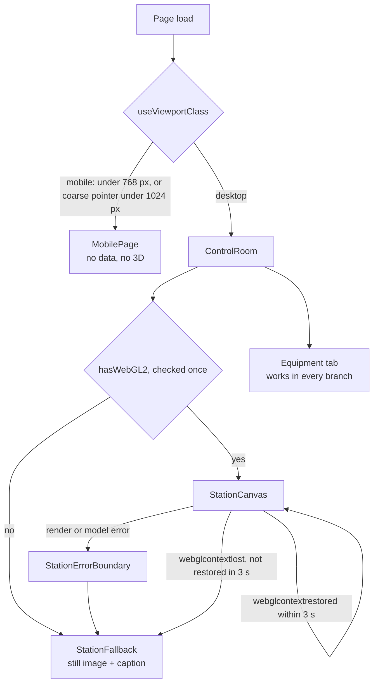
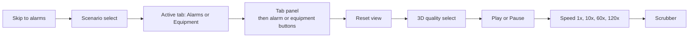

# Accessibility

What the control-room UI does today for keyboard, screen-reader, low-vision and reduced-motion users,
how that is tested, and what is not done yet. Scope: Phase 4 Tasks 2 to 4 (design system and panels)
and Task 10 (the accessible alternatives to the 3D station: equipment list, skip link, WebGL
fallback, mobile page) and the axe scan of Task 11 (`e2e/a11y.spec.ts`, see
[TESTING.md](TESTING.md#browser-tests-playwright-phase-4-task-11)). **Built:** all of those.
**Not done:** screen-reader runs, a target-size review (see Known gaps).

Related pages: [UI_PANELS.md](UI_PANELS.md), [DESIGN_SYSTEM.md](DESIGN_SYSTEM.md),
[FRONTEND.md](FRONTEND.md#accessibility-and-fallbacks-task-10).

## Purpose

Everything the 3D view does has a route that needs neither the mouse nor WebGL: pick equipment from a
list (keyboard, screen reader), see a still image when the 3D view cannot run, get reduced motion when
the OS asks for it, and get a light page on a phone.

Which accessible alternative the page picks (built, Task 10). The Equipment tab and the alarm list are
in the control room in every branch; only the station area changes.

## What exists

### Structure and names

| Element | Markup | Where |
|---|---|---|
| Page language | `<html lang="en">` | `index.html` |
| Page heading | `h1` `PlumeTrace` in `<header>` | `app/TopBar.tsx` |
| Station view | `<main aria-label="Station view">` | `app/AppShell.tsx` |
| Panels | `<section aria-labelledby>` with an `h2` title: `Alarms`, `Station log`, `Trends` | `shared/ui/Panel.tsx` |
| Chart titles | `h3` per chart block: `Methane (ppm)`, `Wind (m/s, °)` | `features/trends/components/TrendsPanel.tsx` |
| Alarm list | `<ul aria-live="polite" aria-label="Alarm list">`; each row is one `<button>`; the selected row has `aria-current="true"` | `features/alarms/components/` |
| Station log | `<ul aria-label="Station log entries">` | `StationLog.tsx` |
| Load status | `role="status"` container with the message, so it is announced politely | `ScenarioStatus.tsx` |
| Charts | the uPlot host has `role="img"` and an `aria-label` (`Methane trend per sensor, 1 highlighted`, `Wind speed and direction trend`) | `UPlotChart.tsx` |
| Play and pause | icon-only button with `aria-label` `Play` or `Pause` | `PlaybackBar.tsx` |
| Speed | `role="radiogroup"` `aria-label="Playback speed"`; each button has `role="radio"` and `aria-checked` | `PlaybackBar.tsx` |
| Scrubber | `input type="range"` `aria-label="Simulation time"`, `aria-valuetext="Elapsed +02:20"`, step 60 s | `PlaybackBar.tsx` |
| Alarm ticks under the scrubber | `aria-hidden="true"` (decoration; the alarms are in the list) | `PlaybackBar.tsx` |
| Scenario picker | native `<select aria-label="Scenario">` | `ScenarioPicker.tsx` |
| Status markers | 6 px square `aria-hidden`; the word carries the meaning | `shared/ui/StatusBadge.tsx` |
| Skip link | first focusable element, `Skip to alarms`, `href="#alarms-panel"`; visually hidden until focused | `app/SkipLink.tsx` |
| Left column | Radix tabs (`role="tablist"`, `tab`, `tabpanel`): `Alarms` and `Equipment`; the column is `#alarms-panel` with `tabindex="-1"` (skip-link target) | `app/LeftColumn.tsx` |
| Equipment list | `Panel` `Equipment`; one `<section aria-label>` per area with an `h3`; each row a `<button aria-pressed>` named `VS-250 Vent stack` (tag then type) | `features/station3d/EquipmentList.tsx` |
| Station fallback | `<figure>` with an `img` that has an `alt` text and a `figcaption` | `features/station3d/StationFallback.tsx` |
| Mobile page | `<header>` with the product name and `Simulated`, `<main>` with the only `h1`, an `img` with the same `alt` | `app/MobilePage.tsx` |

Tests `app/AppShell.test.tsx` and `app/AppShell.viewport.test.tsx` assert the `h1`, the three panel
regions, the `main` region and the skip link by role and name; `app/LeftColumn.test.tsx` the tabs;
`features/station3d/EquipmentList*.test.tsx` the rows and `aria-pressed`;
`app/MobilePage.test.tsx` the mobile page.

### Keyboard

| Key | Action |
|---|---|
| `Tab` / `Shift+Tab` | Moves through the controls in DOM order (below) |
| `Space` | Play or pause from anywhere except a focused button, which activates itself |
| `ArrowLeft` / `ArrowRight` | Seek by 60 s; with `Shift` by 600 s |
| Arrow keys on the scrubber | The browser moves it by its 60 s step |
| `Enter` or `Space` on an alarm row | Selects the sensor and seeks to the close time (native button) |
| `ArrowLeft` / `ArrowRight` on a tab | Moves to the other tab and activates it (Radix, WAI-ARIA tabs) |
| `Enter` or `Space` on an equipment row | Selects the tag (the 3D view highlights it and flies there); again clears it |
| `R` | Reset the 3D view to the review camera; ignored in `input`, `select`, `textarea`, `[contenteditable]` and with a modifier (`useCameraFlyTo.test.tsx`) |

Keys are ignored in `input`, `select`, `textarea` and `[contenteditable]` targets and with Ctrl, Alt
or Meta held, so typing and browser shortcuts keep working. `usePlaybackKeys.test.tsx` pins this.

Tab order of the control room, recorded in Chromium on 2026-11-17 by pressing Tab 12 times from a
fresh load (replay build, desktop): `Skip to alarms`, `Scenario`, the active tab, the tab panel (Radix
gives it `tabindex="0"`), `Reset view`, `3D quality`, `Play`, the four speeds, `Simulation time`, then
the browser. The station log and the trends have no focusable child; Chromium did not stop on their
scroll containers. `Retry` appears after the tab panel only while a retryable error shows. Only the
active tab is in the Tab order; the arrow keys move between the tabs. The skip link moves focus to
`#alarms-panel` (checked: `document.activeElement.id` is `alarms-panel`, the URL gets `#alarms-panel`).

### Colour and contrast

- Text and value contrast on the panel surfaces is measured and recorded in
  [DESIGN_SYSTEM.md](DESIGN_SYSTEM.md#colour-tokens): `--text-1` 13.72:1 and `--text-2` 7.55:1 on
  surface-1.
- Meaning is never colour alone: alarm and state use a marker plus a word; the clock says `UTC` or
  `Elapsed`; highlighted chart sensors are listed by id in the panel header.
- `--text-3` (4.37:1 on surface-1) is not used for values, units or labels. Today it appears only in the
  disabled scenario picker (3.91:1 on surface-2) and in quiet chart strokes (graphics). The recorded
  rule is stricter (surface-0 only); see [DESIGN_SYSTEM.md](DESIGN_SYSTEM.md#rules-that-follow-from-the-contrast-numbers).
- Focus: a 2 px `--focus` outline with a 2 px offset on every `:focus-visible` (8.62:1 against
  surface-0).

### Motion

Under `prefers-reduced-motion: reduce`, animation and transition durations drop to 0.01 ms for all
elements. The panels have no autoplay animation; the only motion is the clock, which the user starts.
In the 3D station view (built, tested): the camera jumps instead of flying, the plume particles and the
flare flicker run at a quarter speed, and a sensor alarm ring appears at full size at once
(`useCameraFlyTo.test.tsx`, `PlumeLayer.test.tsx`, `FlareFlame.test.tsx`, `SensorMarkers.test.tsx`;
see [PLUME.md](PLUME.md)). The store reads `prefers-reduced-motion` and follows changes
(`store.tier.test.tsx`, `store.reducedMotion.test.ts`: with the query mocked to `reduce`,
`useStationStore.getState().reducedMotion` is `true`). Chromium with reduced motion emulated loaded the
control room without new console errors or warnings (checked 2026-11-17).

## Fallbacks and mobile

| Situation | What the user gets | Pinned by |
|---|---|---|
| No WebGL 2 (checked once on mount) | `StationFallback` (still image plus the caption `3D view unavailable on this device. The alarms, equipment list and trends still work.`), no quality menu, no legend, no canvas, **no console output**; the Equipment tab still selects tags | `StationView.test.tsx`, `StationView.clean.test.tsx`; browser: Chromium with `--disable-webgl --disable-webgl2 --disable-3d-apis`, the `ks07.glb` request never happened |
| Canvas or model throws while loading or rendering | `StationErrorBoundary` swaps in the fallback and logs `station view failed` once | `StationView.failure.test.tsx` |
| Graphics context lost and not restored within 3 s | fallback and one `console.error` | `StationView.failure.test.tsx` (2999 ms keeps the canvas, 3000 ms falls back); browser: `WEBGL_lose_context.loseContext()` gave the fallback after 4 s |
| Context restored within 3 s | the canvas stays, nothing is logged | `StationView.failure.test.tsx`; browser: restore after 0.8 s kept the canvas and logged nothing |
| Width under 768 px, or a coarse pointer under 1024 px | `MobilePage`: no scenario data, no 3D chunk, no `ks07.glb` | `useViewportClass.test.ts`, `AppShell.viewport.test.tsx`; browser at 390 x 844 and 820 x 1180 with touch emulation: no request for `.glb`, `/replay/` or `/api/`, no horizontal scroll |
| A large touch screen (1366 px) | keeps the control room | `useViewportClass.test.ts` |

The fallback and mobile image is `app/frontend/public/images/station-fallback.jpg`: a screenshot of the
real 3D view at the review camera, scenario S5 at t = 0 (no plume), without the legend and menu. It is
a still of the simulated station. The mobile page has no weather or measurement data, so it needs no
data attribution. Recipe (run 2026-11-17; the capture script was a throw-away outside the repo, using the
Playwright library from the local npx cache and the installed Chromium build 1248 with SwiftShader WebGL):

1. From `app/frontend/`: `npx vite --mode replay --port 5173 --strictPort` (dev server on the replay data;
   `?clean` works in dev builds only, `import.meta.env.DEV`, so `npm run preview:replay` ignores it).
2. Open `http://localhost:5173/?clean` with a viewport of 2600 x 1392 CSS px at device scale factor 1.
   The `main[aria-label="Station view"]` box is then exactly 1920 x 1080 (width 2600 - 320 - 360,
   height 1392 - 48 - 220 - 44); the script asserts the box and the canvas box and stops otherwise.
3. Choose the scenario `Sensor drift on AT-106` (S5) in the `Scenario` select. The clock stays at
   `+00:00`, paused (the `Play` button is shown), nothing is selected (no `aria-pressed="true"`).
4. Wait 8 s for the model; check that the `3D quality` select and the legend text are absent.
5. Element screenshot of the `Station view` element, JPEG, quality 80, saved as
   `public/images/station-fallback.jpg`.
6. Result: 1920 x 1080 (read back with Pillow), 137,576 bytes (limit 300,000). Stop the dev server.

**Deviation from the plan, owner ruling 2026-11-17:** the image text alternative is
`Station KS-07 seen from the south-west: compressor shelters, scrubbers, fin-fan coolers, vent stack VS-250, two storage tanks and pipework.`
The plan text names a flare, which is outside the frame (`stationImage.ts`; the plan tests still match
because they test the first words only).

`src/shared/testing/setup.ts` makes jsdom's `HTMLCanvasElement.prototype.getContext` return `null`
quietly. Without it jsdom prints `Not implemented: HTMLCanvasElement's getContext()` every time a test
renders `AppShell` (the real `hasWebGL2` runs there). `webgl.test.ts` spies on `getContext` in each
test, so it still tests both the null and the throwing paths; an early return in `hasWebGL2` would
have made those plan tests pass vacuously.

## Known gaps and limits

- **Axe covers what axe can see.** `e2e/a11y.spec.ts` runs `@axe-core/playwright` 4.14.0 (axe-core
  4.14.1) with the tags `wcag2a`, `wcag2aa` and `wcag21aa` on the control room (S1 at +04:00, no
  WebGL, so the fallback) and on the phone page (390 x 844), and fails on any serious or critical
  violation. On 2026-11-17 both pages had no violation of any impact (30 and 8 rules passed). It does
  not run with the 3D canvas, and automated rules find only part of the real problems (no screen reader
  was run).
- **Screen-reader behaviour is unverified.** No screen reader was run. The alarm list is a polite live
  region whose content is replaced once per simulated minute; how an assistive technology announces
  that was not tested.
- **Speed buttons are a radiogroup without radio arrow-key behaviour.** They are `role="radio"`
  buttons reached by Tab. Pressing `ArrowLeft` or `ArrowRight` while one has focus seeks the clock
  (the global handler ignores only inputs, selects, text areas and editable content), instead of moving
  between speeds.
- **Charts have a text label only.** There is no data table or per-point readout; the alarm list and
  station log carry the same events as text.
- **The alarm live region is not mounted while the Equipment tab is active.** Radix unmounts the
  inactive panel, so new alarms are not announced then; they appear when the Alarms tab is opened again.
- **web-design-guidelines review (2026-11-17), left open.** The active tab is not in the URL (no
  router; accepted). The fallback caption is not a live region, so a runtime switch to the still image
  after a context loss is not announced (the fallback mounts with its text; accepted for now). The
  shared `tabs.tsx` still carries shadcn's `transition-all` in its base class; `LeftColumn` overrides it
  with `transition-none`, the file itself is not a Task 10 file. The mobile page copy (rewritten in the
  Gate 4 fix round to describe only what the replay shows, see the guard in `MobilePage.test.tsx`)
  can still break "KS-07" at the hyphen across lines (seen at 390 px, left open).
- **No screen reader run.** The names and roles above come from Testing Library queries, axe and a
  Chromium tab-order recording.
- **A lost context logs a three.js warning.** When the fallback replaces the canvas, three.js warns
  `WEBGL_lose_context extension not supported` while disposing the lost renderer (a warning, not an
  error).
- **Console in a plain load.** Fixed in Task 11 for the favicon: `index.html` now links
  `/favicon.svg` (a 32 px ring on the dark surface colour), so a browser that asks for an icon no
  longer gets a `404` console error. With WebGL the console still shows two three.js 0.187.0
  deprecation warnings (`THREE.Clock`, `PCFSoftShadowMap`); the `webgl` end-to-end test lists exactly
  those two texts and fails on any other warning or error.
- **Touch targets.** `Button` `xs` (speed buttons) is 24 px high; the 32 px `icon-sm` and `sm` sizes
  are used for play and Retry. The equipment rows are about 28 px high. A target-size review has not
  been done.
- **Mobile page is static.** It has no scenario picker and no video yet (the demo video is Phase 7,
  planned).

## How to extend

1. Give every new panel a `Panel` title (the region name) and a list or table with an `aria-label`.
2. Every interactive element is a native `button`, `select`, `input` or `a`; add `aria-label` to
   icon-only controls. Use `aria-pressed`, `aria-checked` or `aria-current` for state, and a word for
   every colour.
3. Do not capture keys that a focused control needs. Extend `usePlaybackKeys.ts` only with tests for
   the ignored targets.
4. Check contrast of any new token with the WCAG 2.x formula on all four surfaces before use.
5. Add a test that finds the control by role and name (Testing Library `getByRole`), then run axe with
   `e2e/a11y.spec.ts` (`npm run e2e`).

## Changelog

- 2026-11-15: first version, written from the Task 4 code.
- 2026-11-17: Phase 4 Task 10: skip link, Alarms and Equipment tabs, equipment list, WebGL fallback
  (no WebGL 2, error boundary, context loss), reduced-motion test, viewport classes and the mobile
  page; purpose diagram, tab order and fallback table added; gaps updated.
