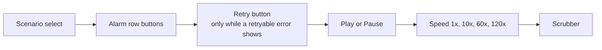

# Accessibility

What the control-room UI does today for keyboard, screen-reader, low-vision and reduced-motion users,
how that is tested, and what is not done yet. Scope: Phase 4 Tasks 2 to 4 (design system and panels).
The 3D station and its accessible alternatives (equipment list, skip link, WebGL fallback, mobile page)
are Phase 4 Task 10 and are **not built**.

Related pages: [UI_PANELS.md](UI_PANELS.md), [DESIGN_SYSTEM.md](DESIGN_SYSTEM.md),
[FRONTEND.md](FRONTEND.md).

## What exists

### Structure and names

| Element | Markup | Where |
|---|---|---|
| Page language | `<html lang="en">` | `index.html` |
| Page heading | `h1` `PlumeTrace` in `<header>` | `app/TopBar.tsx` |
| Station view | `<main aria-label="Station view">` | `app/AppShell.tsx` |
| Panels | `<section aria-labelledby>` with an `h2` title: `Alarms`, `Station log`, `Trends` | `shared/ui/Panel.tsx` |
| Chart titles | `h3` per chart block: `Methane (ppm)`, `Wind (m/s, °)` | `features/trends/components/TrendsPanel.tsx` |
| Alarm list | `<ul aria-live="polite" aria-label="Alarm list">`; each row is one `<button>`; the selected row has `aria-current="true"` | `features/alarms/components/` |
| Station log | `<ul aria-label="Station log entries">` | `StationLog.tsx` |
| Load status | `role="status"` container with the message, so it is announced politely | `ScenarioStatus.tsx` |
| Charts | the uPlot host has `role="img"` and an `aria-label` (`Methane trend per sensor, 1 highlighted`, `Wind speed and direction trend`) | `UPlotChart.tsx` |
| Play and pause | icon-only button with `aria-label` `Play` or `Pause` | `PlaybackBar.tsx` |
| Speed | `role="radiogroup"` `aria-label="Playback speed"`; each button has `role="radio"` and `aria-checked` | `PlaybackBar.tsx` |
| Scrubber | `input type="range"` `aria-label="Simulation time"`, `aria-valuetext="Elapsed +02:20"`, step 60 s | `PlaybackBar.tsx` |
| Alarm ticks under the scrubber | `aria-hidden="true"` (decoration; the alarms are in the list) | `PlaybackBar.tsx` |
| Scenario picker | native `<select aria-label="Scenario">` | `ScenarioPicker.tsx` |
| Status markers | 6 px square `aria-hidden`; the word carries the meaning | `shared/ui/StatusBadge.tsx` |

Test `app/AppShell.test.tsx` asserts the `h1`, the three panel regions and the `main` region by role
and name.

### Keyboard

| Key | Action |
|---|---|
| `Tab` / `Shift+Tab` | Moves through the controls in DOM order (below) |
| `Space` | Play or pause from anywhere except a focused button, which activates itself |
| `ArrowLeft` / `ArrowRight` | Seek by 60 s; with `Shift` by 600 s |
| Arrow keys on the scrubber | The browser moves it by its 60 s step |
| `Enter` or `Space` on an alarm row | Selects the sensor and seeks to the close time (native button) |

Keys are ignored in `input`, `select`, `textarea` and `[contenteditable]` targets and with Ctrl, Alt
or Meta held, so typing and browser shortcuts keep working. `usePlaybackKeys.test.tsx` pins this.

Tab order in `AppShell` (DOM order: top bar, alarms, station view, station log, trends, playback
bar). Station log and trends have no focusable child. Whether a browser makes their scroll
containers focusable was not checked.

### Colour and contrast

- Text and value contrast on the panel surfaces is measured and recorded in
  [DESIGN_SYSTEM.md](DESIGN_SYSTEM.md#colour-tokens): `--text-1` 13.72:1 and `--text-2` 7.55:1 on
  surface-1.
- Meaning is never colour alone: alarm and state use a marker plus a word; the clock says `UTC` or
  `Elapsed`; highlighted chart sensors are listed by id in the panel header.
- `--text-3` (4.37:1 on surface-1) is not used for values, units or labels. Today it appears only in the
  disabled scenario picker (3.91:1 on surface-2) and in quiet chart strokes (graphics). The recorded
  rule is stricter (surface-0 only); see [DESIGN_SYSTEM.md](DESIGN_SYSTEM.md#rules-that-follow-from-the-contrast-numbers).
- Focus: a 2 px `--focus` outline with a 2 px offset on every `:focus-visible` (8.62:1 against
  surface-0).

### Motion

Under `prefers-reduced-motion: reduce`, animation and transition durations drop to 0.01 ms for all
elements. The panels have no autoplay animation; the only motion is the clock, which the user starts.
In the 3D station view (built, tested): the camera jumps instead of flying, the plume particles and the
flare flicker run at a quarter speed, and a sensor alarm ring appears at full size at once
(`useCameraFlyTo.test.tsx`, `PlumeLayer.test.tsx`, `FlareFlame.test.tsx`, `SensorMarkers.test.tsx`;
see [PLUME.md](PLUME.md)). The no-WebGL fallback and the mobile view are planned for Task 10.

## Known gaps and limits

- **No automated accessibility test yet.** The plan adds `@axe-core/playwright` 4.14.0 with the e2e
  tests in Task 11. Until then the checks above are unit tests and manual review.
- **Screen-reader behaviour is unverified.** No screen reader was run. The alarm list is a polite live
  region whose content is replaced once per simulated minute; how an assistive technology announces
  that was not tested.
- **Speed buttons are a radiogroup without radio arrow-key behaviour.** They are `role="radio"`
  buttons reached by Tab. Pressing `ArrowLeft` or `ArrowRight` while one has focus seeks the clock
  (the global handler ignores only inputs, selects, text areas and editable content), instead of moving
  between speeds.
- **Charts have a text label only.** There is no data table or per-point readout; the alarm list and
  station log carry the same events as text.
- **No skip link, no equipment list, no mobile page.** Planned for Task 10.
- **Touch targets.** `Button` `xs` (speed buttons) is 24 px high; the 32 px `icon-sm` and `sm` sizes
  are used for play and Retry. A target-size review has not been done.
- **Station view is empty** until the 3D scene exists, so nothing there needs an alternative yet.

## How to extend

1. Give every new panel a `Panel` title (the region name) and a list or table with an `aria-label`.
2. Every interactive element is a native `button`, `select`, `input` or `a`; add `aria-label` to
   icon-only controls. Use `aria-pressed`, `aria-checked` or `aria-current` for state, and a word for
   every colour.
3. Do not capture keys that a focused control needs. Extend `usePlaybackKeys.ts` only with tests for
   the ignored targets.
4. Check contrast of any new token with the WCAG 2.x formula on all four surfaces before use.
5. Add a test that finds the control by role and name (Testing Library `getByRole`), then run axe when
   Task 11 provides it.

## Changelog

- 2026-11-15: first version, written from the Task 4 code.
