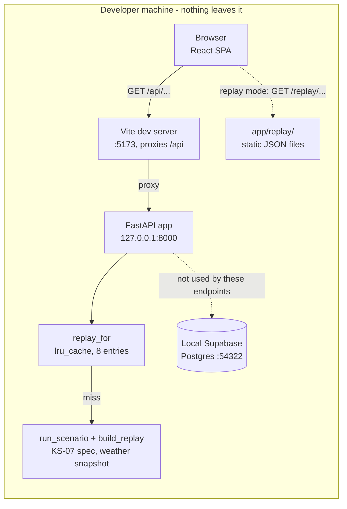
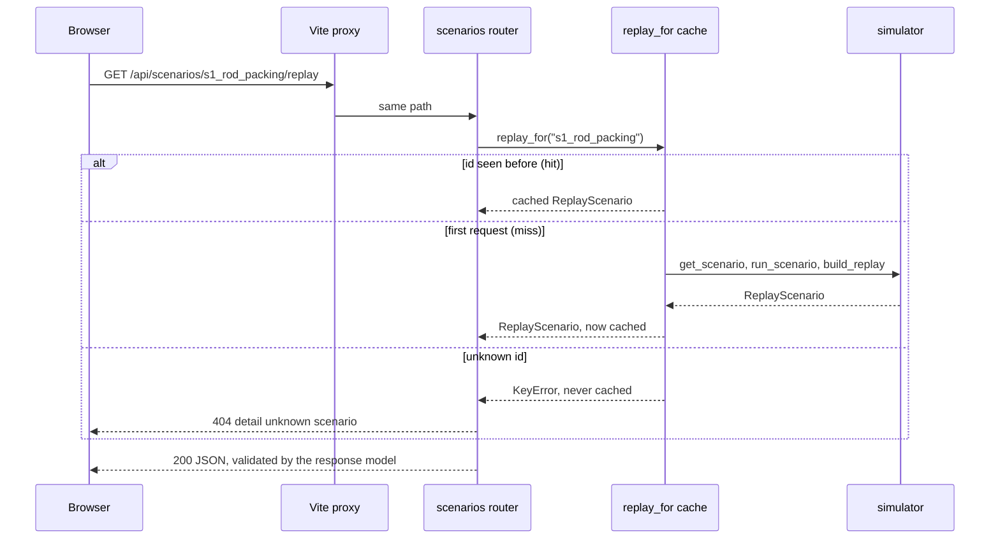

# API

REST API of the PlumeTrace backend (FastAPI 0.162.5, uvicorn 0.54.0; pins in
`app/backend/pyproject.toml`). Phase 4 Task 1 delivers three endpoints: health, scenario list and
scenario replay. The WebSocket and the agent-run endpoints are added in Phase 5 and extend this page.

Related pages: [DATA_LAYER.md](DATA_LAYER.md) (how the frontend calls these endpoints),
[REPLAY.md](REPLAY.md) (the replay document, field by field), [SECURITY.md](SECURITY.md) (trust
boundaries), [SIMULATOR.md](SIMULATOR.md) (the truth model behind the replay).

## Purpose and scope

In live mode the frontend loads a scenario's full time series from the backend and plays it with
its own clock. The API computes it on demand with the truth model (simulator plus plume grid). It
serves the **simulated station only**: station KS-07 is fictional. It has no inversion endpoint and
returns no inversion rate, no AI output and no engineering estimate.

Rate display rule (R1 to R4, owner decision 2026-11-14): when an endpoint later exposes an
inversion result, it returns an interval (p05, p50, p95 in kg/h) with the flags and the top
candidate, `null` when inconclusive, top `NONE` or at the grid edge, labelled as a model estimate
with model probabilities. Never a bare rate.

The API does not touch the database today. `plumetrace/api/run_store.py` (Phase 3) can save a run,
its events and its 60 s readings to local Supabase, but no route calls it yet.

## Architecture



Containers of the backend and the frontend, live mode (solid) and replay mode (dotted). In replay
mode no FastAPI process runs; the browser reads the copied files.

Code map (`app/backend/plumetrace/api/`):

| File | Role |
|---|---|
| `main.py` | `create_app()`: title `PlumeTrace API`, docs at `/api/docs`, OpenAPI at `/api/openapi.json`, `redoc` off, CORS middleware, the two routers. `app = create_app()` is the ASGI entry (`plumetrace.api.main:app`) |
| `routes/health.py` | `GET /api/health` |
| `routes/scenarios.py` | `GET /api/scenarios` and `GET /api/scenarios/{scenario_id}/replay` |
| `schemas.py` | `Health`, `ScenarioSummary` |
| `scenario_cache.py` | `replay_for(scenario_id)`, the cached truth-model run |
| `run_store.py` | Persists a run to Supabase. Not routed |

## Request path of a replay

The sequence has five participants on purpose: the Vite proxy is the only layer in front of FastAPI,
and the cache is the only step before the simulator.



`replay_for` is decorated with `functools.lru_cache(maxsize=8)`. The first call per id runs the
scenario once. Measured on the development machine on 2026-11-15 (machine dependent): about 0.33 s
for S1, 0.16 s for S4 and 0.22 s for S5 on the first call. Later calls return the same object from
memory. The cached document is shared between requests and must never be mutated. An exception is
not cached, so every unknown-id request re-reads the facility spec and the weather snapshot (about
40 ms measured) before the `KeyError`. Only three scenarios exist, so eviction does not happen
today; if more than 8 ids were requested, the least recently used would be recomputed.

## Public interface

Base URL `http://127.0.0.1:8000`. In development the frontend calls relative `/api/...` URLs and
Vite proxies them (`app/frontend/vite.config.ts`, target `http://127.0.0.1:8000`).

| Method | Path | Response | Errors |
|---|---|---|---|
| GET | `/api/health` | `Health` | none |
| GET | `/api/scenarios` | `list[ScenarioSummary]`, sorted by `id` | none |
| GET | `/api/scenarios/{scenario_id}/replay` | `ReplayScenario` | `404` `{"detail": "unknown scenario"}` |
| GET | `/api/docs` | Swagger UI | |
| GET | `/api/openapi.json` | OpenAPI schema | |

Other statuses seen with the test client on 2026-11-15: `POST /api/health` answers `405`,
`GET /api/redoc` answers `404`, an extra path segment after `/replay` answers `404`. FastAPI answers
`422` for a parameter of the wrong shape (none of today's endpoints has one). All three endpoints
are sync `def` path operations.

### Worked examples (real responses)

Produced with FastAPI's `TestClient` against `create_app()`; nothing was written to the repo.

`GET /api/health`

```json
{"status": "ok", "version": "0.1.0"}
```

`GET /api/scenarios`

```json
[
  {"id": "s1_rod_packing", "title": "K-202 rod-packing leak via vent stack VS-250", "duration_h": 6, "is_mvp": true},
  {"id": "s4_planned_blowdown", "title": "Planned blowdown of K-201 vented to VS-250", "duration_h": 4, "is_mvp": true},
  {"id": "s5_sensor_drift", "title": "Sensor drift on AT-106", "duration_h": 6, "is_mvp": true}
]
```

`GET /api/scenarios/s1_rod_packing/replay` answers `200`, `content-type: application/json`, 445,851
bytes. Shape (values abridged; `series` and `units` have the same 17 keys, `AT-101` to `AT-108`
then the nine instrument tags):

| Key | Value in this response |
|---|---|
| `schema_version` | `1` |
| `scenario_id` | `"s1_rod_packing"` |
| `sim_start_utc` | `"2025-07-14T00:00:00Z"` |
| `duration_s`, `step_s` | `21600.0`, `60.0` |
| `sensors` | 8 entries, first `{"id": "AT-101", "x_m": 5.0, "y_m": 5.0, "z_m": 2.0}` |
| `wind_speed_m_s`, `wind_from_deg`, `stability` | 360 samples each; first `3.95`, `351.2`, `"E"` |
| `events` | 3 entries: `AT-101` window start 7800 s, `AT-102` 10200 s, `AT-101` 16800 s |
| `log` | 3 entries at 600 s (`shift_note`), 4000 s (`gauging`, TK-402), 5000 s (`maintenance`, AT-103) |
| `keyframes` | 180 entries (one per 120 s); the first has `"sources": []` |
| `simulated` | `true` |
| `attribution` | `"Weather data by Open-Meteo.com (CC BY 4.0), ERA5 reanalysis. Station KS-07 is fictional and simulated; sensor, instrument and scenario data are synthetic. Only the weather is real."` |

Other scenarios from the same probe: S4 has `duration_s` 14400 and two events (`AT-101`, `AT-102`,
both window start 7200 s); S5 has `duration_s` 21600 and two events on `AT-106` (window starts
7800 s and 14400 s). The replay file on disk (`app/replay/scenarios/s1_rod_packing.json`) is 445,852
bytes; it holds the same data with sorted keys and a trailing newline.

An unknown id:

```text
GET /api/scenarios/<script>/replay   ->   404   {"detail": "unknown scenario"}
```

### Schemas

`Health` (`plumetrace/api/schemas.py`): `status` (always `"ok"`), `version` (package version).

`ScenarioSummary`: `id`, `title`, `duration_h` (int, hours), `is_mvp` (true for S1, S4, S5). Its
properties equal those of the replay `ReplayIndexEntry` (a test pins it), so the frontend parses the
live list and `scenarios/index.json` with one type (see [REPLAY.md](REPLAY.md#indexjson)). The
endpoint builds the list from the scenario registry, sorted by `id`, and sets `is_mvp` to true for
every entry.

`ReplayScenario` (`plumetrace/simulator/replay_schema.py`; field-by-field format in
[REPLAY.md](REPLAY.md)): `schema_version`, `scenario_id`, `title`, `simulated` (always true),
`attribution`, `sim_start_utc`, `step_s`, `duration_s`, `sensors`, `series` (per instrument tag),
`units`, `wind_speed_m_s`, `wind_from_deg`, `stability`, `events`, `log`, `grid`, `keyframes`.
`keyframes[].sources[].rate_kg_h` is the **simulation input** used only to draw the plume. The
interface must not show it as a result, and it must never reach agent tools or any text or number
response.

## Design decisions and assumptions

- Design section 9 (control room) and 10 (backend). The replay is computed on demand rather than
  read from `app/replay/` so live mode exercises the same truth model as the generator.
- Sync `def` path operations: the work is CPU-bound and runs in FastAPI's thread pool.
- Return types declare the response models; FastAPI validates and serialises them.
- The list endpoint and the replay endpoint share one id registry (`SCENARIOS`), so the picker can
  only offer ids the replay endpoint knows.

## Limits and failure behaviour

- Unknown scenario id: `404` with the fixed body `{"detail": "unknown scenario"}`. The id is never
  echoed, so no reflected content.
- A replay is about 0.45 MB of JSON (S1: 445,851 bytes), below the 5 MB `MAX_REPLAY_BYTES`. That
  budget is enforced when a replay file is written (`simulator/export.py`), not by the endpoint.
- The cache holds at most 8 scenarios; evicted ones are recomputed. An unknown id is not cached and
  costs about 40 ms per request. No request or body size limit, rate limit or timeout exists yet
  (Phase 6).
- If the server is down, the Vite proxy answers `5xx` (seen as `502` on 2026-11-15); the frontend
  maps that to the error kind `unreachable` (see [DATA_LAYER.md](DATA_LAYER.md#error-kinds)).

## Configuration

No environment variable. The server binds **127.0.0.1:8000** only (the `--host` flag in the run
command); it is not reachable from other machines.

CORS (`plumetrace/api/main.py`, `ALLOWED_ORIGINS`), exactly:

| Setting | Value |
|---|---|
| Allowed origins | `http://localhost:5173`, `http://127.0.0.1:5173` |
| Methods | `GET`, `POST` |
| Headers | `Content-Type` (Starlette also always allows `Accept`, `Accept-Language`, `Content-Language`) |
| Credentials | off |

`POST` is allowed in the list although no `POST` endpoint exists yet (`POST /api/health` answers
`405`); it is there for the Phase 5 run endpoints.

Observed with the test client: a request with `Origin: http://localhost:5173` gets
`access-control-allow-origin: http://localhost:5173`; `Origin: http://127.0.0.1:5173` gets the same
value back for that origin; `Origin: https://evil.example` gets no `access-control-allow-origin`
header. A preflight (`OPTIONS`) from the first origin answers `200` with
`access-control-allow-methods: GET, POST`.

Run from `app/` (the same command as in [LOCAL_DEVELOPMENT.md](../LOCAL_DEVELOPMENT.md#running-the-backend)):

```bash
uv run uvicorn plumetrace.api.main:app --host 127.0.0.1 --port 8000 --reload
curl -s http://127.0.0.1:8000/api/health
```

## Testing and evidence

`app/backend/tests/api/test_api.py` (FastAPI `TestClient`) has six tests:

| Test | Pins |
|---|---|
| `test_health` | `{"status": "ok", "version": "0.1.0"}` |
| `test_scenario_list` | the three ids in sorted order |
| `test_scenario_replay` | S5 replay: `scenario_id`, `simulated is True`, 360 wind samples |
| `test_unknown_scenario_is_404_without_echo` | `<script>` id gives `404` and the fixed body |
| `test_cors_allows_only_the_dev_origin` | allowed origin echoed; `https://evil.example` gets no header |
| `test_scenario_summary_matches_replay_index_entry` | `ScenarioSummary` and `ReplayIndexEntry` have equal properties |

Run: `cd app && uv run pytest backend/tests/api -q`. The frontend side of the contract is tested in
`src/shared/data/` (see [DATA_LAYER.md](DATA_LAYER.md#tests)).

## How to extend

Add an endpoint:

1. Write the response model in `plumetrace/api/schemas.py` (or reuse a simulator model). No field may
   carry a bare inversion rate or `keyframes[].sources` as a result.
2. Add a router module under `plumetrace/api/routes/` (one responsibility per module; limits in
   CLAUDE.md rule 20) and include it in `create_app()`.
3. Declare the return type, give the function a Google-style docstring, and use a generic error
   body. Never echo a path or query value.
4. Test every status code in `backend/tests/api/` first (TDD), plus a security test for any input.
5. Add a row to the table above, update [SECURITY.md](SECURITY.md) if a trust boundary changes, and
   re-run `scripts/export_contract.py` if a model that the frontend uses changed.
6. If the frontend needs it, extend `DataSource` (see [DATA_LAYER.md](DATA_LAYER.md#how-to-add-a-data-source-method)).

Invariants:

- Keep the 404 body generic and never echo a path parameter.
- Keep the bind address and the CORS allow-list; widening either needs the owner's approval.
- No endpoint may return a bare inversion rate (see Purpose and scope).
- A new endpoint that costs money (OpenAI) must go through `BudgetedLLM` (CLAUDE.md rule 23).

## Changelog

- 2026-11-15: Phase 4 Task 1. Health, scenario list, scenario replay, CORS.
- 2026-11-15: documentation pass: architecture and request-path diagrams, real example responses,
  exact CORS observations, extension steps.
