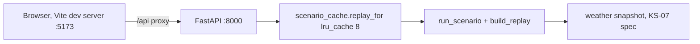

# API

REST API of the PlumeTrace backend (FastAPI 0.162.5, uvicorn 0.54.0). Phase 4 Task 1 delivers the
health, scenario list and scenario replay endpoints. The WebSocket and the agent-run endpoints are
added in Phase 5 and extend this page.

## Purpose and scope

In live mode the frontend loads a scenario's full time series from the backend and plays it with
its own clock. The API computes it on demand with the truth model (simulator plus plume grid). It
serves the **simulated station only**. It has no inversion endpoint and returns no inversion
rate, no AI output and no engineering estimate. Rate display rule (R1 to R4, owner decision
2026-11-14): when an endpoint later exposes an inversion result, it returns an interval (p05, p50,
p95 in kg/h) with the flags and the top candidate, `null` when inconclusive, top `NONE` or at the
grid edge, labelled as a model estimate with model probabilities. Never a bare rate.

## How it works



`replay_for(scenario_id)` runs the scenario once per id and keeps the result in an in-process
`functools.lru_cache(maxsize=8)`. The cached document is shared between requests and is never
mutated. Cost of the first request per id: a few seconds; later requests are served from memory.

## Public interface

Base URL `http://127.0.0.1:8000`. In development the frontend calls relative `/api/...` URLs and
Vite proxies them (`app/frontend/vite.config.ts`).

| Method | Path | Response | Errors |
|---|---|---|---|
| GET | `/api/health` | `Health` | none |
| GET | `/api/scenarios` | `list[ScenarioSummary]`, sorted by `id` | none |
| GET | `/api/scenarios/{scenario_id}/replay` | `ReplayScenario` | `404` `{"detail": "unknown scenario"}` |
| GET | `/api/docs` | Swagger UI | |
| GET | `/api/openapi.json` | OpenAPI schema | |

Invalid parameter shapes are answered by FastAPI with `422`. `redoc` is disabled.

### Schemas

`Health` (`plumetrace/api/schemas.py`): `status` (always `"ok"`), `version` (package version).

`ScenarioSummary`: `id`, `title`, `duration_h` (int, hours), `is_mvp` (true for S1, S4, S5).

`ReplayScenario` (`plumetrace/simulator/replay_schema.py`; field-by-field format in
[REPLAY.md](REPLAY.md)): `schema_version`, `scenario_id`, `title`, `simulated` (always true),
`attribution`, `sim_start_utc`, `step_s`, `duration_s`, `sensors`, `series` (per instrument tag),
`units`, `wind_speed_m_s`, `wind_from_deg`, `stability`, `events`, `log`, `grid`, `keyframes`.
`keyframes[].sources[].rate_kg_h` is the **simulation input** used only to draw the plume. The
interface must not show it as a result, and it must never reach agent tools or any text or number
response.

## Design decisions and assumptions

- Design section 9 (control room) and 10 (backend). The replay is computed on demand rather than
  read from `app/replay/` so live mode exercises the same truth model as the generator.
- Sync `def` path operations: the work is CPU-bound and runs in FastAPI's thread pool.
- Return types declare the response models; FastAPI validates and serialises them.

## Limits and failure behaviour

- Unknown scenario id: `404` with the fixed body `{"detail": "unknown scenario"}`. The id is never
  echoed, so no reflected content.
- A replay is about 0.45 MB of JSON (S1), below `MAX_REPLAY_BYTES` (5 MB).
- The cache holds at most 8 scenarios; evicted ones are recomputed.

## Configuration

No environment variable. The server binds **127.0.0.1:8000** only (the `--host` flag in the run
command); it is not reachable from other machines.

CORS (`plumetrace/api/main.py`, `ALLOWED_ORIGINS`): only `http://localhost:5173` and
`http://127.0.0.1:5173`; methods `GET`, `POST`; header `Content-Type`; no credentials. Any other
origin gets no `Access-Control-Allow-Origin` header.

Run from `app/`:

```bash
uv run uvicorn plumetrace.api.main:app --host 127.0.0.1 --port 8000 --reload
```

## Testing and evidence

`app/backend/tests/api/test_api.py` (FastAPI `TestClient`): health, scenario list order, replay
format, 404 without echo, CORS allowlist. Run: `cd app && uv run pytest backend/tests/api -q`.

## How to extend

- Keep the 404 body generic and never echo a path parameter.
- Keep the bind address and the CORS allowlist; widening either needs the owner's approval.
- A new endpoint gets a row in the table above, an API test for every status code, and a security
  test; the contract export (`scripts/export_contract.py`) must stay in sync.
- No endpoint may return a bare inversion rate (see Purpose and scope).

## Changelog

- 2026-11-15: Phase 4 Task 1. Health, scenario list, scenario replay, CORS.
