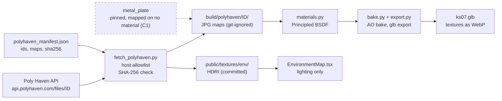

# Assets

## 1. Purpose and scope

Third-party assets used by the 3D station pipeline, how they are fetched, pinned and used. All of
them are from Poly Haven under the CC0 licence (public-domain dedication, no attribution required;
credited here anyway). Nothing else is third-party: the station geometry is generated from the
facility spec, never downloaded.

Built (Phase 4 Tasks 5 and 6): the fetch script, the manifest with SHA-256 values, the six assets
below, and their use in the model: the spike (`K-202`, `VS-250`, ground) and, since Task 6, the
grating (`metal_grate_rusty`, key `grating`) on platforms, walkways and stair treads of the other
equipment types. `metal_plate` is downloaded and pinned but **no material uses it** since the owner
ruling C1 (its tread-plate maps are not mapped onto painted vessels, pipes or panels); the manifest
is unchanged. The full station (Task 7) uses the same textures and no new asset: the yard gravel
and the 600 m outer terrain use `gravel_floor_02` with its diffuse map multiplied by 0.45 (owner
ruling C2: the gravel must not read as snow; see [STATION_MODEL.md](STATION_MODEL.md)). The owner approved the
download in chat on 2026-11-15.

Owner modules: `scripts/fetch_polyhaven.py` (download and verify), `scripts/blender/polyhaven_manifest.json`
(the pin), `scripts/blender/materials.py` (use).

## 2. How it works



*Caption: from the Poly Haven API to the model and the runtime lighting. Solid = built and used
(`metal_grate_rusty` is in `Tex` and used by Task 6); dotted = downloaded and pinned but not used
by any material.*

1. The script reads the manifest: resolution `1k`, per-texture map names, the HDRI id and format,
   and the recorded `sha256` map.
2. For each asset it asks `https://api.polyhaven.com/files/<id>` for the download URLs
   (`data[<map>]["1k"]["jpg"]["url"]`, HDRI: `data["hdri"]["1k"]["hdr"]["url"]`). Every URL must
   start with `https://dl.polyhaven.org/`; otherwise nothing is downloaded and the exit code is 1.
3. Textures are written to `build/polyhaven/<id>/<file name from the URL>` (git-ignored scratch);
   the HDRI to `app/frontend/public/textures/env/` (committed, because the browser loads it at run
   time).
4. Each file's SHA-256 is compared with the manifest. `--record` writes the hashes instead.
5. `materials.py` loads the JPGs as Blender images; the glTF exporter embeds them in the raw glb and
   glTF-Transform re-compresses them to WebP at most 512 px (spike). The HDRI is never baked in: it
   only lights the scene (`environmentIntensity` 0.8) and the visible sky is the flat colour
   `#a9b4bd`.

## 3. Module-by-module reference

Assets (all CC0, resolution 1k, source `https://polyhaven.com/a/<id>`):

| Asset id | Maps | Used for | Used by |
|---|---|---|---|
| `metal_plate` | `nor_gl`, `Rough` | **unused** (owner ruling C1, spike review: its tread-plate pattern is wrong on vessel bodies, pipes and panels). `paint_grey`, `paint_dark`, `paint_red`, `paint_white` and `pipe_gas` are plain colours with a constant roughness (`paint_grey` 0.5). It may only ever be used on a walkway or deck surface | no material |
| `concrete_floor_02` | `Diffuse`, `nor_gl`, `Rough` | concrete pads; its normal map (strength 0.3, tile 3 m) is the surface of the building panels | keys `concrete`, `building_panel` (normal only) |
| `gravel_floor_02` | `Diffuse`, `nor_gl`, `Rough` | yard ground (diffuse x 0.45) and the outer terrain (diffuse x 0.45, constant roughness 1.0) | keys `gravel`, `gravel_far` |
| `corrugated_iron_02` | `Diffuse`, `nor_gl`, `Rough` | shelter roof and cladding | key `cladding` |
| `metal_grate_rusty` | `Diffuse`, `nor_gl`, `Rough` | grating: platform plates, walkways, stair treads (tile 1 m, metallic 0.7, its own roughness and normal) | key `grating` |
| `industrial_sunset_puresky` | HDRI `.hdr` | image-based lighting | `scene/EnvironmentMap.tsx` |

`scripts/fetch_polyhaven.py` (stdlib plus httpx 0.28.1):

| Function | Contract |
|---|---|
| `sha256_of(path) -> str` | hex digest of a file |
| `plan_downloads(client, manifest) -> list[tuple[str, Path]]` | resolves every entry to `(url, target)`; raises `FetchError` when a URL is outside `https://dl.polyhaven.org/` |
| `fetch_one(client, url, target, recorded) -> str` | downloads unless the file already has the recorded hash; raises `FetchError("hash mismatch: <repo-relative path>")` when the hash differs; returns the digest |
| `main(argv) -> int` | `--record` rewrites the manifest (`indent=2`, sorted `sha256`, LF, trailing newline); returns 0, or 1 on a refused URL, a hash mismatch or a failed request |

The request header is `User-Agent: PlumeTrace-asset-fetch/1.0` (no personal data).

## 4. Worked example

Real values from the first `--record` run on 2026-11-15 (15 files: the 14 JPGs sum to 10,807,441 bytes,
about 10.8 MB or 10.3 MiB, plus the 1,158,432-byte HDRI):

- `metal_plate` yields two files: `build/polyhaven/metal_plate/metal_plate_nor_gl_1k.jpg`
  (770,307 bytes) and `build/polyhaven/metal_plate/metal_plate_rough_1k.jpg` (775,206 bytes).
- The manifest then holds
  `"build/polyhaven/metal_plate/metal_plate_nor_gl_1k.jpg": "994f851a84d52b51e97906021a1b7070ee6eac9a789fef041132268de47d8e6b"`
  (key = repo-relative path, entries sorted).
- A second run without `--record` printed `ok <path>` for all 15 files and exited 0.
- If the API ever returned `https://cdn.example.com/metal_plate_nor_gl_1k.jpg`, the run would print
  `fetch failed: refusing URL outside https://dl.polyhaven.org/: https://cdn.example.com/...` to
  stderr and exit 1 before writing any file.

## 5. Edge cases and failure modes

| Case | Behaviour | Pinned by |
|---|---|---|
| URL outside `dl.polyhaven.org` | `FetchError`, exit 1, no file written | `app/backend/tests/test_fetch_polyhaven.py::test_url_outside_the_allowed_host_is_refused` |
| Hash differs from the recorded one | exit 1, message `hash mismatch: <path>` | `test_fetch_polyhaven.py::test_hash_mismatch_names_the_file` |
| File exists with the recorded hash | not downloaded again | `test_fetch_polyhaven.py::test_matching_hash_skips_the_download` |
| `--record` | rewrites the manifest sorted, LF, `indent=2`; a later verify run accepts it | `test_fetch_polyhaven.py::test_record_writes_sorted_hashes` |
| File names come from the URL | `<id>_nor_gl_1k.jpg` and so on | `test_fetch_polyhaven.py::test_plan_maps_file_names_from_urls` |
| Network or HTTP error | `fetch failed: ...`, exit 1 | not tested (needs a failing transport; the code path is `except httpx.HTTPError`) |
| An existing file with no recorded hash, no `--record` | downloaded again and not verified | not tested; run `--record` once per new asset |

The tests use `httpx.MockTransport` and `tmp_path`: no network, no download.

## 6. Design decisions, assumptions, limits

- CC0 assets from one host, 1k only, so the repo stays small and the licence question is closed;
  the owner chose Poly Haven and approved the file list (Phase 4 Task 5 plan, chat 2026-11-15).
- Textures are git-ignored scratch (`build/`) because the glb embeds what the model uses; only the
  HDRI is committed because the browser needs it.
- **Limit:** the host allowlist checks the URL from the API; the client follows redirects and does
  not re-check the final host. The SHA-256 check is the second guard once hashes are recorded.
- **Limit:** a new asset has no recorded hash until `--record` is run once and the owner has
  looked at the manifest change.
- The HDRI is lighting only. No real operator name or logo appears in any asset.

## 7. Configuration

None. No environment variable, no key. The asset list is the manifest; the folders are constants
at the top of the script.

## 8. How to run

```bash
cd app && uv run python ../scripts/fetch_polyhaven.py --record   # first time: writes the hashes
cd app && uv run python ../scripts/fetch_polyhaven.py            # later: verifies them
```

Expected: one `ok <path>` line per file and exit code 0.

## 9. How to extend

1. Ask the owner (a download needs a yes in chat) and add the asset id and map names to
   `textures` (or `hdris`) in `scripts/blender/polyhaven_manifest.json`.
2. Run the script with `--record`, check the manifest diff (new files only), commit the manifest.
3. Add the material in `materials.py` (`SPECS`) and a row in the table above. Keep the host
   allowlist, the hash check and the CC0 rule; a non-CC0 asset is not allowed (free tools only,
   rule 21).

## 10. Testing and evidence

`app/backend/tests/test_fetch_polyhaven.py` (5 tests, no network); written after the script, so not
red-first. Evidence: `docs/evidence/2026-11-spike.md`.

## 11. Related

- [scripts/blender/README.md](../../scripts/blender/README.md) (generator and commands),
  [scripts/blender/polyhaven_manifest.json](../../scripts/blender/polyhaven_manifest.json)
- [FRONTEND.md](FRONTEND.md) (3D station section), [docs/evidence/2026-11-spike.md](../evidence/2026-11-spike.md)
- Work log: 2026-11-15 Phase 4 Task 5.

Changelog: 2026-11-15 created (Phase 4 Task 5); rewritten to the deep-documentation template. 2026-11-16 Phase 4 Task 6: `grating` in use, `metal_plate` mapped on no material (ruling C1), `building_panel` uses the concrete normal.
