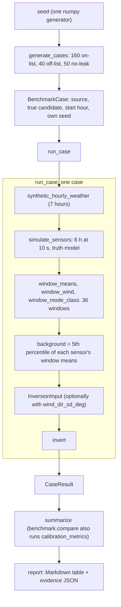
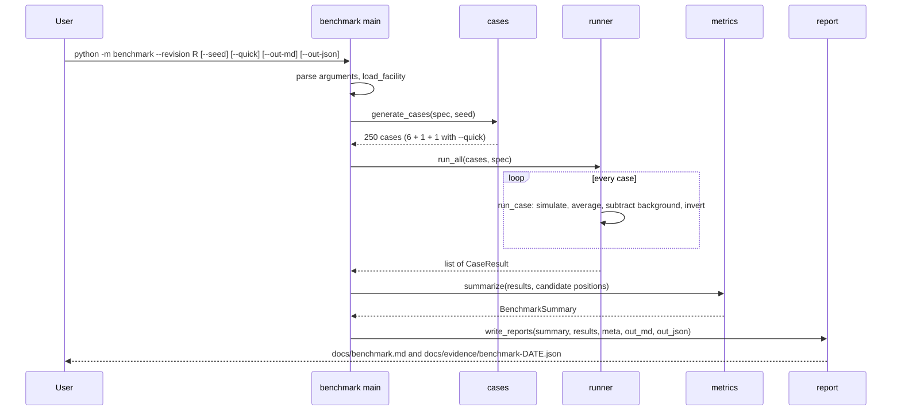
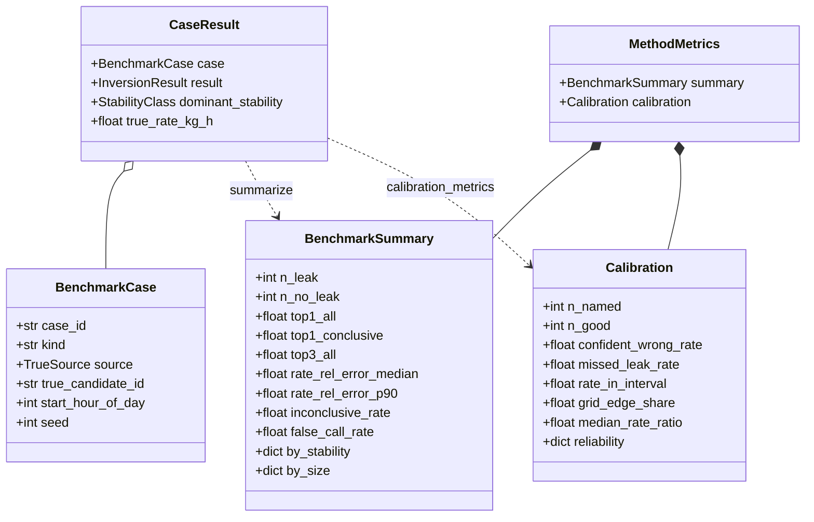
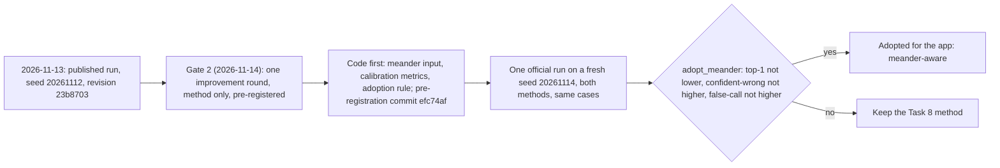

# Model-mismatch benchmark: method, results and how to read them

How the source inversion is scored when the data come from different physics than the inversion
assumes, what the published numbers are, what the pre-registered improvement round changed, and how
to run and extend the harness. Package `benchmark` in `app/backend/benchmark/` (not part of
`plumetrace`; imported top level because pytest sets `pythonpath = ["backend"]`). The results
themselves are the generated files [docs/benchmark.md](../benchmark.md) and
[docs/benchmark-improvement.md](../benchmark-improvement.md); this page explains them and never
replaces them. Contract-level text and the post-hoc reading are also in
[ENGINEERING.md](ENGINEERING.md) section "Benchmark". Data generator:
[TRUTH_MODEL.md](TRUTH_MODEL.md). Method under test: [INVERSION.md](INVERSION.md).

**Evidence label: synthetic.** A fictional station, simulated sensors, synthetic weather, one seed
per method. The model is a simplified Gaussian plume model. The probabilities and rate intervals
the inversion states are **not calibrated** (section 7). Nothing here is evidence of accuracy at a
real site.

## 1. Purpose and scope

Question: how well does the Task 8 inversion find and size a leak when the data come from
different physics?

The Task 8 likelihood is **deliberately mismatched to the truth model**: Briggs rural spreads
against Martin spreads, a narrow plume along the mean wind against a meandering and gusty wind,
no building wake against a wake, and sensor noise. The benchmark measures the consequence. The
mismatch is partial (same Gaussian formula, no plume rise, no terrain), so a good number would show
robustness to these effects only.

Does: generate cases, simulate data, run the inversion, score it, write reports.
Does not: tune anything. Constants, thresholds, coefficients and the case list were fixed before
each run. It scores the physics inversion alone: the fusion step ([INVERSION.md](INVERSION.md)
section 8) is not part of it.

## 2. How it works



*Figure 1. One benchmark run. Every case seeds its own generator, so a case gives identical weather,
noise and meander whichever method is run on it.*



*Figure 2. Call flow of `python -m benchmark`. `python -m benchmark.compare` is the same with two
`run_all` calls (section 8) and `benchmark.compare_report` as the writer.*



*Figure 3. The data classes. `BenchmarkCase` and `CaseResult` are frozen dataclasses;
`BenchmarkSummary`, `Calibration` and `MethodMetrics` are Pydantic models.*

### The case set (`cases.generate_cases`, seed `BENCHMARK_SEED` = 20261112 by default)

250 cases from one seeded generator, in this order: 160 on-list, 40 off-list, 50 no-leak. Ids are
`<kind>-<i:03d>`.

| Kind | Count | Source |
|---|---|---|
| `on_list` | 160 | exactly at an emission candidate |
| `off_list` | 40 | 2 to 10 m from a candidate (random angle), clipped into the site bounds; no candidate is exactly right |
| `no_leak` | 50 | no source (a control) |

Rates are log-uniform between 0.5 and 100 kg/h. Each case has a random start hour (0 to 23) and its
own seed. It runs 6 hours at 10 s steps through `simulate_sensors` with the default `TruthConfig`
and the facility's building-wake obstacles. These values are Phase 2 Task 13 project choices.

### What `run_case` hands the inversion

36 ten-minute windows of means, the window wind (arithmetic mean speed, circular mean direction),
the most frequent stability class per window, the mean air temperature and the site pressure. The
background of each sensor is the 5th percentile of its window means, subtracted before the
inversion. With `meander=True` it also passes `window_direction_sd_deg` of the 10 s direction
series, measured from the data and never taken from the truth model's setting. The inversion uses
its default constants and Briggs rural coefficients. Sensor faults and drift are not used.

## 3. Metric definitions (`metrics.py`, `calibration.py`)

Every rate is 0.0 when its denominator is 0; a median is `None` then.

| Metric | Definition |
|---|---|
| Correct at `k` (`is_correct`) | leak cases only. Take the ranked ids in order, remove `NONE`, keep the first `k`. Correct if one is the true candidate (on-list) or lies within 10 m horizontally of the true source (off-list). An inconclusive result is never correct. `NONE` is dropped before the top `k` is taken, so a conclusive `NONE` case whose runner-up is right counts as correct. |
| Top-1 (all) | correct at `k = 1` over all leak cases |
| Top-1 (conclusive) | the same count over the conclusive leak cases |
| Top-3 (all) | correct at `k = 3` over all leak cases |
| Rate error (median, p90) | `abs(rate - true) / true` over leak cases that are conclusive and correct at `k = 1` |
| Inconclusive rate | inconclusive leak cases over all leak cases |
| False-call rate | no-leak cases that are conclusive with a top id other than `NONE`, over all no-leak cases |
| Splits | by dominant stability class and by true rate (`<5`, `5-20`, `20-100` kg/h): `n`, top-1 (all), inconclusive rate |
| named | leak cases that are conclusive with a top id other than `NONE` |
| Confident-wrong rate | named cases wrong at `k = 1` with `top_probability >= 0.95`, over named |
| Missed-leak rate | conclusive leak cases with top `NONE`, over all leak cases |
| good | named cases correct at `k = 1` that report a rate |
| Rate in interval | good cases with `p05 <= true rate <= p95` (both inclusive), over good |
| Grid-edge share | good cases with `rate_at_grid_edge`, over good |
| Median rate ratio | median of `rate / true rate` over good |
| Reliability | per bin of `top_probability` (`[0.6, 0.8)`, `[0.8, 0.95)`, `[0.95, 1.0]`, the last open above 1.0) over named cases: `n` and top-1 accuracy |

Read the false-call rate with care: it counts only conclusive wrong names on **no-leak** cases. It
is 0 partly because many no-leak cases end `ambiguous` or `weak_signal`. A "never cries wolf"
result is also an "often says nothing" result.

## 4. Published results (seed 20261112, revision 23b8703, 2026-11-13)

The published run is the unchanged "before". Numbers exactly as in
[docs/benchmark.md](../benchmark.md) (case-level evidence:
[docs/evidence/benchmark-2026-11-13.json](../evidence/benchmark-2026-11-13.json)).

| Metric | Value |
|---|---|
| Top-1 accuracy (all leak cases) | 0.4 |
| Top-1 accuracy (conclusive leak cases) | 0.491 |
| Top-3 accuracy (all leak cases) | 0.62 |
| Rate error, median (relative) | 1.13 |
| Rate error, 90th percentile (relative) | 26.7 |
| Inconclusive rate (leak cases) | 0.185 |
| False-call rate (no-leak cases) | 0 |

By dominant stability class (cases, top-1 over all, inconclusive rate): B 21, 0.429, 0.0952; C 46,
0.522, 0.217; D 73, 0.342, 0.164; E 50, 0.4, 0.2; F 10, 0.2, 0.3. By true leak size (kg/h): `<5`
90, 0.411, 0.267; `5-20` 44, 0.432, 0.205; `20-100` 66, 0.364, 0.0606.

Reading (from the numbers above and the evidence file):

- With these mismatches the inversion names the right source for 40 % of the leak cases (49 % of
  those where it commits). The median relative rate error is 113 %, and the 90th-percentile relative error is 27 (the
  estimate is about 28 times the truth): **the rate is not trustworthy at this level of mismatch.**
- The probable cause (looked at in one case, hypothesis): a sensor a few tens of metres from the
  source sees hits from a plume whose direction wanders, while the inversion places a narrow plume
  along the 10-minute mean direction; to explain a hit it considers unlikely it needs a very large
  rate. A one-off matched-physics check was made after the run. It is **post-hoc, indicative only
  and not reproducible from the repository** (no script or evidence file was kept). Do not cite it
  as a result.
- Class F has 10 cases; small classes carry wide uncertainty.

### Post-hoc reading of the committed evidence

Made after the run; no code, constant, threshold or scoring changed. From
`docs/evidence/benchmark-2026-11-13.json` (reproduce snippet in [ENGINEERING.md](ENGINEERING.md)):
163 of the 200 leak cases are conclusive. In 9 of them the top is `NONE` (a conclusive "no leak" on
a real leak). Of the other 154, 77 name the true candidate id and 77 name another. The median
`top_probability` is 1.0 for both groups (76 and 67 respectively at 0.95 or more). **A wrong call
is typically as confident as a right one**, so the probabilities are overconfident and should not be
read as calibrated.

## 5. The pre-registered improvement round



*Figure 4. The sequence. The published run stays the "before"; the fresh seed had never been run
before the official run, and tests never use it.*

**The change.** The Task 8 inversion assumes a narrow plume along the mean direction. The
meander-aware method widens `sigma_y` by the measured circular standard deviation of the 10 s
direction series in each window ([DISPERSION.md](DISPERSION.md) section 6). Both methods run on the
same fresh cases.

**The adoption rule** (`calibration.adopt_meander(t8, m)`, applied by the code, not by hand): adopt
the meander-aware method if and only if `m.top1_all >= t8.top1_all`, `m.confident_wrong_rate <=
t8.confident_wrong_rate` and `m.false_call_rate <= t8.false_call_rate`. Ties adopt. Otherwise the
app keeps the Task 8 method.

**Rules against tuning** (fixed before the run): (1) no run of seed 20261114 (test, manual or
quick) before the pre-registration commit; (2) one official run, at commit `efc74af`; (3) a bug
found afterwards is fixed in code only, labelled post-hoc, rerun once, both evidence files kept,
scoring and rule unchanged; (4) no second improvement round.

### Results (seed 20261114, revision efc74af, 2026-11-14)

Exactly as in [docs/benchmark-improvement.md](../benchmark-improvement.md) (case-level evidence:
[docs/evidence/benchmark-improvement-2026-11-14.json](../evidence/benchmark-improvement-2026-11-14.json)).

| Metric | Published (seed 20261112) | Fresh Task 8 | Fresh meander-aware |
|---|---|---|---|
| Top-1 accuracy (all leak cases) | 0.4 | 0.48 | 0.69 |
| Top-1 accuracy (conclusive leak cases) | 0.491 | 0.552 | 0.836 |
| Top-3 accuracy (all leak cases) | 0.62 | 0.72 | 0.805 |
| Rate error, median (relative) | 1.13 | 1.34 | 0.177 |
| Rate error, 90th percentile (relative) | 26.7 | 49.2 | 0.611 |
| Inconclusive rate (leak cases) | 0.185 | 0.13 | 0.175 |
| False-call rate (no-leak cases) | 0 | 0 | 0 |
| Confident-wrong rate (named cases wrong with p >= 0.95) | not recorded | 0.407 | 0.122 |
| Missed-leak rate (conclusive NONE on a leak case) | not recorded | 0.035 | 0.005 |
| Rate inside the 90 % interval (good cases) | not recorded | 0.2 | 0.428 |
| Rate at the grid edge (good cases) | not recorded | 0.316 | 0 |
| Median rate / true rate (good cases) | not recorded | 2.34 | 0.932 |

Reliability of the stated probability (named cases):

| Top probability | Task 8 named | Task 8 top-1 | Meander named | Meander top-1 |
|---|---|---|---|---|
| [0.6, 0.8) | 2 | 0 | 4 | 0.5 |
| [0.8, 0.95) | 4 | 0.5 | 6 | 0.333 |
| [0.95, 1.0] | 161 | 0.578 | 154 | 0.87 |

By stability class (cases Task 8 / meander, top-1 Task 8, top-1 meander, inconclusive Task 8,
inconclusive meander): B 21 / 21, 0.476, 0.619, 0, 0; C 49 / 49, 0.571, 0.776, 0.102, 0.102; D 79 /
79, 0.418, 0.671, 0.19, 0.228; E 43 / 43, 0.535, 0.698, 0.116, 0.209; F 8 / 8, 0.25, 0.5, 0.125,
0.375. The size split is in the generated file.

**Verdict printed by the code: "Adopted for the app: meander-aware"** (top-1 0.69 against 0.48;
confident-wrong 0.122 against 0.407; false-call 0 against 0).

### Reading of the data

- **Accuracy.** On the fresh seed the Task 8 method names the right source in 0.48 of the leak
  cases and 0.72 in its top three; the meander-aware method in 0.69 and 0.805. The comparison is
  paired (same cases, same data).
- **Rate.** Over the good cases (95 for Task 8, 138 for meander-aware) the median relative rate
  error is 1.34 and 0.177. The two sets of good cases differ, so the rate figures are not a
  like-for-like comparison of the same cases.
- **Inconclusive.** 0.13 for Task 8 and 0.175 for meander-aware: the meander method says
  "inconclusive" more often, most visibly in classes E and F (class F has 8 cases).
- **Is the probability calibrated? No, for either method.** Among named cases stating a probability
  of 0.95 or more (161 and 154) the top-1 accuracy is 0.578 and 0.87; a calibrated probability would
  be about 0.95 or more in that bin. The 90 % interval holds the true rate in 0.2 and 0.428 of the
  good cases, against 0.9 for a calibrated interval: the intervals are too narrow for both. This is
  why the app labels these values "model estimate" and "model probability".
- **Sampling error.** One seed per method: about plus or minus 0.07 (approximate 95 % half-width
  for a proportion near 0.4 over 200 leak cases: 2 x sqrt(0.4 x 0.6 / 200) = 0.069). The Task 8
  method on two seeds differs by 0.08 in top-1 (0.4 and 0.48), the order of that error. The top-1 gap
  between the two methods on the fresh seed (0.21) is larger than that spread. Small differences on
  one seed should be read with the error in mind.

### The caveat that must travel with the numbers

**Inverse crime (a statement, not a hypothesis).** The meander in the benchmark data is generated
by a wind-direction process acting on the same Gaussian plume formula that the meander-aware
correction models: the truth model adds a stationary AR(1) direction meander (default standard
deviation 10 degrees, correlation time 120 s) and evaluates `concentration_ppm` at every 10 s step;
the 10-minute window mean of that series is a time average of Gaussian plumes whose axis wanders,
which is the situation `sigma_y,eff^2 = sigma_y^2 + (x s)^2` describes. The correction is therefore
partly self-consistent with the data generator. **The measured gain is an optimistic result for a
simulated station, an upper bound for a real site, and not evidence of real-world accuracy.**

Hypotheses, not tested by the run: the gain is consistent with within-window direction spread being
the main cause of the poor published rate result; a real station, whose wind may behave
differently, may see a smaller gain; the higher inconclusive rate may come from the wider plume
responding less sharply to a source.

## 6. Adoption and what follows from it

The code printed "Adopted for the app: meander-aware". Wherever a later phase builds the window
input of the inversion, it passes `wind_dir_sd_deg = window_direction_sd_deg(series.times_s,
series.wind_from_deg)` sliced to the same windows. Today that is `plumetrace.simulator.selection`;
the Phase 5 input builder must do the same (a deviation pre-approved at Gate 2, recorded in the
STATUS owner decisions log). The Task 8 default path (`wind_dir_sd_deg=None`) is unchanged and
bit-identical, and the published run at `23b8703` stays the "before".

## 7. How to read the generated files

| You want to know | Look at | Caution |
|---|---|---|
| How often it names the right source | Top-1 (all leak cases); top-1 (conclusive) excludes the cases where it said "inconclusive" | the "all" figure is the honest headline: inconclusive counts as wrong |
| Whether the true source is near the top | Top-3 | easier than top-1 |
| How big the rate error is | Rate error median and p90 | only conclusive, correct-at-top-1 cases; different case sets for different methods |
| Whether it cries wolf | False-call rate | only no-leak cases, and many end inconclusive |
| Whether a stated probability can be trusted | Confident-wrong rate and the reliability table | the top bin should be near 0.95 if calibrated; it is 0.578 and 0.87 |
| Whether the stated interval covers the truth | Rate inside the 90 % interval | 0.2 and 0.428, against 0.9 for a calibrated interval |
| Where it fails | Stability-class and leak-size splits | small classes (F) carry wide uncertainty |

Binding rule R4 (Gate 2, STATUS owner decisions log): public benchmark numbers (Phase 7 About and
README) come only from the generated evidence JSON of the adopted method, showing top-1,
rate-in-interval, confident-wrong rate and inconclusive rate next to the published `23b8703`
numbers. That is, for the adopted meander-aware method: 0.69, 0.428, 0.122 and 0.175, next to the
published top-1 0.4 and inconclusive 0.185 (the published run did not record rate-in-interval). Any
inversion rate shown elsewhere follows R1 to R3 ([INVERSION.md](INVERSION.md) section 6).

## 8. Running it

From `app/backend` (about one minute for a full run):

```
uv run python -m benchmark --revision $(git rev-parse --short HEAD)
uv run python -m benchmark.compare --seed <fresh seed> --revision $(git rev-parse --short HEAD)
```

| Option | `benchmark` | `benchmark.compare` |
|---|---|---|
| `--revision` | required | required |
| `--seed` | default 20261112 | **required, no default** |
| `--quick` | 6 on-list, 1 off-list, 1 no-leak case | the same |
| `--out-md`, `--out-json` | default `../../docs/benchmark.md` and `../../docs/evidence/benchmark-<date>.json` | default `../../docs/benchmark-improvement.md` and `../../docs/evidence/benchmark-improvement-<date>.json` |
| `--published-json` | n/a | default `../../docs/evidence/benchmark-2026-11-13.json` (only its `summary` is read) |

**Warning: the default output paths are the committed evidence files.** To explore, always pass
`--out-md` and `--out-json` pointing outside `docs/`. The reports are written by the program and are
never edited by hand. A run is deterministic: the same seed and code give the same numbers, and two
runs give identical files apart from the date. Do not run seed 20261114 (the pre-registered seed) to
look at results or tune anything; a new method needs a new pre-registered round decided by the
owner. No benchmark run makes a paid call.

## 9. Limits and disclosures

- One seed and 250 cases per run: about plus or minus 0.07 on a proportion near 0.4.
- Not tuned: constants, thresholds, coefficients and the case list were fixed before the runs.
- The truth model shares the Gaussian formula, so the mismatch is partial: no plume rise, terrain,
  buoyancy or non-Gaussian profile.
- **No sensor faults and no numeric false-alarm target** (the truth model supports faults; the
  benchmark does not use them). A disclosed deviation from design sections 5 and 5.1b, accepted at
  Gate 2. The detection false-alarm behaviour was measured only in the planner prototype (0 of 20
  clean no-leak seeds). The 8-sensor layout is kept, not optimised.
- The fusion step is not part of the benchmark; the figures describe the physics inversion alone.
- The weather is synthetic, the station is simulated, and no real leak data were used.

## 10. Testing and evidence

`tests/benchmark/test_benchmark.py` and `test_benchmark_edges.py` (case generation, runner, metrics,
report), `test_calibration.py` (each calibration metric on hand-built results including empty
denominators, the 0.95 inclusive edge and the bin edges, the reuse of `summarize`, and the adoption
truth table with each condition failing alone and ties adopting) and `test_compare.py`
(`run_case(meander=False)` equals `run_case()`, `run_case(meander=True)` is valid and finite, the
quick comparison on the published seed writes both files and is identical on a second run apart
from the date, `--seed` is required, and no benchmark source or test holds the fresh seed). Run
from `app/`: `uv run pytest backend/tests/benchmark -q`. The Gate 2 evidence (full check run,
determinism check, published reproduction) is in
[docs/evidence/2026-11-phase-2-gate-2.md](../evidence/2026-11-phase-2-gate-2.md).

## 11. How to extend

- A new metric goes in `calibration.py` or `metrics.py` with a hand-built-result test, and into the
  report writers. It must not change an existing definition: the published numbers must reproduce.
- A new mismatch ingredient belongs in the truth model ([TRUTH_MODEL.md](TRUTH_MODEL.md)); say
  whether the inversion could reasonably know it. Do not give the inversion the truth model's
  setting.
- A new method is a new argument to `run_case` with a default that keeps the old path
  byte-identical, a new pre-registered seed that has never been run, a written adoption rule and one
  official run. Never tune against an already-run seed.
- Keep the generated files generated. If a number in a doc and the evidence disagree, the evidence
  wins and the doc is fixed.

## 12. Changelog

- 2026-11-15: page created (documentation pass for Phase 2).
