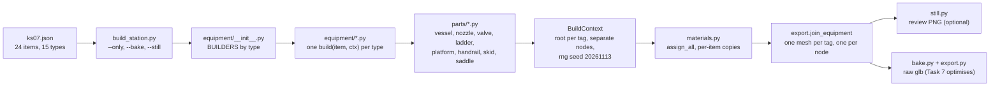
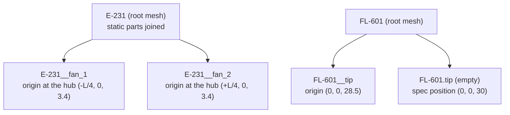

# Blender parts library and equipment builders

## 1. Purpose and scope

The bpy generator in `scripts/blender/` builds every equipment item of the facility spec
(`ks07.json`, 24 items of 15 types) from a small parts library. This page documents the parts, the
15 builders, the materials they ask for, the separate glb nodes (fan blades, flare tip) and how to
check one type or the whole station. The pipeline around it (spike, bake, export, versions) is in
[scripts/blender/README.md](../../scripts/blender/README.md) and [FRONTEND.md](FRONTEND.md); the
textures are in [ASSETS.md](ASSETS.md).

Built (Phase 4 Task 6, 2026-11-16): the parts library, one builder for each of the 15
`EquipmentType` values (the compressor, shelter and vent stack are the Task 5 builders), the
material additions, the separate nodes, `layout.ao_resolution`, and a still-image option for
review. **Not built** (Task 7): piping and racks, the full ground, the bake of the full station
(`bake.py` still uses its own AO sizes, it does not call `ao_resolution` yet), the optimised
`ks07.glb` of the full station and its budget check. The shipped `public/models/ks07.glb` is still
the spike model. Nothing here is rendered in the app yet (Tasks 8 and 9).

## 2. How it works



*Caption: the build chain for one run. Everything is built (Task 5 for the chain, Task 6 for the
builders and parts); `still.py` is a review aid and its output is not in the glb.*

1. `build_station.py` loads the spec, picks the items (`--only`), resets the scene and builds the
   ground, then calls `BUILDERS[item["type"]](item, ctx)` for each item. A type with no builder
   stops the run with `no builder for type <name>`.
2. A builder calls `ctx.new_root(item)` (an object named exactly the tag at the item's position and
   rotation) and adds parts with `ctx.add_part(tag, obj, material_key, tile_m)`. Coordinates are
   item-local: `x` along the long axis, `y` across, `z` up, origin at `position_m` on the ground.
3. Anchors are never built by a builder. `export.add_anchors` places one empty per spec anchor at
   the spec position; builders only put the named part where it touches that point (the item-local
   position comes from `anchors.anchor_local`).
4. `materials.assign_all` writes the box UVs and gives each part a per-item copy of its material
   (`<key>__<tag>`); `paint_*` colours are multiplied by one seeded factor per item (1 +- 2 %).
5. `export.join_equipment` applies the bevel modifiers and joins the parts of each tag into its
   root. A part that must stay animatable is a *separate node* and is joined into itself.



*Caption: the node tree of the two types with separate nodes. All other types are a root mesh plus
their anchor empties. Names are contracts (see `naming.part_name`).*

## 3. Module-by-module reference

All sizes are metres. Round parts use 32 facets from radius 0.3 m, 16 from 0.1 m, 8 below
(`solids.segments_for`). Blocks (boxes of at least 1 m, none thinner than 0.1 m) get a 0.02 m
bevel (`shapes.block`).

### Pure helpers (tested from the uv environment)

| Module | Interface | Invariant |
|---|---|---|
| `layout.py` | `to_local`, `to_world`, `ao_resolution(equipment_type, level) -> int` | `low` is 256; `high` is 1024 for `recip_compressor` and `ground`, else 512; any other level raises `ValueError` |
| `anchors.py` | `anchor_local(item, suffix) -> (x, y, z)` | item-local position of `<tag>.<suffix>`; `ValueError` if absent |
| `naming.py` | `part_name(tag, part)` | `E-231__fan_1`, `FL-601__tip` |

### Parts (`scripts/blender/parts/`, all take `ctx, tag` first)

| Module | Public functions | Builds |
|---|---|---|
| `solids.py` | `segments_for`, `orient`, `cone_bmesh` | facet rule, bmesh cone and cylinder along X, Y or Z |
| `mesh_ops.py` | `box`, `plane`, `cylinder`, `cone`, `torus`, `half_cylinder`, `tube`, `bevel_edges`, ... | primitives (`cone` and `torus` are new) |
| `shapes.py` | `block`, `tilt`, `rod`, `slab` | bevelled box, rotation, cylinder between two points, closed plate with optional hole |
| `vessel.py` | `vessel(ctx, tag, name, D, shell_length, axis, location, heads, material)`, `horizontal_vessel` | shell plus two 2:1 heads (depth D/4); total length is shell + D/2 (`heads="none"`: shell only); `location` is the shell centre |
| `nozzle.py` | `nozzle(ctx, tag, name, r, length, start, direction, material)` | pipe plus flange at the outer end; `direction` is `+X`, `-X`, `+Y`, `-Y`, `+Z` or `-Z`; returns the flange centre |
| `skid.py` | `skid(ctx, tag, length, width, height)` | two W-beams, cross beams at most 2.5 m apart, 0.05 m deck |
| `platform.py` | `platform`, `platform_edge`, `ring_outline` | 0.05 m grating plate (top face at `z_m`, optional round hole), toe plates and handrail along open edges |
| `ladder.py` | `ladder(ctx, tag, name, base, top_z, facing_deg, caged)` | rails 0.06 m, 0.45 m apart, rungs r 0.012 m every 0.3 m, rails 1.0 m above the landing, hoops r 0.35 m every 0.9 m from 2.2 m |
| `handrail.py` | `handrail` (Task 5), `handrail_path(ctx, tag, name, points)` | posts every 1.5 m or less, top rail 1.1 m, knee rail 0.55 m, along any 3D polyline (stairs too) |
| `flange.py` | `flange` | disc r + 0.06 m, 0.04 m thick |
| `valve.py` | `valve(ctx, tag, name, r, location, axis)` | body 2.5 r x 2 r x 2 r, stem, handwheel (torus r 2 r) with a spoke at an angle from `ctx.rng` |
| `saddle.py` | `saddle(ctx, tag, name, D, x, vessel_centre_z, y)` | box 0.3 m x 0.8 D from the ground to the vessel underside |
| `separator.py` | `build_separator(item, ctx, with_platform)` | the shared vertical separator (V-100 and V-211..213) |

`scene_setup.BuildContext` gained `new_node`, `add_node_part`, `groups` and the per-tag
`paint_value`; `export.join_equipment` and `materials.assign_all` iterate `ctx.groups()` so root
meshes and separate nodes are handled the same way.

### Builders (`scripts/blender/equipment/`, registry in `__init__.py`)

| Type (tags) | Main parts | Anchor and how the geometry reaches it | Separate nodes |
|---|---|---|---|
| `pig_trap` (PIG-101, PIG-702) | concrete pad, barrel D 0.6 (shell only), reducer 0.6 to 0.4, line stub D 0.4, door disc D 0.85 x 0.15, two saddles, kicker valve | `door`: the door disc is centred on it; the door end is the end whose sign matches the anchor's local x (PIG-101 -x, PIG-702 +x) | none |
| `filter_separator` (V-100) | skirt, vessel with heads, PSV, two nozzles r 0.3, level gauge, ring platform r 1.9, caged ladder | `psv`: PSV cylinder top at z 6.0 | none |
| `scrubber` (V-211..213) | as V-100 without the platform; uncaged ladder to z 4.4 with brackets | `psv`: PSV top at z 5.0 | none |
| `recip_compressor` (K-201..203) | Task 5 builder, plus shelter | `packing`, `engine_exhaust` | none |
| `fin_fan_cooler` (E-231..233) | four legs, plenum, bundle, headers, two fan rings, motors with beams and hangers, walkway with rail | none in the spec | `<tag>__fan_1`, `<tag>__fan_2` (hub plus four blades pitched 12 degrees) |
| `vent_stack` (VS-250) | Task 5 builder | `tip` | none |
| `teg_contactor` (T-301) | skirt, 13.5 m vessel, eight banding rings from z 3, platforms at 7.0 and 13.5, caged ladder, two nozzles | none in the spec | none |
| `teg_regenerator` (R-302) | reboiler D 1.4 on two saddles, firebox, burner stack to z 5.0, still column, surge drum | `still_vent`: the still column top at z 8.0 | none |
| `fuel_gas_skid` (FG-501) | skid, two filter vessels, regulator run with four valves, line heater | `skid`: the raised centre section of the run (two spools and a cross pipe at z 1.5) | none |
| `storage_tank` (TK-401, TK-402) | shell D 6, cone roof, thief hatch and tilted lid, 45 degree stair, roof platform, nozzle | `thief_hatch`: top of the lid at z 7.0 | none |
| `vru` (VRU-410) | skid, compressor box, motor on a foot, scrubber, panel | `skid`: a 0.25 m discharge spool on the compressor box top | none |
| `knockout_drum` (V-602) | horizontal vessel D 2 on two saddles, PSV body, outlet pipe, drain nozzle | `psv`: outlet pipe top at z 4.0 | none |
| `flare_stack` (FL-601) | base plate, three sections with cone transitions, six aviation bands, two platforms, caged ladder, pilot line | `tip`: the wind shield ring's top centre at z 30.0 | `FL-601__tip` (pivot at z 28.5) |
| `meter_run` (M-701) | meter tube r 0.2, bypass r 0.12, ultrasonic meter box, four valves, five supports | `meter`: the meter box is centred on it | none |
| `building` (CR-901, MCC-902) | panel box, parapet, door, roof HVAC unit; CR-901 windows, MCC-902 louvres | none in the spec | none |

### Materials added (`materials.py` `SPECS`)

| Key | Base colour (linear) | Roughness | Metallic | Texture |
|---|---|---|---|---|
| `paint_grey`, `paint_dark` | (0.50, 0.52, 0.50), (0.12, 0.13, 0.14) | 0.5, 0.6 constant | 0.3, 0.4 | none (ruling C1) |
| `paint_red`, `paint_white` | (0.50, 0.05, 0.04), (0.80, 0.80, 0.78) | 0.5 constant | 0.2 | none (C1) |
| `pipe_gas` | (0.60, 0.58, 0.40) | 0.55 constant | 0.3 | none (C1) |
| `building_panel` | (0.62, 0.62, 0.58) | 0.7 | 0.1 | `concrete_floor_02` normal, strength 0.3, tile 3 m |
| `glass` | (0.05, 0.07, 0.08) | 0.1 | 0.0 | none |
| `grating` | `metal_grate_rusty` diffuse | its roughness map | 0.7 | its normal, tile 1 m |

## 4. Worked example

Real runs on 2026-11-16, Blender 4.5.16, seed 20261113, `--bake none`:

- One type with a still: `--only FL-601 --still build/stills/flare_stack.png` printed
  `build_station: ... bake=none bake_s=0.0 total_s=8.8`; `check_glb.py --only FL-601` printed
  `glb OK: 4 nodes, 7739224 bytes`: `ground`, `FL-601`, the anchor `FL-601.tip` and the separate
  node `FL-601__tip`.
- The whole station: no `--only`, `total_s=5.3`, `check_glb.py` printed
  `glb OK: 53 nodes, 14533672 bytes` (24 roots, ground, 21 anchors, 7 separate nodes: six fans and
  the flare tip). Counted from the raw glb JSON: 32 meshes, 108 primitives (one per material per
  mesh, so about 108 draw calls before any optimisation), 83,550 triangles, 12 images. This is the
  raw export before glTF-Transform; piping and the full ground (Task 7) are not in it yet.
- Triangles by item (mesh plus separate nodes): FL-601 22,192; T-301 13,100; V-100 5,704; K-20x
  3,896 each; FG-501 2,968; E-23x 2,344 each; M-701 2,296; TK-40x 2,288 each; V-21x 2,108 each;
  R-302 1,960; VRU-410 1,368; V-602 1,104; PIG-x 1,016 each; VS-250 568; CR-901 324; MCC-902 312.
- Anchors against the geometry (manual check with a throwaway Blender script, not in the repo,
  nearest point of the joined mesh): the doors, PSV tops, packing and exhaust points, still vent,
  thief hatch, VRU and FG skid points are on or inside the geometry (distance 0 to 0.075 m, the
  doors inside the 0.15 m disc). The open tips are 0.18 m (`VS-250.tip`, 0.2 m radius tube) and
  0.20 m (`FL-601.tip`, ring open at the top) from the nearest surface because the anchor is the
  centre of an opening; `M-701.meter` is the centre of the meter box inside the tube.
- Ruling S311: `ctx.rng` is `np.random.default_rng(20261113)`; the valve handwheel angle is
  `float(ctx.rng.uniform(0.0, 180.0))` and each item's paint factor is
  `float(ctx.rng.uniform(0.98, 1.02))`.

Review stills (960 x 540, Cycles, 32 samples): `docs/evidence/2026-11-equipment/<type>.png`, 13
files of 311,787 to 364,894 bytes, every one at most 400,000 bytes (400 KB; "KB" in the plans is
decimal, owner ruling 2026-11-16). A rerun does not give identical bytes (a Cycles rerun of
`flare_stack.png` differed from the committed file).

Final sizes in bytes: `teg_regenerator` 311,787; `flare_stack` 311,969; `knockout_drum` 314,158;
`meter_run` 317,116; `vru` 327,806; `teg_contactor` 328,212; `building` 330,388; `scrubber`
331,954; `fuel_gas_skid` 334,791; `pig_trap` 337,948; `filter_separator` 361,969;
`fin_fan_cooler` 363,556; `storage_tank` 364,894 (checked with `stat` on the files).

`storage_tank.png` was first rendered at 403,063 bytes. It was recompressed without changing a
pixel: the zlib stream was rewritten with the Sub filter on every row (a throwaway stdlib Python
script outside the repo; no tool or dependency installed). Before 403,063 bytes, after 364,894
bytes; the decoded frame has the same MD5 (`503ce960ae1aaf92f556f5af6611270c`) before and after
(`ffmpeg -f md5`). The other 12 stills were not touched and no still was rendered again.

## 5. Edge cases and failure modes

| Case | What happens | Pinned by |
|---|---|---|
| A spec type has no builder | `sys.exit("no builder for type <t>")` in `build_station.py` | `tests/blender/test_builders.py::test_every_equipment_type_has_a_builder` (the registry equals the 15 spec types) |
| A builder asks for an unknown material key | `KeyError` in `materials.make_material` | `test_builders.py::test_builders_only_ask_for_known_material_keys` |
| Tread-plate maps on paint, pipes or panels | not allowed (ruling C1) | `test_builders.py::test_painted_materials_have_no_texture_maps`, `test_paint_grey_roughness_is_constant_half` |
| `random` module imported | not allowed (ruling S311) | `test_builders.py::test_no_random_module` |
| `ao_resolution` with a level other than `low` or `high` | `ValueError` | `test_layout.py::test_ao_resolution_budget` |
| Anchor missing from the spec item | `ValueError: anchor <tag>.<name> missing from the spec` | `tests/blender/test_anchors.py::test_missing_anchor_is_rejected` |
| Door end of a pig trap | picked from the sign of the door anchor's local x | `test_anchors.py::test_door_anchors_of_the_two_pig_traps_face_opposite_ends` (the builder itself needs Blender: **no automated test**) |
| Separate node names | `<tag>__<part>` | `test_builders.py::test_separate_node_names` |
| Geometry meeting its anchor, no floating parts, bevels, joins | checked by the Blender runs and by looking at the stills | **no automated test** (needs Blender) |
| A tag in `--only` not in the spec | `ValueError: unknown tag` | `test_spec_loader.py::test_unknown_tag_is_rejected` |
| `--only` changes the seeded values | the paint factor and handwheel angles depend on build order, so a subset build differs slightly from the full build | not tested; documented limit |

## 6. Design decisions, assumptions, limits

Source: Phase 4 Task 6 plan, design section 9, owner rulings of 2026-11-15.

- **Owner rulings applied.** C1: no `metal_plate` maps on `paint_grey`, `paint_dark`, `paint_red`,
  `paint_white`, `pipe_gas`; constant roughness (`paint_grey` 0.5). The spike's `paint_dark` also
  lost its normal map, so the spike `K-202` looks different from the shipped spike glb (which is not
  regenerated by Task 6). S311: `ctx.rng` only. Plan corrections: `export_texcoords=True`,
  `optimize --prune false`, spike glb at `--texture-size 512`.
- **Plan-silent choices (mine).** Builders return `None` and take `(item, ctx)` like the Task 5
  builders (the plan's `-> Object` signature was not used); parts take `ctx, tag` first (Task 5
  convention) instead of the plan's bare `(name, ...)` signatures; `mesh_ops.cone` and `torus` are
  in `mesh_ops` as the plan says, the bmesh helpers they need are in `solids.py` and the composite
  shapes (`rod`, `slab`, `block`, `tilt`) in `shapes.py` so that `mesh_ops.py` stays within 12
  top-level definitions; `handrail_path` is added to `handrail.py` for sloped and closed rails.
- **Geometry the plan left open.** Vertical vessels (separators, filter vessels, VRU scrubber): the
  bottom head hangs inside the skirt, so the top head ends at `H - D/4` and the PSV is `D/4` long
  (the plan says both "shell `H - 0.8 - 1.0`" and "top of top head `H - 0.4`", which cannot both
  hold; the shell formula was kept, the apex is 0.1 m lower than the parenthesis). The scrubber
  outlet nozzle is at z 3.75, not 4.2, so it stays on the shell. Rails of every ladder run 1.0 m
  above its landing. The tank roof ends in a 0.25 m radius flat on which the hatch stands, so the
  lid top is the anchor (the plan says both "apex at H" and "anchor at the hatch top").
  The tank shell is `paint_white` (the plan names no colour). Platform plates leave a round
  opening that follows the head of the vessel at that height.
- **Owner-accepted plan corrections (owner ruling 2026-11-16; geometry only, anchors unchanged):**
  vertical vessel top head ends at `H - 0.5` (built as `H - D/4`, the plan said `H - 0.4`); tank lid top at anchor z = H through a 0.25 m flat;
  scrubber outlet nozzle at z 3.75; the K-20x skid has 6 cross beams (at most 2.5 m apart).
- **Skid cross beams** follow the plan rule (at most 2.5 m apart); this changed the compressor
  skid from 5 to 6 cross beams, and the facet rule changed the Task 5 cylinder facet counts.
- **Limits.** Stills frame the first selected tag (`--only` with several tags still checks all of
  them with `check_glb.py`); the TK-401 still was rendered with `--only TK-401` (TK-401 with TK-402
  was 446,805 bytes) and the PNG was then recompressed to at most 400,000 bytes (400 KB). The gravel patch is hidden and a plain floor is used in stills (the patch noise
  made the PNGs 3 times larger). The meter-run, fin-fan and VRU shapes are plain blocks: nothing
  is claimed about visual fidelity beyond the stills.
- **Task 7 risk.** The six fan nodes have identical geometry; `gltf-transform optimize` with its
  default `--instance` or dedup could merge them and drop the named nodes. `check_glb.py` checks
  only tags and anchors, so the seven separate-node names need their own check in Task 7.
- **Not claimed.** No fps, draw-call or size budget is claimed for the full station; those are
  Task 7 and Task 8 measurements. The integrated-GPU fps run (C6) is an owner step.

## 7. Configuration

None: no environment variable, no key. Constants sit at the top of each module. Seed:
`build_station.SEED = 20261113`. Blender: 4.5.16 LTS only (the build refuses other versions).

## 8. How to run

Repo root, Git Bash; `BLENDER` is the path in `docs/LOCAL_DEVELOPMENT.md`:

```bash
"$BLENDER" --background --factory-startup --python scripts/blender/build_station.py -- \
  --spec app/frontend/src/shared/facility/ks07.json --out build/type_check.glb \
  --bake none --only V-211,V-212,V-213 --still build/stills/scrubber.png
cd app && uv run python ../scripts/check_glb.py --glb ../build/type_check.glb \
  --spec frontend/src/shared/facility/ks07.json --only V-211,V-212,V-213
```

Expected: `build_station: ... bake=none ...` then `glb OK: 7 nodes, ... bytes`. Without `--only` the
whole station is built. The tests: `cd app && uv run pytest backend/tests/blender -q` (21 tests,
no Blender needed).

## 9. How to extend

1. A new type: add `equipment/<type>.py` with `build(item, ctx)` (`ctx.new_root(item)` first, parts
   through `ctx.add_part`, anchors only via `anchor_local`), register it in `BUILDERS`; the registry
   test then forces the spec type to match.
2. A new animatable part: `node = ctx.new_node(tag, "name", pivot)` and `ctx.add_node_part(node,
   obj, material)` with locations relative to the pivot; document the node name in FRONTEND.md.
3. Keep: item-local frame, anchors at the spec position, material keys from `SPECS`, no `random`,
   no `metal_plate` on paint, limits (module 300 lines, function 50, 12 top-level definitions).
4. Task 7 will wire `ao_resolution` into `bake.py`, add piping, ground and the budget check.

## 10. Testing and evidence

- `app/backend/tests/blender/`: `test_layout.py` (the `ao_resolution` test was written red first:
  `AttributeError`, then green), `test_anchors.py` and `test_builders.py` (written after the code,
  so not red-first; the registry test was checked to fail with a builder removed).
- Blender runs: the 13 per-type builds and the full no-bake build above, all `glb OK`.
- Stills: `docs/evidence/2026-11-equipment/` (review aids, a look at plain geometry; not a
  validation of the model).

## 11. Related

- Code: [scripts/blender/](../../scripts/blender/), tests `app/backend/tests/blender/`.
- Pages: [FRONTEND.md](FRONTEND.md) (3D section), [ASSETS.md](ASSETS.md),
  [FACILITY.md](FACILITY.md) (the spec the items come from).
- Evidence: [2026-11-equipment](../evidence/2026-11-equipment/), [spike](../evidence/2026-11-spike.md).
- Work log: 2026-11-16 Phase 4 Task 6.

Changelog: 2026-11-16 created (Phase 4 Task 6).
