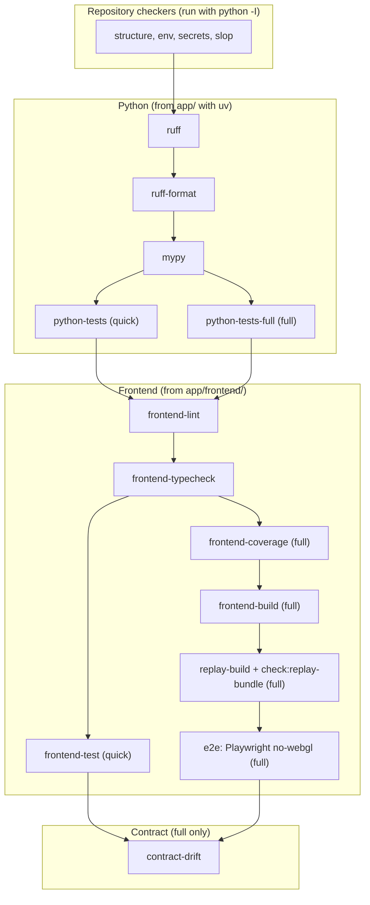
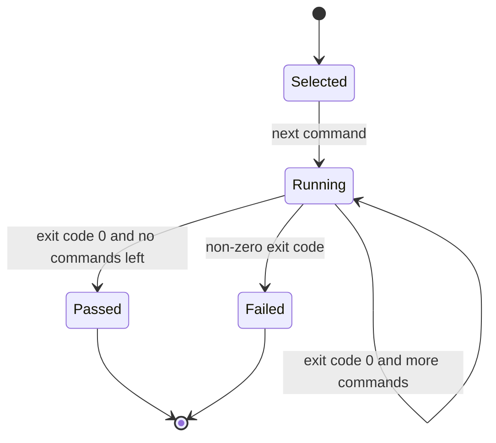
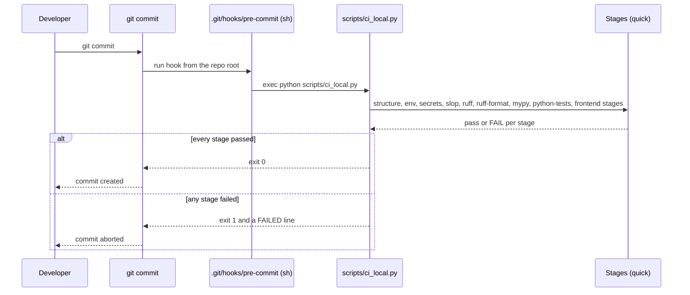

# Local checks and the pre-commit hook

## Purpose and scope

PlumeTrace does not use GitHub Actions (owner decision 2026-11-13, billing). Every check runs on
the developer machine through one script, `scripts/ci_local.py`, and a git `pre-commit` hook runs
its quick mode before every commit. This page explains the stages, what each one proves, how the
hook works, the three repository checkers, and how to add a stage.

It covers Phase 1 Task 8, plus the stages that later phases added (`slop`, the frontend coverage
and build stages, `contract-drift`). The test layers behind the stages are in
[TESTING.md](TESTING.md). Rule source: `CLAUDE.md` rules 18, 25 and 26. Never commit with
`--no-verify`.

## How it works

### The stage pipeline



Caption: stages run in the fixed order of the `STAGES` tuple. Quick mode runs the stages marked
quick or both; full mode swaps `python-tests` and `frontend-test` for their heavier versions and
adds the builds, the browser tests (`e2e`) and the contract check.

The arrows show run order only. A failed stage does not stop the next stage: every selected stage
runs, then the summary lists the failures. Inside one stage, the first failing command stops that
stage.

### Stage reference

Commands are the exact `STAGES` entries in `scripts/ci_local.py`. `skill` means
`python -I .claude/skills/<script>`.

| Stage | Modes | Command (folder) | What a pass proves |
|---|---|---|---|
| `structure` | quick, full | `skill repo-structure/scripts/check_structure.py .` (root) | Folder layout, file homes, import direction, no-god-file limits (see [STRUCTURE.md](STRUCTURE.md)) |
| `env` | quick, full | `skill security-checks/scripts/check_env.py .` (root) | One root `.env`, names in sync with `.env.example`, no values in the example |
| `secrets` | quick, full | `skill security-checks/scripts/secret_scan.py .` (root) | No key pattern and no literal `.env` value in any scanned file |
| `slop` | quick, full | `skill frontend-design/scripts/check_slop.py app/frontend/src` (root) | No banned UI patterns in the frontend source (`no slop found`) |
| `ruff` | quick, full | `uv run ruff check .` and `uv run ruff check --config pyproject.toml ../scripts` (`app`) | Lint rules `E,F,W,I,B,UP,D,S,ANN,N`, Google docstrings, security rules `S`, for the workspace and `scripts/` |
| `ruff-format` | quick, full | `uv run ruff format --check --config pyproject.toml . ../scripts` (`app`) | Formatting is already applied |
| `mypy` | quick, full | `uv run mypy` (`app`) | Strict type check of `plumetrace` and `plumetrace_agents` (Pydantic plugin) |
| `python-tests` | quick | `uv run pytest -q -m "not slow and not fuzz"` (`app`) | Fast Python tests pass; database tests skip with a hint when Supabase is down |
| `python-tests-full` | full | `uv run pytest -q -m "not fuzz" --cov=plumetrace --cov=plumetrace_agents --cov-report=term-missing:skip-covered --cov-fail-under=85` (`app`), env `PLUMETRACE_REQUIRE_DB=1` | Slow tests pass, database tests must run (no skip), total coverage at least 85 % |
| `frontend-lint` | quick, full | `npm run lint` (`app/frontend`) | ESLint, including the JSDoc rule |
| `frontend-typecheck` | quick, full | `npm run typecheck` (`app/frontend`) | `tsc --noEmit`, strict |
| `frontend-test` | quick | `npm run test` (`app/frontend`) | Vitest component and unit tests |
| `frontend-coverage` | full | `npm run test:coverage` (`app/frontend`) | Same tests plus coverage thresholds |
| `frontend-build` | full | `npm run build` (`app/frontend`) | Type-check and production build succeed |
| `replay-build` | full | `npm run build:replay`, then `npm run check:replay-bundle` (`app/frontend`) | The replay-only build type-checks and builds, and its bundle has no live-API path but does contain the ReplaySource (`replay bundle OK`) |
| `e2e` | full | `npm run e2e` (`app/frontend`) | Playwright `no-webgl` project: control-room flows, console-clean run per scenario, axe, phone page, against a fresh replay build served on port 4173 (see [TESTING.md](TESTING.md#browser-tests-playwright-phase-4-task-11)). The `webgl` project is not part of the stage |
| `contract-drift` | full | `uv run python ../scripts/export_contract.py` (`app`), `npm run gen:types` (`app/frontend`), `git diff --exit-code -- app/frontend/src/shared` (root) | Committed generated files match the Pydantic models (see [CONTRACT.md](CONTRACT.md)) |

What the quick mode does not prove: coverage thresholds, the production build, the contract, slow
tests (none exist yet), and the database tests, which may be skipped (they run when Supabase is up
and skip when it is not). Run `--full` before every phase gate.

The first four stages are checkers: `structure`, `env` and `secrets` are described below, and
`slop` is a fourth checker (`check_slop.py` in the `frontend-design` skill) for the frontend.

### Stage execution (`run_stage`)



Caption: a stage is a list of commands; it passes only if every command exits 0, and it stops at
the first failure.

`run_stage` builds the environment as the process environment plus the stage's own variables
(`python-tests-full` adds `PLUMETRACE_REQUIRE_DB=1`), prints `$ (<folder>) <command>`, resolves
the executable and runs it with `cwd = repo root / folder`.

### The pre-commit hook



Caption: the hook is a four-line shell script (shebang, two comments, one `exec`) that replaces itself with the quick check run; a
non-zero exit aborts the commit.

`scripts/install_git_hooks.py` writes `.git/hooks/pre-commit` with this exact content:

```sh
#!/bin/sh
# Installed by scripts/install_git_hooks.py: quick local checks before every commit.
# GitHub Actions are not used; never bypass this hook with --no-verify.
exec python scripts/ci_local.py
```

The installer prints `installed .git/hooks/pre-commit`. It refuses to overwrite a different
existing hook (message `a different pre-commit hook exists; not overwritten: <path>`, exit 1) and
exits 1 with `not a git repository: run git init first` when `.git/hooks` is missing. Running it
twice is safe: an identical hook is rewritten with the same bytes. It has no unit test; check the
hook by running `python scripts/install_git_hooks.py` and reading `.git/hooks/pre-commit`.

## Module reference: `scripts/ci_local.py`

| Name | What it does |
|---|---|
| `Stage` | Frozen dataclass: `name`, `commands` (tuple of `(folder, argv)`), `modes` (default both), `env` (extra variables) |
| `STAGES` | The ordered tuple of the 15 stages above |
| `_skill(script, *args)` | Command that runs a project-skill script with `sys.executable -I` |
| `select(mode, only=())` | Stages of the mode, or the named ones (any mode, in `STAGES` order); an unknown name raises `SystemExit("unknown stage: ...")` |
| `run_stage(stage, runner)` | Runs the commands, stops at the first non-zero exit, returns pass or fail |
| `main(argv, runner)` | Parses `--full`, `--only`, `--list`; runs the selected stages; prints the summary; returns 0 or 1 |

The `runner` argument defaults to `subprocess.run` and exists so tests inject a fake.

Windows detail: `shutil.which("npm")` returns the extensionless script, which `CreateProcess`
cannot start. On `nt`, `run_stage` first looks for `<name>.cmd` (so `npm` becomes `npm.cmd`) and
falls back to `shutil.which(<name>)`. Python commands use `sys.executable`, the interpreter that
started `ci_local.py`, so run the script with the Python you want (3.12).

## Worked example

`python scripts/ci_local.py --list` prints the 15 stages with their modes:

```text
structure              full/quick
env                    full/quick
secrets                full/quick
slop                   full/quick
ruff                   full/quick
ruff-format            full/quick
mypy                   full/quick
python-tests           quick
python-tests-full      full
frontend-lint          full/quick
frontend-typecheck     full/quick
frontend-test          quick
frontend-coverage      full
frontend-build         full
replay-build           full
e2e                    full
contract-drift         full
```

A quick run ends with a summary table (the seconds vary by machine; this is one local run on
2026-11-15 with Supabase running):

```text
stage                  result  seconds
structure              pass       11.5
env                    pass        0.8
secrets                pass        6.3
slop                   pass        0.2
ruff                   pass        0.3
ruff-format            pass        0.1
mypy                   pass        1.2
python-tests           pass       40.0
frontend-lint          pass        5.3
frontend-typecheck     pass        4.3
frontend-test          pass       22.0
all stages passed
```

When a stage fails, the table shows `FAIL` for it and one more line, for example
`FAILED: structure`, and the exit code is 1. The failing command's own output appears above the
table.

Examples of what a stage prints on a failure (message formats from the checker code):

- `god file: app/backend/plumetrace/x.py is 301 lines (limit 300); split it`
- `forbidden import: plumetrace.facility -> plumetrace.simulator (app/backend/plumetrace/facility/x.py)`
- `unexpected entry in repository root: .github`

## The three repository checkers

### `check_structure.py`

Runs five rules in four checks and prints `structure OK` or one line per problem. Its modules sit
next to it in `.claude/skills/repo-structure/scripts/`; all rules are data in `structure_config.py`.

| Module | Check |
|---|---|
| `layout_checks.check_levels` | Only allowed entries exist in the nine structural folders (`ALLOWED_CHILDREN` keys): the root, `app`, `app/backend`, `app/backend/plumetrace`, `app/agents`, `app/agents/plumetrace_agents`, `app/frontend/src`, `app/frontend/src/features` and `app/replay` |
| `layout_checks.check_placement` | Python only under `app/backend`, `app/agents`, `scripts`; TypeScript only under `app/frontend`; SQL only under `app/supabase`; Markdown only under `docs/` or agent prompts (a `README.md` is exempt); no catch-all names such as `utils.py` or folders such as `misc/` |
| `import_checks.check_imports` | `plumetrace_agents` never imports `plumetrace`; only `plumetrace.api` and `plumetrace.agent_tools` import `plumetrace_agents`; each sub-package imports only what `BACKEND_ALLOWED` or `AGENTS_ALLOWED` lists |
| `size_checks.check_sizes` | Line limits per file type; function, class and top-level-definition limits for Python; generated paths exempt |

Folders that do not exist yet are skipped, so the checker works from the first commit. Layout and
limits are listed in [STRUCTURE.md](STRUCTURE.md).

### `check_env.py` and `secret_scan.py`

Described in [CONFIGURATION.md](CONFIGURATION.md): `env OK` and `no secrets found`.

## Edge cases and failure modes

| Case | Behaviour | Test |
|---|---|---|
| Quick vs full selection | quick has `python-tests`, no `python-tests-full`, no `contract-drift`, no `replay-build`, no `e2e`; full has the opposite; `structure`, `env`, `secrets`, `slop`, `ruff` and `mypy` are in both | `test_ci_local.py::test_quick_mode_excludes_full_only_stages` |
| `--only nope` | Stops before running anything: `unknown stage: nope` | `test_ci_local.py::test_unknown_stage_name_is_an_error` |
| First command fails | The second command of the stage never runs | `test_ci_local.py::test_stage_stops_at_first_failing_command` |
| One stage fails | Exit 1, `FAILED: bad`, passing stages still listed | `test_ci_local.py::test_main_reports_failures` |
| Stage environment | Variables such as `PLUMETRACE_REQUIRE_DB` reach the command | `test_ci_local.py::test_stage_env_is_passed` |
| Skip rules of the scanner | The only project path skipped is `app/supabase/.temp` (CLI cache); tool and cache folders and the `.env` file itself are skipped as well; other `.temp` folders are scanned | `test_secret_scan.py` |
| Database not running (quick) | database tests skip with a start hint | `tests/db/conftest.py` |
| Database not running (full) | the same condition fails the test | `tests/db/conftest.py` with `PLUMETRACE_REQUIRE_DB=1` |
| `--only` with `--full` | `--only` wins; the named stages run whatever their mode | `select` in `ci_local.py` (not separately tested) |
| Existing different hook | not overwritten, exit 1 | `install_git_hooks.py` (no test) |

Known gaps: `check_structure.py`, `check_env.py`, `env_set.py` and `install_git_hooks.py` have no
unit tests of their own; they are exercised by running the stages.

## How to run

```bash
python scripts/install_git_hooks.py         # once per clone
python scripts/ci_local.py                  # quick, the hook runs this
python scripts/ci_local.py --full           # before every phase gate; local Supabase must run
python scripts/ci_local.py --only ruff,mypy
python scripts/ci_local.py --list
```

Notes for Windows and PowerShell:

- The commands above are identical in PowerShell. Run them from the repository root.
- Start Docker Desktop and `npx --yes supabase@3.1.0 start` (from `app/`) before `--full`.
- To set the database switch for a manual pytest run in PowerShell:
  `$env:PLUMETRACE_REQUIRE_DB = "1"; cd app; uv run pytest -q`. In Git Bash:
  `PLUMETRACE_REQUIRE_DB=1 uv run pytest -q`.
- The hook runs through the `sh` that Git for Windows installs, and `python` must be on the
  `PATH` that `sh` sees.

## How to extend

Add a stage:

1. Add a `Stage(...)` entry to `STAGES` in `scripts/ci_local.py` at the position it should run.
   Use `_skill(...)` for a project-skill script, and `("app", ("uv", "run", ...))` style tuples
   for the others. Choose `modes=BOTH`, `QUICK` or `FULL`.
2. Keep Python in `scripts/` lint-clean: the `ruff` and `ruff-format` stages include it.
3. Add or extend a test in `app/backend/tests/test_ci_local.py` if the selection logic changes.
4. Update the stage table and the list on this page, [TESTING.md](TESTING.md),
   [LOCAL_DEVELOPMENT.md](../LOCAL_DEVELOPMENT.md) and `docs/WORK_LOG.md`.

Change a structure rule: edit `structure_config.py` and the `repo-structure` skill together, then
update [STRUCTURE.md](STRUCTURE.md). Never raise a limit or add an exemption without the owner's
approval (`CLAUDE.md` rule 20).

Invariants to keep: checks stay local (no `.github/` folder; `check_structure.py` refuses one);
the hook runs quick mode only; no stage makes a paid call; a failing stage never hides behind a
passing one.

## Related

- Code: `scripts/ci_local.py`, `scripts/install_git_hooks.py`,
  `.claude/skills/repo-structure/scripts/`, `.claude/skills/security-checks/scripts/`
- Pages: [TESTING.md](TESTING.md), [STRUCTURE.md](STRUCTURE.md), [CONFIGURATION.md](CONFIGURATION.md),
  [CONTRACT.md](CONTRACT.md), [SECURITY.md](SECURITY.md)
