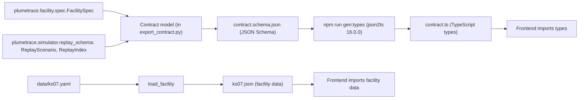
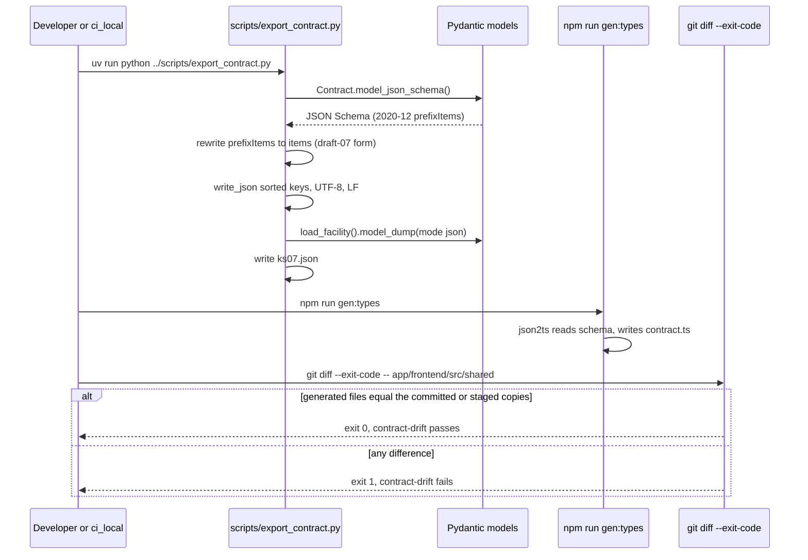

# Python to TypeScript contract

## Purpose and scope

The backend and the frontend must agree on the shape of the facility and of the replay files. The
Pydantic models in Python are the single source of truth. A script turns them into a JSON Schema,
a generator turns the schema into TypeScript types, and a check fails when the committed copies
no longer match the models. Nobody edits the generated files.

This page covers Phase 1 Task 7 (the facility part) and the replay models that later phases added
to the same schema. The replay file format itself (fields, units, size) is in
[REPLAY.md](REPLAY.md); the facility model is in [FACILITY.md](FACILITY.md). Design reference:
design section 10 (architecture) and `CLAUDE.md` rule 26 (contract tests).

## How it works

### Files in the pipeline



Caption: one Pydantic `Contract` model produces the schema and, through json2ts, the TypeScript
types; the facility YAML produces `ks07.json` through the same loader the backend uses.

| Generated file | Produced by | Holds |
|---|---|---|
| `app/frontend/src/shared/types/generated/contract.schema.json` | `scripts/export_contract.py` | JSON Schema of `Contract` (about 870 lines) |
| `app/frontend/src/shared/types/generated/contract.ts` | `npm run gen:types` | TypeScript types, banner `GENERATED by npm run gen:types ... do not edit.` |
| `app/frontend/src/shared/facility/ks07.json` | `scripts/export_contract.py` | The validated KS-07 spec as JSON |

`Contract` has three required fields: `facility` (`FacilitySpec`), `replay_scenario`
(`ReplayScenario`) and `replay_index` (`ReplayIndex`). It sets `extra="forbid"` so the generated
TypeScript has no `[k: string]: unknown` index signature. Its docstring says the replay index is
also the live scenario list entry.

The frontend uses the types in the data layer and the panels (for example
`ReplayScenario` in `shared/data/DataSource.ts`) and the data in `TopBar.tsx`, which reads
`site` from `ks07.json` to print the station id.

### Sequence: export and drift check



Caption: the `contract-drift` stage regenerates the three files and fails if `git diff` finds any
difference under `app/frontend/src/shared`.

### The `prefixItems` rewrite

Pydantic describes a fixed-length tuple such as `Vec3 = tuple[float, float, float]` with the JSON
Schema 2020-12 keyword `prefixItems`. `json-schema-to-typescript` 16.0.0 ignores that keyword and
would type each coordinate as `unknown`. `_tuples_as_items` renames every `prefixItems` to the
draft-07 array form `items`, which, together with `minItems` and `maxItems` that Pydantic already
emits, gives `[number, number, number]`. If a node has both keys the function raises `ValueError`,
because one of them would be lost silently.

## Module reference: `scripts/export_contract.py`

| Name | What it does |
|---|---|
| `Contract` | Pydantic model with the three shared types (`extra="forbid"`) |
| `_tuples_as_items(node)` | Recursive `prefixItems` to `items` rewrite; raises on a node with both |
| `build_contract_schema()` | `Contract.model_json_schema()`, rewritten, `title` set to `Contract` |
| `build_facility_json(spec)` | `spec.model_dump(mode="json")` |
| `write_json(path, data)` | Creates parent folders; writes `json.dumps(data, indent=2, sort_keys=True, ensure_ascii=False) + "\n"` as bytes |
| `main()` | Writes `SCHEMA_OUT` and `FACILITY_OUT`, prints their repo-relative paths, returns 0 |

`write_json` writes bytes (`path.write_bytes(text.encode("utf-8"))`) so Windows never turns LF
into CRLF. Together with `.gitattributes` (`* text=auto eol=lf`) the files are byte-identical on
Windows and Linux. Keys are sorted, so a changed field order in a model does not cause a diff.

## Worked example

Before: `Anchor.position_m` is a `Vec3` in Python. After export, the schema holds
(`test_vec3_is_a_fixed_number_tuple` pins this shape):

```json
"position_m": { "items": [{"type": "number"}, {"type": "number"}, {"type": "number"}],
                "maxItems": 3, "minItems": 3, "title": "Position M", "type": "array" }
```

and `contract.ts` has:

```ts
export type PositionM = [number, number, number];
```

The exported facility starts with the first equipment item, `PIG-101`, whose anchor `PIG-101.door`
is at `[12.0, 75.0, 1.0]`. Keys appear in sorted order (`anchors`, `description`, `position_m`,
`rotation_deg`, `shelter`, `size_m`, `tag`, `type`, `vents_to`), and unset optional fields appear
as `null` (for example `"vents_to": null`).

## Edge cases and failure modes

| Case | Behaviour | Test |
|---|---|---|
| Same data written twice | Identical bytes; LF only; sorted keys; trailing newline; `°` kept as UTF-8 | `test_export_contract.py::test_write_json_is_deterministic_and_lf_only` |
| Facility export | `site.id == "KS-07"`, 24 equipment items | `test_export_contract.py::test_facility_json_has_site_and_candidates` |
| Schema content | title `Contract`; properties include `facility`, `replay_scenario`, `replay_index` | `test_export_contract.py::test_contract_schema_describes_facility_spec` |
| `prefixItems` left in schema | Must not occur | `test_contract_types.py::test_schema_has_no_prefix_items` |
| Position type | `items` array of three numbers, `minItems = maxItems = 3` | `test_contract_types.py::test_vec3_is_a_fixed_number_tuple` |
| Node with `prefixItems` and `items` | `ValueError` | `test_contract_types.py::test_rewrite_rejects_items_next_to_prefix_items` |
| Committed `contract.ts` | Has no `unknown`; contains `[number, number, number]` | `test_contract_types.py::test_generated_contract_ts_has_no_unknown` |
| Model changed, files not regenerated | `contract-drift` fails (full mode only) | stage `contract-drift` in `scripts/ci_local.py` |

What the drift check proves and what it does not:

- It runs `git diff --exit-code -- app/frontend/src/shared`, which compares the working tree with
  the git index. It passes when the regenerated files equal what is staged or committed. It also
  fails on any other uncommitted edit under `app/frontend/src/shared`, even a hand-written file
  (the work log records one such false alarm that disappeared after the commit).
- A brand-new untracked generated file is not reported by `git diff`. That does not happen in
  practice because the three files already exist.
- It runs only in full mode, not in the pre-commit hook. Run it yourself after any model change.

## How to run

From the repository root. These commands work in PowerShell and Git Bash.

```bash
cd app
uv run python ../scripts/export_contract.py     # writes contract.schema.json and ks07.json
cd frontend
npm run gen:types                               # writes contract.ts
cd ../..
python scripts/ci_local.py --only contract-drift
```

The last command runs the three drift-stage steps in order (export, gen:types, git diff). It does
not need the database.

## How to extend

Add a new shared type (for example a new replay field or a new model):

1. Change the Pydantic model in the backend (and its docstring; the docstring becomes a comment
   in `contract.ts`).
2. If the type is new at the top level, add it as a field of `Contract` in
   `scripts/export_contract.py`. Types referenced by an existing field are included automatically.
3. Run the export and `npm run gen:types`. Read the diff of `contract.ts`: it must contain no
   `unknown`. Fixed-length tuples must show as `[number, number, number]`.
4. Fix any frontend code the type change breaks (`npm run typecheck`).
5. Add a test next to `test_export_contract.py` when the new type has a shape rule.
6. Run `python scripts/ci_local.py --full` before the phase gate, and update this page,
   [REPLAY.md](REPLAY.md) when a replay field changed, and `docs/WORK_LOG.md`.

Invariants to keep: the Python model is the source; generated files are never hand-edited; output
is deterministic (sorted keys, UTF-8, LF, trailing newline); the frontend gets types and data only,
never a Python import and never a secret.

## Related

- Code: `scripts/export_contract.py`, `app/frontend/src/shared/types/generated/`,
  `app/frontend/src/shared/facility/ks07.json`, tests `app/backend/tests/test_export_contract.py`
  and `app/backend/tests/test_contract_types.py`
- Pages: [FACILITY.md](FACILITY.md), [REPLAY.md](REPLAY.md), [FRONTEND.md](FRONTEND.md),
  [CHECKS.md](CHECKS.md)
