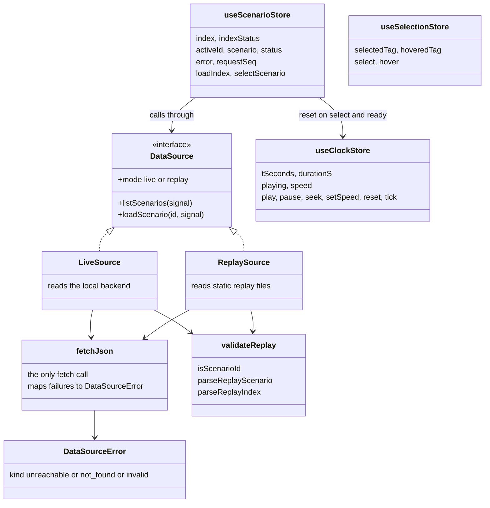
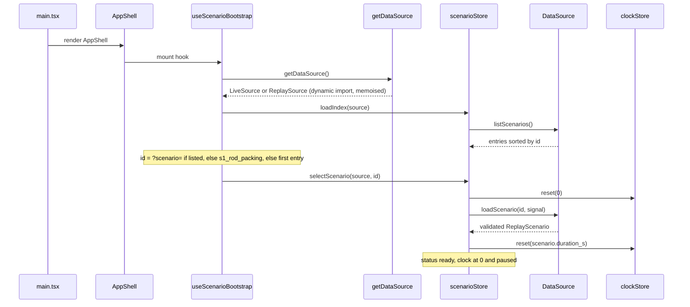
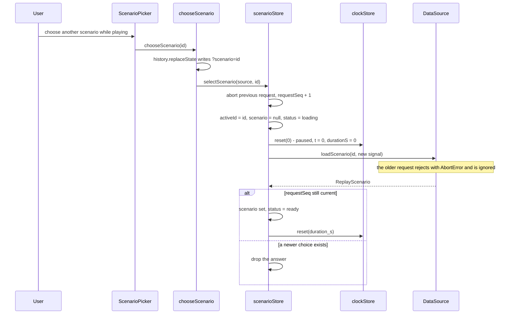
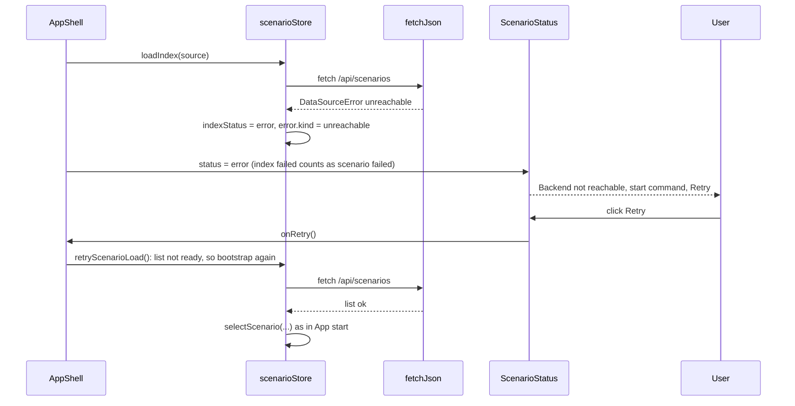
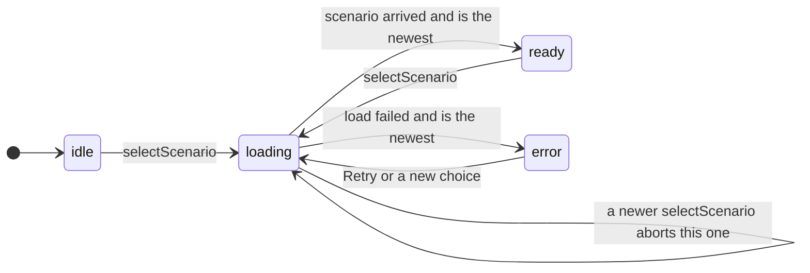
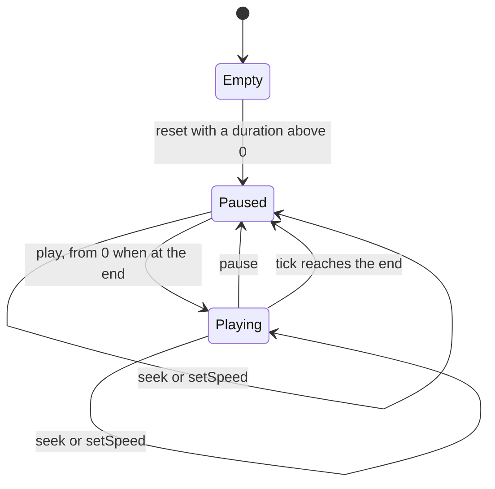
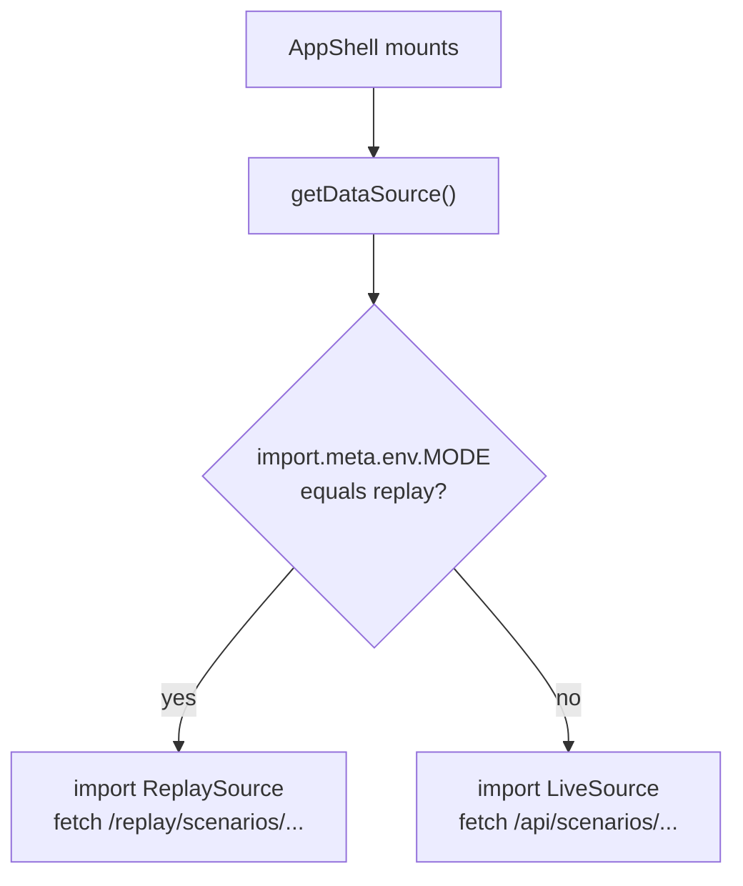
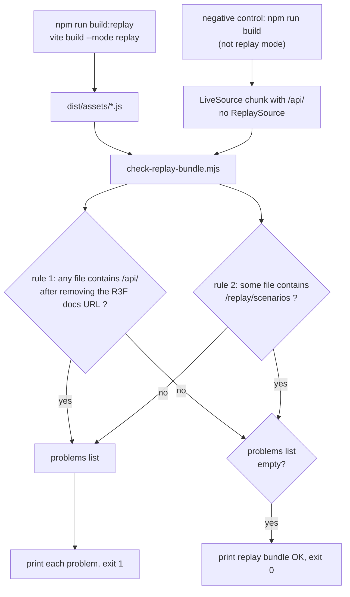

# Data layer

How the frontend gets scenario data, keeps time and tracks selection. Code: `app/frontend/src/shared/data/`,
`src/shared/playback/`, `src/shared/selection/`. Phase 4 Task 3, wired into the shell in Task 4.

Related pages: [FRONTEND.md](FRONTEND.md) (overview), [UI_PANELS.md](UI_PANELS.md) (the panels that read
these stores), [API.md](API.md) (the live endpoints), [REPLAY.md](REPLAY.md) (the static files and the
document format).

## Purpose and scope

Every feature reads scenario data through one interface, `DataSource`, with two implementations: the
local FastAPI backend (live) and static replay files (replay). The public replay build contains only
the replay implementation. Three small Zustand stores hold the state: which scenario is open and how
it loaded, the simulation clock, and the selected equipment tag.

The layer is business-neutral. It does not compute alarms, rates or chart data. It does not hold a
rate and no inversion result exists in it. The data is the simulated station KS-07 (fictional); only
the weather in it is real.

Features import `@/shared/data`, `@/shared/playback` and `@/shared/selection` only, never an inner
file (rule of the `frontend-structure` skill). Each folder has an `index.ts` that is its public API.

## Module map



Classes, functions and stores of the data layer. `LiveSource` and `ReplaySource` are deliberately not
exported from `data/index.ts`: only `getDataSource()` loads them. `useSelectionStore` has no link to
the others; it stores tags only.

### Files

| File | What it holds |
|---|---|
| `data/DataSource.ts` | `DataSourceMode` (`"live"` or `"replay"`) and the `DataSource` interface |
| `data/errors.ts` | `DataSourceError(kind, message)` and `DataSourceErrorKind` |
| `data/fetchJson.ts` | `fetchJson(url, signal)` and `isAbortError(error)`; the only code that calls `fetch` |
| `data/validateReplay.ts` | `isScenarioId`, `parseReplayScenario(data, expectedId)`, `parseReplayIndex(data)` |
| `data/LiveSource.ts`, `data/ReplaySource.ts` | The two implementations |
| `data/getDataSource.ts` | `getDataSource()` (memoised), `resetDataSourceForTests()` |
| `data/scenarioStore.ts` | `useScenarioStore`, `useActiveScenario()`, `useScenarioStatus()`, types `LoadStatus`, `ScenarioState` |
| `data/useCurrentConditions.ts` | `useCurrentConditions()`: wind speed, direction and stability at the current sample |
| `playback/clockStore.ts` | `useClockStore`, `useSampleIndex()`, `SPEEDS`, `DEFAULT_SPEED`, `SAMPLE_STEP_S` |
| `playback/usePlaybackLoop.ts` | `usePlaybackLoop()`: one `requestAnimationFrame` loop |
| `selection/selectionStore.ts` | `useSelectionStore` |
| `src/shared/types/generated/contract.ts` | Generated types `ReplayScenario`, `ReplayIndex`, `ReplayIndexEntry`, `ReplayEvent`. Never redeclared, never edited (see [FRONTEND.md](FRONTEND.md#type-contract)) |

## The `DataSource` interface

```ts
interface DataSource {
  readonly mode: "live" | "replay";
  listScenarios(signal?: AbortSignal): Promise<ReplayIndexEntry[]>;   // sorted by id
  loadScenario(id: string, signal?: AbortSignal): Promise<ReplayScenario>;
}
```

Phase 5 adds agent runs to the same interface.

| Implementation | Reads | Used when |
|---|---|---|
| `ReplaySource` | `/replay/scenarios/index.json`, `/replay/scenarios/<id>.json` (static files) | `import.meta.env.MODE === "replay"` |
| `LiveSource` | `GET /api/scenarios`, `GET /api/scenarios/<id>/replay` (FastAPI through the Vite proxy) | every other mode (`npm run dev`, `npm run build`) |

Both implementations:

- check the id against `^s[0-9]+_[a-z0-9_]+$` before building a URL; an id that fails the check
  gives `not_found` without any request (so `../x`, `s1/../x` and `S1_Rod_Packing` never reach a
  path; pinned by `LiveSource.guard.test.ts`);
- validate the body with `parseReplayScenario` or `parseReplayIndex`;
- accept a `ReplayIndex` object or a bare array as the scenario list (the live API answers a bare
  array, the file holds `{"schema_version": 1, "scenarios": [...]}`); the list is sorted by id.

`parseReplayScenario` checks: the value is an object; `schema_version === 1`; `simulated === true`;
`scenario_id` equals the requested id; `step_s > 0`; with `n = round(duration_s / step_s)` the lists
`wind_speed_m_s`, `wind_from_deg`, `stability` and every `series` array have `n` entries; every
`series` tag has a string in `units`. The Python model checks the rest when the file is written.

Worked example, S1 (live): `LiveSource.loadScenario("s1_rod_packing")` requests
`/api/scenarios/s1_rod_packing/replay`; the body has `duration_s` 21600 and `step_s` 60, so `n` is 360
and 360 wind samples must be present, otherwise the error is `invalid`.

## Error kinds

Every method rejects with `DataSourceError(kind, message)`. The UI chooses its text from `kind` and
never shows `message` verbatim. An aborted request re-throws the original `AbortError`, which the
store ignores.

| `kind` | Meaning | Raised when |
|---|---|---|
| `unreachable` | No server answered | `fetch` rejected, or any non-OK status other than 404 (the Vite proxy answers 5xx while the backend is down) |
| `not_found` | The id or file does not exist | status 404, or an id that is not a scenario id |
| `invalid` | The answer is not a usable replay | the body is not JSON, or a check in `validateReplay.ts` failed |

Verified by hand on 2026-11-15: with the backend running, `GET /api/scenarios` through the Vite dev
server answered 200 with three scenarios; after stopping the backend the same request answered 502,
which `fetchJson` maps to `unreachable`.

## Flows

The diagrams on this page are kept small on purpose, one flow or one state machine each, so that every
label stays readable. The two state diagrams (four and three states) are complete as drawn.

### App start



On start the shell resolves the source, loads the list, picks the first scenario and loads it. The
clock stays paused at 0; the user presses Play.

Details that matter:

- `useScenarioBootstrap` keeps a local `active` flag. React `StrictMode` runs effects twice in
  development; only the live run loads (test: "loads the list once even when the effect runs twice").
- The scenario to open: `?scenario=<id>` when the id is in the list, else `s1_rod_packing` when
  present, else the first entry, else none (tests in `useScenarioBootstrap.test.tsx`).
- If the list fails, `bootstrap` stops and `indexStatus` is `error`; no scenario is requested.

### Scenario switch during playback



A switch never mixes old and new data: the old scenario is cleared before the new request starts,
the clock is reset immediately, and any answer that is no longer the newest is dropped.

Worked example: S1 plays at +00:50 (t = 3000 s). The user picks S5. At once `scenario` is `null`,
`status` is `loading`, the clock reads t = 0 and is paused. When S5 arrives the clock gets
`durationS = 21600` (S5 is 6 h); for S4 it would be 14400. `chooseScenario` also writes
`?scenario=<id>` to the address bar with `history.replaceState`.

### Backend down, then Retry



With the backend stopped, `fetch` rejects (or the proxy answers 5xx). The panels stay on screen and
the station area shows `Backend not reachable`, the start command and a Retry button. Retry reloads
the list if it never loaded, otherwise the active scenario. In replay mode the same kind gives
`Replay files could not be loaded.` and no backend command. The exact texts are in
[UI_PANELS.md](UI_PANELS.md#station-status-texts).

## Stores



`scenarioStore.status` (the active scenario). `indexStatus` has the same four values and moves
`idle`, `loading`, `ready` or `error` through `loadIndex`; a Retry after `error` starts `loading`
again. An aborted request changes neither status.

| Store | State | Actions |
|---|---|---|
| `useScenarioStore` | `index`, `indexStatus`, `activeId`, `scenario`, `status` (`idle`, `loading`, `ready`, `error`), `error`, `requestSeq` | `loadIndex(source)`, `selectScenario(source, id)` |
| `useClockStore` | `tSeconds`, `durationS`, `playing`, `speed` | `play`, `pause`, `setSpeed`, `seek`, `reset`, `tick` |
| `useSelectionStore` | `selectedTag`, `hoveredTag` | `select(tag or null)`, `hover(tag or null)` |

Hooks: `useActiveScenario()`, `useScenarioStatus()`, `useCurrentConditions()`, `useSampleIndex()`,
`usePlaybackLoop()`.

`selectScenario` in order: abort the previous request; increment `requestSeq`; set `activeId`,
`scenario: null`, `status: "loading"`, `error: null`; reset the clock to 0 (paused, duration 0);
load; only when `requestSeq` still equals this call's number set `scenario` and `status: "ready"`
and reset the clock to the scenario's `duration_s`. A slow earlier response, or a late failure of
it, is dropped. `loadIndex` sets `indexStatus` and, on failure, `error` (kind `unreachable` when the
backend is down); `error` always holds the most recent failure.

`useSelectionStore.select(tag)` on the already-selected tag clears the selection; `hover` is
independent of it.

### Playback clock



States of `useClockStore`. `Empty` means `durationS === 0`. `reset(duration)` from any state returns
to `Paused` at t = 0 and keeps the speed. `play()` is ignored in `Empty`.

Rules:

- Speeds `SPEEDS = [1, 10, 60, 120]` (simulated seconds per real second), default 60;
  `SAMPLE_STEP_S = 60`.
- `play()` does nothing on an empty timeline (`durationS === 0`); at the end it restarts from 0.
- `reset(durationS)` sets `t = 0`, pauses and keeps the speed. `seek(t)` clamps to `[0, durationS]`
  and ignores a non-finite `t`.
- `tick(dtRealS)` adds `dtRealS * speed` while playing, stops at the end and ignores a step that is
  not in `(0, 1]` s: a tab that slept must not make the clock jump (1 s gap guard).
- The clock is the single time source. Panels re-render once per 60 s sample: `useSampleIndex()`
  selects `clamp(floor(t / 60), 0, n - 1)` with `n = max(1, round(durationS / 60))`. It is a number,
  so React re-renders only when the index changes. The 3D layer will read
  `useClockStore.getState()` inside `useFrame`; nothing animates through React state.
- `usePlaybackLoop()` is one `requestAnimationFrame` loop that calls `tick((now - last) / 1000)`;
  `AppShell` mounts it once. The first frame only records the timestamp. It holds no React state and
  cancels on unmount.

Worked example, S1 at speed 60: a 16.7 ms frame adds `0.0167 * 60 = 1.0` s. The sample index at
t = 8400 s is `floor(8400 / 60) = 140` of `n = 360`. The clock readout at that time is
`Elapsed +02:20 · 02:20:00 UTC` (S1 starts at `2025-07-14T00:00:00Z`).

## Replay-only build and live build



Runtime choice, as written in `getDataSource.ts`. `vite build --mode replay` replaces
`import.meta.env.MODE` with the string `"replay"` at build time, so the `else` branch and its dynamic
`import("./LiveSource")` are removed.



How the check proves the live code is absent, and why it cannot pass vacuously. The two rules run
independently and each adds its problem to one list; the script prints every problem and exits 1 if
the list is not empty. Rule 1 fails when live API code is present. Rule 2 fails when the ReplaySource
is missing, so a build that does not import the data layer at all would fail instead of passing. The
negative control (a normal build) fails both rules.

Observed on 2026-11-15 with `vite build` into a scratch folder (not `dist/`):

| Build | JS chunks | `check-replay-bundle.mjs` |
|---|---|---|
| `--mode replay` | `index-*.js` 278.33 kB, `ReplaySource-*.js` 1.77 kB, `uPlot.esm-*.js` 50.99 kB | prints `replay bundle OK`, exit 0 |
| default mode | `index-*.js` 278.32 kB, `LiveSource-*.js` 1.77 kB, `uPlot.esm-*.js` 50.99 kB | `live API code in replay bundle: LiveSource-....js` and `no ReplaySource in the bundle`, exit 1 |

`src/app/checkReplayBundle.test.ts` pins six cases with synthetic bundle folders: a valid replay
bundle passes; the negative control fails with `live API code in replay bundle`; a bundle without
ReplaySource fails with `no ReplaySource`; a missing folder fails; the R3F documentation URL alone
passes; and a live `/api/` path next to that URL still fails, naming the file.

Rule 1 ignores one thing only: the exact prefix `https://docs.pmnd.rs/react-three-fiber/api/`
(`IGNORED_DOC_URL` in the script). R3F's own error text links its docs
(`.../react-three-fiber/api/objects#...`); that is a string, not a live API call. The script removes
that prefix from each file's text before it looks for `/api/` (owner ruling 2026-11-16). Observed
on 2026-11-16 with the real build: `npm run build:replay` then `npm run check:replay-bundle` printed
`replay bundle OK`; after `npm run build` the check printed `live API code in replay bundle:
LiveSource-<hash>.js`. `ci_local.py` does not run the check yet (Phase 4 Task 11 adds it).

Replay files are copied from `app/replay/` to `app/frontend/public/replay/` (git-ignored) by
`npm run copy:replay`, which runs before `dev`, `build` and `build:replay`.

## What the data layer must not expose

A loaded scenario also holds `keyframes[].sources` (`anchor_id`, `rate_kg_h`): the simulation input
used only to draw the plume. It is not a measurement and not an estimate. No store selector or hook
returns it as text, and nothing passes it to a format helper; views must not render it. The data
layer stores no rate. `useCurrentConditions()` returns only wind speed, direction and stability.

Any rate display must follow R1 to R4 (see [UI_PANELS.md](UI_PANELS.md#binding-display-rules)), and
every clock shown carries a zone label.

## Tests

| File | Pins |
|---|---|
| `data/validateReplay.test.ts` | a valid file is accepted; seven invalid files are rejected: wrong id, not simulated, schema version 2, short `series`, missing unit, short wind list, not an object (`step_s <= 0` and a short `stability` list are checked by the code but have no test); index object and bare array; malformed entries |
| `data/fetchJson.test.ts` | `Accept` header; abort re-thrown; 404 to `not_found`, other statuses to `unreachable`; non-JSON to `invalid` |
| `data/LiveSource.test.ts`, `data/ReplaySource.test.ts` | relative URLs; fetch failure and proxy 502 give `unreachable`; replay file loaded from `/replay`; 404 gives `not_found`; non-scenario ids rejected without a fetch |
| `data/LiveSource.guard.test.ts` | `../x`, `s1/../x`, `s1_a/b`, `S1_Rod_Packing`, empty id: `not_found`, `fetch` never called |
| `data/getDataSource.test.ts` | live in a normal build; replay in replay mode and memoised; the two classes are not exported |
| `data/scenarioStore.test.ts` | a slow earlier response is ignored; a typed error is recorded |
| `data/scenarioStore.states.test.ts` | backend down gives `unreachable`; switch during playback resets the clock and never mixes data; the previous request is aborted; a late failure does not overwrite the newer scenario |
| `data/useCurrentConditions.test.tsx` | null without a scenario; the sample at the clock time |
| `playback/clockStore.test.ts`, `clockStore.rules.test.tsx` | advance and stop at end; gap guard; clamped seeks; empty timeline; reset keeps speed; play at the end restarts; zero, negative, NaN or over-1 s steps ignored; sample-index re-render rule; rAF loop |
| `selection/selectionStore.test.ts` | select and toggle; another tag replaces it, null clears it; hover is independent |
| `app/checkReplayBundle.test.ts` | see above |
| `app/AppShell.wiring.test.tsx` | backend down shows `Backend not reachable`; the playback loop is mounted |
| `features/scenarios/hooks/useScenarioBootstrap.test.tsx` | default S1, `?scenario=`, unknown id, S1 not first, StrictMode double run, `chooseScenario`, `retryScenarioLoad` |

Run from `app/frontend/`: `npm run test`. `src/shared/testing/replayFixture.ts` (`makeReplay`) builds a
small valid `ReplayScenario` (10 samples) for tests. Docs checked on 2026-11-15 (Context7): Zustand
v5.0.14 and Vite 8.3.5 were the versions that the docs tool listed on that day (`create<T>()(...)`,
`getInitialState`, `setState`, `getState`; `import.meta.env.MODE`, `--mode`, static replacement for
tree shaking). The repo pins differ (Zustand 5.1.0 and Vite 8.3.8 exactly, in `package.json`); the
APIs used are the same, and the pins are the versions the tests run against.

## How to extend

### How to add a data source method

1. Add the method to `DataSource` in `DataSource.ts` with TSDoc, and a typed result from
   `contract.ts` (regenerate the contract if the Pydantic model changed).
2. Implement it in **both** `LiveSource` and `ReplaySource`. Build URLs only from ids that passed
   `isScenarioId`; call only `fetchJson`; validate the body in `validateReplay.ts`.
3. Test both sources, the failure kinds and an abort. Keep the two classes out of `data/index.ts`.
4. Add the endpoint to the backend first (see [API.md](API.md#how-to-extend)).
5. Run `npm run build:replay` and `npm run check:replay-bundle`. A live-only method must stay
   behind the `import.meta.env.MODE` branch so it never reaches the public bundle.

### How to add a store or a selector

- Keep stores business-neutral. Put derived values in a hook with a **primitive** selector (a number
  or string), so components re-render only when it changes (see `useSampleIndex`).
- Never keep a clock of your own. Read `useClockStore`; for 3D read `getState()` inside `useFrame`.
- Do not copy `keyframes[].sources` into a store or a hook result.

Invariants a change must keep: one `fetch` call site; ids validated before a URL is built; errors
carry a `kind` and the UI shows text chosen from it; a switch drops stale answers; the replay bundle
check stays non-vacuous.

## Changelog

- 2026-11-15: Phase 4 Task 3 data layer; Task 4 wired it into the shell.
- 2026-11-15: documentation pass: module map, start, switch and backend-down sequences, state
  diagrams, build-mode diagrams with the observed negative control, test table, extension steps.
