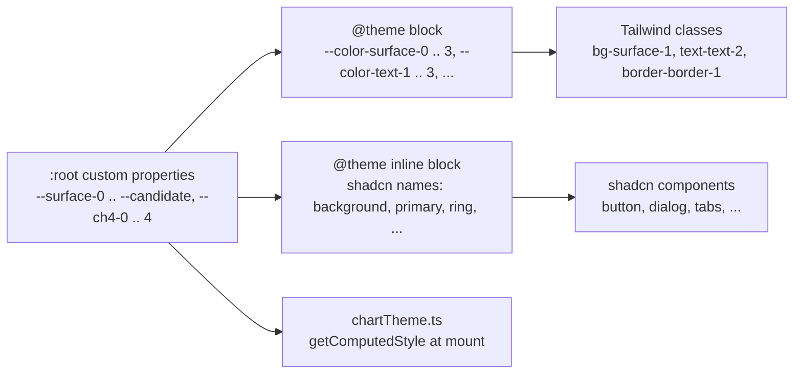

# Design system

Tokens, type scale, shape, focus, motion, the shadcn primitives and the shared primitives of the
PlumeTrace frontend. Final since Phase 4 Task 2. Everything lives in `app/frontend/src/styles/index.css`.

Related pages: [FRONTEND.md](FRONTEND.md) (overview), [UI_PANELS.md](UI_PANELS.md) (where the tokens
are used), [ACCESSIBILITY.md](ACCESSIBILITY.md). Visual direction: `.ux-profile.md` and
`.claude/skills/frontend-design/references/anti-slop.md`.

## Purpose and scope

The control room must read like industrial HMI software, not a SaaS page: dark neutral surfaces,
colour reserved for meaning (ISA-101 spirit), dense tabular data with units, one accent hue for
actions. This page records the tokens and the rules that follow from their measured contrast. It
documents the UI as built; the 3D scene (Tasks 8 and 9) reads some tokens through `var()` but does
not exist yet.

## How the tokens flow

One palette, three readers. Components use token classes, never raw hex or `bg-[var(--x)]`. Canvas
code cannot use `var()`, so `chartTheme.ts` resolves the variables once at mount. The 3D layer will
read `--ch4-*` and `--plume-tint` the same way.

## Colour tokens

Surfaces are grey in four levels, separated by 1 px borders rather than shadows. Colour is reserved
for meaning.

Contrast ratios are WCAG 2.x relative-luminance ratios. The first two columns are the values recorded
in `FRONTEND.md` at Task 2; on 2026-11-15 they were recomputed with a short script (kept outside the
repo) and the extra columns added. Recomputed values agree with the recorded ones to the rounding
shown (`--text-2` on surface-1 is 7.55, recorded as 7.6; `--text-3` on surface-1 is 4.37, recorded
as 4.4).

| Token | Value | Meaning | on surface-0 | on surface-1 | on surface-2 | on surface-3 |
|---|---|---|---|---|---|---|
| `--surface-0` | `#15171a` | App background, 3D view surround | n/a | n/a | n/a | n/a |
| `--surface-1` | `#1c1f23` | Panel body | n/a | n/a | n/a | n/a |
| `--surface-2` | `#24282d` | Raised controls, dialogs | n/a | n/a | n/a | n/a |
| `--surface-3` | `#2d3238` | Hover and selected rows | n/a | n/a | n/a | n/a |
| `--border-1` | `#343a41` | Panel and divider lines | 1.56 | 1.44 | 1.29 | 1.12 |
| `--border-2` | `#4a515a` | Control outlines | 2.24 | 2.06 | 1.85 | 1.61 |
| `--text-1` | `#e8eaed` | Primary text and values | 14.90 | 13.72 | 12.30 | 10.72 |
| `--text-2` | `#a9b0b8` | Secondary text, units, panel titles | 8.20 | 7.55 | 6.77 | 5.90 |
| `--text-3` | `#7c848d` | Tertiary, disabled | 4.74 | 4.37 | 3.91 | 3.41 |
| `--accent` | `#5b8db8` | The one action hue (primary buttons, highlighted chart lines) | 5.09 | 4.68 | 4.20 | 3.66 |
| `--accent-contrast` | `#0f1b26` | Text on `--accent` | 4.93 on `--accent` | | | |
| `--focus` | `#8fb8de` | Focus ring (`:focus-visible`, 2 px, offset 2 px) | 8.62 | 7.94 | 7.12 | 6.20 |
| `--alarm-high` | `#d9534f` | Alarm priority high | 4.53 | 4.17 | 3.74 | 3.26 |
| `--alarm-med` | `#e8a33d` | Alarm priority medium | 8.33 | 7.67 | 6.87 | 5.99 |
| `--alarm-low` | `#c8b44a` | Alarm priority low | 8.62 | 7.94 | 7.12 | 6.21 |
| `--ok` | `#4e9f70` | Normal, approved, healthy | 5.57 | 5.13 | 4.60 | 4.01 |
| `--candidate` | `#f0a202` | AI-located leak candidate | 8.44 | 7.78 | 6.97 | 6.08 |
| `--ch4-0` to `--ch4-4` | `#f6e8a6`, `#f3c063`, `#e8893a`, `#d4502e`, `#a61e22` | Methane concentration ramp, low to high, sequential, colour-blind safe | data colours | | | |
| `--plume-tint` | `#cbc3b2` | Plume particle tint; methane is invisible, so the overlay is a labelled visualisation | data colour | | | |

Also recorded: white text on `--alarm-high` is 3.96:1 (STATUS.md, Task 4.2 review), so no
destructive button is used without a design review. `button.tsx` still carries shadcn's
`destructive` variant with `text-white`; nothing in the app uses it yet.

### Rules that follow from the contrast numbers

- `--text-3` falls below 4.5:1 on surface-1 and below. The recorded rule (STATUS.md, carried from
  `FRONTEND.md` at Task 2): use it only on surface-0, never for a value, unit or label an operator must
  read. Exceptions in the code today, both non-essential: the disabled scenario picker text is
  `--text-3` on surface-2 (3.91:1), and the quiet chart lines use it as a stroke (graphics, which need
  3:1, not text). Any other use needs a design review.
- `--alarm-high` as text is 4.17:1 on surface-1. State and priority are carried by the marker shape
  and the word (see `StatusBadge`); the colour only reinforces them.
- `--ch4-3` and `--alarm-high` are both red-orange. A concentration colour must never be the only sign
  of an alarm, and an alarm must never be shown as a concentration colour.
- `--accent` text on surface-2 is 4.20:1: use it for fills, strokes and large or bold text on
  surface-0 and surface-1, not for body text on raised surfaces.
- `--border-1` (1.44 on surface-1) is a decorative divider only. `--border-2` (2.06) is the control
  outline and is not relied on alone to identify a control; controls also carry a visible label.
- Empty and loading text uses `--text-2`, not `--text-3`.

Tailwind classes come from the `@theme` block: `bg-surface-0..3`, `border-border-1|2`,
`text-text-1|2|3`, `bg-accent`, `bg-alarm-high|med|low`, `bg-ok`, `bg-candidate`. The `--ch4-*` and
`--plume-tint` tokens have no Tailwind class; the 3D and chart code reads them through `var()`.

## Typography

IBM Plex Sans (interface) and IBM Plex Mono (tags such as K-202 and PIC-101, values, timestamps),
chosen as an engineering-drawing family with true tabular figures. Licence: SIL Open Font License 1.1
(package licence `OFL-1.1`, @fontsource 5.3.0). Files come from the npm packages
`@fontsource/ibm-plex-sans` (400, 500, 600) and `@fontsource/ibm-plex-mono` (400, 500), imported in
`src/main.tsx` and bundled by Vite: no font is fetched from a network at run time. The font stacks
fall back to `ui-sans-serif, system-ui, sans-serif` and `ui-monospace, monospace`.

| Class | Size / line height | Use |
|---|---|---|
| `text-xs` | 12 / 16 | Units, badges, table meta |
| `text-sm` | 13 / 18 | Panel titles, table cells |
| `text-base` | 14 / 20 | Body (set on `html`) |
| `text-md` | 16 / 22 | Section headings |
| `text-lg` | 20 / 26 | Dialog titles |
| `text-xl` | 24 / 30 | KPI values |

Numbers use `font-mono` or `tabular-nums` and always carry their unit in a quieter weight. The chart
canvases use `11px "IBM Plex Mono"` for axis text (`chartOptions.ts`).

## Shape, focus, motion

- Radius: `--radius` 4 px (`rounded-sm`, also `rounded-md`); dialogs and tab lists 6 px
  (`rounded-lg`). No larger radius on product surfaces.
- Focus: every `:focus-visible` gets a 2 px `--focus` outline with a 2 px offset (global rule in
  `index.css`). shadcn's own `focus-visible:ring` classes on buttons add a 3 px half-transparent ring.
- Reduced motion: under `prefers-reduced-motion: reduce` animation and transition durations drop to
  0.01 ms (`!important`, all elements and pseudo-elements).
- No gradients, glass or glows on product UI. The shadcn `Dialog` content keeps its `shadow-lg` (an
  overlay, not a panel), and the `Tabs` trigger keeps `data-[state=active]:shadow-sm` for the default
  variant (`shadow-none` for the line variant). Tabs are not used by any panel yet; remove or accept
  that shadow when the first tab list is built (Task 10).

## shadcn primitives

Config: `app/frontend/components.json` (style `new-york`, Radix, Tailwind v4, no `tailwind.config`,
base colour `neutral`, CSS variables on, icons `lucide`). Aliases map components and ui to
`@/shared/ui`, utils to `@/shared/lib/cn`. Added with the pinned CLI:
`npx --yes shadcn@4.23.0 add <name>` run from `app/frontend`. Present: `button`, `dialog`, `tooltip`,
`tabs`, `separator`, `scroll-area`. Only `Button` is used by the panels so far; the others are
tested in `shared/ui/primitives.test.tsx` and wait for Tasks 10 and later.

Rules:

- shadcn's semantic names are mapped onto our tokens in the `@theme inline` block of `index.css`:

  | shadcn name | Token |
  |---|---|
  | `background` | `--surface-2` |
  | `foreground`, `secondary-foreground` | `--text-1` |
  | `muted`, `secondary` | `--surface-3` |
  | `muted-foreground` | `--text-2` |
  | `primary` | `--accent` |
  | `primary-foreground` | `--accent-contrast` |
  | `destructive` | `--alarm-high` |
  | `border` | `--border-1` |
  | `input` | `--border-2` |
  | `ring` | `--focus` |
  | `radius-md` | `--radius`; `radius-lg` is 6 px |

  There is no second palette.
- `--color-accent` stays our action hue, so the shadcn "hover surface" role is not `accent`:
  `button.tsx` (outline and ghost variants), `dialog.tsx` (close button open state) and `tooltip.tsx`
  use `surface-3` directly. Re-adding a component with `--overwrite` loses these edits; redo them from
  this list.
- Edits to generated files are limited to token classes, import paths and a TSDoc line per export (the
  lint rule requires it). The CLI wrote `from "cn"` and added an npm package `cn` for the `utils`
  alias; the imports were changed to `@/shared/lib/cn` and the package removed.
- Lucide icons only, monochrome (`Play`, `Pause` today). `TooltipProvider` must wrap the app when the
  first tooltip is used.
- `Button` sizes in use: `icon-sm` (32 px, play and pause), `sm` (32 px high, Retry), `xs` (24 px high,
  speed buttons); variants `outline` and `ghost`.

## Shared primitives

- `Panel({ title, actions?, children, className? })`: `<section aria-labelledby>` with a 32 px header
  (`h2`, `text-sm`, `text-text-2`), 1 px `border-border-1` border, `bg-surface-1`, scrolling body. The
  title is the region's accessible name.
- `StatusBadge({ tone, children })`: tones `high`, `med`, `low`, `ok`, `neutral`; a 6 px square marker
  (`aria-hidden`) plus text in `text-text-1`, never colour alone. `neutral` uses `--text-3` as a
  marker fill.
- `cn(...)` in `shared/lib/cn.ts`: `twMerge(clsx(...))`.

## Formatting helpers (`src/shared/lib/format.ts`)

| Function | Result |
|---|---|
| `formatPpm(v)` | `"4.2 ppm"` below 100, `"123 ppm"` from 100; `"—"` for null or non-finite |
| `formatRate(kgPerHour)` | `"14.2 kg/h"`; `"—"` for null or non-finite |
| `formatUtc(simStartUtc, t)` | `"HH:MM:SS UTC"` (hours wrap at 24, no date); `"—"` for an invalid start or non-finite `t` |
| `formatClock(t)` | `"+HH:MM"` elapsed (seconds truncated, `"-"` for negative); `"—"` for non-finite `t` |
| `compass16(fromDeg)` | one of 16 compass names, 22.5 degree sectors centred on the point |

Worked examples: `formatUtc("2025-07-14T00:00:00Z", 8400)` is `02:20:00 UTC`; `formatClock(8400)` is
`+02:20`; `formatClock(7260)` is `+02:01`; `formatPpm(2.062)` is `2.1 ppm`; `compass16(250)` is `WSW`.

Display rules owned by the callers (Gate 3 owner decisions, 2026-11-15) are in
[UI_PANELS.md](UI_PANELS.md#binding-display-rules): zone-labelled clocks, rate intervals R1 to R4,
`keyframes[].sources` never rendered. `formatRate` formats one number to one decimal and cannot
enforce the interval rule; no view may call it.

## Anti-slop rules

Every UI task runs `python -I .claude/skills/frontend-design/scripts/check_slop.py app/frontend/src`,
which must print `no slop found`, and records a screenshot critique in `docs/WORK_LOG.md`. Banned:
gradients on controls or text, glassmorphism, neon glows, purple "AI" accents, emoji and sparkle
icons, filler marketing copy, placeholder text, decorative infinite animations, identical rounded
cards, hard-coded demo numbers. Full list: `.ux-profile.md` and
`.claude/skills/frontend-design/references/anti-slop.md`.

## Evidence

`docs/evidence/2026-11-phase-4-tokens.png`: 1440x900 screenshot of the dev server with a token and
type-scale specimen injected into the DOM for the screenshot only (no specimen code is in the repo).

## Tests

`shared/ui/Panel.test.tsx` (region labelled by its title), `StatusBadge.test.tsx` (meaning as text
next to a decorative marker), `primitives.test.tsx` (Button click and `asChild`, Dialog open and
close, Tabs switch, Tooltip content, Separator and ScrollArea), `features/trends/chartTheme.test.ts`
(colours come from the CSS variables), `src/app/vercelConfig.test.ts` (security headers; not a
design test).

## How to extend

Add a token:

1. Add the custom property to `:root` in `index.css` and, if a Tailwind class is needed, a
   `--color-*` line in `@theme`.
2. Measure its contrast on all four surfaces with the WCAG 2.x formula and add it to the table above
   with the rule that follows (where it may be used as text).
3. Never add a second palette or a raw hex to a component.

Add a shadcn component:

1. Run `npx --yes shadcn@4.23.0 add <name>` from `app/frontend`.
2. Fix the `cn` import to `@/shared/lib/cn`, replace `accent` hover roles with `surface-3`, add a TSDoc
   line per export, and make sure no file is over 250 lines.
3. Record the edits in the shadcn section above, add a test to `primitives.test.tsx`, and run
   `npm run lint`, `npm run typecheck`, `npm run test` and `check_slop.py`.

## Changelog

- 2026-11-15: Phase 4 Task 2 tokens, fonts, shadcn primitives.
- 2026-11-15: documentation pass: token-flow diagram, contrast table recomputed for four surfaces,
  shadcn mapping table, token rules.
