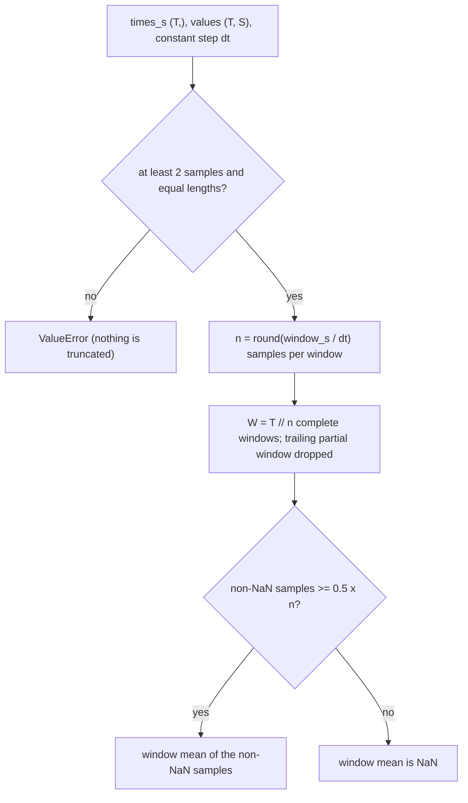
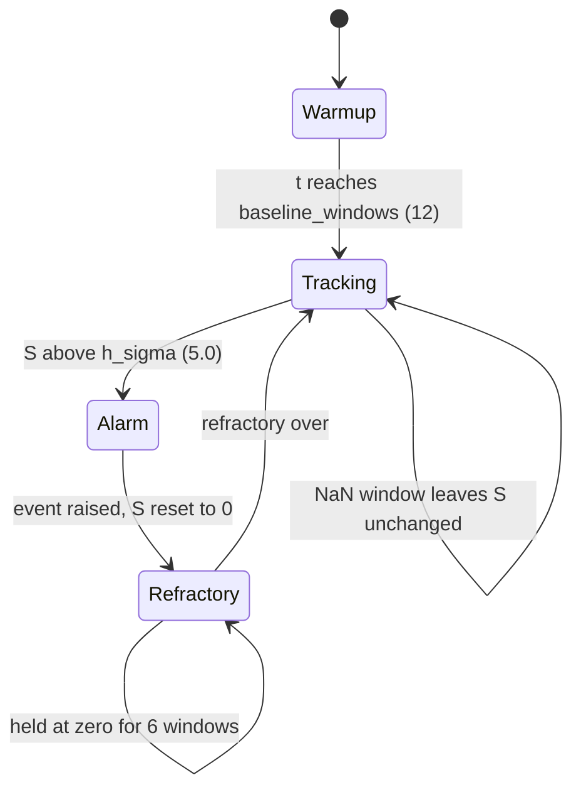
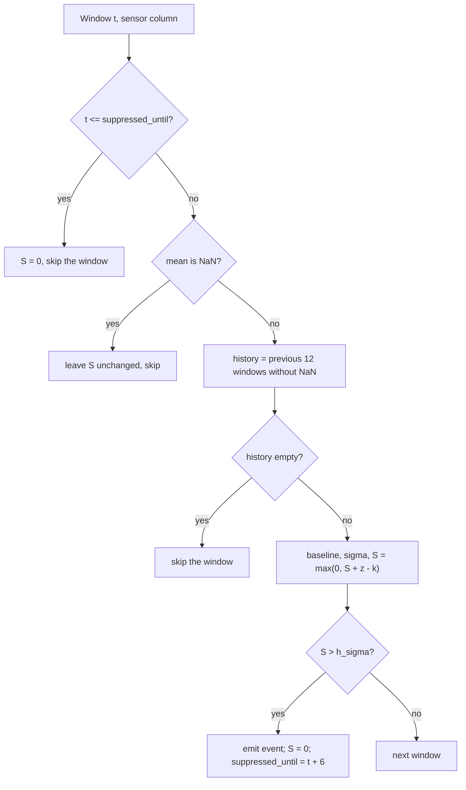

# Averaging and event detection

How raw 10 s samples become 10-minute window statistics, and how a sustained rise of one methane
sensor above its own recent background is flagged. Modules `plumetrace.engineering.averaging` and
`plumetrace.engineering.detection`. Data flow context: [PHYSICS_PIPELINE.md](PHYSICS_PIPELINE.md).
Contract reference and constants: [ENGINEERING.md](ENGINEERING.md) sections "Averaging" and "Event
detection".

## 1. Purpose and scope

Averaging: the plume model predicts roughly 10-minute mean concentrations, so samples are averaged
into complete windows before they are compared with it. Single samples carry turbulent noise the
model does not describe.

Detection: tells the rest of the system that **something changed** on a sensor. It does not decide
leak versus sensor fault (triage's job, later phase), and it does not locate or size the source
(that is [INVERSION.md](INVERSION.md)). It never calls the inversion and the inversion never calls
it.

## 2. Averaging

*Figure 1. `window_means`: complete windows only, with a 50 % coverage rule per sensor.*

All window functions share one grid: window `k` covers `[t0 + k window_s, t0 + (k + 1) window_s)`
with `t0 = times_s[0]`, `window_s = WINDOW_S = 600`. A series shorter than one window returns empty
arrays of shape `(0,)` and `(0, S)`. Values: `WINDOW_S` = 600 s, `CALM_WIND_M_S` = 1.0 m/s and
`MIN_COVERAGE` = 0.5 are Phase 2 Task 6 values.

| Function | Returns | Equation or rule | Notes |
|---|---|---|---|
| `window_means(times_s, values)` | `(starts (W,), means (W, S))` | mean of non-NaN samples | 29 valid of 60 gives NaN; exactly 30 of 60 is kept (checked) |
| `circular_mean_deg(dirs)` | one angle in `[0, 360)` | `atan2(sum sin, sum cos)` | 359 and 1 give 0.0, not 180; empty input raises |
| `window_wind(times_s, speed, from_deg)` | `(mean speed (W,), circular mean direction (W,))` | arithmetic mean and vector mean | no NaN coverage rule |
| `window_direction_sd_deg(times_s, from_deg)` | `(W,)` degrees | `degrees(sqrt(-2 ln R))` | see below |
| `window_mode_class(classes, steps_per_window, n_windows)` | list of `W` classes | most frequent class | tie goes to the alphabetically first class |
| `is_calm(speed_m_s)` | bool | `speed < 1 m/s` | the plume formula divides by speed |

### Circular statistics: why not the plain mean

Wind direction wraps at 360 degrees. The plain mean of 359 and 1 degrees is 180, the opposite
direction. The vector mean averages unit vectors and returns 0. The same reasoning applies to the
spread.

`window_direction_sd_deg` computes `R`, the mean resultant length of the unit vectors in the window
(`R = mean(cos(direction - circular mean))`, clipped to `[0, 1]`), and returns
`sd = degrees(sqrt(-2 ln R))`. `R = 1` for a constant direction, so `sd` is exactly 0.0. A window
that alternates between 350 and 10 degrees gives 10.02556 degrees (checked). A window whose
directions cancel exactly (`R = 0`) gives infinity; `InversionInput` rejects an infinite spread.
The result is NaN exactly where `window_wind` is NaN (a window with any missing direction). This is
the measured input of the plume's `dir_sd_deg` option ([DISPERSION.md](DISPERSION.md) section 6).

### `window_mode_class`

Window `k` is `classes[k * n : (k + 1) * n]`. The benchmark runner and the simulator export
delegate to it. Checked example: `[D, E, E, D]` with 2 steps per window gives `[D, D]` (each window
is a tie and the alphabetically first class wins). A requested window with no steps raises
`ValueError`; `n_windows = 0` gives an empty list.

### Failure behaviour (tests: `test_averaging.py`, `test_averaging_edges.py`, `test_window_mode_class.py`)

- Fewer than two samples, or a `values`, `speed_m_s` or `from_deg` whose length differs from
  `times_s` (longer or shorter): `ValueError`. Nothing is truncated.
- A series shorter than one window: empty results, not an error.
- NaN is "missing", never an error.

## 3. Event detection

`detect_events(window_start_s, means_ppm, sensors, site_center_xy, wind_from_deg,
config=DetectionConfig())` returns frozen `DetectionEvent`s sorted by `(window_index, sensor_id)`.
`means_ppm` holds **absolute** window means (not above background) of shape `(W, S)`.

### What runs for one sensor

For each window `t` from `baseline_windows` on:

1. `baseline` = median of the previous `baseline_windows` non-NaN means.
2. `sigma = max(1.4826 x MAD, sigma_floor_ppm)`, where `MAD` is the median absolute deviation of
   those means about the baseline. The factor 1.4826 turns the MAD into a normal-distribution
   sigma.
3. `S = max(0, S + (x - baseline) / sigma - k_sigma)`: the one-sided CUSUM, in sigmas.
4. If `S > h_sigma`, raise an event, reset `S` to 0 and hold the sensor for `refractory_windows`.

*Figure 2. States of one sensor column in `_cusum_column`. `z` is `(x - baseline) / sigma`; `k` is
`k_sigma`. Warmup windows are never tested.*

*Figure 3. The per-window decision, in the order the code takes it.*

| Parameter (`DetectionConfig`) | Default | Meaning |
|---|---|---|
| `baseline_windows` | 12 | windows (2 h) in the rolling baseline |
| `k_sigma` | 0.5 | allowance per window; rises smaller than 0.5 sigma never accumulate |
| `h_sigma` | 5.0 | decision threshold on `S`, in sigmas |
| `sigma_floor_ppm` | 0.1 | lower bound of sigma, so a flat history cannot give huge scores |
| `refractory_windows` | 6 | windows held at zero after an event (one event per episode) |
| `downwind_half_angle_deg` | 60.0 | half width of the downwind sector |

The defaults are Phase 2 Task 7 values: project choices, not published constants.

Why CUSUM: a step of a few sigma crosses `h_sigma` in one or two windows, and a slow drift too
small for a per-window threshold still accumulates `(drift - k_sigma)` per window until it crosses.
The rolling median baseline follows slow background changes and ignores a few outliers.

### Worked example

Sixteen windows (indices 0 to 15) alternating 1.90 (even index) and 2.00 ppm (odd index), baseline
1.95 and MAD sigma 0.074 so the 0.1 ppm floor applies, then three windows (indices 16 to 18) of
2.30 ppm. One throwaway run of the pure
algorithm:

| Window | Mean (ppm) | Baseline (ppm) | sigma (ppm) | `S` after the window |
|---|---|---|---|---|
| 15 | 2.00 | 1.95 | 0.1 | 0.0 |
| 16 | 2.30 | 1.95 | 0.1 | 3.0 |
| 17 | 2.30 | 2.00 | 0.1 | 5.5 |

Window 16: `(2.30 - 1.95) / 0.1 - 0.5 = 3.0`, below 5. Window 17: the baseline has moved to 2.00
because one 2.30 now sits in the history, `(2.30 - 2.00) / 0.1 - 0.5 = 2.5`, so `S = 3.0 + 2.5 = 5.5`,
above 5: one `DetectionEvent` at window 17 (`window_start_s` 10 200 s) with `mean_ppm` 2.3,
`baseline_ppm` 2.0 and `cusum` 5.5. The same series with a 3.36 ppm step (the 36 kg/h example of
[PHYSICS_PIPELINE.md](PHYSICS_PIPELINE.md)) gives `S` of about 33 in the first window.

The baseline is rolling, so a rise that lasts longer than the baseline becomes the new baseline and
`S` stops growing. Detection flags the start of an episode; it does not follow it.

### The downwind flag

`downwind_of_site` is true when the sensor lies in the sector the plume of a source at the site
centre would cover. With `dx, dy` the sensor offset from `site_center_xy`,
`bearing = degrees(atan2(dx, dy)) mod 360` and the plume travel direction
`(wind_from_deg + 180) mod 360`, the flag is `smallest angular difference <= downwind_half_angle_deg`
(inclusive). A NaN wind direction, or a sensor exactly at the centre, has no bearing and gives
false.

Example for a site centred at (100, 75) m (the centre of the 200 m x 150 m site bounds) and sensor
AT-103 at (195, 5): its bearing from the centre is 126.4 degrees.

| Wind from (deg) | Travel toward (deg) | Difference (deg) | `downwind_of_site` |
|---|---|---|---|
| 270 | 90 | 36.4 | true |
| 0 | 180 | 53.6 | true |
| 90 | 270 | 143.6 | false |
| 180 | 0 | 126.4 | false |

The flag is stored on the event for later stages. It is computed per window from the window-mean
direction and does not enter the CUSUM, so it never changes whether an event is raised.

### Measured behaviour and limits

Measured in the planner prototype (same algorithm and defaults; STATUS task 2.7): 0 false alarms
over 20 seeds x 2 days x 8 sensors of Gaussian noise (sigma 0.05 ppm around 1.95 ppm); a +2 ppm
step caught at its first window; a +0.02 ppm/window drift caught at window 63 (drift began at 50).
The tests assert less: on seed 7 no alarm on noise, a step event within windows 100 to 102, and the
drift flagged by window 80. There is **no numeric false-alarm-rate target**: a disclosed deviation from
design section 5.1b, accepted at Gate 2 (`docs/superpowers/plans/STATUS.md`, Owner decisions log).

- The first `baseline_windows` windows are never tested. A series with `W <= baseline_windows`
  gives no events.
- During the refractory hold and while the history has no data, nothing is tested.
- A sensor whose history is flat has a MAD of zero, so the 0.1 ppm floor sets sigma. Sensors with
  noise well below the floor are less sensitive than they could be; sensors noisier than the floor
  are not penalised by it.
- The detector reads absolute means. A slow drift of a real sensor (faults) looks like a rise; fault
  detection is not here.
- `ValueError` for a `means_ppm` that is not `(W, S)` with `S` sensors, window or wind arrays of the
  wrong length, `baseline_windows < 1` or a non-positive `sigma_floor_ppm`.

## 4. Tuning knobs

Raise `h_sigma` or `k_sigma` for fewer false alarms and slower or smaller-rise misses; lengthen
`baseline_windows` for a steadier baseline that follows real background change more slowly; raise
`refractory_windows` to merge nearby episodes into one event. All are fields of the frozen
`DetectionConfig`; the defaults are what the simulator uses. Changing a default changes the
simulator's detected events and therefore the replay files; regenerate and review them.

## 5. Testing and evidence

`test_averaging.py` (complete windows with the partial tail dropped, the NaN coverage rule with 70 %
missing NaN and 50 % kept, circular mean across north, window wind, calm threshold),
`test_averaging_edges.py` (short series, length mismatches, empty circular mean),
`test_window_mode_class.py` (equals the old per-slice rule, ties, partial last window),
`test_meander.py` (the direction spread), `test_detection.py` (no false alarms on noise, one prompt
event for a step, a slow drift, NaN dropout, the downwind flag) and `test_detection_edges.py` (short
or empty series, all-NaN sensor, step after a gap, ordering, refractory hold, inclusive sector edge
and wrap-around, NaN wind, sensor at the centre, flat history, shape and config errors). Run from
`app/`: `uv run pytest backend/tests/engineering -q`. `test_properties.py` checks that the circular
mean rotates with the data.

## 6. How to extend

- A new window statistic uses `_samples_per_window` so it shares the validation and the grid.
- Keep detection independent of the inversion. If a later stage needs a different baseline, add it
  beside this one and keep the default numbers unchanged.
- Any new parameter goes into `DetectionConfig` (frozen) with a default, a row in the table above
  and a test.

## 7. Changelog

- 2026-11-15: page created (documentation pass for Phase 2).
