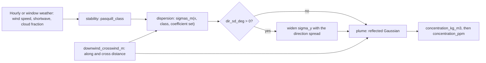
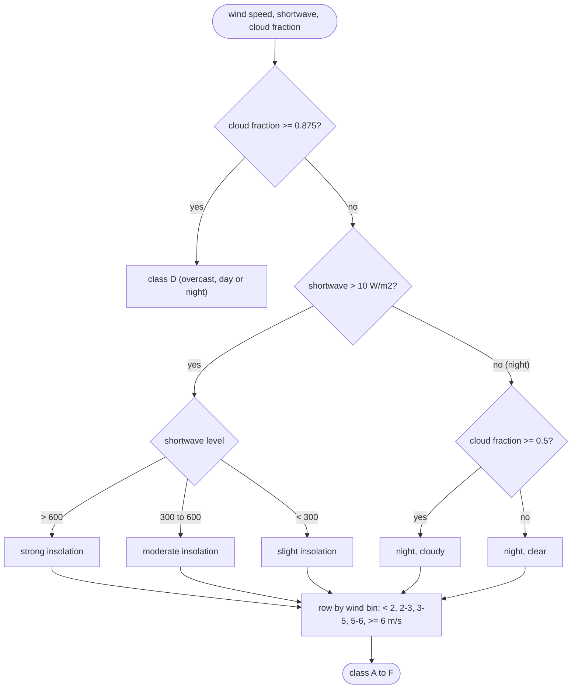
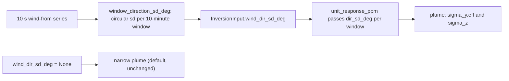

# Dispersion and the Gaussian plume

How PlumeTrace predicts the methane a sensor reads from a leak of a given rate: the stability
class, the horizontal and vertical spread of the plume, the Gaussian plume formula with ground
reflection, the optional wind-meander widening, and the replay plume grid. Modules
`plumetrace.engineering.stability`, `dispersion`, `plume`, `plume_field` (and `geometry`).

This is a **simplified Gaussian plume model on a simulated station**. It is the forward model of
the source inversion ([INVERSION.md](INVERSION.md)) and, with other settings, of the truth model
([TRUTH_MODEL.md](TRUTH_MODEL.md)). The constants and the per-class coefficient tables are in
[ENGINEERING.md](ENGINEERING.md) (sections "Stability", "Dispersion coefficients" and "Gaussian
plume"); this page explains how they fit together. The coordinate and wind convention is in
[PHYSICS_PIPELINE.md](PHYSICS_PIPELINE.md) section 4.

Citation disclosure: every coefficient, threshold source and formula source named here is copied
from the code comments and the project plan. None has been checked against the primary
publication yet (owner action before the Phase 7 release gate).

## 1. Purpose and scope

Does: turn wind speed, wind direction, stability class, source position and rate into a
concentration above background at any receptor, in kg/m3 or ppm.

Does not: model plume rise, buildings, terrain, chemistry or deposition; use any height-dependent
wind profile; handle calm wind (below 1 m/s the caller skips the window).

## 2. How it works



*Figure 1. From weather to a concentration. The stability class picks the row of the coefficient
table; the distance picks the spread; the optional direction spread widens the horizontal spread
before the plume formula.*

## 3. Stability class (`stability.pasquill_class`)

`pasquill_class(wind_speed_m_s, shortwave_w_m2, cloud_fraction)` returns a `StabilityClass`
(`A` very unstable to `F` moderately stable) from lookup tables. The scheme is Pasquill-Gifford-
Turner, Table 1-1 of Turner (1994), *Workbook of Atmospheric Dispersion Estimates*, 2nd ed., as
cited in the code. The W/m2 and cloud thresholds are project choices, not Turner's values.



*Figure 2. The decision in `pasquill_class`. The full 5 x 5 table is in
[ENGINEERING.md](ENGINEERING.md) section "Stability".*

Examples from the pure function:

| Wind (m/s) | Shortwave (W/m2) | Cloud | Class | Why |
|---|---|---|---|---|
| 1.5 | 700 | 0.1 | A | day, strong insolation, wind below 2 |
| 2.5 | 400 | 0.2 | B | day, moderate, wind 2 to 3 |
| 4 | 0 | 0.1 | E | night, clear, wind 3 to 5 |
| 4 | 0 | 0.9 | D | overcast: always D |
| 1.5 | 0 | 0.2 | F | night, clear, wind below 2 |
| 7 | 500 | 0.3 | D | day, moderate, wind 6 or more |

Split cells of the classic table (for example A-B) resolve to the **more stable** letter. A more
stable class gives a narrower plume and a higher predicted concentration at a given distance; in the
inversion that makes the inferred rate lower. Detection never uses the plume model. Boundaries are inclusive on the lower edge of each wind
bin and the moderate band includes both 300 and 600 W/m2 (tests: `test_stability.py`).

## 4. Spreads (`dispersion.sigmas_m`)

`sigmas_m(x_m, stability, coeff)` returns `(sigma_y_m, sigma_z_m)` for an array of downwind
distances. Steps: clip `x` to `[X_MIN_M, X_MAX_M]` = `[10, 1000]` m, evaluate the coefficient set,
floor both results at `SIGMA_MIN_M` = 0.5 m.

| Set (`CoefficientSet`) | Form (x in m, sigma in m) | Source named in the code |
|---|---|---|
| `BRIGGS_RURAL` | `sigma = k x (1 + b x)^p`, one `(k, b, p)` per class and axis | Briggs 1973, open country; Seinfeld & Pandis, *Atmospheric Chemistry and Physics*, 3rd ed., Table 18.3 |
| `PG_MARTIN` | `sigma_y = a x_km^0.894`, `sigma_z = c x_km^d + f`, `x_km = x / 1000` | Martin 1976 fit of the Pasquill-Gifford curves for x below 1 km; Cooper & Alley, *Air Pollution Control*, Table 20-1 |

The per-class numbers are in [ENGINEERING.md](ENGINEERING.md) section "Dispersion coefficients".
The inversion uses `BRIGGS_RURAL`. The truth model uses `PG_MARTIN`, so the two disagree on purpose.

Worked values (class D, from the pure function):

| x (m) | Briggs `sigma_y`, `sigma_z` (m) | Martin `sigma_y`, `sigma_z` (m) |
|---|---|---|
| 100 | 7.96, 5.60 | 8.68, 4.55 |
| 300 | 23.65, 14.95 | 23.18, 12.17 |

At 300 m the Martin `sigma_z` is about 19 % below the Briggs one. That difference is the first of
the "mismatch" ingredients the benchmark measures ([BENCHMARK.md](BENCHMARK.md)).

Limits (tests: `test_dispersion.py`):

- The classic fits are extrapolated below 100 m. The distance clip means the value within 10 m of
  the source equals the 10 m value, and beyond 1 km the spread stops growing.
- The Martin class D `sigma_z` is `33.2 x_km^0.725 - 1.7`, which falls below the 0.5 m floor under
  about 24 m, so the floor applies there.
- Spreads grow monotonically with distance for every class and both sets (tested).
- No input check: `sigmas_m` does not validate its input. A negative or NaN distance is the caller's
  error.

## 5. The Gaussian plume (`plume.concentration_kg_m3`)

```
C = Q / (2 pi u sy sz) * exp(-y^2 / (2 sy^2)) * [ exp(-(z - H)^2 / (2 sz^2)) + exp(-(z + H)^2 / (2 sz^2)) ]
```

| Symbol | Meaning | Unit | Code name |
|---|---|---|---|
| `Q` | emission rate, >= 0 | kg/s | `rate_kg_s` |
| `u` | wind speed, > 0 (10 m wind used at all heights) | m/s | `wind_speed_m_s` |
| `sy`, `sz` | horizontal and vertical spread at the downwind distance | m | `sigmas_m` |
| `y` | crosswind distance of the receptor | m | `cross` |
| `z` | receptor height | m | `receptors[:, 2]` |
| `H` | source height | m | `source.z_m` |
| `C` | concentration above background | kg/m3 | return value |

Reference as cited in the code: Turner, *Workbook of Atmospheric Dispersion Estimates*, 2nd ed.,
1994 (eq. 1-1 in the property tests). The second exponential is the image source at `-H`: total
ground reflection.

`C` is zero wherever `along <= 0` (a receptor upwind of, or level with, the source). `along` and
`cross` come from `downwind_crosswind_m` ([PHYSICS_PIPELINE.md](PHYSICS_PIPELINE.md) section 4).
`concentration_ppm` converts with `units.kg_m3_to_ppm` using the air temperature and pressure.
Errors: `ValueError` for `wind_speed_m_s <= 0`, `rate_kg_s < 0` or a negative or non-finite
`dir_sd_deg`.

### Worked example

36 kg/h (`Q = 0.01 kg/s`), source and receptor at 2 m, receptor 300 m downwind on the axis
(`y = 0`), `u` = 4 m/s, class D, Briggs rural, 290 K, 98 900 Pa:

1. `sy` = 23.648 m, `sz` = 14.948 m.
2. Vertical bracket: `exp(0) + exp(-(2 + 2)^2 / (2 x 14.948^2))` = 1 + 0.9648 = 1.9648.
3. `C = 0.01 / (2 pi x 4 x 23.648 x 14.948) x 1.9648` = 2.21e-6 kg/m3.
4. To ppm: `C x R T / (P M) x 1e6` with `R = 8.314462618`, `T` = 290, `P` = 98 900,
   `M` = 0.016043: **3.36 ppm** above background.

With Martin coefficients the same case gives **4.17 ppm**, about 24 % higher. The code returns 3.36089
and 4.17495 ppm (one throwaway run); `test_truth_model.py` asserts the Martin result differs from
the Briggs one by more than 10 %.

### Properties that hold (tests: `test_plume.py`, `test_properties.py`)

- Linear in rate: doubling `Q` doubles `C`.
- Inversely proportional to wind speed: `C u` is the same for any speed.
- Zero upwind, exactly.
- Mirror symmetric in the crosswind offset.
- Unchanged when source, receptor and wind direction rotate together.
- A vectorised call equals a loop over single receptors.

Linearity in `Q` is what lets the inversion compute one unit response per candidate and window and
scale it by every rate on the grid ([INVERSION.md](INVERSION.md)).

## 6. Wind meander option (`dir_sd_deg`)

The default plume is narrow and lies along the mean wind direction. Real wind wanders inside a
10-minute window, so a window-mean plume is the narrow plume smeared sideways. Both concentration
functions take a keyword-only `dir_sd_deg` (degrees, default 0.0). With `dir_sd_deg > 0`:

```
sigma_y,eff^2 = sigma_y^2 + (x_c * radians(dir_sd_deg))^2        sigma_z unchanged
```

`x_c` is the along-wind distance clipped to 10 to 1000 m exactly as `sigmas_m` clips it.



*Figure 3. Where the direction spread comes from and where it is used. It is always measured
from the data, never copied from the truth model's setting.*

This is a **project derivation, not a published formula.** A plume axis that wanders with direction
standard deviation `s` (radians) is displaced by about `x s` at distance `x` (small angle), so the
displacement variance `(x s)^2` adds to the plume's own `sigma_y^2`. The small-angle step is the
limit: at 20 degrees `tan` differs from the angle by about 4 %, so the option is meant for spreads
of the order of 10 degrees.

What it does to the numbers (class D, Briggs, from the pure function):

| x (m) | `sigma_y` (m) | `sigma_y,eff` for 10 degrees (m) | Centreline factor `sigma_y / sigma_y,eff` |
|---|---|---|---|
| 100 | 7.96 | 19.18 | 0.415 |
| 300 | 23.65 | 57.45 | 0.412 |

The 36 kg/h example above falls from 3.36 ppm to 1.38 ppm on the axis at 300 m (Martin: 4.17 to
1.69 ppm). The crosswind integral of `C` is unchanged (a Gaussian in `y` integrates to the same
value for any `sigma_y`): the same mass is spread over more width. Nothing changes for
`along <= 0`. With exactly `dir_sd_deg = 0.0` the original code path runs with no extra arithmetic,
so results are bit-identical to the version without the option (`test_meander.py`).

The effect on the benchmark is measured in [BENCHMARK.md](BENCHMARK.md). It is a gain on a
simulated station whose own meander is built from the same kind of process, so it is an optimistic
result, not evidence of real-world accuracy.

## 7. Plume grid for the replay (`plume_field`)

`ground_grid_ppm(sources, t_s, wind_speed_m_s, wind_from_deg, stability, coeff, temp_k, pressure_pa,
grid)` sums `concentration_ppm` over the sources active at `t_s` (`start_s <= t_s < end_s`) on a
regular `GridSpec` (default 40 x 30 cells of 5 m at 1.5 m height). It is linear in every rate and
additive over sources, and it has no building wake. `encode_log_u8` stores the grid as one byte per
cell:

```
byte = 0                                            if ppm < 0.1
byte = clip(round(1 + 254 log10(ppm / 0.1) / 4), 1, 255)   otherwise
```

so 0.1 to 1000 ppm maps to bytes 1 to 255. For example 10 ppm encodes to byte 128 and decodes to
10.0 ppm; 1 ppm encodes to byte 64 and decodes to about 0.98 ppm. A value inside the range comes
back within a factor of 1.018. `PPM_MIN = 0.1` and `DECADES = 4.0` are display values, not
published constants. The file format that uses it is in [REPLAY.md](REPLAY.md). The grid is the
model's computed plume, not the 3D scene's drawn plume.

## 8. Tuning knobs and limits

| Knob | Where | Default | Effect |
|---|---|---|---|
| Coefficient set | `coeff` argument | `BRIGGS_RURAL` in the inversion, `PG_MARTIN` in the truth model | changes `sigma_z` by about 19 % at 300 m, class D |
| Distance clip | `X_MIN_M`, `X_MAX_M` | 10 m, 1000 m | value flat inside 10 m, spread stops growing beyond 1 km |
| Spread floor | `SIGMA_MIN_M` | 0.5 m | avoids division by a near-zero spread |
| Direction spread | `dir_sd_deg` | 0.0 | widens `sigma_y`; 0.0 is bit-identical to no option |
| Thresholds | `stability.py` constants | 10, 300, 600 W/m2; 0.5, 0.875 | project choices |

## 9. Testing and evidence

`test_stability.py` (every table cell, overcast, bin boundaries), `test_dispersion.py` (hand
calculations, floor, clipping, monotone growth, the 300 m difference between sets), `test_plume.py`
(closed form, linearity, symmetry, zero upwind, convention, near-source clipping, ground
reflection, validation, vectorised equals loop), `test_meander.py` (the direction spread and its
effect), `test_plume_field.py`, `test_plume_field_edges.py` and `test_plume_field_properties.py`
(grid and encoding), `test_properties.py` (Hypothesis laws). Run from `app/`:
`uv run pytest backend/tests/engineering -q`.

## 10. How to extend

- A new coefficient set: add a member to `CoefficientSet`, a table of the same keys as the existing
  ones, a branch in `sigmas_m`, a source comment, and a monotone-growth test.
- Keep the floor and the clip in `sigmas_m`; the plume and the meander option rely on them.
- Anything that changes the default numbers changes the inversion and the published benchmark.
  The default path must stay bit-identical unless the owner decides otherwise.
- Do not add plume rise, a wind profile or a time-varying source here without a design change
  (design section 5).

## 11. Changelog

- 2026-11-15: page created (documentation pass for Phase 2).
