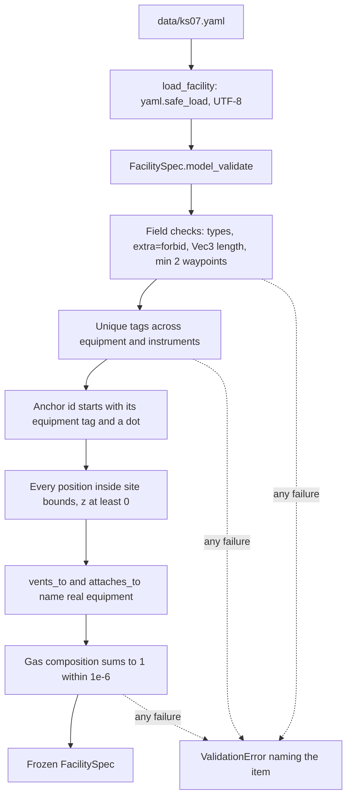
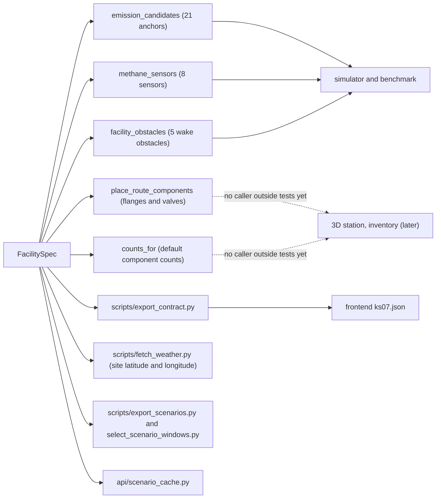
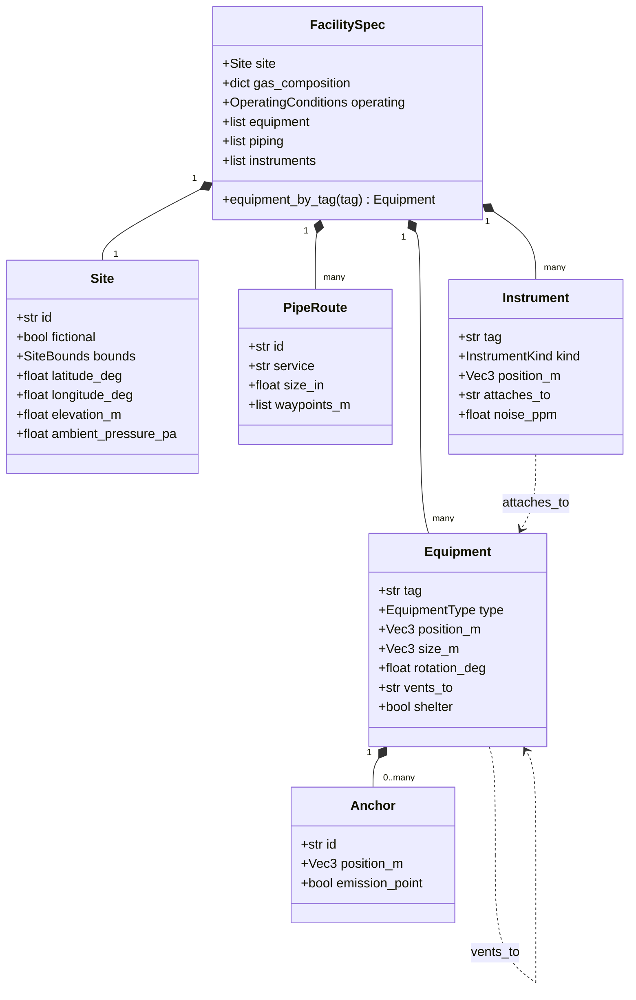

# Facility model (Station KS-07)

## Purpose and scope

`plumetrace.facility` turns one hand-written YAML file, `data/ks07.yaml`, into a validated,
immutable Python object (`FacilitySpec`). Everything else that needs the station layout asks that
object: the simulator, the inversion benchmark, the weather fetcher and the frontend contract.

Station KS-07 is **fictional and simulated**. Its coordinates, equipment and gas composition are
an authored model, not a real site. Its latitude and longitude are used only to request real
public weather data. See [SIMULATOR.md](SIMULATOR.md) for the equipment tables, the instruments
and the scenarios that use them, and `docs/superpowers/specs/2026-11-12-plumetrace-design.md`
section 4 for the design.

This page explains the model, the id scheme, the validation, the derived lists (candidates,
sensors, obstacles, components) and how to change the spec safely. It describes Phase 1 Task 6
plus two later additions that live in the same package (`obstacles.py` and the use of the spec by
the simulator).

Coordinates for every position: metres, x = east, y = north, z = up, origin = south-west fence
corner. The site is 200 m by 150 m (`bounds: x 0..200, y 0..150`).

## How it works

### From YAML to a validated spec



Caption: the loader parses YAML, Pydantic checks each field, then five cross-reference checks run
in a fixed order inside one `model_validator`. The first failure stops loading.

The five checks live in `spec.py` as small functions (`_check_unique_tags`,
`_check_anchor_ownership`, `_check_bounds`, `_check_references`, `_check_composition`) called by
`FacilitySpec._validate`. Each error message names the offending tag, anchor id or route id, for
example `duplicate tag K-202` or `K-202 vents_to unknown tag VS-999`. The order matters only for
which error you see first when several problems exist.

### Who uses the spec



Caption: candidates, sensors and obstacles feed the simulator and the benchmark; the exporter
writes the frontend JSON; the weather fetcher, the scenario scripts and the API scenario cache
read the spec directly; component placement and counts are implemented and tested but have no
production caller yet.

The dependency rule from `repo-structure`: `facility` imports only `plumetrace.engineering`
(`Candidate`, `Point3`, `Sensor`, `WakeObstacle`). `engineering` never imports `facility`, which
is why `facility_obstacles` lives here and not in the engineering core.

### The data model (`types.py`, `spec.py`)



Caption: a spec owns the site, equipment (each with anchors), pipe routes and instruments; two
string references (`vents_to`, `attaches_to`) point at equipment tags.

Every model derives from `_Frozen` (`extra="forbid"`, `frozen=True`): a misspelled key such as
`vent_to` is an error, and a loaded spec cannot change. `OperatingConditions` and `SiteBounds`
complete the model and are omitted from the diagram for space.

## Id scheme

| Kind | Pattern | Examples (real values) | Rule |
|---|---|---|---|
| Equipment tag | `<ISA-style letters>-<number>` | `K-202`, `VS-250`, `TK-401`, `PIG-101`, `CR-901` | unique across equipment and instruments |
| Anchor id | `<equipment tag>.<name>` | `K-202.packing`, `VS-250.tip`, `TK-401.thief_hatch` | must start with its own equipment tag and a dot |
| Instrument tag | `AT-1xx` methane, `MET-01` mast, `FT-`, `TT-`, `TE-`, `PT-` | `AT-104`, `FT-250`, `TT-202P`, `TE-601` | unique with equipment tags |
| Pipe route id | `R-<number>` | `R-250` (service `vent`), `R-150` (service `gas`) | unique by convention; not checked for uniqueness by the validator |

Anchor names used in `ks07.yaml`: `door`, `psv`, `packing`, `engine_exhaust`, `tip`, `still_vent`,
`skid`, `thief_hatch`, `meter`. The anchor id is the identifier downstream: the
inversion's candidate id and the simulator's scenario sources use the same string, and later
phases (3D highlight, agent tool results) are meant to reuse it.

`emission_point: true` marks an anchor as a place the inversion may pick as the source. All 21
anchors in KS-07 are emission points.

## Module reference

| File | What it does | Why it is separate |
|---|---|---|
| `types.py` | `Vec3`, `EquipmentType` (15 values), `InstrumentKind` (6 values), `Anchor`, `Equipment`, `PipeRoute`, `Instrument`, `SiteBounds` (with `contains`), `Site`, `OperatingConditions` | Pure value types, no logic except `SiteBounds.contains` |
| `spec.py` | `FacilitySpec`, the five cross-reference checks, `equipment_by_tag` | One responsibility: whole-spec consistency |
| `loader.py` | `load_facility(path=DEFAULT_SPEC_PATH)` reads UTF-8, `yaml.safe_load`, validates | The only file that touches the file system for the spec |
| `candidates.py` | `emission_candidates(spec)` and `methane_sensors(spec)` | Convert spec rows to the engineering types the inversion uses |
| `obstacles.py` | `facility_obstacles(spec)` and `SHELTER_HEIGHT_M = 6.0` | Wake obstacles for the truth model; lives here because `engineering` must not import `facility` |
| `components.py` | `place_route_components`, `PlacedComponent`, `ComponentCounts`, `CountsTable`, `load_component_counts`, `counts_for`, `FLANGE_SPACING_M = 12.0` | Procedural flange/valve placement and the cited count table |
| `data/ks07.yaml` | The station: 24 equipment items, 15 routes, 18 instruments | Single source of truth for layout |
| `data/component_counts.yaml` | Default component counts per equipment class, with citation | Data, not code |

### Behaviour of the derived lists

- `emission_candidates(spec)` returns one `Candidate(id, Point3(*position_m))` per anchor with
  `emission_point` true, sorted by anchor id (plain string order). The first six ids are
  `FG-501.skid`, `FL-601.tip`, `K-201.engine_exhaust`, `K-201.packing`, `K-202.engine_exhaust`,
  `K-202.packing`.
- `methane_sensors(spec)` returns one `Sensor(id, Point3, noise_ppm)` per instrument of kind
  `methane_point`, sorted by tag. A methane sensor with no `noise_ppm` raises `ValueError`.
- `facility_obstacles(spec)` lists every `building` and every equipment with `shelter: true`, in
  spec order. Half width is `max(size_x, size_y) / 2`; the centre is the footprint centre; the
  rotation is ignored (a conservative square). A building uses its own height (`size_z`); a shelter
  uses `SHELTER_HEIGHT_M` (6 m). A building that is also flagged as a shelter appears once, as a
  building.
- `place_route_components(spec, spacing_m=12.0)` places a flange at every waypoint and at every
  multiple of the spacing measured along the polyline, and a valve at the first and last waypoint.
  Points closer than 1e-6 m merge (the earlier one is kept). Output is ordered along each route,
  flange before valve at equal distance, route by route in spec order. It is deterministic: two
  calls give equal lists.
- `counts_for(spec, table)` maps each equipment type to a class through `equipment_type_map`;
  a type mapped to `null` gets all zeros.

## Worked example

Equipment `K-202` in `ks07.yaml`:

```yaml
- {tag: K-202, type: recip_compressor, position_m: [75, 75, 0], rotation_deg: 0, size_m: [12, 4, 3],
   shelter: true, vents_to: VS-250,
   anchors: [{id: K-202.packing, position_m: [73, 75, 1.5], emission_point: true},
             {id: K-202.engine_exhaust, position_m: [80, 75, 6.0], emission_point: true}]}
```

Read it as: the compressor box is 12 m by 4 m by 3 m, centred at x 75, y 75 on the ground, so it
spans x 69 to 81. The rod-packing anchor `K-202.packing` sits 2 m west of the centre at 1.5 m
height, inside the box. Its packing vent is routed to `VS-250`, whose tip anchor `VS-250.tip` is at
`(85, 115, 12)`. Because `shelter: true`, `facility_obstacles` adds the obstacle
`WakeObstacle((75.0, 75.0), 6.0, 6.0)` (half width 6 m, height 6 m).

Sensor `AT-104` is `{kind: methane_point, position_m: [195, 75, 2.0], noise_ppm: 0.3}`, so
`methane_sensors` gives `Sensor("AT-104", Point3(195.0, 75.0, 2.0), 0.3)`. It is the fourth of the
eight sensors `AT-101` to `AT-108`.

Component placement on route `R-250` (the packing vent header, 2 inch, waypoints
`(73,57,2) (73,93,2) (73,105,2) (85,105,2) (85,115,1)`): the segment lengths are 36, 12, 12 and
about 10.05 m, so the cumulative distances are 0, 36, 48, 60 and 70.05 m. Flanges go at 0, 12, 24,
36, 48, 60 and 70.05 m (seven), valves at the two ends (two): nine components in total. The shorter
test route in `test_components.py`, a straight 24 m pipe, gives flanges at 0, 12 and 24 m and valves
at 0 and 24 m.

Numbers for the real spec (pinned by `test_loader.py`, `test_candidates.py`): 24 equipment items,
15 routes, 18 instruments (8 methane, 1 met mast, 3 flow, 3 temperature, 2 pressure, 1
thermocouple), 21 emission anchors. Six equipment items have no anchors (`E-231`, `E-232`,
`E-233`, `T-301`, `CR-901`, `MCC-902`).

## Gas, operating conditions and the component table

- Gas composition (mole fractions): CH4 0.930, C2H6 0.035, C3H8 0.008, nC4H10 0.002, CO2 0.010,
  N2 0.015. It is an illustrative pipeline-quality gas chosen by the owner at Gate 1 (2026-11-13),
  not taken from a cited analysis.
- Operating pressures are absolute (Pa), not gauge: suction 4,500,000 Pa, discharge 7,000,000 Pa.
  Gas temperature 300 K. Throughput 41,667 Sm3/h. Ambient pressure 98,900 Pa at 200 m elevation.
- `component_counts.yaml` carries default counts per equipment class and the citation the file
  itself gives (40 CFR Part 98, Subpart W, Table W-1B, Western U.S. column, CFR 2023 edition). The
  table describes production and gathering equipment and is used as a documented proxy for a
  transmission compressor station. The file notes that the numbers were transcribed and are not
  yet verified against the primary text; that check is an open owner action in
  [OWNER_ACTIONS.md](../OWNER_ACTIONS.md). This page does not restate any regulatory content.
- For KS-07 the table gives, for example, `compressors` = 73 valves, 179 connectors, 3 open-ended
  lines, 4 pressure relief valves, applied to each of `K-201`, `K-202`, `K-203` and `VRU-410`.

## Edge cases and failure modes

| Case | Result | Test |
|---|---|---|
| Duplicate tag | `duplicate tag K-202` | `test_validation.py::test_invalid_spec_names_the_item` |
| Anchor id with another tag (`K-999.packing` on `K-202`) | error names the anchor | same |
| Equipment at x = 250 (outside 0..100 in the fixture) | error names `K-202` | same |
| Instrument below ground (z = -1) | error names `AT-1` | same |
| Pipe waypoint outside bounds | error names route `R-1` | same |
| `vents_to` or `attaches_to` unknown | error names the unknown tag | same |
| Gas fractions sum to 0.99 | error contains the sum `0.99` | same |
| Misspelled field (`vent_to`) | `ValidationError` (`extra="forbid"`) | `test_validation.py::test_unknown_field_is_rejected` |
| Unknown tag lookup | `KeyError` naming the tag | `test_loader.py::test_unknown_tag_lookup_raises` |
| Non-ASCII text (`–`, `≈`, `°`) in YAML | loads on Windows (explicit UTF-8) | `test_loader.py::test_loader_reads_utf8` |
| Gas composition sums to 1 | within 1e-9 for KS-07 | `test_loader.py::test_gas_composition_sums_to_one` |
| Component map names an unknown class | error names the class | `test_components.py::test_unknown_class_in_map_is_rejected` |
| Waypoint on a spacing point | not duplicated | `test_components.py::test_bent_route_measures_distance_along_the_polyline` |
| Building flagged as shelter | listed once, building height | `test_obstacles_edges.py` |
| Rotated or taller building | rotation ignored; keeps its own height | `test_obstacles_edges.py` |

Known limits of the validator (by design of the code, not tested as failures): bounds checks test
equipment centres, anchors, instruments and waypoints, not the full extent of each equipment box;
route ids are not checked for uniqueness; `emission_point: false` anchors exist in the model but
the current spec has none.

## How to run

From `app/` (see [LOCAL_DEVELOPMENT.md](../LOCAL_DEVELOPMENT.md)):

```bash
cd app
uv run pytest -q backend/tests/facility            # 30 tests, no database needed
uv run python -c "from plumetrace.facility.loader import load_facility as f; s = f(); print(len(s.equipment), len(s.piping), len(s.instruments))"
```

The second command prints `24 15 18`.

## How to extend

Change the station (new equipment, a moved sensor, a new anchor):

1. Edit `app/backend/plumetrace/facility/data/ks07.yaml`. Keep the file UTF-8 with LF line endings.
2. Follow the id scheme: new anchors are `<equipment tag>.<name>`; keep every position inside the
   bounds.
3. If a new equipment type is needed, add it to `EquipmentType` in `types.py` and add the type to
   `equipment_type_map` in `component_counts.yaml` (a test requires the map to cover every type).
4. Update the pinned counts in `test_loader.py`, the id list in `test_candidates.py`, the obstacle
   list in `test_obstacles_edges.py` and the equipment count in `test_export_contract.py`, because
   those tests pin the real spec.
5. Regenerate the frontend files: `cd app && uv run python ../scripts/export_contract.py`, then
   `cd frontend && npm run gen:types` (see [CONTRACT.md](CONTRACT.md)). The `contract-drift` stage
   of `python scripts/ci_local.py --full` fails otherwise.
6. Changing the layout or the gas composition changes simulator output. The scenarios, replay files
   and benchmark depend on it, so check [SIMULATOR.md](SIMULATOR.md) and [REPLAY.md](REPLAY.md) and
   raise the change with the owner (a Gate 1 decision).
7. Update this page, [SIMULATOR.md](SIMULATOR.md) and `docs/WORK_LOG.md`.

Invariants to keep: the model stays immutable and rejects unknown fields; a broken spec fails with
a message that names the item; `facility` imports only `engineering`; the site stays labelled
fictional and simulated.

## Related

- Code: `app/backend/plumetrace/facility/`, tests `app/backend/tests/facility/`
- Pages: [SIMULATOR.md](SIMULATOR.md), [CONTRACT.md](CONTRACT.md), [ENGINEERING.md](ENGINEERING.md),
  [STRUCTURE.md](STRUCTURE.md)
