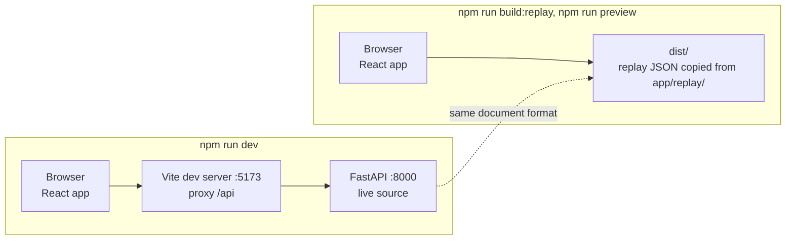
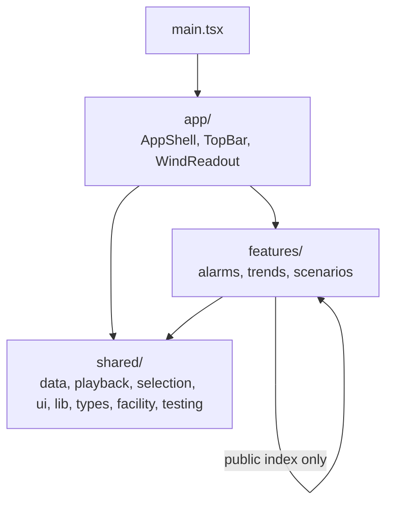
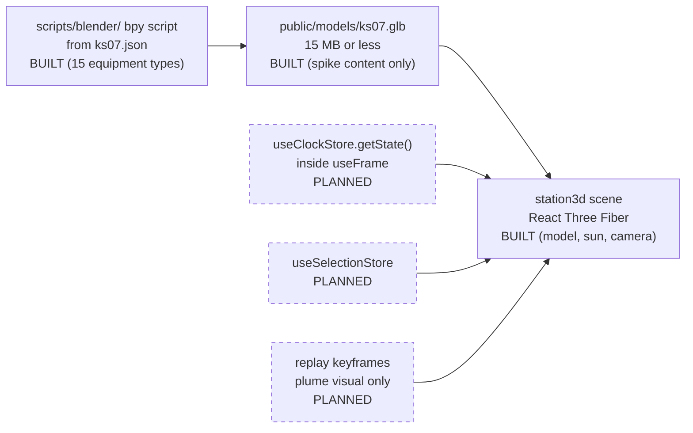
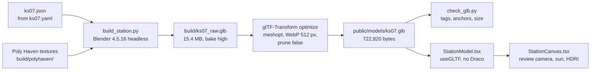

# Frontend

## Purpose

`app/frontend/` is the PlumeTrace control-room web app: React + TypeScript + Vite. As of Phase 4 Task 4
it has the design system, the data layer (live API or static replay) and the control-room panels:
top bar, alarms, station log, trends and playback bar. The station area shows the scenario load status and, since the Task 5 spike, a baked 3D model of
one skid (the full scene is Phase 4 Tasks 6 to 9, pending the owner's go). The data is the simulated station KS-07
(fictional); the weather in it is real. Design reference: section 9; visual rules: `.ux-profile.md`.

This page is the overview. The detail lives in four focused pages:

| Page | Covers |
|---|---|
| [DESIGN_SYSTEM.md](DESIGN_SYSTEM.md) | Tokens, contrast figures, type scale, shadcn edits, shared primitives, formatting helpers |
| [DATA_LAYER.md](DATA_LAYER.md) | `DataSource`, live and replay sources, error kinds, the three stores, the clock, the replay-bundle check |
| [UI_PANELS.md](UI_PANELS.md) | Layout, component tree, alarm rule, chart rules, keyboard map, binding display rules (R1 to R4) |
| [ACCESSIBILITY.md](ACCESSIBILITY.md) | What is implemented for keyboard and assistive technology, and the known gaps |

## Architecture

The two diagrams in this section are small on purpose: each shows one boundary (run modes, then
layers) and nothing else.



The same React code runs in two modes. In development it calls relative `/api/...` URLs that Vite
proxies to the local backend (live source). In the replay build it reads static JSON from `/replay/`
and the live-API code is not in the bundle. The frontend never connects to Supabase or OpenAI and
holds no secret. Nothing is deployed (rule 27); the replay build is built and previewed locally.

### Layers and dependency direction



`src/` may contain only `main.tsx`, `vite-env.d.ts`, `app/`, `features/`, `shared/` and `styles/`.
Shared code never imports a feature. A feature is used through its `index.ts` only (today
`features/trends` imports `visibleEvents` from `@/features/alarms`). `check_structure.py` enforces the
folders and the size limits.

## Stack and pinned versions

Exact versions are in `app/frontend/package.json` and `package-lock.json`; the full table is in
[LOCAL_DEVELOPMENT.md](../LOCAL_DEVELOPMENT.md#pinned-versions).

| Package | Version |
|---|---|
| react, react-dom | 19.3.1 |
| vite, @vitejs/plugin-react | 8.3.8, 6.3.0 |
| tailwindcss, @tailwindcss/vite | 4.3.5 |
| typescript | 6.0.3 (not 7.x: typescript-eslint 8.72.2 needs `<6.1`) |
| eslint, typescript-eslint | 10.14.0, 8.72.2 |
| vitest, @vitest/coverage-v8 | 5.1.0 (the two must match) |
| jsdom | 29.1.1 (Phase 1 plan pin note: 30 and later need Node 22.22 or newer) |
| @testing-library/react, dom, jest-dom | 16.3.3, 10.4.2, 7.0.1 |
| @fontsource/ibm-plex-sans, @fontsource/ibm-plex-mono | 5.3.0 |
| clsx, tailwind-merge, class-variance-authority | 2.1.1, 3.7.0, 0.7.1 |
| lucide-react, radix-ui | 1.72.0, 1.8.1 |
| zustand | 5.1.0 |
| uplot | 1.6.32 |
| shadcn CLI (run with `npx`, not installed) | 4.23.0 |

Node `>=22.13.0` (`engines` in `package.json`).

## Scripts

Run from `app/frontend/`.

| Script | What it does |
|---|---|
| `npm run copy:replay` | Copy `app/replay/` to `public/replay/` (git-ignored); runs before `dev`, `build` and `build:replay` |
| `npm run dev` | Vite dev server on `http://localhost:5173`; `npm run dev -- --mode replay` runs without the backend |
| `npm run build` | Type-check, then `vite build` into `dist/` (git-ignored); the live build |
| `npm run build:replay` | Copy replay files, type-check, `vite build --mode replay` (no live-API code) |
| `npm run check:replay-bundle` | `scripts/check-replay-bundle.mjs`: fails if a `dist/assets/*.js` file contains `/api/` or if none contains `/replay/scenarios` (the ReplaySource must really be in the bundle); prints `replay bundle OK` |
| `npm run preview` | Serve `dist/` locally |
| `npm run lint` | ESLint (typescript-eslint, react-hooks, react-refresh, jsdoc) |
| `npm run typecheck` | `tsc --noEmit` (strict, `noUncheckedIndexedAccess`) |
| `npm run test` | Vitest, one run |
| `npm run test:coverage` | Vitest with v8 coverage; thresholds lines 80, functions 80, branches 70, statements 80 |
| `npm run gen:types` | `json2ts` (json-schema-to-typescript 16.0.0): `contract.schema.json` to `contract.ts` (see Type contract) |

## Folder rules

`src/` may contain only `main.tsx`, `vite-env.d.ts`, `app/`, `features/`, `shared/` and `styles/`.
`check_structure.py` enforces it, together with the size limits (TS/TSX file at most 250 lines,
tests at most 400). A feature folder is used through its `index.ts` only. The full rules are in the
`frontend-structure` skill.

- `src/app/` holds `AppShell.tsx` (the top-level layout), `TopBar.tsx` and `WindReadout.tsx`.
  `scripts/` (next to `src/`) holds `check-replay-bundle.mjs`.
- `src/features/alarms/` (`AlarmList`, `AlarmRow`, `StationLog`, `visibleEvents`),
  `src/features/trends/` (`TrendsPanel`, `UPlotChart`, `chartData`, `chartOptions`, `chartTheme`,
  `cursorPlugin`) and `src/features/scenarios/` (`ScenarioPicker`, `ScenarioStatus`, `PlaybackBar`,
  `useScenarioBootstrap`, `usePlaybackKeys`).
- `src/shared/testing/setup.ts` is the Vitest setup file (jest-dom matchers, cleanup after each
  test); `replayFixture.ts` builds a valid replay for tests.
- `src/shared/data/`, `src/shared/playback/` and `src/shared/selection/` are the data layer (see
  Data layer); each has an `index.ts` that is its public API.
- `src/shared/lib/` holds `cn.ts` (class merging) and `format.ts` (units and time formatting).
- `src/shared/ui/` holds the shadcn primitives (lower-case file names, generated) and our own shared
  primitives `Panel.tsx` and `StatusBadge.tsx` (PascalCase).
- `src/shared/facility/ks07.json` and `src/shared/types/generated/` are generated (see Type
  contract).
- `src/styles/index.css` imports Tailwind and defines the design tokens.
- The `@/` alias points to `src/` (`tsconfig.json` `paths`, `vite.config.ts` `resolve.alias`).

## Design system

Summary only; the full page is [DESIGN_SYSTEM.md](DESIGN_SYSTEM.md). Everything lives in
`src/styles/index.css`; components use token classes (`bg-surface-1`, `text-text-2`,
`border-border-1`), never raw hex or `bg-[var(--x)]`. Four grey surfaces, 1 px borders instead of
shadows, colour reserved for meaning, one accent hue. IBM Plex Sans and IBM Plex Mono from npm
packages (no network font). shadcn components are mapped onto the same tokens (no second palette).
Rules that follow from the contrast numbers: `--text-3` only on surface-0 and never for a value, unit
or label an operator must read (the recorded rule; today's two exceptions, the disabled picker text
and the quiet chart strokes, are listed in DESIGN_SYSTEM.md); alarm state always has a marker and a word; `--ch4-*` and `--alarm-high` never stand in
for each other; white text on `--alarm-high` is 3.96:1, so no destructive button without a design
review.

## Data layer

Summary only; the full page is [DATA_LAYER.md](DATA_LAYER.md). Every feature gets scenario data
through one interface in `src/shared/data/`: `DataSource` with `listScenarios` and `loadScenario`.
`ReplaySource` reads `/replay/scenarios/...` (used when `import.meta.env.MODE === "replay"`);
`LiveSource` reads `/api/scenarios/...` through the Vite proxy (every other mode). Failures are
`DataSourceError` with kind `unreachable`, `not_found` or `invalid`; the UI chooses its text from the
kind. Three Zustand stores hold the state: `useScenarioStore`, `useClockStore` (speeds 1, 10, 60, 120;
one `requestAnimationFrame` loop) and `useSelectionStore`. A scenario switch aborts the previous
request, drops stale answers and resets the clock. `npm run check:replay-bundle` proves the live
source is absent from the replay bundle.

What the data layer must not expose: `keyframes[].sources` (the simulation input that draws the
plume) is never rendered as text, and the layer stores no rate.

## Layout and panels

Summary only; the full page is [UI_PANELS.md](UI_PANELS.md). `AppShell` is a CSS grid, rows
`48px / 1fr / 220px / 44px`: top bar, working area (alarms 320 px, station view, station log 360 px
from 1280 px wide; the log moves under the alarms below that), trends and playback bar. An alarm
appears when its 10-minute detection window closes: `window_start_s + 600 <= t`. Keyboard: `Space`
plays or pauses; `ArrowLeft` and `ArrowRight` seek 60 s, 600 s with `Shift`. Every clock is
zone-labelled (`... UTC`) or says `Elapsed`.

### Display rules that bind every UI task

- **R1 to R4 (rate display; owner decision at Gate 2, 2026-11-14).** R1: a leak rate is shown only as
  an interval, `p05-p95 kg/h (median p50)`, 2 significant figures, never the median alone. R2: it is
  suppressed with a reason when the result is inconclusive, the top candidate is `NONE` or the rate is
  at the grid edge. R3: every inversion rate and probability carries the fixed label
  `model estimate` / `model probability` with a link to the benchmark page, and the words
  "confidence", "certain" and "calibrated" are never used. R4 does not apply to the panels: the Phase 7
  About page and README take benchmark numbers only from the generated evidence JSON of the adopted
  method. No view shows a rate today. The rate-interval component is **deferred**: the first task that renders an inversion rate or
  probability must add it, with a test, before showing the number. `formatRate` must not be called
  from a view (`src/app/viewGuards.test.ts`).
- **Replay `keyframes[].sources` is never rendered as text** (`viewGuards.test.ts`,
  `simulationTruth.test.tsx`).
- **Every clock shows a zone label or `Elapsed`** (`clockLabels.test.tsx`). A station-local time gets
  its own label `UTC+5 station time`.

## 3D station: built (spike) versus planned

Described in `docs/superpowers/plans/phase-4/README.md` and the Task 5 to 11 plan files. In the
code there is the Task 5 spike scene (see "3D station (Task 5 spike)" below) and, since Task 6, the
Blender generator for every equipment type ([BLENDER_EQUIPMENT.md](BLENDER_EQUIPMENT.md)); the
shipped `ks07.glb` is still the spike model and the rest of this section is still planned. `vite.config.ts` excludes `src/features/station3d/scene/**` from coverage.



*Caption: data flow of approach B (Blender-baked). Solid nodes exist: the generator builds all 24
spec items (Task 6) but the shipped glb and the scene still show only the Task 5 spike content
(one skid, one stack, one ground patch); dotted nodes are planned and not built.*

Planned data flow, approach B, from the Phase 4 plan. The plume and highlights are real-time R3F;
the clock is read inside `useFrame`, never through React state; plume visibility is gated by the
model grid in the replay. Only the left half (model and scene) is built, and only with the spike
content; the full station (Tasks 6 and 7) and the dotted inputs (Tasks 8 and 9) are planned. This
section becomes the 3D reference when Tasks 5 to 9 are done (rule 21).

## 3D station (Task 5 spike)

Built in Phase 4 Task 5 to test approach B (Blender-baked) with one skid; the owner decides go or
no-go from `docs/evidence/2026-11-spike.md`. The generator is documented in
`scripts/blender/README.md`; third-party assets in [ASSETS.md](ASSETS.md).

Pipeline: `ks07.json` (from `ks07.yaml`) -> `scripts/blender/build_station.py` (Blender 4.5.16
LTS, headless, bpy) builds the equipment, bakes ambient occlusion with Cycles, exports
`build/ks07_raw.glb` -> `npx @gltf-transform/cli@4.5.1 optimize` (meshopt geometry, WebP
textures, `--prune false`, `--join false --flatten false`) -> `public/models/ks07.glb` ->
`scripts/check_glb.py` (every spec tag and anchor present, size budget). The glb is generated;
never edit it by hand. Spike content: K-202 with shelter, VS-250, a ground patch.

Code (`src/features/station3d/`, public entry `index.ts` exports `StationView`):

| File | Role |
|---|---|
| `StationView.tsx` | lazy boundary; renders nothing when WebGL 2 is missing (the full fallback is Task 10) |
| `StationCanvas.tsx` | R3F `<Canvas>`: dpr `[1, 1.5]`, shadows, review camera, optional `?perf` overlay (dev only) |
| `model/StationModel.tsx` | `useGLTF("/models/ks07.glb", false, true)`: **no Draco** (its decoder loads from a CDN), bundled meshopt; meshes cast and receive shadow |
| `scene/EnvironmentMap.tsx` | local HDRI `public/textures/env/industrial_sunset_puresky_1k.hdr` as lighting only, plus a flat grey sky colour |
| `scene/Sun.tsx` | the one directional light: azimuth 250 degrees (WSW), elevation 18 degrees, 2048 shadow map |
| `scene/reviewCamera.ts` | `REVIEW_CAMERA`: the fixed camera for every screenshot and fps measurement |
| `scene/coords.ts` | `specToScene([x, y, z])` returns `[x, z, -y]` |
| `dev/PerfOverlay.tsx` | `r3f-perf`, dynamic import behind `import.meta.env.DEV`, mounted by `?perf` |

Coordinates: the spec and Blender are Z-up (x east, y north); three.js is Y-up. A spec point
`(x, y, z)` is the scene point `(x, z, -y)`; the exporter's +Y-up conversion does the same. The
review camera is at spec `[45, 40, 25]` looking at `[80, 95, 3]`, field of view 35 degrees.

Pinned (Task 5): three 0.187.0, @react-three/fiber 9.8.2, @react-three/drei 10.7.9, @types/three
0.187.0, r3f-perf 7.2.3. Tests: `scene/coords.test.ts`; the pure Blender helpers and `check_glb.py`
are tested in `app/backend/tests/blender/` and `app/backend/tests/test_check_glb.py`. Spike
measurements (size, draw calls, fps, bake time) are in `docs/evidence/2026-11-spike.md`.

### Separate glb nodes (generator built in Task 6, not in the shipped glb yet)

Most items are one node named by the tag. Two kinds of part stay their own node so the frontend can
animate them; their names are `naming.part_name(tag, part)` = `<tag>__<part>`:

| Node | Where | Origin (pivot) | Contents | Intended use (Task 9, planned) |
|---|---|---|---|---|
| `E-231__fan_1`, `E-231__fan_2` (same for `E-232`, `E-233`) | fin-fan coolers | the fan hub, item-local `(-L/4, 0, 3.4)` and `(+L/4, 0, 3.4)` | hub cylinder r 0.2 m and four blades pitched 12 degrees | spin about the node's local Y axis |
| `FL-601__tip` | flare stack | item-local `(0, 0, 28.5)`, the top of the stack | tip cylinder r 0.35 m and the open wind shield ring; its top centre is the anchor `FL-601.tip` | place the flame at the anchor |

Real values from the 2026-11-16 raw export (three.js frame, Y up): `E-231__fan_1` has translation
`[-2, 3.4, 0]` inside `E-231` (translation `[95, 0, -57]`), its blades span about +-1.55 m in x and z
and 0.04 m in y, so the hub axis is the node's local **Y**. `FL-601__tip` is at `[0, 28.5, 0]` inside
`FL-601` (`[185, 0, -30]`) and the anchor `FL-601.tip` at `[0, 30, 0]`. Separate nodes carry their own
material copies but no baked AO. Risk for Task 7: `gltf-transform optimize` defaults (`--instance`,
dedup) can merge identical meshes (the six fans) into instanced batches and drop the named nodes;
`check_glb.py` only checks tags and anchors, so Task 7 must also check the seven separate-node names.

### Spike pipeline (built)



*Caption: the built spike chain from the facility spec to the canvas. Nothing in it is hand-edited;
rerunning the commands in `scripts/blender/README.md` reproduces `ks07.glb`.*

### Worked example (real values, 2026-11-15)

- Build: `--only K-202,VS-250 --bake high` took 43.8 s in total (41.5 s of baking) and wrote a
  15,397,876-byte raw glb. `optimize ... --texture-size 512 --prune false` made it 722,820 bytes
  (at `--texture-size 1024` it is 2,598,024 bytes, over the 2 MB spike budget).
- Check: `check_glb.py --only K-202,VS-250 --max-bytes 2000000` printed
  `glb OK: 6 nodes, 722820 bytes`. The six nodes are `ground`, `K-202`, `K-202.packing`,
  `K-202.engine_exhaust`, `VS-250` and `VS-250.tip`.
- Coordinates: the spec anchor `VS-250.tip` is `[85, 115, 12]`; `specToScene([85, 115, 12])` returns
  `[85, 12, -115]`, which is where the exported anchor empty sits (root at `(85, 0, -115)` plus the
  local `(0, 12, 0)`). The review camera `specToScene([45, 40, 25])` is `[45, 25, -40]`.
- Render: at the review camera on an RTX 3050 Laptop GPU the scene is 16 draw calls and 9,804
  triangles; fps and the integrated-GPU caveat are in `docs/evidence/2026-11-spike.md`.

### Edge cases and failure modes

| Case | What happens | Pinned by |
|---|---|---|
| `optimize` run with `--prune true` | the anchor empties are deleted; `check_glb.py` prints `missing nodes: [...]` and exits 1 (a throwaway build printed `['K-202.engine_exhaust', 'K-202.packing', 'VS-250.tip']`) | the detection is pinned by `test_check_glb.py::test_missing_anchor_fails`; the flag itself is **not** pinned by an automated test (manual evidence in the spike file) |
| A tag in `--only` that is not in the spec | `ValueError: unknown tag K-999` | `tests/blender/test_spec_loader.py::test_unknown_tag_is_rejected` |
| A JSON file without `equipment` | `ValueError: ... missing equipment` | `test_spec_loader.py::test_rejects_non_spec_json` |
| A file that is not a glb | `ValueError` naming the bad magic | `test_check_glb.py::test_bad_magic_is_rejected` |
| glb over the byte budget | `glb is N bytes, budget M`, exit 1 | `test_check_glb.py::test_size_budget` |
| Face normal exactly between two axes | box UV picks z, then x | `tests/blender/test_uvmath.py::test_diagonal_normal_ties_to_z` |
| Item rotated in the spec | local and world positions round-trip | `tests/blender/test_layout.py::test_round_trip` |
| Spec point to scene point | `[x, y, z]` becomes `[x, z, -y]` | `scene/coords.test.ts` (2 tests) |
| Browser without WebGL 2 (or jsdom) | `StationView` renders nothing; the 2D panels work | indirectly by the `AppShell` tests (jsdom has no WebGL 2); no dedicated test, the full fallback is Task 10 |
| Draco | never used; the glb has no Draco data and `useGLTF(url, false, true)` skips its CDN decoder | **no test** (the scene is excluded from jsdom and coverage); keep it by never passing `--compress draco` |
| `--bake none`, `low` (512 px, 16 samples), `high` (1024 px, 128 samples) | AO image size and samples change; `none` exports without occlusion | **no test** (needs Blender); measured times in the spike file |
| Blender other than 4.5 | prints `Blender 4.5 required, found x.y.z` and exits 2 | **no test** (needs Blender) |

## Anti-slop gate

Every UI task runs `python -I .claude/skills/frontend-design/scripts/check_slop.py app/frontend/src`,
which must print `no slop found`, and records a screenshot critique in `docs/WORK_LOG.md`.
Rules: `.ux-profile.md` and `.claude/skills/frontend-design/references/anti-slop.md`.

## Tests

Vitest with the `jsdom` environment and Testing Library. Setup: `src/shared/testing/setup.ts`.
Tests live beside the code as `*.test.ts(x)`. Per area: data layer, stores and the replay-bundle check
in [DATA_LAYER.md](DATA_LAYER.md#tests); panels, guards and keyboard in
[UI_PANELS.md](UI_PANELS.md#tests); primitives in [DESIGN_SYSTEM.md](DESIGN_SYSTEM.md#tests).
`src/app/vercelConfig.test.ts` reads `vercel.json` and pins the security headers and the SPA rewrite
(recorded for a later phase; see [DEPLOYMENT.md](DEPLOYMENT.md)). Layers required by the
`testing-strategy` skill: [TESTING.md](TESTING.md).

## Type contract

The Pydantic models in `app/backend/plumetrace/facility/` are the source of truth. The frontend
never hand-copies a type or the facility data; it uses three generated files:

| File | Produced by |
|---|---|
| `src/shared/types/generated/contract.schema.json` | `scripts/export_contract.py` (`Contract`: `facility`, `replay_scenario`, `replay_index`) |
| `src/shared/types/generated/contract.ts` | `npm run gen:types` (from the schema) |
| `src/shared/facility/ks07.json` | `scripts/export_contract.py` (`load_facility()` as JSON) |

Regenerate, in this order:

```bash
cd app && uv run python ../scripts/export_contract.py
cd frontend && npm run gen:types
```

Never edit the generated files by hand; change the Pydantic model or `ks07.yaml` and regenerate.
Output is deterministic: UTF-8, LF line endings, sorted keys, trailing newline (bytes are written,
so Windows does not add CRLF; `.gitattributes` also forces LF). The generated folder is excluded
from ESLint. Drift check: `python scripts/ci_local.py --full`, stage `contract-drift` (Task 8),
re-runs both commands and fails if `git diff` is not empty.

Fixed-length tuples (for example a position `[x, y, z]`) reach the schema as JSON Schema 2020-12
`prefixItems`, which json-schema-to-typescript 16.0.0 ignores and types as `unknown`.
`scripts/export_contract.py` therefore rewrites every `prefixItems` to the draft-07 `items` array
(with `minItems` and `maxItems`), so the generated type is `[number, number, number]`. A node that
has both keywords is an error. `app/backend/tests/test_contract_types.py` checks the rewrite, the
schema and the committed `contract.ts`.

## Changelog

- 2026-11-13: Phase 1 Task 5 scaffold.
- 2026-11-15: Phase 4 Tasks 2 to 4 (design system, data layer, panels).
- 2026-11-15: documentation pass: this page became the overview; detail moved to DESIGN_SYSTEM.md,
  DATA_LAYER.md, UI_PANELS.md and ACCESSIBILITY.md; added architecture and layer diagrams and the
  planned 3D data flow.
