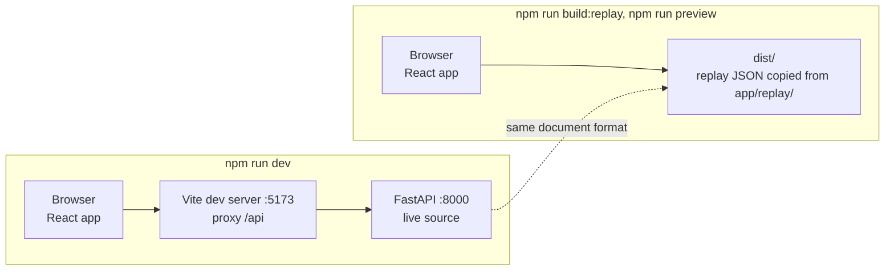
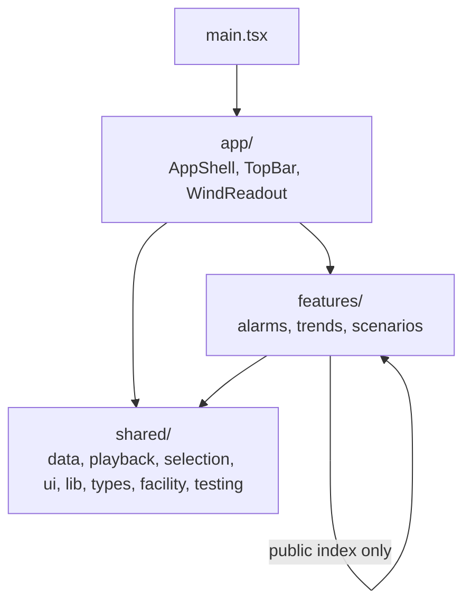
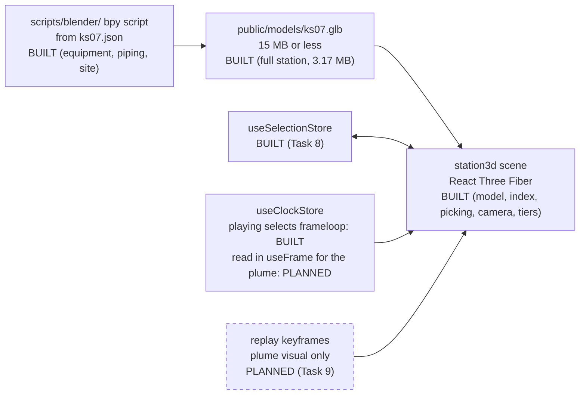
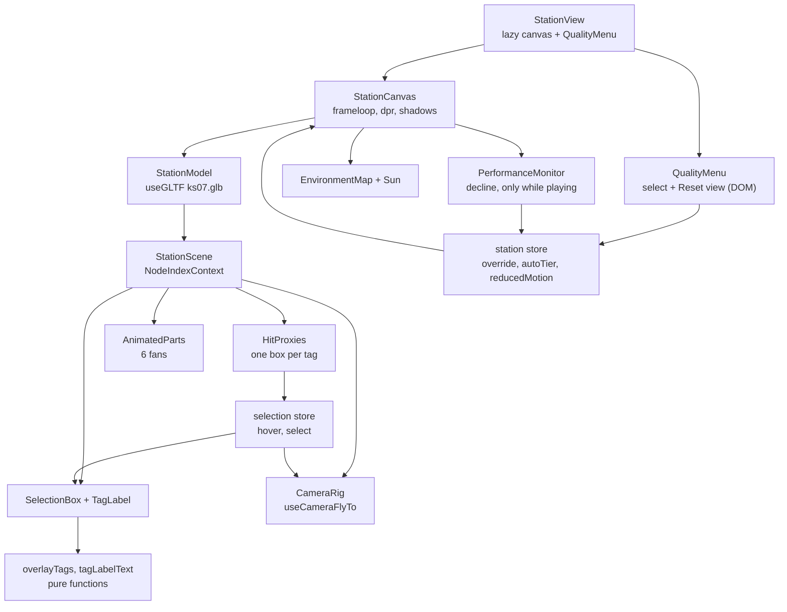
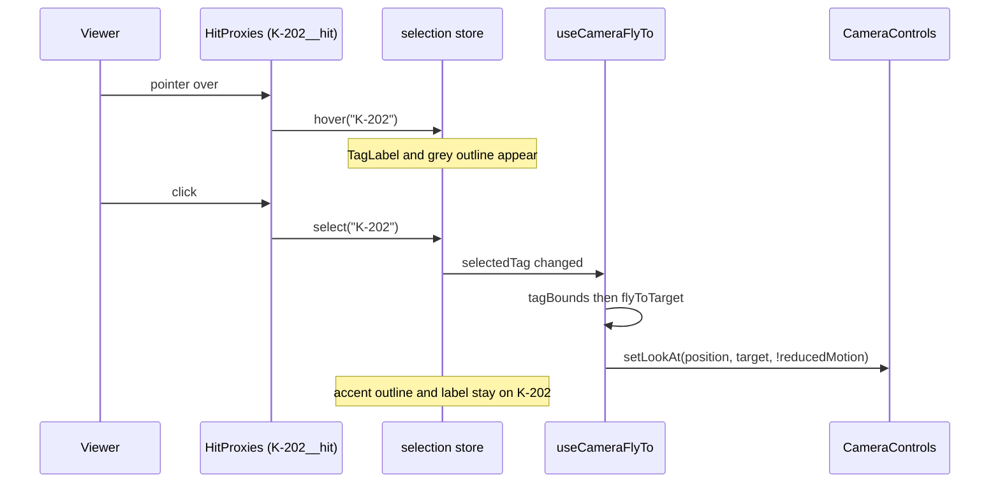
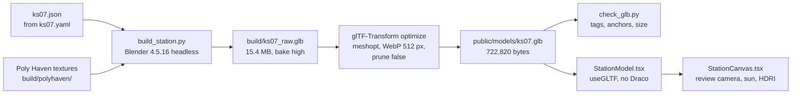

# Frontend

## Purpose

`app/frontend/` is the PlumeTrace control-room web app: React + TypeScript + Vite. As of Phase 4 Task 4
it has the design system, the data layer (live API or static replay) and the control-room panels:
top bar, alarms, station log, trends and playback bar. The station area shows the scenario load status and the baked 3D model of
the full station with picking, selection, camera fly-to and quality tiers (Task 8; the plume is Task 9). The data is the simulated station KS-07
(fictional); the weather in it is real. Design reference: section 9; visual rules: `.ux-profile.md`.

This page is the overview. The detail lives in four focused pages:

| Page | Covers |
|---|---|
| [DESIGN_SYSTEM.md](DESIGN_SYSTEM.md) | Tokens, contrast figures, type scale, shadcn edits, shared primitives, formatting helpers |
| [DATA_LAYER.md](DATA_LAYER.md) | `DataSource`, live and replay sources, error kinds, the three stores, the clock, the replay-bundle check |
| [UI_PANELS.md](UI_PANELS.md) | Layout, component tree, alarm rule, chart rules, keyboard map, binding display rules (R1 to R4) |
| [ACCESSIBILITY.md](ACCESSIBILITY.md) | What is implemented for keyboard and assistive technology, and the known gaps |

## Architecture

The two diagrams in this section are small on purpose: each shows one boundary (run modes, then
layers) and nothing else.



The same React code runs in two modes. In development it calls relative `/api/...` URLs that Vite
proxies to the local backend (live source). In the replay build it reads static JSON from `/replay/`
and the live-API code is not in the bundle. The frontend never connects to Supabase or OpenAI and
holds no secret. Nothing is deployed (rule 27); the replay build is built and previewed locally.

### Layers and dependency direction



`src/` may contain only `main.tsx`, `vite-env.d.ts`, `app/`, `features/`, `shared/` and `styles/`.
Shared code never imports a feature. A feature is used through its `index.ts` only (today
`features/trends` imports `visibleEvents` from `@/features/alarms`). `check_structure.py` enforces the
folders and the size limits.

## Stack and pinned versions

Exact versions are in `app/frontend/package.json` and `package-lock.json`; the full table is in
[LOCAL_DEVELOPMENT.md](../LOCAL_DEVELOPMENT.md#pinned-versions).

| Package | Version |
|---|---|
| react, react-dom | 19.3.1 |
| vite, @vitejs/plugin-react | 8.3.8, 6.3.0 |
| tailwindcss, @tailwindcss/vite | 4.3.5 |
| typescript | 6.0.3 (not 7.x: typescript-eslint 8.72.2 needs `<6.1`) |
| eslint, typescript-eslint | 10.14.0, 8.72.2 |
| vitest, @vitest/coverage-v8 | 5.1.0 (the two must match) |
| jsdom | 29.1.1 (Phase 1 plan pin note: 30 and later need Node 22.22 or newer) |
| @testing-library/react, dom, jest-dom | 16.3.3, 10.4.2, 7.0.1 |
| @fontsource/ibm-plex-sans, @fontsource/ibm-plex-mono | 5.3.0 |
| clsx, tailwind-merge, class-variance-authority | 2.1.1, 3.7.0, 0.7.1 |
| lucide-react, radix-ui | 1.72.0, 1.8.1 |
| zustand | 5.1.0 |
| uplot | 1.6.32 |
| three, @types/three | 0.187.0 |
| @react-three/fiber, @react-three/drei | 9.8.2, 10.7.9 |
| @react-three/test-renderer, @react-three/eslint-plugin (dev, Task 8) | 9.1.1, 0.1.2 (the plugin brings a nested, unused ESLint 8.57.1; see the work log) |
| r3f-perf (dev) | 7.2.3 |
| shadcn CLI (run with `npx`, not installed) | 4.23.0 |

Node `>=22.13.0` (`engines` in `package.json`).

## Scripts

Run from `app/frontend/`.

| Script | What it does |
|---|---|
| `npm run copy:replay` | Copy `app/replay/` to `public/replay/` (git-ignored); runs before `dev`, `build` and `build:replay` |
| `npm run dev` | Vite dev server on `http://localhost:5173`; `npm run dev -- --mode replay` runs without the backend |
| `npm run build` | Type-check, then `vite build` into `dist/` (git-ignored); the live build |
| `npm run build:replay` | Copy replay files, type-check, `vite build --mode replay` (no live-API code) |
| `npm run check:replay-bundle` | `scripts/check-replay-bundle.mjs`: fails if a `dist/assets/*.js` file contains `/api/` (after removing the one prefix `https://docs.pmnd.rs/react-three-fiber/api/` that R3F's own error text contains) or if none contains `/replay/scenarios` (the ReplaySource must really be in the bundle); prints `replay bundle OK` |
| `npm run preview` | Serve `dist/` locally |
| `npm run lint` | ESLint (typescript-eslint, react-hooks, react-refresh, jsdoc) |
| `npm run typecheck` | `tsc --noEmit` (strict, `noUncheckedIndexedAccess`) |
| `npm run test` | Vitest, one run |
| `npm run test:coverage` | Vitest with v8 coverage; thresholds lines 80, functions 80, branches 70, statements 80 |
| `npm run gen:types` | `json2ts` (json-schema-to-typescript 16.0.0): `contract.schema.json` to `contract.ts` (see Type contract) |

## Folder rules

`src/` may contain only `main.tsx`, `vite-env.d.ts`, `app/`, `features/`, `shared/` and `styles/`.
`check_structure.py` enforces it, together with the size limits (TS/TSX file at most 250 lines,
tests at most 400). A feature folder is used through its `index.ts` only. The full rules are in the
`frontend-structure` skill.

- `src/app/` holds `AppShell.tsx` (the top-level layout), `TopBar.tsx` and `WindReadout.tsx`.
  `scripts/` (next to `src/`) holds `check-replay-bundle.mjs`.
- `src/features/alarms/` (`AlarmList`, `AlarmRow`, `StationLog`, `visibleEvents`),
  `src/features/trends/` (`TrendsPanel`, `UPlotChart`, `chartData`, `chartOptions`, `chartTheme`,
  `cursorPlugin`) and `src/features/scenarios/` (`ScenarioPicker`, `ScenarioStatus`, `PlaybackBar`,
  `useScenarioBootstrap`, `usePlaybackKeys`).
- `src/shared/testing/setup.ts` is the Vitest setup file (jest-dom matchers, cleanup after each
  test); `replayFixture.ts` builds a valid replay for tests.
- `src/shared/data/`, `src/shared/playback/` and `src/shared/selection/` are the data layer (see
  Data layer); each has an `index.ts` that is its public API.
- `src/shared/lib/` holds `cn.ts` (class merging) and `format.ts` (units and time formatting).
- `src/shared/ui/` holds the shadcn primitives (lower-case file names, generated) and our own shared
  primitives `Panel.tsx` and `StatusBadge.tsx` (PascalCase).
- `src/shared/facility/ks07.json` and `src/shared/types/generated/` are generated (see Type
  contract).
- `src/styles/index.css` imports Tailwind and defines the design tokens.
- The `@/` alias points to `src/` (`tsconfig.json` `paths`, `vite.config.ts` `resolve.alias`).

## Design system

Summary only; the full page is [DESIGN_SYSTEM.md](DESIGN_SYSTEM.md). Everything lives in
`src/styles/index.css`; components use token classes (`bg-surface-1`, `text-text-2`,
`border-border-1`), never raw hex or `bg-[var(--x)]`. Four grey surfaces, 1 px borders instead of
shadows, colour reserved for meaning, one accent hue. IBM Plex Sans and IBM Plex Mono from npm
packages (no network font). shadcn components are mapped onto the same tokens (no second palette).
Rules that follow from the contrast numbers: `--text-3` only on surface-0 and never for a value, unit
or label an operator must read (the recorded rule; today's two exceptions, the disabled picker text
and the quiet chart strokes, are listed in DESIGN_SYSTEM.md); alarm state always has a marker and a word; `--ch4-*` and `--alarm-high` never stand in
for each other; white text on `--alarm-high` is 3.96:1, so no destructive button without a design
review.

## Data layer

Summary only; the full page is [DATA_LAYER.md](DATA_LAYER.md). Every feature gets scenario data
through one interface in `src/shared/data/`: `DataSource` with `listScenarios` and `loadScenario`.
`ReplaySource` reads `/replay/scenarios/...` (used when `import.meta.env.MODE === "replay"`);
`LiveSource` reads `/api/scenarios/...` through the Vite proxy (every other mode). Failures are
`DataSourceError` with kind `unreachable`, `not_found` or `invalid`; the UI chooses its text from the
kind. Three Zustand stores hold the state: `useScenarioStore`, `useClockStore` (speeds 1, 10, 60, 120;
one `requestAnimationFrame` loop) and `useSelectionStore`. A scenario switch aborts the previous
request, drops stale answers and resets the clock. `npm run check:replay-bundle` proves the live
source is absent from the replay bundle.

What the data layer must not expose: `keyframes[].sources` (the simulation input that draws the
plume) is never rendered as text, and the layer stores no rate.

## Layout and panels

Summary only; the full page is [UI_PANELS.md](UI_PANELS.md). `AppShell` is a CSS grid, rows
`48px / 1fr / 220px / 44px`: top bar, working area (alarms 320 px, station view, station log 360 px
from 1280 px wide; the log moves under the alarms below that), trends and playback bar. An alarm
appears when its 10-minute detection window closes: `window_start_s + 600 <= t`. Keyboard: `Space`
plays or pauses; `ArrowLeft` and `ArrowRight` seek 60 s, 600 s with `Shift`. Every clock is
zone-labelled (`... UTC`) or says `Elapsed`.

### Display rules that bind every UI task

- **R1 to R4 (rate display; owner decision at Gate 2, 2026-11-14).** R1: a leak rate is shown only as
  an interval, `p05-p95 kg/h (median p50)`, 2 significant figures, never the median alone. R2: it is
  suppressed with a reason when the result is inconclusive, the top candidate is `NONE` or the rate is
  at the grid edge. R3: every inversion rate and probability carries the fixed label
  `model estimate` / `model probability` with a link to the benchmark page, and the words
  "confidence", "certain" and "calibrated" are never used. R4 does not apply to the panels: the Phase 7
  About page and README take benchmark numbers only from the generated evidence JSON of the adopted
  method. No view shows a rate today. The rate-interval component is **deferred**: the first task that renders an inversion rate or
  probability must add it, with a test, before showing the number. `formatRate` must not be called
  from a view (`src/app/viewGuards.test.ts`).
- **Replay `keyframes[].sources` is never rendered as text** (`viewGuards.test.ts`,
  `simulationTruth.test.tsx`).
- **Every clock shows a zone label or `Elapsed`** (`clockLabels.test.tsx`). A station-local time gets
  its own label `UTC+5 station time`.

## 3D station: built versus planned

Described in `docs/superpowers/plans/phase-4/README.md` and the Task 5 to 11 plan files. In the
code there is the Task 5 spike scene (see "3D station (Task 5 spike)" below), since Task 6 the
Blender generator for every equipment type ([BLENDER_EQUIPMENT.md](BLENDER_EQUIPMENT.md)) and, since
Task 7, the piping, site, bake and the one-command export ([STATION_MODEL.md](STATION_MODEL.md)):
the shipped `ks07.glb` is the full station (24 items, 15 piping routes, racks, site). Since Task 8
the viewer adds picking, selection, labels, camera fly-to and quality tiers (section "3D station
view (Task 8)" below); the plume and candidate highlights (Task 9) are still planned.
`vite.config.ts` excludes `src/features/station3d/scene/**` from coverage.



*Caption: data flow of approach B (Blender-baked). Solid nodes exist: the generator and the shipped
glb hold the full station (Tasks 6 and 7), the scene renders it with picking and camera (Task 8),
and the selection store drives both the scene and the panels; the dotted node (replay plume
frames) is planned and not built.*

Planned data flow, approach B, from the Phase 4 plan. The plume and highlights are real-time R3F;
the clock is read inside `useFrame`, never through React state; plume visibility is gated by the
model grid in the replay. In Task 8 the clock only decides whether the canvas draws every frame
(playing) or on demand (paused).

### Regenerating the station model

One command from the repo root (Git Bash); `BLENDER` is the Blender 4.5.16 path from
[LOCAL_DEVELOPMENT.md](../LOCAL_DEVELOPMENT.md):

```bash
export BLENDER="C:/Users/Nagdy/Tools/blender-4.5.16/blender-4.5.16-windows-x64/blender.exe"
scripts/build_station.sh high      # about 3 minutes; low is a 30 second preview
```

It regenerates the contract JSON, builds, bakes and exports the station, optimises it with
glTF-Transform 4.5.1 (`--texture-size 512 --prune false`, no join, flatten, simplify or palette)
and runs `check_glb.py`. The file is generated; never edit it by hand. Budgets (all must pass, none
may be raised without the owner); latest values from the 2026-11-16 run, details in
[../evidence/2026-11-ks07-glb.md](../evidence/2026-11-ks07-glb.md):

| Budget | Limit | Latest | Checked by |
|---|---|---|---|
| file size | 15,000,000 bytes | 3,165,648 | `check_glb.py --max-bytes` |
| triangles | 1,500,000 | 110,484 | `check_glb.py --max-triangles` |
| draw calls (estimate) | 300 | 168 (the browser count at the review camera, Task 8: 272 with the shadow pass and the hit proxies, 116 on the `low` tier; see "3D station view (Task 8)") | `check_glb.py --max-draw-calls` |
| GPU texture memory | 128 MB | 71.4 MB | by hand: sum of `gpuSize` in `build/ks07_inspect.txt` |
| tags, anchors, 7 separate nodes | 0 missing | 0 missing | `check_glb.py` (no `--only`) |

In the shipped glb a tag node holds its mesh in an unnamed child node for most items (the 21 unnamed
child nodes carry the meshes, each with the quantisation scale and translation the meshopt
step adds), so the Task 8 `nodeIndex` (built) must
look at descendants, not only at the named node.

## 3D station view (Task 8)

Built in Phase 4 Task 8: the interactive layer on top of the baked model. It adds the node index,
picking through invisible proxies, hover and selection visuals, camera controls with fly-to and
reset, quality tiers and the lights. The station is fictional and simulated; the labels show a tag
and a type name only (no rate, no value). The plume, candidate highlights and wind indicator are
**planned** (Task 9); the full no-WebGL fallback and the DOM equipment list are planned (Task 10).



*Caption: component and state flow of the Task 8 view. All boxes are built. The camera rig is a
child of `StationScene` (through `StationModel`'s `children`) because it needs the node index. The
monitor is a sibling of the scene, mounted only while playing, and writes only `autoTier`; the menu
writes the override.*



*Caption: hover, click and fly-to for one equipment item. The same path runs when a click in the
alarm list selects an instrument tag (`AT-102`): `tagBounds` then returns a 2 m cube.*

### Object-tree contract and the node index

The loaded or built root must follow the contract of the generator
([STATION_MODEL.md](STATION_MODEL.md)): a node named by each equipment tag (`K-202`), anchor empties
named `<tag>.<anchor>` (`K-202.packing`), and separate part nodes `<tag>__<part>` (`E-231__fan_1`,
`FL-601__tip`). In the shipped glb most tag nodes keep the mesh in an unnamed child node (21
nodes), three tags (`T-301`, `CR-901`, `MCC-902`) are the mesh node itself. So every box and
outline is computed over the **descendants** of the tag node (`tagBox`).

`model/nodeIndex.ts`:

| Export | Contract |
|---|---|
| `buildNodeIndex(root, spec)` | one traversal; first node wins when a name repeats; returns `get(name)`, `equipmentTags`, `missing` |
| `equipmentTags` | the spec equipment tags **present** in the scene, in spec order. A tag that is absent is not in this list and goes to `missing`. Task 9 relies on this: `get(tag)` is defined for every entry |
| `missing` | spec tags and anchor ids absent from the scene, in spec order (a tag, then its anchors) |
| `tagBox(node)` | world `Box3` of the node and descendants; a node without geometry gets a 1 m box at its world position |
| `tagBounds(tag, index, spec)` | equipment: the node box; instrument: a 2 m cube (`instrumentBox`); unknown tag: `null` |
| `NodeIndexContext`, `useNodeIndex()` | the index of the mounted `StationScene` |

**Name sanitising.** `GLTFLoader` removes `[ ] . : /` from `node.name` and keeps the original in
`userData.name`: the anchor `K-202.packing` loads as `K-202packing`. The index therefore keys on
`userData.name` when it is a string and on `node.name` otherwise (a procedurally built tree). The
shipped glb loads with no `station model is missing nodes` message in the browser; `StationScene`
logs a non-empty `missing` list once with `console.error("station model is missing nodes", missing)`
(the plan put this call in `StationView`, which is outside the canvas and cannot see the index).

### Picking, hover and selection

- **Only proxies are pickable.** `StationModel` gives every mesh a no-op `raycast` and
  `castShadow`/`receiveShadow`. `HitProxies` renders one `<mesh name="<tag>__hit">` per equipment tag
  with a shared unit `BoxGeometry` scaled to the tag box and one shared `MeshBasicMaterial`
  (`colorWrite` and `depthWrite` off). Every handler calls `stopPropagation`; over a proxy the
  cursor is `pointer`. A box thinner than 0.1 m is widened to 0.1 m (a flat box cannot be raycast).
  The proxies assume an identity transform of the model root.
- **State** is `useSelectionStore` (`selectedTag`, `hoveredTag`; selecting the selected tag clears
  it). Panels and the scene share it, so a click in the alarm list (`select(event.sensor_id)`)
  outlines and frames the sensor.
- **Visuals.** `SelectionBox` always mounts two `lineSegments` (shared `EdgesGeometry` of a unit
  box) and toggles `visible`: selected tag in `--accent`, hovered tag in `--text-2` at 50 % opacity,
  `depthTest` off, `renderOrder` 10. Colours are read once from the CSS tokens. `TagLabel` renders at
  most two drei `Html` labels (hovered, selected; one when they are the same tag) at the top centre of
  the box plus 1 m: tag in `font-mono text-xs` and the type name (`Recip compressor`, `Fin-fan cooler`,
  `TEG contactor`, `Vapour recovery unit`, ...; instruments `Methane sensor`, `Met mast`, ...).
  `pointer-events: none`. No rate or value is ever shown here (R1 to R4). The logic is in pure
  functions so it can be tested without a DOM layer: `overlays/overlayTags.ts` (`overlayTags`: which
  tag each overlay shows), `overlays/tagLabelText.ts` (`describeTag`, `labelPosition`, the two name
  maps); `TagLabel` and `SelectionBox` only call them.
- **Fans.** `AnimatedParts` rotates the six `E-23x__fan_n` nodes about local Y by `delta * 2.0` rad/s
  (0.5 with reduced motion) in one `useFrame` without allocation; the reduced-motion flag is read from
  the store, not subscribed. They turn only while frames are drawn (clock playing).

### Camera rules

`CameraRig` mounts drei `CameraControls` (`makeDefault`, distance 8 to 350 m, polar angle at most
85 degrees) and sets the review camera without a transition on mount. **The controls mount only
after the glb has loaded** (they are inside `Suspense`, as a child of `StationModel`), so before that
the canvas shows nothing and no camera input exists.

`flyToTarget(box, cameraPos)`: the target is the box centre; the distance is
`d = max(12, 2.5 * largest box dimension)` metres; the camera keeps its horizontal direction from the
target (azimuth) and looks down at 30 degrees: `position = target + d * (cos30 * horizontal unit + sin30 * up)`.
Directly above the target (horizontal length below 1e-6) it uses the review camera's azimuth.
`useCameraFlyTo` runs it when `selectedTag` changes; with reduced motion the move is instant.
`R` (not inside `input`, `select`, `textarea` or `contenteditable`, and not with Ctrl, Alt or Meta) and
the `Reset view` button (which dispatches the `plumetrace:reset-view` window event, because the button
is outside the canvas) return to the review camera the same way. Listeners are removed on unmount.

### Quality tiers and lights

| Tier | dpr cap | Shadows | Shadow map | Plume particles (Task 9) |
|---|---|---|---|---|
| high | `[1, 1.5]` | on | 2048 | 40,000 |
| medium | `[1, 1.25]` | on | 1024 | 20,000 |
| low | `[1, 1]` | off | 512 | 10,000 |

`useQualityTier()` is the manual override, or the automatic tier when the override is `Auto`. The
override persists in `localStorage["plumetrace.quality"]` (invalid values and storage errors are
ignored). drei `PerformanceMonitor` is mounted only while the clock plays; it calls `decline()` (one
tier per call, stops at `low`), which sets only the automatic tier. It never calls `setOverride`, so
it never writes the override or `localStorage`; `setOverride` is the manual menu only (owner ruling
2026-11-16, pinned by `store.tier.test.tsx`, "an automatic decline never touches the stored
override"). Trade-off: while paused the canvas draws on demand, and sparse frames would read as a
low frame rate, so a slow GPU is never auto-declined while paused; it is measured only once the
clock plays. `Sun` casts shadows only when the tier has them and re-creates its shadow map when the
size changes. The canvas draws every frame while the clock plays and on demand while paused.

Lights (owner ruling C2): the sun is **2.2** (was 2.5) and `environmentIntensity` is **0.6** (was
0.8), both inside the ruled bands (1.5 to 2.5 and 0.4 to 0.8). At the review camera the ground
reads as mid-grey gravel, not snow, and the cast shadows read better than at the old values. No HDRI
or asset was changed.

### Measurements (2026-11-16, review camera, 1240 x 768 canvas, Chrome under Playwright)

Hardware: NVIDIA GeForce RTX 3050 Laptop GPU, a **discrete GPU, not the integrated one**; the
display is 144 Hz. **No integrated-GPU figure is claimed** (owner action C6 in `docs/OWNER_ACTIONS.md`).
Draw calls and triangles are `gl.info.render.calls` and `.triangles` of the last render, so they
include the sun's shadow pass and the 24 invisible hit proxies; they are the scene as rendered
(not the generator's estimate of 168). fps is the `requestAnimationFrame` rate over 30 s at a fixed
tier with the clock playing.

| Tier | Calls | Triangles | fps | p99 frame | Textures / geometries |
|---|---|---|---|---|---|
| high | 272 | 139,168 | 144.0 | 7.3 ms | 41 / 159 |
| medium | 272 | 139,168 | 144.0 | 7.3 ms | 41 / 159 |
| low (no shadow pass) | 116 | 52,088 | 143.7 | 8.3 ms | 39 / 159 |

272 is within the 300-call budget as rendered. fps is capped by the display refresh. With the page
reporting a device pixel ratio of 2 (set by script), the pixel ratio was 1.5, 1.25 and 1 for high,
medium and low. The `r3f-perf` overlay (`?perf`) showed zeros in this session, so the numbers above
were read from `gl.info` through a temporary hook that was removed before the end of the task.

### Worked example (real values)

From the review camera `[45, 25, -40]` an alarm click selects `AT-102` (spec position `[100, 5, 2]`,
scene `[100, 2, -5]`). `instrumentBox` gives `min [99, 1, -6]`, `max [101, 3, -4]`; the largest side is
2 m, so `d = max(12, 5) = 12`. The horizontal direction from the target is `(-55, -35)`, length 65.19;
the camera lands at `[91.23, 8.0, -10.58]`, the value read back from the browser (`camera.position`
after the move). With reduced motion the same position is reached at once (read 40 ms after the
click: `[12.8, 8.0, -11.8]` for `AT-101` on every sample); without it the samples moved
(`[17.3, 8.9, -15.1]` to `[13.9, 8.2, -12.7]` in 160 ms).

### Edge cases and the test that pins each

| Case | Behaviour | Pinned by |
|---|---|---|
| anchor loaded as `K-202packing` with `userData.name` | found as `K-202.packing` | `nodeIndex.test.ts` ("resolves a loaded anchor by its original name") |
| name repeats | first node wins | `nodeIndex.test.ts` ("keeps the first node") |
| tag absent from the scene | not in `equipmentTags`, listed in `missing` | `nodeIndex.test.ts` (two tests) |
| missing names | logged once, also after a re-render | `StationScene.missing.test.tsx` |
| mesh in an unnamed child | box covers the descendants | `tagBounds.test.ts` |
| node without geometry | 1 m box at its world position | `tagBounds.test.ts`, `StationScene.test.tsx` |
| one proxy per equipment item, click selects | `K-202__hit` click sets `selectedTag` | `StationScene.test.tsx` |
| fly-to keeps azimuth, 30 degrees, at least 12 m | formula above | `flyToTarget.test.ts` |
| instrument box | 2 m cube on `specToScene(position)` | `flyToTarget.test.ts`, `tagBounds.test.ts` |
| reduced motion | `setLookAt(..., false)` | `useCameraFlyTo.test.tsx` |
| unknown tag selected | camera does not move | `useCameraFlyTo.test.tsx` |
| `R` with a modifier or inside a `select` | ignored | `useCameraFlyTo.test.tsx` |
| tier declines one step and stops at `low` | `decline()` | `store.test.ts` |
| manual override wins; invalid stored value, blocked storage, `matchMedia` change | see test names | `store.tier.test.tsx` |
| fans spin 2.0 rad/s, 0.5 reduced | `advanceFrames` | `AnimatedParts.test.tsx` |
| quality menu options, store write, reset event | DOM | `QualityMenu.test.tsx` |
| quality menu shows a `Quality` caption and the `R` shortcut | visible text on the control surface; `aria-keyshortcuts="R"` | `QualityMenu.test.tsx` ("shows a visible Quality caption ...") |
| pointer over a proxy | sets `hoveredTag`, cursor `pointer`, calls `stopPropagation` | `HitProxies.test.tsx` ("hover sets the hovered tag ...") |
| pointer out of a proxy | clears `hoveredTag`, cursor reset, `stopPropagation` | `HitProxies.test.tsx` ("pointer out clears ...") |
| pointer moves from one proxy to another | the second tag stays hovered | `HitProxies.test.tsx` ("moving from one proxy ...") |
| click, then click again | selects, stops propagation, second click clears | `HitProxies.test.tsx` ("a click selects ...") |
| proxy size and place | one per tag present; box centre and size from the tag box | `HitProxies.test.tsx` ("renders one proxy per tag ...") |
| outlines | two `lineSegments` always mounted, both hidden with no selection | `SelectionBox.test.tsx` ("mounts two outlines ...") |
| selecting a tag | the same two objects, selected one `visible` on that tag's box, hover one hidden | `SelectionBox.test.tsx` ("selecting a tag ...") |
| hover outline | `visible`, opacity 0.5, `depthTest` off, `renderOrder` 10; selected opacity 1 | `SelectionBox.test.tsx` ("hovering another tag ...") |
| hovered tag equals selected tag | hover outline hidden (and no second label) | `SelectionBox.test.tsx`, `overlayTags.test.ts` |
| selection cleared | the selected outline is hidden, not unmounted | `SelectionBox.test.tsx` ("clearing the selection ...") |
| instrument selected | outlined with a 2 m cube | `SelectionBox.test.tsx` ("outlines an instrument ...") |
| label text | type name for each of the 15 equipment types and 6 instrument kinds; empty for an unknown tag | `tagLabelText.test.ts` |
| label position | top centre of the box, 1 m above it | `tagLabelText.test.ts` ("labelPosition") |
| at most two labels | which tags get one: `overlayTags` (hover dropped when equal to selected) | `overlayTags.test.ts` |
| the drei `Html` label element itself | **not unit tested**: the test renderer has no DOM layer for `Html`; checked in the browser (screenshots in `docs/evidence/`) | none |
| frame-loop allocation (`new`, `.clone()` in `useFrame`) | lint rule `@react-three/no-new-in-loop`, `no-clone-in-loop` | none yet: the plugin is installed but not wired into `eslint.config.js` (pending the owner's edit; see "Known issues found in this task") |

Test-first: the five plan tests (seen failing first), and `overlayTags.test.ts` and
`tagLabelText.test.ts` (seen failing on the missing modules, then green). Written after the code (not
red first): `store.tier`, `QualityMenu`, `useCameraFlyTo`, `AnimatedParts`, `tagBounds`,
`StationScene.missing`, `HitProxies` and `SelectionBox` tests. The last two were then checked by five
hand-made mutants, applied together and reverted afterwards: a missing `stopPropagation` on pointer
over, a cursor not reset on pointer out, no hover suppression in `overlayTags`, an outline always
`visible`, and a label with no 1 m lift. All five were caught by 8 failing tests. The `R` hint of
`QualityMenu` was checked separately: an earlier assertion (`textContent` contains "R") was vacuous
because "Reset view" contains an R; it is now `within(button).getByText("R")`, and deleting the
`<kbd>` hint makes that test fail (seen, then restored). Rendering, picking
on a real GPU and the camera feel are checked by hand in the browser; the scene folder is excluded
from coverage.

### Known issues found in this task

- **Open: `@react-three/eslint-plugin` is installed but not wired into `eslint.config.js`.** The file
  is protected by a config-protection hook; the ruled wiring is pending the owner's edit, and the
  negative control (`@react-three/no-new-in-loop`) has not been run.

- **Left after the design critique (2026-11-16), each with its reason.** (1) The hover outline
  (`--text-2` at 50 %) is faint on the light ground: 50 % is the plan's value; changing it needs an
  owner decision. (2) The two controls are 24.5 CSS px high (`h-7` at a 14 px root), under the 44 px
  touch target: touch layout is Task 10. (3) The K-202 box includes the whole shelter: the outline is
  the tag node's world box. (4) Label text is 12 px (`text-xs`, the plan's value).
  (5) The drei `Html` label is not unit tested (see the edge-case table).

### Resolved in this task

- **PerformanceMonitor flip-flops (resolved, owner ruling 2026-11-16).** drei's monitor increments
  `flipped` on every incline as well as every decline, so on a machine above 100 fps the plan's
  `flipflops={3}` plus `onFallback={() => setOverride("low")}` pinned and stored `low` after about
  10 s of playing (seen twice in the browser). `StationCanvas` now has no `flipflops` and no
  `onFallback`; the monitor mounts only while the clock plays and calls `decline()` only.
  Browser check after the change (144 Hz, discrete GPU, device pixel ratio 1): `plumetrace.quality`
  cleared, 30 s of playing at 120x leaves the stored value `null`, shadows on and pixel ratio 1;
  then paused, 264 pointer moves with 320 to 350 ms gaps hovered 10 distinct items (the ones visible
  from the review camera) and shadows stayed on.
- **`check:replay-bundle` on a documentation URL (resolved, owner ruling 2026-11-16).** The replay
  chunk contains the R3F error text `https://docs.pmnd.rs/react-three-fiber/api/objects#...`, which
  contains `/api/`. The script now removes exactly the prefix `https://docs.pmnd.rs/react-three-fiber/api/`
  before looking for `/api/`; any other `/api/` still fails. Pinned by two tests in
  `checkReplayBundle.test.ts`: the R3F URL alone passes, and the R3F URL next to `fetch("/api/scenarios")`
  still fails. Real bundles: `npm run build:replay` then `npm run check:replay-bundle` prints
  `replay bundle OK`; after `npm run build` the check fails naming `LiveSource-*.js`. `ci_local.py`
  does not run this check yet (Task 11 adds it).

### How to run and extend

```bash
cd app/frontend
npm run dev                    # http://localhost:5173 ; add ?perf for the dev overlay
npx vitest run src/features/station3d
```

To add a pickable item: add it to `ks07.yaml` so the generator emits a tag node, regenerate the glb;
the proxy, label and fly-to follow from the spec. To add scene content that needs the index, pass it
as a child of `StationModel` and read `useNodeIndex()`. Links: [STATION_MODEL.md](STATION_MODEL.md),
[UI_PANELS.md](UI_PANELS.md), `.claude/skills/frontend-3d/`.

## 3D station (Task 5 spike)

Built in Phase 4 Task 5 to test approach B (Blender-baked) with one skid; the owner decides go or
no-go from `docs/evidence/2026-11-spike.md`. The generator is documented in
`scripts/blender/README.md`; third-party assets in [ASSETS.md](ASSETS.md).

Pipeline: `ks07.json` (from `ks07.yaml`) -> `scripts/blender/build_station.py` (Blender 4.5.16
LTS, headless, bpy) builds the equipment, bakes ambient occlusion with Cycles, exports
`build/ks07_raw.glb` -> `npx @gltf-transform/cli@4.5.1 optimize` (meshopt geometry, WebP
textures, `--prune false`, `--join false --flatten false`) -> `public/models/ks07.glb` ->
`scripts/check_glb.py` (every spec tag and anchor present, size budget). The glb is generated;
never edit it by hand. Spike content: K-202 with shelter, VS-250, a ground patch.

Code (`src/features/station3d/`, public entry `index.ts` exports `StationView`):

| File | Role |
|---|---|
| `StationView.tsx` | lazy boundary and the quality menu; renders nothing when WebGL 2 is missing (the full fallback is Task 10) |
| `StationCanvas.tsx` | R3F `<Canvas>`: tier dpr and shadows, `frameloop` from the clock, performance monitor, review camera, optional `?perf` overlay (dev only); since Task 8 (spike: dpr `[1, 1.5]`, shadows always on) |
| `model/StationModel.tsx` | `useGLTF("/models/ks07.glb", false, true)`: **no Draco** (its decoder loads from a CDN), bundled meshopt; meshes cast and receive shadow and have a no-op raycast (Task 8); renders `StationScene` |
| `scene/EnvironmentMap.tsx` | local HDRI `public/textures/env/industrial_sunset_puresky_1k.hdr` as lighting only (intensity 0.6 since Task 8, spike 0.8), plus a flat grey sky colour |
| `scene/Sun.tsx` | the one directional light: azimuth 250 degrees (WSW), elevation 18 degrees; intensity 2.2 and shadow map by tier since Task 8 (spike: 2.5, 2048) |
| `scene/reviewCamera.ts` | `REVIEW_CAMERA`: the fixed camera for every screenshot and fps measurement |
| `scene/coords.ts` | `specToScene([x, y, z])` returns `[x, z, -y]` |
| `dev/PerfOverlay.tsx` | `r3f-perf`, dynamic import behind `import.meta.env.DEV`, mounted by `?perf` |

Coordinates: the spec and Blender are Z-up (x east, y north); three.js is Y-up. A spec point
`(x, y, z)` is the scene point `(x, z, -y)`; the exporter's +Y-up conversion does the same. The
review camera is at spec `[45, 40, 25]` looking at `[80, 95, 3]`, field of view 35 degrees.

Pinned (Task 5): three 0.187.0, @react-three/fiber 9.8.2, @react-three/drei 10.7.9, @types/three
0.187.0, r3f-perf 7.2.3. Tests: `scene/coords.test.ts`; the pure Blender helpers and `check_glb.py`
are tested in `app/backend/tests/blender/` and `app/backend/tests/test_check_glb.py`. Spike
measurements (size, draw calls, fps, bake time) are in `docs/evidence/2026-11-spike.md`.

### Separate glb nodes (built in Task 6, in the shipped glb since Task 7)

Most items are one node named by the tag. Two kinds of part stay their own node so the frontend can
animate them; their names are `naming.part_name(tag, part)` = `<tag>__<part>`:

| Node | Where | Origin (pivot) | Contents | Intended use (Task 9, planned) |
|---|---|---|---|---|
| `E-231__fan_1`, `E-231__fan_2` (same for `E-232`, `E-233`) | fin-fan coolers | the fan hub, item-local `(-L/4, 0, 3.4)` and `(+L/4, 0, 3.4)` | hub cylinder r 0.2 m and four blades pitched 12 degrees | spin about the node's local Y axis |
| `FL-601__tip` | flare stack | item-local `(0, 0, 28.5)`, the top of the stack | tip cylinder r 0.35 m and the open wind shield ring; its top centre is the anchor `FL-601.tip` | place the flame at the anchor |

Real values from the 2026-11-16 raw export (three.js frame, Y up): `E-231__fan_1` has translation
`[-2, 3.4, 0]` inside `E-231` (translation `[95, 0, -57]`), its blades span about +-1.55 m in x and z
and 0.04 m in y, so the hub axis is the node's local **Y**. `FL-601__tip` is at `[0, 28.5, 0]` inside
`FL-601` (`[185, 0, -30]`) and the anchor `FL-601.tip` at `[0, 30, 0]`. Separate nodes carry their own
material copies and, since Task 7, their own baked AO. In the Task 7 build `optimize` kept all
seven nodes with its default `--instance`; `check_glb.py` now requires the seven names
(`test_check_glb.py::test_separate_nodes_are_required`).

### Spike pipeline (built)



*Caption: the built spike chain from the facility spec to the canvas. Nothing in it is hand-edited;
rerunning the commands in `scripts/blender/README.md` reproduces `ks07.glb`.*

### Worked example (real values, 2026-11-15)

- Build: `--only K-202,VS-250 --bake high` took 43.8 s in total (41.5 s of baking) and wrote a
  15,397,876-byte raw glb. `optimize ... --texture-size 512 --prune false` made it 722,820 bytes
  (at `--texture-size 1024` it is 2,598,024 bytes, over the 2 MB spike budget).
- Check: `check_glb.py --only K-202,VS-250 --max-bytes 2000000` printed
  `glb OK: 6 nodes, 722820 bytes`. The six nodes are `ground`, `K-202`, `K-202.packing`,
  `K-202.engine_exhaust`, `VS-250` and `VS-250.tip`.
- Coordinates: the spec anchor `VS-250.tip` is `[85, 115, 12]`; `specToScene([85, 115, 12])` returns
  `[85, 12, -115]`, which is where the exported anchor empty sits (root at `(85, 0, -115)` plus the
  local `(0, 12, 0)`). The review camera `specToScene([45, 40, 25])` is `[45, 25, -40]`.
- Render: at the review camera on an RTX 3050 Laptop GPU the scene is 16 draw calls and 9,804
  triangles; fps and the integrated-GPU caveat are in `docs/evidence/2026-11-spike.md`.

### Edge cases and failure modes

| Case | What happens | Pinned by |
|---|---|---|
| `optimize` run with `--prune true` | the anchor empties are deleted; `check_glb.py` prints `missing nodes: [...]` and exits 1 (a throwaway build printed `['K-202.engine_exhaust', 'K-202.packing', 'VS-250.tip']`) | the detection is pinned by `test_check_glb.py::test_missing_anchor_fails`; the flag itself is **not** pinned by an automated test (manual evidence in the spike file) |
| A tag in `--only` that is not in the spec | `ValueError: unknown tag K-999` | `tests/blender/test_spec_loader.py::test_unknown_tag_is_rejected` |
| A JSON file without `equipment` | `ValueError: ... missing equipment` | `test_spec_loader.py::test_rejects_non_spec_json` |
| A file that is not a glb | `ValueError` naming the bad magic | `test_check_glb.py::test_bad_magic_is_rejected` |
| glb over the byte budget | `glb has N bytes, budget M`, exit 1 | `test_check_glb.py::test_size_budget` |
| glb over the triangle or draw-call budget | `glb has N triangles, budget M` (or `draw calls`), exit 1 | `test_check_glb.py::test_triangle_and_draw_call_budgets` |
| a fan or the flare tip missing from the glb | `missing nodes: ['E-231__fan_1', ...]`, exit 1 | `test_check_glb.py::test_separate_nodes_are_required` |
| Face normal exactly between two axes | box UV picks z, then x | `tests/blender/test_uvmath.py::test_diagonal_normal_ties_to_z` |
| Item rotated in the spec | local and world positions round-trip | `tests/blender/test_layout.py::test_round_trip` |
| Spec point to scene point | `[x, y, z]` becomes `[x, z, -y]` | `scene/coords.test.ts` (2 tests) |
| Browser without WebGL 2 (or jsdom) | `StationView` renders nothing; the 2D panels work | indirectly by the `AppShell` tests (jsdom has no WebGL 2); no dedicated test, the full fallback is Task 10 |
| Draco | never used; the glb has no Draco data and `useGLTF(url, false, true)` skips its CDN decoder | **no test** (the scene is excluded from jsdom and coverage); keep it by never passing `--compress draco` |
| `--bake none`, `low` (256 px, 16 samples), `high` (`layout.ao_resolution`: 1024 px compressors and ground, else 512 px; 128 samples) | AO image size and samples change; `none` exports without occlusion | **no test** (needs Blender); times in the evidence files |
| Blender other than 4.5 | prints `Blender 4.5 required, found x.y.z` and exits 2 | **no test** (needs Blender) |

## Anti-slop gate

Every UI task runs `python -I .claude/skills/frontend-design/scripts/check_slop.py app/frontend/src`,
which must print `no slop found`, and records a screenshot critique in `docs/WORK_LOG.md`.
Rules: `.ux-profile.md` and `.claude/skills/frontend-design/references/anti-slop.md`.

## Tests

Vitest with the `jsdom` environment and Testing Library. Setup: `src/shared/testing/setup.ts`.
Tests live beside the code as `*.test.ts(x)`. Per area: data layer, stores and the replay-bundle check
in [DATA_LAYER.md](DATA_LAYER.md#tests); panels, guards and keyboard in
[UI_PANELS.md](UI_PANELS.md#tests); primitives in [DESIGN_SYSTEM.md](DESIGN_SYSTEM.md#tests).
The 3D view is tested in `src/features/station3d/` with `@react-three/test-renderer` (scene graph,
picking, frames) and plain Vitest (store, node index, fly-to maths); the table is in "3D station view
(Task 8)". `src/app/vercelConfig.test.ts` reads `vercel.json` and pins the security headers and the SPA rewrite
(recorded for a later phase; see [DEPLOYMENT.md](DEPLOYMENT.md)). Layers required by the
`testing-strategy` skill: [TESTING.md](TESTING.md).

## Type contract

The Pydantic models in `app/backend/plumetrace/facility/` are the source of truth. The frontend
never hand-copies a type or the facility data; it uses three generated files:

| File | Produced by |
|---|---|
| `src/shared/types/generated/contract.schema.json` | `scripts/export_contract.py` (`Contract`: `facility`, `replay_scenario`, `replay_index`) |
| `src/shared/types/generated/contract.ts` | `npm run gen:types` (from the schema) |
| `src/shared/facility/ks07.json` | `scripts/export_contract.py` (`load_facility()` as JSON) |

Regenerate, in this order:

```bash
cd app && uv run python ../scripts/export_contract.py
cd frontend && npm run gen:types
```

Never edit the generated files by hand; change the Pydantic model or `ks07.yaml` and regenerate.
Output is deterministic: UTF-8, LF line endings, sorted keys, trailing newline (bytes are written,
so Windows does not add CRLF; `.gitattributes` also forces LF). The generated folder is excluded
from ESLint. Drift check: `python scripts/ci_local.py --full`, stage `contract-drift` (Task 8),
re-runs both commands and fails if `git diff` is not empty.

Fixed-length tuples (for example a position `[x, y, z]`) reach the schema as JSON Schema 2020-12
`prefixItems`, which json-schema-to-typescript 16.0.0 ignores and types as `unknown`.
`scripts/export_contract.py` therefore rewrites every `prefixItems` to the draft-07 `items` array
(with `minItems` and `maxItems`), so the generated type is `[number, number, number]`. A node that
has both keywords is an error. `app/backend/tests/test_contract_types.py` checks the rewrite, the
schema and the committed `contract.ts`.

## Changelog

- 2026-11-13: Phase 1 Task 5 scaffold.
- 2026-11-15: Phase 4 Tasks 2 to 4 (design system, data layer, panels).
- 2026-11-16: Phase 4 Task 8: "3D station view (Task 8)" section (node index, picking, selection,
  camera, quality tiers, lights, measurements, known issues); the planned-data-flow diagram updated;
  stack table lists the 3D packages.
- 2026-11-16: Phase 4 Task 8 fix rounds: performance monitor only while playing (no flip-flop
  fallback); `check:replay-bundle` ignores the R3F documentation URL; load-status panel is solid;
  component tests for `HitProxies` and `SelectionBox`, pure `overlayTags` and `tagLabelText`;
  `QualityMenu` shows a `Quality` caption and the `R` shortcut after a design critique.
- 2026-11-16: Phase 4 Task 7: the shipped glb is the full station; "Regenerating the station model"
  section with the budgets; separate-node and check_glb notes updated; STATION_MODEL.md added.
- 2026-11-15: documentation pass: this page became the overview; detail moved to DESIGN_SYSTEM.md,
  DATA_LAYER.md, UI_PANELS.md and ACCESSIBILITY.md; added architecture and layer diagrams and the
  planned 3D data flow.
