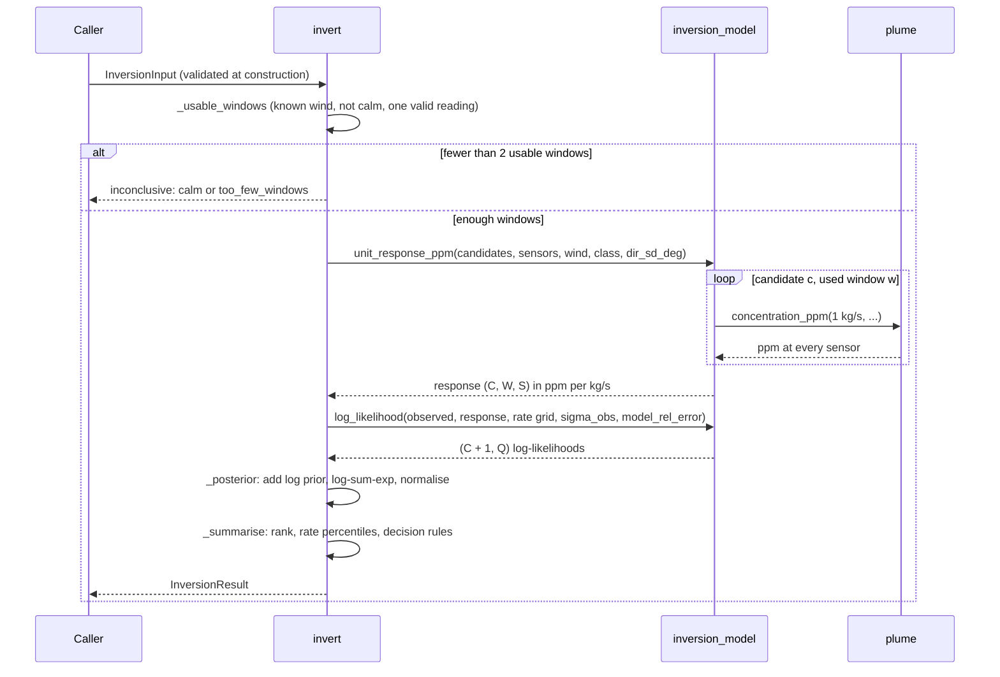
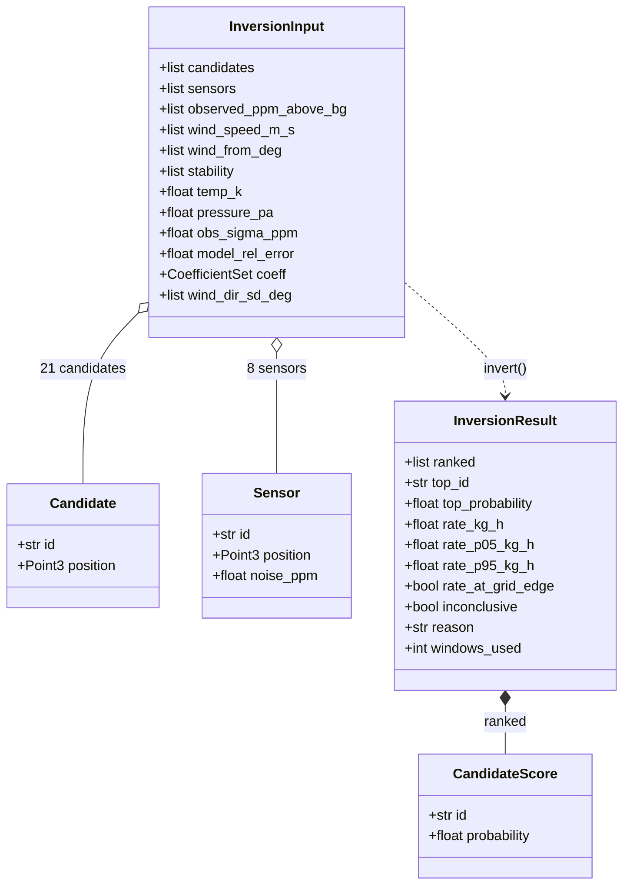
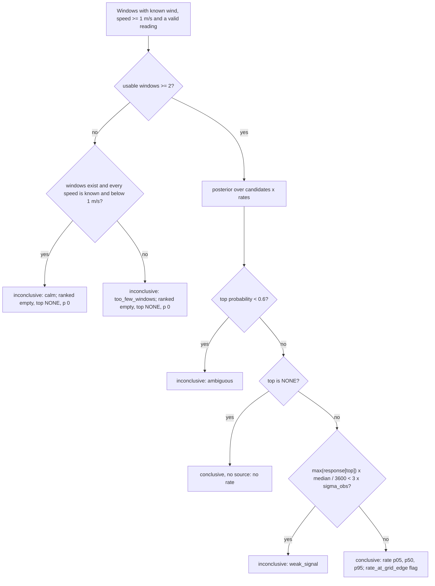
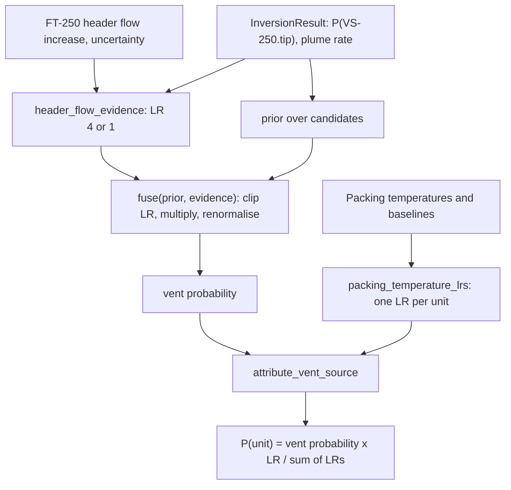

# Source inversion and evidence fusion

How PlumeTrace decides which emission candidate leaks, at what rate, and how sure it is, and how
process evidence then shifts that ranking. Modules `plumetrace.engineering.inversion`,
`inversion_input`, `inversion_model` and `fusion`. Contract reference and constants:
[ENGINEERING.md](ENGINEERING.md) sections "Source inversion" and "Evidence fusion". Forward model:
[DISPERSION.md](DISPERSION.md). Scoring of the method: [BENCHMARK.md](BENCHMARK.md).

The inversion is a Bayesian grid method on a **simplified Gaussian plume model, simulated
station**. Its probabilities and rate intervals are **model estimates, not calibrated
probabilities** (evidence in [BENCHMARK.md](BENCHMARK.md)). Do not read them as confidence.

## 1. Purpose and scope

Does: given window-mean methane readings above background from 8 sensors, wind, stability and an
error model, return a ranking of the 21 KS-07 emission candidates plus "no source" (`NONE`), the
rate of the top candidate as a median with a 90 % interval, or an explicit `inconclusive` with a
reason.

Does not: detect events ([DETECTION.md](DETECTION.md)), subtract the background (the caller does),
choose the windows (the caller does), consider more than one simultaneous source, or call an LLM.
The agents never produce an engineering number themselves; they take it from this result through a
tool (project rule 4).

## 2. How it works



*Figure 1. Call flow of `invert`. The forward model is called once per candidate and window with a
unit rate; the rate grid is applied by multiplication afterwards.*

The unit-rate trick works because the plume is linear in the rate: the prediction for candidate `c`
at rate `q` in window `w` at sensor `s` is `response[c, w, s] x q`.

### The data types



*Figure 2. The input and result models. Types are summarised: lists hold one entry per window (or
per candidate, sensor); `reason` is one of `calm`, `too_few_windows`, `ambiguous`, `weak_signal` or
None.*

`InversionInput` is a Pydantic model that rejects bad input when it is built:

- empty candidates or sensors; a candidate id of `NONE` or a duplicate id;
- wind, stability or observation arrays whose length differs from the number of windows; an
  observation row whose width differs from the number of sensors;
- a finite observation with `abs(value) > MAX_ABS_OBS_PPM` (1e6, the pure-methane bound; NaN and
  infinity mean "missing" and stay allowed);
- a finite negative wind speed (NaN means unknown);
- a non-positive or non-finite `obs_sigma_ppm`, `temp_k` or `pressure_pa`, a negative `model_rel_error`;
- a `wind_dir_sd_deg` of the wrong length, with a negative or infinite value, or NaN where the wind
  direction is known.

If the log-posterior is still not finite (for example an absurd `obs_sigma_ppm`), `invert` raises
`ValueError` instead of returning a made-up distribution.

## 3. The mathematics

Symbols: `y[w, s]` the observation (ppm above background); `r[c, w, s]` the unit response (ppm per
kg/s, from `concentration_ppm` at 1 kg/s); `q` a rate from the grid; `sigma_obs` =
`obs_sigma_ppm` (default 0.1 ppm); `rho` = `model_rel_error` (default 0.6).

**Rate grid.** `RATE_GRID_KG_H = geomspace(0.1, 500, 80)`: 80 log-spaced rates, each about 11.4 %
above the previous one (ratio 1.1138). Each hypothesis spreads its prior evenly over the grid, so
the prior on the rate is log-uniform between 0.1 and 500 kg/h.

**Prediction and variance** for candidate `c` at rate `q`:

```
pred[c, q, w, s] = r[c, w, s] x (q / 3600)          (q in kg/h, r per kg/s)
var  [c, q, w, s] = sigma_obs^2 + (rho x pred)^2
```

The second variance term is the plume model error: a reading may differ from the prediction by a
share `rho` of the prediction, not only by sensor noise.

**Log-likelihood** over the non-missing readings (`log_likelihood`):

```
ln L[c, q] = sum over (w, s) of  -0.5 x ( (y - pred)^2 / var + ln(2 pi var) )
```

`NONE` has `pred = 0` and `var = sigma_obs^2`, identical for every rate.

**Priors.** `NO_SOURCE_PRIOR` = 0.5 for `NONE`; the other 0.5 is shared equally by the candidates
(0.5 / 21 each). Most windows in operation are not leaks, and a prior of `1 / (C + 1)` for `NONE`
would make a quiet site look like it probably has a leak somewhere; 0.5 says "no leak" and "a leak"
are equally plausible before seeing data.

**Posterior** over the `(C + 1) x Q` cells, by log-sum-exp (`_posterior`):

```
ln joint[c, q] = ln L[c, q] + ln prior[c] - ln Q
joint = exp(ln joint - ln sum exp(ln joint))
P(c) = sum over q of joint[c, q]
```

`ranked` sorts hypotheses by `P(c)`, ties by id, and sums to 1.

**Rate of the top candidate** (`_rate_percentiles_kg_h`): normalise `joint[top, :]` to a
distribution over the grid, take its cumulative sum, and interpolate linearly on `ln(rate)` at
0.05, 0.5 and 0.95. The result is `rate_p05_kg_h`, `rate_kg_h` (the median, p50) and
`rate_p95_kg_h`. `rate_at_grid_edge` is true when the median is at or below the second grid value
(0.1114 kg/h) or at or above the second-last one (448.9 kg/h): the rate may be outside the grid.

## 4. The decision: conclusive or not



*Figure 3. The decision tree in `invert`, `_decision` and `_summarise`. `ambiguous` and
`weak_signal` results still report the rate of their top candidate; read it together with the
reason, and see section 6 for when a rate may be shown.*

| Constant | Value | Role |
|---|---|---|
| `NO_SOURCE_PRIOR` | 0.5 | prior of `NONE` |
| `MIN_CONCLUSIVE_PROBABILITY` | 0.6 | below this the top is `ambiguous` |
| `MIN_SIGNAL_TO_NOISE` | 3.0 | predicted peak below `3 x obs_sigma_ppm` is a `weak_signal` |
| `MIN_USABLE_WINDOWS` | 2 | fewer is `calm` or `too_few_windows` |
| `DEFAULT_OBS_SIGMA_PPM` | 0.1 | observation noise |
| `DEFAULT_MODEL_REL_ERROR` | 0.6 | relative plume model error |
| `MAX_ABS_OBS_PPM` | 1.0e6 | largest accepted finite `abs(observation)` |

The `calm` and `too_few_windows` rule is an owner ruling (2026-11-13). A mix of calm and
unknown-wind windows is `too_few_windows`. A known wind speed of exactly 0 counts as calm; an
unknown (NaN) speed does not. The constants are Phase 2 Task 8 values: project choices, not
published or calibrated numbers.

### Reading an `InversionResult`

| Field | Meaning | Caution |
|---|---|---|
| `ranked` | every hypothesis with its probability, best first | empty when there is no usable data |
| `top_id`, `top_probability` | best hypothesis and its probability | a model probability, not calibrated |
| `rate_kg_h`, `rate_p05_kg_h`, `rate_p95_kg_h` | median and 90 % interval of the top candidate's rate in kg/h | `None` when the top is `NONE`; interval is too narrow, see section 5 |
| `rate_at_grid_edge` | median at or beyond the second grid value from either end | rate possibly outside 0.1 to 500 kg/h |
| `inconclusive`, `reason` | evidence does not support a conclusion, and why | `None` reason means conclusive |
| `windows_used` | windows that entered the likelihood | |

## 5. Worked examples

All three runs used the 21 KS-07 candidates, the 8 sensors, 290 K and the site's ambient pressure,
with the default error model. The data are made **by the same Briggs plume model** the inversion
uses (plus 0.1 ppm Gaussian noise, seed 7): they check that the algorithm works, not that it
survives model mismatch. One throwaway run of the pure functions each; nothing is stored in the
repository. Noise comes from `numpy.random.default_rng(7)`: per window, one draw of 8 values
(`rng.normal(0, 0.1, 8)`) added to the plume values, windows in order.

### A. A source that the data pin down

True source `VS-250.tip` at 10 kg/h, 290 K, 98 900 Pa. Twelve windows, class D. Wind from
`linspace(200, 280, 9)` followed by `linspace(200, 220, 3)` degrees; speed `linspace(3.5, 4.4, 12)`
m/s.

| Output | Value |
|---|---|
| top candidate | `VS-250.tip`, model probability 1.0 |
| rate | **5.8–19 kg/h (median 9.7), model estimate** (unrounded 5.81, 9.714, 19.49) |
| conclusive, `rate_at_grid_edge` | yes, no |
| windows used | 12 |

The 90 % interval holds the true 10 kg/h here. Passing `wind_dir_sd_deg` of all zeros gives a
result equal to passing nothing (tested). Passing 10 degrees for every window, although this data
has no meander, moves the model estimate to 6.3–14 kg/h (median 9.0): the option widens the plume, so
a given reading is explained by a different rate. One call took about 0.02 s.

### B. A source that one wind direction cannot pin down

Same source and noise but the wind constant at 250 degrees and 4 m/s for 12 windows. Only one
sensor reads clearly (0.59 ppm in the first window). Output: top `K-202.packing` with model probability
0.101, then `V-212.psv`, `FG-501.skid`, `VS-250.tip` and others at 0.100; ten candidates hold more
than 1 % each. The result is `inconclusive` with reason `ambiguous`. A plausible reading (not
examined further) is that a free rate lets several candidates on the same wind line fit one
sensor's pattern equally well. The true source is among the ten.

### C. Nothing to find, and not enough data

- Twelve windows of noise only (wind constant at 250 degrees and 4 m/s as in B): top `NONE`, model probability about 0.75, conclusive, no rate.
- One window only (same wind): `inconclusive`, reason `too_few_windows`.
- Twelve windows at 0.5 m/s (same data as B): `inconclusive`, reason `calm`, `ranked` empty, `windows_used` 0.

## 6. The rate display rule (R1 to R4, binding)

Decided at Gate 2 (2026-11-14, `docs/superpowers/plans/STATUS.md`, Owner decisions log). It applies
to inversion and fusion outputs in the UI, captions, drafts and reports, not to the bottom-up
inventory KPI.

- **R1.** Show the inversion rate only as an interval `p05–p95 kg/h (median p50)` at 2 significant
  figures, never the median alone. Example A reads: "5.8–19 kg/h (median 9.7)".
- **R2.** Suppress the rate when the result is inconclusive, the top is `NONE` or
  `rate_at_grid_edge` is true. Show "rate not quantified" plus the reason ("outside model range"
  for the grid edge). This is why `ambiguous` results with a rate attached (example B) are not shown
  as a number.
- **R3.** Every inversion rate and probability carries the fixed label "model estimate" or "model
  probability" with a link to the benchmark page. Never "confidence", "certain" or "calibrated".
- **R4.** Public benchmark numbers come only from the generated evidence JSON of the adopted
  method, next to the published `23b8703` numbers, and show four metrics: top-1, rate-in-interval,
  confident-wrong rate and inconclusive rate (the published run did not record rate-in-interval;
  see [BENCHMARK.md](BENCHMARK.md) section 7).

## 7. Known behaviour and limits

- **The rate interval is too narrow and the median is biased.** On clean data from the same model
  (Phase 2 Task 8 tests) the multiplicative variance term pulls the median about 25 % below the
  truth (posterior medians of 7.1 to 7.7 kg/h for a 10 kg/h test leak, three seeds, 12 to 1000
  windows; these are test diagnostics, not display values, and R1 still governs display). The `p95 / p05`
  ratio was about 1.93 at 12 windows (covers 10 kg/h), 1.48 at 36, 1.25 at 100 and 1.21 at 300
  to 1000 (does not cover), plateauing near 1.8 grid steps. The model-error term is independent per
  reading, so the interval narrows as windows accumulate without covering the truth. The benchmark
  measures real coverage under mismatch ([BENCHMARK.md](BENCHMARK.md)).
- **Unreachable candidates look like `NONE`.** A candidate whose plume never reaches a sensor has
  the same likelihood as `NONE` for every rate, so the data cannot separate them; they differ only
  by prior. With a single candidate the result is 0.5 / 0.5, `ambiguous`
  (`test_inversion_edges.py::test_unreachable_candidate_is_indistinguishable_from_no_source`). In
  KS-07 a leak at an unreachable candidate is read as `NONE` (a missed leak).
- **One source.** Two simultaneous leaks are not represented.
- **Model mismatch.** A real plume is not this plume. With the default narrow plume against a
  meandering truth, the published run named the right source for 40 % of leak cases
  ([BENCHMARK.md](BENCHMARK.md)).
- **Cost.** `C x W` plume calls of `S` receptors each, then a `(C, Q, W, S)` array operation.
  36 windows x 21 candidates x 8 sensors x 80 rates took about 0.04 s in the Task 8 prototype; the
  test limit is 2 s.

### Tuning knobs

| Knob | Default | Effect |
|---|---|---|
| `obs_sigma_ppm` | 0.1 | sensor noise; larger values widen intervals and make more results `weak_signal` |
| `model_rel_error` | 0.6 | share of the prediction counted as plume error; smaller values trust the plume model more |
| `coeff` | `BRIGGS_RURAL` | dispersion set |
| `wind_dir_sd_deg` | `None` | optional measured direction spread per window; the adopted method for the app passes it |
| `MIN_CONCLUSIVE_PROBABILITY`, `MIN_SIGNAL_TO_NOISE`, `MIN_USABLE_WINDOWS`, `NO_SOURCE_PRIOR` | see table | decision thresholds; module constants, not settings |

Changing a constant changes every result and invalidates the published benchmark as a description
of the code. The constants are not settings and there is no environment variable for them.

### The meander-aware input

The method adopted at Gate 2 (see [BENCHMARK.md](BENCHMARK.md)) passes
`wind_dir_sd_deg = window_direction_sd_deg(series.times_s, series.wind_from_deg)` sliced to the
used windows. In the repository today this is done in `plumetrace.simulator.selection` and in the
benchmark runner (`run_case(meander=True)`). The Phase 5 input builder must do the same; this is a
binding deviation recorded in the STATUS owner decisions log. The adoption rests on a simulated
benchmark whose meander the correction models directly: the gain is optimistic and partly
self-consistent, not evidence of real-world accuracy (see [BENCHMARK.md](BENCHMARK.md) section 5).

## 8. Evidence fusion (`fusion`)

Why it is code: in scenario S1 the inversion finds the common vent stack `VS-250.tip`, but deciding
which compressor's packing leaks needs process evidence (header flow FT-250 and packing
temperatures TT-201P, TT-202P, TT-203P). That is a tested calculation, never the LLM's judgement.



*Figure 4. How the fusion functions connect for the S1 story. `fuse` and `attribute_vent_source` are
separate pure functions; the caller joins them.*

Rules (constants in the code; all are project choices, not calibrated):

- **`fuse(prior, evidence)`**: posterior of a candidate = prior x product of the clipped
  likelihood ratios (LR) of the evidence items about it, renormalised. `LR_MIN` = 0.05 and
  `LR_MAX` = 20 clip every LR so no single instrument drives a candidate to 0 or 1. Items about an id
  that is not in the prior are ignored and not listed as applied. Items are treated as independent
  (naive Bayes).
- **`header_flow_evidence(increase, uncertainty, plume_rate, vent_candidate_id, source_tag="FT-250")`**:
  `significant = increase > 2 x uncertainty`; `consistent = |increase - plume_rate| <= 2 x
  uncertainty`. Both true gives LR 4 (`HEADER_CONSISTENT_LR`), otherwise 1.0: a missing or
  contradicting header signal is "no information", never evidence against the vent.
- **`packing_temperature_lrs(temps_c, baseline_c, sigma_c=2.0, k=1.0)`**:
  `a_j = (T_j - baseline_j) / sigma_c`, `LR_j = clip(exp(k x (a_j - mean of the other units' a)))`.
  Comparing a unit with its peers cancels a rise shared by all units (ambient temperature, load).
- **`attribute_vent_source(vent_probability, unit_lrs)`**: `P(unit) = vent_probability x LR /
  sum(LR)`; shares add up to the vent probability.

### Worked example (S1 walk-through, values from the pure functions)

FT-250 reads +10 +/- 1 kg/h and the plume rate is 9 kg/h: 10 > 2 and |10 - 9| = 1 <= 2, so the LR
for `VS-250.tip` is 4. With an illustrative prior of 0.5 for `VS-250.tip` and 0.5 for the rest,
the posterior is 0.5 x 4 / (0.5 x 4 + 0.5) = 0.8. The packing probes read K-201 80, K-202 86, K-203
80 degC against baselines of 80: `a = (0, 3, 0)`. K-202: `exp(3 - 0)` = 20.09, clipped to 20. K-201
and K-203: `exp(0 - 1.5)` = 0.2231. So `P(K-202) = 0.8 x 20 / 20.4463` = 0.7825 and each other unit
gets 0.0087.

### Fusion limits

The LRs are not calibrated against plant data; treat the output as a ranking with a stated rule.
Evidence items are assumed independent, so two probes responding to the same cause are counted
twice (the clip at 20 limits the damage). Attribution assumes one leaking unit on the vent header.
The header rule compares against the inversion's plume rate, whose median is biased low (section 7),
so a true header increase can fail `consistent` and give LR 1: information is lost, nobody is
misled. The temperature rule needs a trustworthy per-unit baseline; a drifting thermocouple reads as
a hot packing. Failures raise `ValueError` (non-finite input, a prior with no mass, fewer than two
units, a vent probability outside 0 to 1, and so on; the list is in
[ENGINEERING.md](ENGINEERING.md)). The R1 to R4 rule above applies to fusion outputs too.

## 9. Testing and evidence

- `test_inversion.py`: recovery of a 10 kg/h source with a covering interval, calm and
  too-few-windows, pure noise, mirror-symmetric ambiguity, 30 % NaN, a leak beyond the grid, the
  2 s budget.
- `test_inversion_edges.py`: empty and all-NaN data, NaN or infinite wind and readings, ranking
  ties, a single sensor, a receptor next to the source, an unreachable candidate, `weak_signal`,
  the low grid edge, candidate order, known zero wind versus unknown wind, the pure-methane bound,
  the negative-speed rule, the non-finite posterior guard and every input validation.
- `test_meander.py`: `wind_dir_sd_deg` checks and a recovery with an 8 degree spread (same model for
  data and inversion, so a plumbing check). `test_inversion_reexport.py`: `inversion` still exports
  the same names after the `inversion_input` split.
- `test_fusion.py`, `test_fusion_edges.py`: the S1 numbers, clipping, ordering, every rejection.
  `test_properties.py`: fusion is a probability, order-free, and neutral evidence keeps the prior.
- The tests use data generated by the same plume model, so they check the algorithm, not model
  mismatch. Mismatch is the job of [BENCHMARK.md](BENCHMARK.md).

Run from `app/`: `uv run pytest backend/tests/engineering -q`.

## 10. How to extend

- Keep `invert` pure and keep `InversionInput` the only door in. New inputs get validation in
  `_check`.
- A new decision reason needs: a member of `Reason`, a branch in `_decision` or `invert`, a row in
  figure 3 and the table in section 4, a test for the edge, and a decision on R2 (is the rate
  suppressed?).
- A change to the likelihood, priors, grid or thresholds changes the benchmark. Do not tune them to
  the benchmark numbers; propose a new pre-registered round to the owner.
- A new evidence rule in `fusion` returns an `EvidenceItem` with a documented LR and reason text;
  clip stays in `fuse`.

## 11. Changelog

- 2026-11-15: page created (documentation pass for Phase 2).
