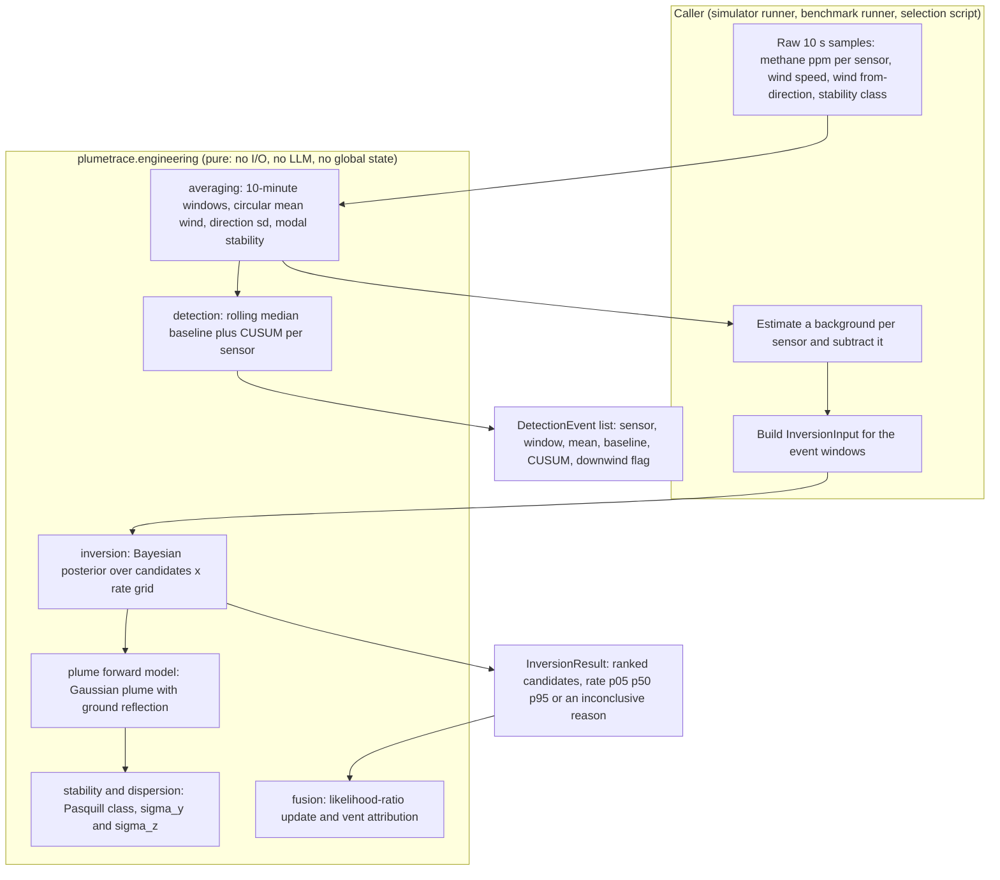
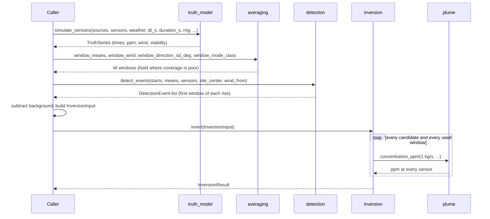
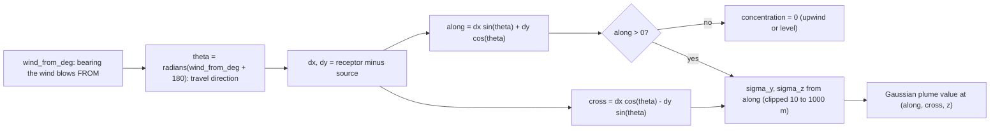

# Physics pipeline: from sensor samples to a ranked source

How a methane reading becomes a ranked emission candidate and a rate interval, end to end, with
the shapes and units at every hop. This page is the map. The detail lives in the pages it links:
[DETECTION.md](DETECTION.md) (averaging and event detection), [DISPERSION.md](DISPERSION.md)
(stability, spreads, plume), [INVERSION.md](INVERSION.md) (source inversion and fusion),
[QUANTIFICATION.md](QUANTIFICATION.md) (gas, flare, blowdown, inventory, intensity),
[TRUTH_MODEL.md](TRUTH_MODEL.md) (the data generator) and [BENCHMARK.md](BENCHMARK.md) (how the
inversion is scored). The contract-level reference for every module stays in
[ENGINEERING.md](ENGINEERING.md).

Everything here describes a **simplified Gaussian plume model on a simulated station** (KS-07 is
fictional). Nothing on this page is a claim about a real site.

## 1. Purpose and scope

Does: show the data path through package `plumetrace.engineering` (and the callers that feed it),
fix the coordinate and unit conventions once, and give one worked chain of numbers.

Does not: restate every equation (see the linked pages), describe the agents (they are not built
yet: the agents will reach these functions only through tools, project rule 4), or describe the
simulator scenarios ([SIMULATOR.md](SIMULATOR.md)).

## 2. The flow



*Figure 1. Data path of one event. Detection finds that a sensor rose; the inversion decides where
the methane came from. The two do not call each other.*

Two rules shape the flow:

- **Detection and inversion are separate.** `detect_events` flags a sustained rise on one sensor.
  It does not locate or size anything. `invert` ignores the detection result and takes the window
  means directly. The caller chooses which windows to invert (the simulator's selection script
  uses the windows from the first leak window to three windows after the first event).
- **Background is the caller's job.** The engineering core has no background estimator. The
  benchmark runner and the simulator's selection script both subtract a per-sensor 5th percentile
  of the window means (in the selection script, over the windows before the first leak window).
  The inversion expects values "above background".

### Shapes and units at each hop

| Hop | Object | Shape | Unit |
|---|---|---|---|
| Truth model or sensor feed | `times_s`, `ppm` | `(T,)`, `(T, S)` | s, ppm |
| Wind feed | `wind_speed_m_s`, `wind_from_deg` | `(T,)` | m/s, degrees clockwise from north |
| `window_means` | window starts, means | `(W,)`, `(W, S)` | s, ppm; NaN where coverage is below 50 % |
| `window_wind` | mean speed, circular mean direction | `(W,)`, `(W,)` | m/s, degrees |
| `window_direction_sd_deg` | circular standard deviation | `(W,)` | degrees; NaN where `window_wind` is NaN |
| `window_mode_class` | most frequent class per window | list of `W` | Pasquill class |
| `detect_events` | `DetectionEvent` | list | ppm, window index, sigmas |
| `InversionInput` | `observed_ppm_above_bg` | `W` rows of `S` | ppm above background; NaN or inf means missing |
| `unit_response_ppm` | response to 1 kg/s | `(C, W, S)` | ppm per kg/s |
| `log_likelihood` | log-likelihood | `(C + 1, Q)` | dimensionless (last row is `NONE`) |
| `invert` | `InversionResult` | one object | kg/h, probability 0 to 1 |

`T` is time steps, `W` complete windows, `S` sensors, `C` emission candidates (21 for KS-07) and
`Q` rate grid points (80).

## 3. One event, step by step



*Figure 2. Call order for a simulated event. With real sensor data the first call is replaced by
the measurement feed; everything after it is the same.*

1. **Generate or receive samples.** In the simulator and the benchmark the samples come from the
   truth model ([TRUTH_MODEL.md](TRUTH_MODEL.md)), which is deliberately different physics from the
   inversion.
2. **Average.** The plume formula predicts a mean over roughly 10 minutes, so the raw 10 s
   samples are averaged into complete windows first.
3. **Detect.** Each sensor column runs its own CUSUM. An event carries the window, the mean, the
   baseline it was compared with and whether the sensor was downwind of the site centre.
4. **Invert.** For every candidate and every usable window the inversion computes the unit plume
   response at every sensor, multiplies by every rate on the grid, and scores the readings.
5. **Decide.** The result is a ranking, a rate with a 90 % interval for the top candidate, or an
   explicit `inconclusive` with a reason.
6. **Fuse (optional).** `fuse` and `attribute_vent_source` update the ranking with process evidence
   such as header flow and packing temperatures.

## 4. Coordinates and the wind convention

Site coordinates are metres, **x east, y north, z up**, origin at the south-west fence corner
(`geometry.py`). The wind direction in every function is the meteorological bearing the wind blows
**from**, in degrees clockwise from north. The plume travels the other way.

```text
                     N  (+y, 0 degrees)
                     ^
                     |
   wind from 270     |
   (blows from W)    |           plume travels toward 90 degrees (east)
   ------------------+----->  E (+x, 90 degrees)
                     | source
                     |
                     S  (180 degrees)

   wind_from_deg = 270  ->  theta = radians(270 + 180) = 90 degrees  ->  east is downwind
   wind_from_deg = 180  ->  theta = 0 degrees                         ->  north is downwind
```



*Figure 3. The receptor transform in `downwind_crosswind_m` and the first test in
`concentration_kg_m3`. A positive `cross` is to the right of the travel direction.*

Values from the pure function for a source at the origin (computed by running
`downwind_crosswind_m`; the tests in `test_plume.py` pin the same convention):

| Wind from | Travel toward | Receptor (x, y) in m | `along` (m) | `cross` (m) | Concentration |
|---|---|---|---|---|---|
| 180 (south) | north | (0, 100) | 100 | 0 | on the axis |
| 270 (west) | east | (100, 0) | 100 | 0 | on the axis |
| 270 (west) | east | (-100, 0) | -100 | 0 | exactly 0 (upwind) |
| 225 (south-west) | north-east | (70.71, 70.71) | 100 | 0 | on the axis |
| 180 (south) | north | (100, 0) | 0 | 100 | 0 (`along` is not above 0) |

A receptor whose `along` is a rounding error above zero (for example `3e-14` for a receptor 100 m
north of a source with wind from 270) is formally downwind, but its `cross` is 100 m, so the value
is zero for every practical purpose.

## 5. Who owns which step

| Step | Module | Detail page | Main tests (`app/backend/tests/engineering/`) |
|---|---|---|---|
| Constants, unit conversions | `constants`, `units` | [QUANTIFICATION.md](QUANTIFICATION.md), [ENGINEERING.md](ENGINEERING.md) | `test_units.py` |
| Gas properties | `gas` | [QUANTIFICATION.md](QUANTIFICATION.md) | `test_gas.py` |
| Stability class | `stability` | [DISPERSION.md](DISPERSION.md) | `test_stability.py` |
| Spreads | `dispersion` | [DISPERSION.md](DISPERSION.md) | `test_dispersion.py` |
| Plume forward model | `plume`, `plume_field` | [DISPERSION.md](DISPERSION.md) | `test_plume.py`, `test_meander.py`, `test_plume_field*.py` |
| Windows, wind statistics | `averaging` | [DETECTION.md](DETECTION.md) | `test_averaging*.py`, `test_window_mode_class.py`, `test_meander.py` |
| Event detection | `detection` | [DETECTION.md](DETECTION.md) | `test_detection*.py` |
| Source inversion | `inversion`, `inversion_input`, `inversion_model` | [INVERSION.md](INVERSION.md) | `test_inversion*.py`, `test_meander.py` |
| Evidence fusion | `fusion` | [INVERSION.md](INVERSION.md) | `test_fusion*.py` |
| Flare, blowdown, inventory, intensity | `flare`, `blowdown`, `emission_factors`, `inventory`, `intensity` | [QUANTIFICATION.md](QUANTIFICATION.md) | `test_flare*.py`, `test_blowdown*.py`, `test_inventory*.py`, `test_intensity*.py` |
| Data generator | `truth_model`, `truth_weather`, `truth_turbulence`, `truth_wake`, `truth_faults` | [TRUTH_MODEL.md](TRUTH_MODEL.md) | `test_truth_*.py` |
| Scoring | package `benchmark` | [BENCHMARK.md](BENCHMARK.md) | `tests/benchmark/` |
| Physical laws | all of the above | this page, section 7 | `test_properties.py` |

The callers in the repository today are `plumetrace.simulator.runner` (simulate, average, detect),
`plumetrace.simulator.selection` (S1 inversion with the direction spread),
`plumetrace.simulator.export` (windows, plume grid), `plumetrace.api.run_store` (calls
`window_means`) and the `benchmark` package. Nothing else in
the repository calls `invert` yet.

## 6. A chain of numbers

Hand arithmetic on values returned by the pure functions (one throwaway run; nothing here is
stored in the repository).

1. **Source.** 36 kg/h of methane, source and receptor both at 2 m, 300 m downwind on the axis,
   wind 4 m/s, stability D, air 290 K at 98 900 Pa. `Q = 36 / 3600 = 0.01 kg/s`.
2. **Spreads at 300 m, class D.** Briggs rural gives `sigma_y` = 23.65 m and `sigma_z` = 14.95 m.
   Martin gives 23.18 m and 12.17 m ([DISPERSION.md](DISPERSION.md)).
3. **Plume.** With Briggs, `C = 2.21e-6 kg/m3` (the vertical bracket is 1.965, the reflection term
   adds 0.965 to the direct term 1). In ppm that is **3.36 ppm** above background. With Martin it
   is **4.17 ppm**.
4. **Reading.** Absolute methane is the 1.95 ppm background (`BACKGROUND_PPM`) plus the plume, so
   5.31 ppm without noise.
5. **Detection.** With a quiet history (sigma at its 0.1 ppm floor) the step is 3.36 / 0.1 = 33.6
   sigma. The CUSUM is `max(0, 0 + 33.6 - 0.5) = 33.1`, above `h_sigma = 5`, so the event is raised
   in the first window of the rise. A smaller step takes more windows ([DETECTION.md](DETECTION.md)
   has a worked series).
6. **Inversion.** The window mean above background is about 3.4 ppm. A candidate whose unit
   response times a rate on the grid reproduces the pattern over all sensors and windows gets the
   posterior mass ([INVERSION.md](INVERSION.md) has a 12-window run).

## 7. Assumptions and limits that cross modules

The full index is in [ENGINEERING.md](ENGINEERING.md) section 4. The ones that matter when
reading any result from this pipeline:

- **Steady state over a window.** The plume is a steady-state formula evaluated at the window-mean
  wind. Wind that wanders inside the window smears the real plume; the optional meander correction
  models that, the default does not.
- **Calm wind is not modelled.** Below 1 m/s the formula divides by a small speed. Calm windows are
  skipped by the inversion.
- **One wind for the whole site.** A single speed and direction per window; no terrain, buildings
  (except in the truth model) or plume rise.
- **Spreads are extrapolated.** The classic fits are extrapolated below 100 m
  (see [ENGINEERING.md](ENGINEERING.md)); distances are clipped to 10 to 1000 m.
- **The probabilities are not calibrated.** See [BENCHMARK.md](BENCHMARK.md).
- **Citations are not verified.** Every coefficient, factor and default is copied from the project
  plan with its source name. None has been checked against the primary publication (owner action
  before the Phase 7 release gate, `docs/OWNER_ACTIONS.md`).

### Failure behaviour

Most functions that take external data raise `ValueError` naming the rejected input; none fills a
default silently. Exceptions: the `units` conversions and `sigmas_m` do not validate, and the window
statistics return NaN (and infinity for exactly cancelling directions) on purpose. NaN and infinity
are used on purpose as "missing" in window averages, the detection series and inversion readings. The full list is in
[ENGINEERING.md](ENGINEERING.md) section 5.

### Physical laws tested

`test_properties.py` (Hypothesis, 200 derandomised examples per test) checks laws that must hold
for any input: the plume is linear in rate, scales as 1/wind speed, is zero upwind, is mirror
symmetric across the axis and unchanged when the scene rotates with the wind; the ppm conversion
round-trips; the circular mean rotates with the data; fusion is a probability and does not depend
on evidence order; an unlit flare never slips less than a lit one; pipeline gas properties stay
physical. The table with sources is in [ENGINEERING.md](ENGINEERING.md) section 7. These tests do
not check mass conservation, monotone fall with distance, or any property of the inversion or the
truth model.

## 8. How to extend

- Keep `plumetrace.engineering` pure. No file or network I/O, no LLM, no global mutable state, no
  `print`. Randomness only through a `numpy.random.Generator` passed in.
- Work in SI with unit suffixes in names (`rate_kg_h`, `u_m_s`, `conc_ppm`, `temp_k`). Convert only
  through `units.py`.
- A new constant goes in `constants.py` with a `# source:` comment and a row in
  [ENGINEERING.md](ENGINEERING.md). Do not add a citation from memory.
- A new stage that feeds the inversion must say who subtracts the background and who chooses the
  windows, as in section 2.
- Any change to a function in this chain updates its detail page, [ENGINEERING.md](ENGINEERING.md)
  and the work log in the same change.

## 9. Changelog

- 2026-11-15: page created (documentation pass for Phase 2).
