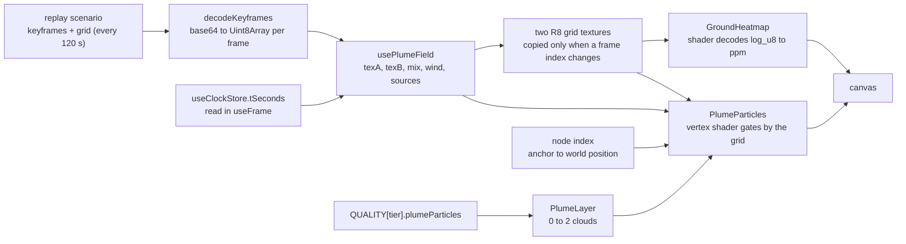
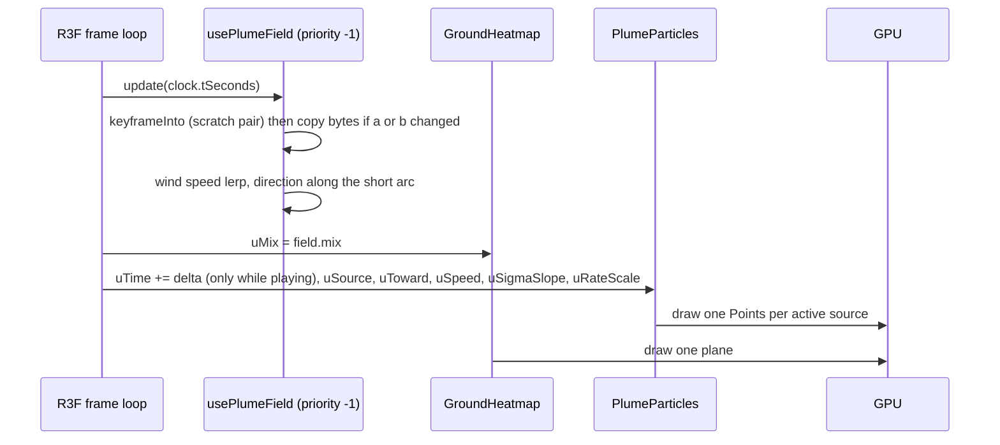
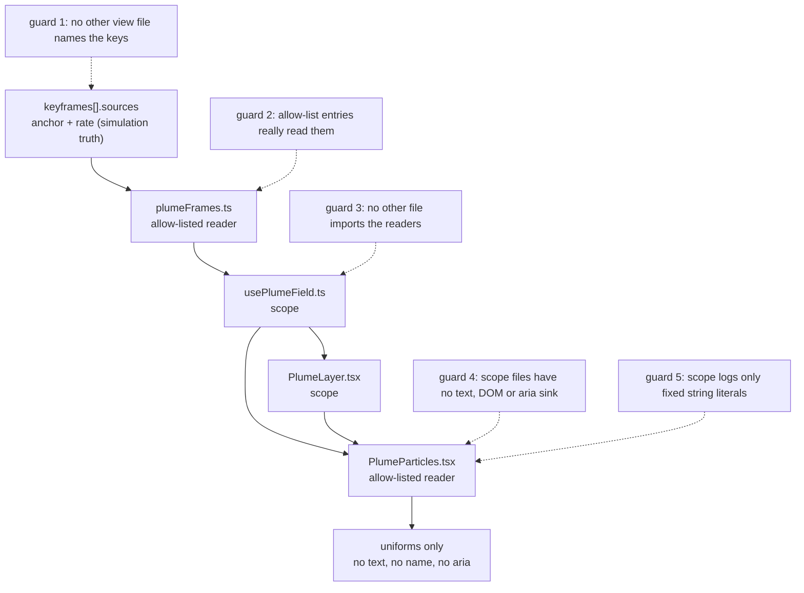

# Plume and effects (3D station view, Task 9)

## Purpose

Built in Phase 4 Task 9 on top of the Task 8 station view ([FRONTEND.md](FRONTEND.md), section "3D
station view (Task 8)"). It draws, inside the R3F canvas, the output of the replay's dispersion
model and a few marker objects: a ground heat-map and a GPU particle cloud (the plume), methane
sensor posts, a windsock, the flare flame, a candidate highlight and the post-processing (bloom, SMAA),
plus a DOM colour legend. Everything is a **visualisation of a simulated station**: the station is
fictional, the plume is the output of a simplified Gaussian model that the backend computed (frontend
rule: it never re-implements the model), and methane itself is invisible.

What it does not do: it shows no emission rate and no inversion result. The replay's
`keyframes[].sources` (anchor and rate) is simulation truth used only to place and brighten the
particles; it is never text, an aria label, a name, a tooltip or a log line (section "Simulation truth
guard"). The candidate highlight is built and tested but **not mounted** (Phase 5).

Built versus planned:

| Part | Status |
|---|---|
| Key-frame decode, grid textures, blend, wind interpolation | built, tested |
| Ground heat-map, particle cloud, `PlumeLayer`, `PlumeLegend` | built, tested; looked at in a browser (high, low) |
| `SensorMarkers`, `WindSock`, `FlareFlame`, `PostEffects` | built, tested; the flame and bloom were seen in a browser on high and low; the sensor posts, rings and windsock were **not** inspected at close range in a browser |
| `CandidateHighlight` | built and tested, **not mounted**; "not R3-compliant until Phase 5 adds the fixed 'model probability' label and benchmark link before mounting" |
| Rate-interval component (R1-R4) | deferred; Task 9 shows no rate |
| Integrated-GPU fps | **not measured** (owner action C6) |

## Diagram: data path



*Caption: from the replay file to pixels. All boxes are built. The only per-frame CPU work is
writing uniforms and, at a key-frame boundary, copying 1,200 bytes into a texture.*

## Diagram: one frame



*Caption: what runs each frame. The field is updated first (priority -1), so the layers read current
values. No `setState`, no `new`, no object or array literal in these callbacks: `keyframeInto` writes
into a module-level scratch pair (the `PlumeLayer` clock-store selector has its own). Pinned by
`plumeMath.into.test.ts`.*

## Module by module

All files are in `app/frontend/src/features/station3d/` and each stays under 250 lines.

| File | Job |
|---|---|
| `plume/plumeMath.ts` | Pure helpers: `decodeLogU8`, `windTowardScene` (and the allocation-free `windTowardInto`), `lerpAngleDeg`, `keyframeAt` (plan helper, allocates one object) and the allocation-free `keyframeInto` with the `KeyframePair` type, `rateScale`, `alphaForPpm`, the visual spread table `SIGMA_SLOPE` and the constants |
| `plume/plumeFrames.ts` | `decodeKeyframes(scenario)`: base64 to bytes per frame, size check |
| `plume/random.ts` | `mulberry32`, `gaussianPairs` (Box-Muller): deterministic particle seeds (seed 7, offsets seed 11) |
| `plume/plumeShaders.ts` | GLSL strings: decode functions, heat-map vertex and fragment, particle vertex and fragment |
| `plume/plumeColors.ts` | Reads a CSS token once and converts it with `Color.setStyle` (sRGB to linear); `RAMP_TOKENS` |
| `plume/heatmapMaterial.ts`, `plume/plumeMaterial.ts` | The two `ShaderMaterial`s (transparent, no depth write, normal blending) |
| `plume/usePlumeField.ts` | The stable field object, the two textures, the per-frame update |
| `plume/GroundHeatmap.tsx` | One plane over the whole site (200 x 150 m), 5 cm above ground, no raycast |
| `plume/PlumeParticles.tsx` | One `Points` per active source (props `{ field, sourceIndex, count, pointSize }`); writes uniforms; hides and logs once for an unknown anchor |
| `plume/PlumeLayer.tsx` | Mounts the heat-map and 0 to 2 clouds; splits the tier's particle budget |
| `plume/PlumeLegend.tsx` | DOM legend, bottom-left of the station area |
| `overlays/SensorMarkers.tsx` | Instanced posts, heads and alarm rings, one hit box per sensor |
| `overlays/WindSock.tsx` | Mast and two-band sock at `MET-01`, direction and droop from the sample's wind |
| `overlays/FlareFlame.tsx` | Billboard teardrop at `FL-601.tip` with a flicker shader |
| `overlays/CandidateHighlight.tsx` | Glowing spheres and one label; not mounted |
| `scene/PostEffects.tsx` | `EffectComposer` with bloom and SMAA on high and medium |

### Data path and decode

A replay file has a key frame every 120 s (`KEYFRAME_STEP_S`): a 40 x 30 grid of 5 m cells from
(0, 0), one byte per cell, encoding `log_u8_0.1_1000ppm` (byte 0 is no gas; byte `b` is
`0.1 * 10^((b - 1) * 4 / 254)` ppm above background). Byte 1 is 0.1 ppm, byte 128 is exactly 10 ppm,
byte 255 is 1000 ppm. The two textures use `RedFormat` + `UnsignedByteType` + `NearestFilter`, so a
sample never mixes two encoded bytes; the shader decodes and then mixes the two decoded values with
`uMix`. Between key frames the field follows **simulation** time: `keyframeAt(t, count)` gives the
frame pair and `mix`; wind speed is interpolated linearly and wind direction along the shortest arc.

`windTowardScene(from)` turns the meteorological "from" bearing into the scene vector the wind blows
toward: `to = from + 180`, spec `(east, north) = (sin to, cos to)`, scene `(x, z) = (east, -north)`
(the same `specToScene` mapping as everything else).

### Threshold, ramp and colours

Concentrations below 1 ppm are discarded. From 1 ppm the ramp is the five methane tokens `--ch4-0` to
`--ch4-4` on a log scale (`t = clamp(log10(ppm) / 2, 0, 1)`, so 1 ppm is the first colour and 100 ppm
the last); opacity is `0.25 + 0.5 t`, at most 0.75 (`alphaForPpm`). The legend (`PlumeLegend`) reads
`Methane above background, ppm (model at 1.5 m)` with five steps `1`, `3`, `10`, `30`, `100+` in the
same tokens and the line `Visualisation of the dispersion model. Methane is invisible.` It is a
solid panel, hidden when no scenario is loaded, and shows no rate.

### Particle model

The cloud is one `Points` per active source (at most two; the tier budget `QUALITY[tier].plumeParticles`
is split evenly: 40,000 on high, 20,000 on medium and 10,000 on low for one source). Positions are
computed in the vertex shader from a per-particle seed and offset: a particle moves `d = age * 250 m`
along the wind, spread sideways and up by the **visual** table `SIGMA_SLOPE[stability]`
(Briggs rural near-field slopes, shape only) times `(d + 2)`, and its opacity comes from the model
grid at its own position (`ppm >= 1`), plus a short fade-in near the source. Nothing is drawn where the
model has no gas, except a small puff within 15 m of the source tip. Time `uTime` is wall-clock seconds
and advances only while the clock plays (a quarter speed with reduced motion), so the drift looks
physical at any playback speed and freezes when paused. Wind speed sets the lifetime
`250 / max(speed, 0.5)`. Brightness scales with `rateScale(rate)` but the rate is never shown.
A source whose anchor is not in the station model is not drawn and logs one fixed message.

### Sensors, windsock, flare, post effects

- **SensorMarkers.** One instanced mesh each for posts (cylinder, radius 0.05 m, height `z_m`), heads
  (0.25 m box) and alarm rings (torus, radius 1.2 m), so three draw calls, plus one 1 x 2.5 x 1 m hit
  box per sensor named `<id>__hit` that hovers and selects the sensor tag. The hit boxes have
  `visible={false}` so they cost no draw call; picking still works because three 0.187.0
  `Raycaster.intersect()` tests only `object.layers`, and the R3F 9.8.2 event code does not look at
  `visible` either (both read in `node_modules`; checked in a browser, see Measurements). Colour per
  instance: `--text-2` normal, `--alarm-med` when the sensor's alarm was raised in the last 30
  simulated minutes (`visibleEvents`, from the alarms feature), `--accent` when selected. Colours
  update only when the sample index or the selection changes. A ring appears under an alarmed sensor
  and scales in over 0.6 s once (full size at once with reduced motion). The Alarms list carries the
  word; the colour and ring are the marker in the scene.
- **WindSock.** At `MET-01` (spec position): mast pole plus an open two-band cone (1.4 m, radius 0.25
  to 0.12) that points the way the wind blows and droops `60 deg * (1 - min(speed, 7) / 7)`. It updates
  once per sample index and has no animation.
- **FlareFlame.** A billboard (1.2 x 2.4 m, yaw only) at `FL-601.tip`; the pilot is lit in every
  scenario. Flicker `0.85 + 0.15 sin(t * 13 + sin(t * 7))`. The colour `#ffb347` is multiplied by 4
  on high and medium so it passes the bloom threshold; on low (no bloom) the gain is 1.
- **PostEffects.** `EffectComposer multisampling={0}` with `Bloom luminanceThreshold={1} mipmapBlur
  intensity={0.6}` and `SMAA` on high and medium; not mounted on low.

## Simulation truth guard

`keyframes[].sources` may be read only by two files. The guards are in `src/app/viewGuards.test.ts`
(owner-approved deviation, 2026-11-16 P4 T9, exact-file allow-list):



*Caption: the allow-listed readers are `plume/plumeFrames.ts` and `plume/PlumeParticles.tsx`; the scope
(files that may import them and are searched for sinks) also holds `usePlumeField.ts` and
`PlumeLayer.tsx`. Dotted lines are static tests.*

1. The existing test "no view reads keyframes[].sources" (`/keyframes|rate_kg_h|anchor_id/` over
   `features/` and `app/`) now skips only the two allow-listed files.
2. "plume truth allow-list is exact": every entry starts with `src/features/station3d/plume/`, exists,
   and really matches the pattern (no dead or over-broad entries). `usePlumeField.ts` does not contain
   the names, so it is in the scope but not in the allow-list (the delegate's list had it as a reader;
   guard 2 would have failed on a dead entry).
3. "nothing outside the plume truth scope imports the readers" (`plumeFrames`, `usePlumeField`,
   `PlumeParticles`).
4. "plume truth scope has no text, DOM or aria sink" (`<Html`, `<Text`, `aria-`, `title=`, `alt=`,
   `label=`, `textContent`, `innerText`, `innerHTML`, `dangerouslySetInnerHTML`, `data-*`, `document.`).
5. "plume truth scope logs only fixed string literals" (every `console.x(` call has a single
   double-quoted literal without `$` or backslash).

Runtime guard: `plume/plumeTruth.test.tsx` renders the legend, then the layer, markers, windsock and
flare with a source of 37.25 kg/h at `VS-250.tip`, and fails if any text, innerHTML, scene object name,
`userData` or console argument contains `37.25`, `37.3`, `37.2`, `VS-250` or `kg/h` (and for an unknown
anchor `XX-999`). The unknown-anchor message is fixed:
`plume source anchor not found in the station model; source not drawn`.

## Measurements (2026-11-17, review camera, 1920 x 1080 browser viewport, S1 at +02:20, clock playing at 1x)

Hardware: NVIDIA GeForce RTX 3050 Laptop GPU, a **discrete GPU, not the integrated one**; 144 Hz
display. **No integrated-GPU fps is claimed** (owner action C6).

**Definition of the draw-call budget (owner ruling, 2026-11-16).** "300 draw calls as rendered" is
the sum of `gl.info.render.calls` over every `renderer.render` call that makes one displayed frame
(the sun's shadow pass and scene pass, then each post-processing pass: bloom, SMAA, copy), measured at
`REVIEW_CAMERA` in a 1920 x 1080 browser viewport with the clock playing, on tiers high, medium and
low. The budget stays 300. The counts were read through a temporary probe (an `onCreated` hook that
wrapped `renderer.render`, set `info.autoReset = false` and summed the per-call deltas); it was removed
afterwards and a search of `src/` finds none of its names. The canvas inside that viewport is
1240 x 768 (the layout, not the viewport, sets the canvas size), device pixel ratio 1.

| Tier | Scene pass calls | All passes calls (render calls) | Triangles (all passes) | fps |
|---|---|---|---|---|
| high | 277 | 296 (20) | 142,613 | average 143.9 over 30 s |
| medium | 277 | 296 (20) | 142,613 | 6 s sample earlier: 144 |
| low | 121 | 121 (1) | 55,514 | 6 s sample earlier: 144 |

The scene pass includes the shadow pass and the hit boxes that are still visible (equipment hit
proxies). Before the fix round the same counts were 280 / 299 (high, medium) and 124 / 124 (low); making the
eight sensor hit boxes `visible={false}` removed 3 calls on every tier (only the boxes inside the
frustum were drawn). The Task 8 figures without the plume layer were 272 / 272 / 116. The budget as
defined holds on all three tiers, with **a margin of 4 on high and medium**; any new scene feature needs a
new check. The `HitProxies.tsx` change that was pre-approved as a second step was not needed and
was not made.

Frame rate, high tier, 30 s, `requestAnimationFrame` sampler in the page (4,316 frames in 30.0 s):
S1 with the clock playing from +02:20:00 to +02:20:59 and the camera reset to `REVIEW_CAMERA` first:
average **143.9 fps**, median 6.9 ms, **p95 7.1 ms**, p99 7.3 ms, slowest frame 28.7 ms. The display
refreshes at 144 Hz, so the frame rate is capped by the display: the result shows the 58 fps target is
met on this discrete GPU, not what an integrated GPU would do. The medium and low figures stay as
the earlier 6 s samples.

**Repeatable since Task 11 (2026-11-17).** `app/frontend/e2e/fps.spec.ts` (`npm run e2e:fps`) now
measures the same definition without any code in the app: `e2e/gpuProbe.ts` reads `renderer.info`
through the `__THREE_DEVTOOLS__` hook, turns `info.autoReset` off, and sums and resets it once per
animation frame (120 frames per case), with a raw WebGL draw-call counter as a cross-check. Results,
S1 +02:20 and the S4 blowdown peak (7200 s), high / medium / low: **296 / 296 / 121** draw calls
(identical to the table above; GL draws equal them), triangles 142,613 / 142,613 / 55,514, and the
test fails above 300. Details and the extra figures: [TESTING.md](TESTING.md#browser-tests-playwright-phase-4-task-11).

Picking after `visible={false}` (browser, `REVIEW_CAMERA`): a ray cast at the screen position of
`AT-105` hit `AT-105__hit` first (and `AT-106__hit` only behind `VS-250__hit`); with the real mouse the
cursor turned to a pointer over `AT-105`, the tag label showed `AT-105`, and a click changed the
selection from `VS-250` to `AT-105`.

## Worked example (real values)

S1 (`s1_rod_packing`), simulation time 8400 s (+02:20:00), key frame 70: wind 3.79 m/s from 11.6
degrees, stability C. `windTowardScene(11.63)` is `[-0.202, 0.980]` (toward the south, slightly west).
The grid has 142 non-zero cells (lower-left corners at x 25 to 90 m and y 0 to 70 m) and a maximum of
1.63 ppm. The 37 cells at 1 ppm or more are a smaller patch: lower-left corners at x 45 to 70 m and
y 0 to 40 m, south of the vent stack at (85, 115) (checked by decoding frame 70 of the replay file with a
throwaway script). The browser showed exactly that: a pale
`--ch4-0` patch south-south-west of `VS-250`, a particle puff at the stack tip, nothing elsewhere.
At 8470 s `keyframeAt(8470, 180)` is `{ a: 70, b: 71, mix: 70 / 120 }`. The S4 scenario (planned
blowdown) at 7500 s reaches the last ramp colour (maximum byte 206 over all frames, about 169 ppm); S5 (sensor drift) has no
non-zero byte in any frame, and the browser at 15,000 s shows no heat-map and no particles.

## Edge cases and the test that pins each

| Case | Behaviour | Test |
|---|---|---|
| Byte 0, 1, 128, 255 | 0, 0.1, 10, 1000 ppm | `plumeMath.test.ts` "decodes the backend log_u8 encoding" |
| Wind from 270 and 0 | toward `+x` and `+z` in the scene | `plumeMath.test.ts` "turns a meteorological ..." |
| Direction wrap 350 to 10 | shortest arc | `plumeMath.test.ts` "interpolates angles ..." |
| No key frames, after the last frame | `{0, 0, 0}`; mix 0 | `plumeMath.test.ts`, `PlumeLayer.test.tsx` "after the last key frame ..." |
| Time before the first key frame (t < 0) | `{ a: 0, b: 1, mix: 0 }`: the mix is clamped to `[0, 1]` | `plumeMath.into.test.ts` "clamps the mix ..." |
| Frame loop and clock selector must not allocate | `keyframeInto` writes into a scratch pair, returns the same object and equals `keyframeAt` for t = -5, 130, 1e9 and count 0 | `plumeMath.into.test.ts` "keyframeInto writes into ..." |
| Sensor hit boxes cost no draw call | `visible === false` on all four hit boxes; picking unaffected (checked in a browser) | `SensorMarkers.test.tsx` "keeps the hit boxes invisible ...", "selects the sensor tag ..." |
| Grid of the wrong size | `Error("plume grid has 3 bytes, expected 1200")` | `plumeFrames.test.ts` |
| Source not yet active | no `Points` | `PlumeLayer.test.tsx` "draws no particles before ..." |
| Pause | `uTime` stops | `PlumeLayer.test.tsx` "blends ..." |
| Reduced motion | particles, flare at a quarter speed; ring at full size at once | `PlumeLayer.test.tsx`, `FlareFlame.test.tsx`, `SensorMarkers.test.tsx` |
| Two sources | two clouds, half the budget each (20,000 on high) | `PlumeLayer.test.tsx` "splits ..." |
| Unknown anchor | hidden, one fixed `console.error` | `PlumeLayer.test.tsx`, `plumeTruth.test.tsx` |
| Rate or anchor reaching the DOM, a name, `userData` or the console | never | `plumeTruth.test.tsx`, `viewGuards.test.ts` (five guards) |
| Four sensors | post, head and ring instance counts are 4 | `SensorMarkers.test.tsx` |
| Sensor click | selects the tag | `SensorMarkers.test.tsx` |
| Alarm older than 30 min | colour returns to normal | `SensorMarkers.test.tsx` |
| Calm and strong wind | sock droop 60 degrees and 0 | `WindSock.test.tsx` |
| Unknown candidate anchor | skipped | `CandidateHighlight.test.tsx` |
| Glow | `1 + 3 p` (3.61 and 1.3 for 0.87 and 0.10) | `CandidateHighlight.test.tsx` |
| Legend text and tokens, no rate, hidden without a scenario | | `PlumeLegend.test.tsx` |

## Deviations from the plan (owner-ratified, 2026-11-16 review)

| Deviation | Why | Where |
|---|---|---|
| `PlumeLayer.test.tsx` uses 3 key frames; the plan's 2-frame seek-130 case gives mix 0 by the plan formula (`keyframeAt(130, 2)` is `{ a: 1, b: 1, mix: 0 }`). A separate 2-frame clamped test stays. The plan file is not edited | The plan test cannot pass as written | `PlumeLayer.test.tsx` |
| `keyframeAt` clamps `mix` to `[0, 1]` (changes only t < 0); `keyframeInto(t, count, out)` and `KeyframePair` added for the frame loop; `keyframeAt` delegates to it, so the plan tests pass unchanged | Rule 21: no allocation in `useFrame` or in the clock-store selector | `plumeMath.ts`, `usePlumeField.ts`, `PlumeLayer.tsx` |
| `PlumeParticles` props are `{ field, sourceIndex, count, pointSize }` (plan: `{ sourceIndex }`) | The component reads the shared field object and the tier's count and size from its parent | `PlumeParticles.tsx` |
| New `plume/plumeColors.ts`, a shared reader of CSS tokens for 3D colours; the private reader in `SelectionBox` is not refactored | Rule 15 (scope) | `plumeColors.ts` |
| `viewGuards.test.ts` has two extra test helpers, `viewSources` and `read` | Shared by the five plume guards | `viewGuards.test.ts` |
| The 8 sensor hit boxes are `visible={false}` | Budget as rendered (see Measurements) | `SensorMarkers.tsx` |

Known limits, found in this task:

- Between two key frames the grids are blended (plan decision), so the heat-map begins to fade in up to
  120 simulated seconds before a source starts (half strength 60 s before). Not captured in a browser.
- When the wind speed changes between key frames the shader's `fract(uTime / life + offset)` changes
  the particle phases; this is the plan's shader and was not changed.
- The S1 plume is weak (maximum 1.6 ppm at 1.5 m): it uses only the first ramp colour at 25 percent
  opacity on a grey ground, so it is faint by design; no concentration is exaggerated.
- In S1 the alarmed sensors (`AT-101` at 8400 s, `AT-102` at 10,800 s) are not under a cell of 1 ppm or
  more at the time of the alarm; the heat-map and the alarms do not coincide in this scenario.
- The grid cells are 5 m and not smoothed, so the heat-map has stair-step edges.

## How to run and extend

```bash
cd app/frontend
npm run test -- src/features/station3d/plume src/features/station3d/overlays src/app/viewGuards
npm run dev -- --mode replay      # then pick a scenario and seek with the time slider
```

Add a new overlay under `overlays/`, mount it in `model/StationScene.tsx`, keep per-frame work to
uniform and ref writes (no `setState`, no `new`, no object or array literal; use `keyframeInto`
and `windTowardInto` style helpers that write into a scratch value), read colours from CSS tokens, and re-measure the draw
calls. A new file that reads replay sources must be added to the allow-list in `viewGuards.test.ts`
and satisfy its five guards. A UI that shows a rate or a probability must first add the R1-R4
rate-interval component. `CandidateHighlight` must get the fixed "model probability" label and the
benchmark link before it is mounted.

## Links

[FRONTEND.md](FRONTEND.md) (view, tiers, display rules) · [REPLAY.md](REPLAY.md) (file format, `log_u8`
encoding) · [DESIGN_SYSTEM.md](DESIGN_SYSTEM.md) (tokens) · [UI_PANELS.md](UI_PANELS.md) (guards) ·
[STATION_MODEL.md](STATION_MODEL.md) (anchors) · [SECURITY.md](SECURITY.md) ·
`.claude/skills/frontend-3d/references/plume-and-effects.md` · Evidence:
`docs/evidence/2026-11-phase-4-plume-s1.png`, `2026-11-phase-4-plume-s4.png`.

## Library check (rule 1)

Context7 was unavailable again (`plugin:context7:context7 needs authentication`), so the pinned
installed packages were read instead: three 0.187.0 (`ShaderMaterial`, `DataTexture`, `RedFormat`,
`UnsignedByteType`, `Points`, `BufferAttribute`, `#include <colorspace_fragment>`),
@react-three/postprocessing 3.2.2 (`dist/EffectComposer.d.ts`, `effects/Bloom.d.ts`, `effects/SMAA.d.ts`),
postprocessing 6.39.6 (peer), @react-three/drei 10.7.9 (`Billboard.d.ts`, `Html.d.ts`),
@react-three/fiber 9.8.2 (`useFrame` priority, `invalidate`).

## Design critique (rule 22)

Done by the `design-skills:design-critique` method on the two evidence screenshots (S1 and S4,
1600 x 900); `impeccable` was not run. Findings: the legend is legible (text-1 on a solid surface-1,
five discrete swatches with the unit in the title) and names what the picture is; the swatch labels
sit under the left edge of each step, so a reader may take `1` as a point and not a lower bound
(severity 1; the plan fixes the labels); the solid legend covers the lower-left of the scene at wide
camera angles (severity 2); the stack puff looks like smoke and is not keyed in the legend, only
covered by the caption (severity 1); S4 reads clearly across the whole ramp, S1 is faint (see limits);
stair-step cell edges are honest to the 5 m grid. Nothing was changed after the critique.

## Changelog

- 2026-11-16: Phase 4 Task 9: page created.
- 2026-11-17: Phase 4 Task 9 fix round: allocation-free `keyframeInto`, deviations section, sensor
  hit boxes invisible, draw calls re-measured as rendered at 1920 x 1080 on three tiers, 30 s fps run,
  corrected the 1 ppm patch extent, stale built and planned labels fixed across the docs.
