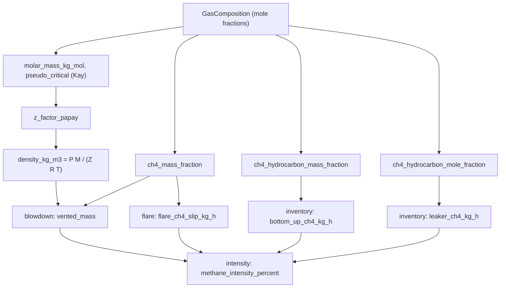
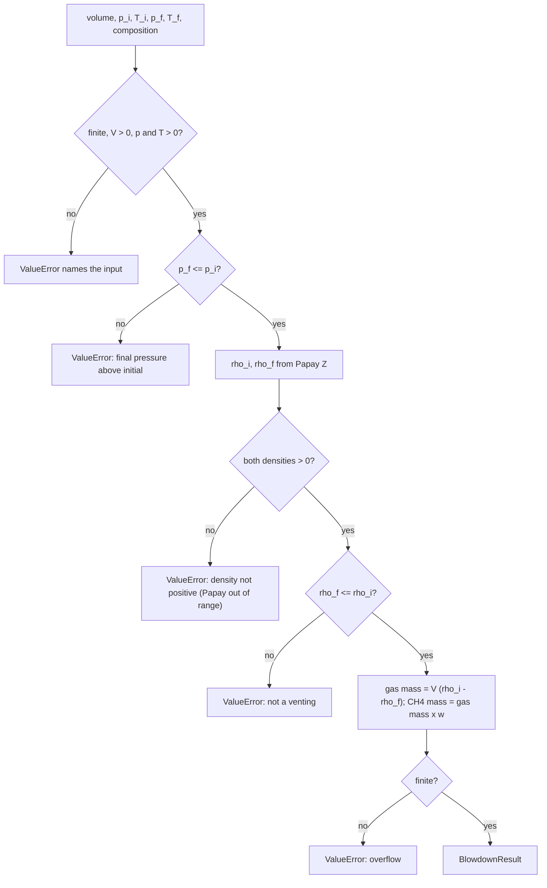
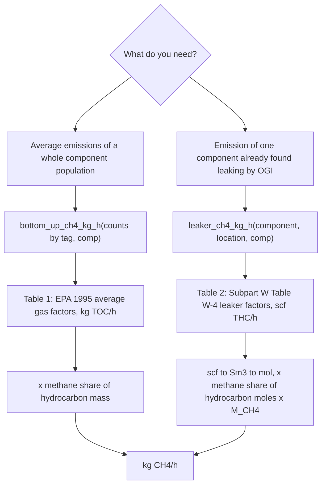

# Quantification: units, gas, flare, blowdown, inventory, intensity

How PlumeTrace turns a known process state into a methane mass or rate: unit conversions, gas
properties, flare methane slip, blowdown vented mass, the emission-factor inventory and methane
intensity. Modules `plumetrace.engineering.constants`, `units`, `gas`, `flare`, `blowdown`,
`emission_factors`, `inventory` and `intensity`. This is the bottom-up side of the engineering
core; the top-down side (finding a leak from sensors) is in [INVERSION.md](INVERSION.md). Tables of
constants and emission factors, and their source comments, are in [ENGINEERING.md](ENGINEERING.md).

Citation disclosure: every constant, factor and default named here (CODATA 2018, NIST Chemistry
WebBook, ISO 13443, IPCC AR6, Papay 1968, EPA-453/R-95-017 Table 2-4, 40 CFR 98 Subpart W Tables
W-1B and W-4, AP-42 section 13.5, OGMP 2.0 98 %, OGCI methane intensity) is copied from the code
comments and the project plan. None has been checked against the primary publication yet (owner
action before the Phase 7 release gate, `docs/OWNER_ACTIONS.md`). The station is fictional and
simulated; the gas composition is an illustrative owner-chosen mix (Gate 1), not a measured gas.

The R1 to R4 rate display rule ([INVERSION.md](INVERSION.md) section 6) applies to inversion and
fusion outputs. It does **not** apply to the bottom-up inventory KPI.

## 1. Purpose and scope

Does: hold every physical constant once with its source, convert units at the edges so the rest of
the core works in SI, and compute five quantities with tested pure functions: the real-gas density
and methane fractions of a gas, the methane that slips past a flare, the methane in a blowdown, a
bottom-up site inventory and one found leaker, and methane intensity.

Does not: read the facility files (the callers pass counts and composition in), decide what a
blowdown vents to, or turn a rate into an annual figure without a duration the caller supplies.

## 2. How it works



*Figure 1. Dependencies. The gas composition feeds every quantity; `intensity` takes any methane
rate the caller passes. Arrows into `intensity` are options, not a fixed chain.*

## 3. Constants and units (`constants`, `units`)

`constants.py` defines named `Final[float]` values. The ones used below:

| Name | Value | Unit | Source named in the code |
|---|---|---|---|
| `R_J_MOL_K` | 8.314462618 | J/(mol K) | CODATA 2018 |
| `M_CH4_KG_MOL` | 0.016043 | kg/mol | NIST Chemistry WebBook |
| `T_STD_K`, `P_STD_PA` | 288.15, 101325.0 | K, Pa | ISO 13443 standard reference conditions |
| `FT3_TO_M3` | 0.028316846592 | m3 per ft3 | exact (1 ft = 0.3048 m) |
| `GWP100_CH4_FOSSIL`, `GWP20_CH4_FOSSIL` | 29.8, 82.5 | kg CO2e per kg CH4 | IPCC AR6 WG1 Ch. 7, Table 7.15 |
| `BACKGROUND_PPM` | 1.95 | ppm | approximate global mean surface CH4 (design section 5) |
| `HOURS_PER_YEAR` | 8760.0 | h | non-leap year |

`units.py` conversions (ideal gas law for the concentration conversions; array input keeps its
shape):

```
kg_h_to_kg_s:  rate / 3600                    kg_h_to_t_yr:  rate x 8760 / 1000
kg_m3_to_ppm:  conc x R T / (P M) x 1e6       ppm_to_kg_m3:  ppm x 1e-6 x P M / (R T)
scf_to_sm3:    volume x FT3_TO_M3             co2e_kg:       ch4_kg x GWP (100-year or 20-year)
```

Example: pure methane at 15 degC and 101 325 Pa is 0.67850 kg/m3, so 1 ppm is 0.6785e-6 kg/m3.
`scf_to_sm3` ignores the 60 degF versus 15 degC reference difference (about 0.2 %). The conversions
do not validate: a zero temperature or pressure gives inf or nan.

## 4. Gas properties (`gas`)

`GasComposition` (frozen Pydantic model) holds `mole_fractions` over the components in
`GAS_COMPONENTS` (`CH4`, `C2H6`, `C3H8`, `nC4H10`, `CO2`, `N2`). It rejects an unknown component,
a negative value and a sum that differs from 1 by more than 1e-6.

| Function | Formula |
|---|---|
| `molar_mass_kg_mol` | sum of `x_i M_i` |
| `pseudo_critical` | Kay's rule: `Tpc = sum x_i Tc_i`, `Ppc = sum x_i Pc_i` |
| `z_factor_papay` | `Pr = P/Ppc`, `Tr = T/Tpc`, `Z = 1 - 3.52 Pr exp(-2.260 Tr) + 0.247 Pr^2 exp(-1.878 Tr)` (Papay 1968) |
| `density_kg_m3` | `P M / (Z R T)` |
| `ch4_mass_fraction` | `x_CH4 M_CH4 / M_mix` (whole gas) |
| `ch4_hydrocarbon_mass_fraction` | `x_CH4 M_CH4 / sum over hydrocarbons x_i M_i` (total-organic-compound factor to CH4) |
| `ch4_hydrocarbon_mole_fraction` | `x_CH4 / sum over hydrocarbons x_i` (total-hydrocarbon volume to CH4) |
| `std_volume_to_ch4_kg` | `(P_STD V / (R T_STD)) x_CH4 M_CH4` |

Worked values for the KS-07 gas (CH4 0.93, C2H6 0.035, C3H8 0.008, nC4H10 0.002, CO2 0.01, N2
0.015), from the pure functions: molar mass 0.017302 kg/mol, methane mass fraction 0.86234. At
7.0 MPa and 300 K, `Z` = 0.86248 and the density is 56.297 kg/m3 (Pr 1.52, Tr 1.53). Papay is valid
for sweet natural gas at moderate reduced pressures; it is not AGA8 and not valid for sour or rich
gas. Tests: `test_gas.py`.

## 5. Flare (`flare.flare_ch4_slip_kg_h`)

```
lit:    slip = (1 - DE) x flared_gas_kg_h x w
unlit:  slip =            flared_gas_kg_h x w
```

`w` is `ch4_mass_fraction`, `DE` the destruction efficiency. `DEFAULT_DESTRUCTION_EFFICIENCY` = 0.98:
the code comment calls it the default for a lit, well-operated flare in OGMP 2.0 guidance and EPA
AP-42 section 13.5, and notes real efficiency varies with wind and flow (design section 5.3). With
the pilot out nothing is destroyed (scenario S3). `DE` is not used for an unlit flare but is still
validated.

Example (the value of `w` from `test_flare.py`; the KS-07 gas has 0.86234): 100 kg/h of gas with `w` = 0.8624 carries 86.24 kg/h of methane. Lit at `DE` = 0.98: 1.7248
kg/h. Unlit: 86.24 kg/h.

Failures: `ValueError` for a negative, NaN or infinite flow, `w` or `DE` outside 0 to 1 (NaN
included, also when unlit). `DE` of 0 and 1 are allowed. The result is never above
`flared_gas_kg_h x w`. Limits: one fixed `DE`; the pilot is binary (a partly blown-out flame is not
represented); the flow and pilot status come from instruments the function cannot check; only
methane slip is computed. Tests: `test_flare.py`, `test_flare_edges.py`.

## 6. Blowdown (`blowdown.vented_mass`)

```
gas_mass_kg = V x (rho(p_i, T_i) - rho(p_f, T_f))
ch4_mass_kg = gas_mass_kg x ch4_mass_fraction
```

`rho` is the real-gas density above; all pressures are absolute. `vented_mass(volume_m3,
p_initial_pa, t_initial_k, p_final_pa, t_final_k, comp)` returns a frozen
`BlowdownResult(gas_mass_kg, ch4_mass_kg)`. In scenario S4 the caller supplies the isolated volume
from the facility spec.



*Figure 2. Validation and result of `vented_mass`. It never returns NaN, infinity or a negative
mass.*

Worked example (KS-07 gas): 10 m3 from 7.0 MPa and 300 K to 98.9 kPa and 300 K. `Z` = 0.86248 and
`rho` = 56.297 kg/m3 at the start; `Z` = 0.99761 and `rho` = 0.68766 kg/m3 at the end. Vented gas
= 10 x (56.297 - 0.68766) = 556.09 kg; methane at mass fraction 0.86234 = 479.54 kg (the code
returns 556.091 and 479.539 kg).

Equal pressures and temperatures give 0 kg. A final pressure at or below ambient is accepted: the
function does not know the ambient pressure. Limits: only start and end states are used (no choked
flow, no cooling by expansion, no wall heat), so the caller supplies `T_f`; a real blowdown cools
the gas, so using the start temperature slightly overstates the mass. Dead legs and inflow from
outside the isolated section are not modelled. The mass is released, not necessarily emitted: if the
blowdown goes to the flare, the methane that reaches the atmosphere is the flare slip, not this mass.
Tests: `test_blowdown.py`, `test_blowdown_edges.py`.

## 7. Inventory (`emission_factors`, `inventory`)

Two jobs, two tables, two functions. They are not additive without care: the bases and origins
differ.



*Figure 3. Which inventory function answers which question.*

`bottom_up_ch4_kg_h` sums, over every equipment tag, `valves x f[valves] + connectors x
f[connectors] + open_ended_lines x f[open_ended_lines] + pressure_relief_valves x f[others]`
(relief valves take the "others" factor) and multiplies by `ch4_hydrocarbon_mass_fraction`. Flanges
and pump seals have factors in the table but no count in the interface, so they are not summed. The
input is a mapping tag to `ComponentCountsDict` (the facility package's `ComponentCounts.model_dump()`;
`engineering` never imports `facility`).

`leaker_ch4_kg_h` converts `scf_h x FT3_TO_M3 x (P_STD_PA / (R T_STD_K)) x ch4_hydrocarbon_mole_fraction
x M_CH4_KG_MOL`.

Worked values (KS-07 gas, from the pure functions):

| Case | Result |
|---|---|
| One compressor, 73 valves, 179 connectors, 3 open-ended lines, 4 relief valves | 0.4055 kg TOC/h x 0.90746 = 0.36798 kg CH4/h (about 3.2 t CH4 per year if it ran all year) |
| Non-compressor valve leaker (10.5 scf/h) | 0.19243 kg CH4/h |
| Compressor valve leaker (24.2 scf/h) | 0.44349 kg CH4/h |

Failures (`ValueError`, never NaN): a gas without hydrocarbons, a count that is missing, negative,
not an integer (booleans and floats included) or so large the rate is not finite (the message names
the tag and field), an unknown component or location. An empty mapping gives 0.0.

**Limits that matter.** The component counts for KS-07 are an **unverified proxy**: Subpart W Table
W-1B production and gathering-and-boosting default counts used for a transmission compressor
station (owner accepted at Gate 1, transcription still to be verified). The average factors
describe an early-1990s US production population applied to a different kind of site, so treat the
site total as an order of magnitude, not a measurement. The W-4 factors are per leaker, not per
component, and say nothing about how often a component leaks or for how long. Tests:
`test_inventory.py`, `test_inventory_edges.py`.

## 8. Methane intensity (`intensity.methane_intensity_percent`)

```
intensity [%] = (ch4_emitted_kg_h / rho_CH4,std) / throughput_sm3_h x 100
rho_CH4,std = ppm_to_kg_m3(1e6, T_STD_K, P_STD_PA) = 0.67850 kg/Sm3
```

The basis is volume: emitted methane volume at standard conditions over gas handled volume,
following the OGCI methane-intensity methodology as cited in the code. Example: 6.785 kg/h is
10.000 Sm3/h; over 1000 Sm3/h that is 1.000 %. For the KS-07 station, 1 kg/h over 1000 Sm3/h is
0.1474 %.

`ValueError` for a throughput that is zero, negative, NaN or infinite, an emission that is negative,
NaN or infinite, or an overflowing ratio. Zero emission gives 0 %. The result is not capped at
100 %. Limits: it is an instantaneous rate over an instantaneous flow (a reported intensity is
normally annual; the caller must use rates and flows covering the same period); what counts as
"gas handled" is the caller's choice; ideal gas at 15 degC. Tests: `test_intensity.py`,
`test_intensity_edges.py`.

## 9. Configuration

None. Constants are code, not settings.

## 10. Testing and evidence

`test_units.py`, `test_gas.py`, `test_flare*.py`, `test_blowdown*.py`, `test_inventory*.py` and
`test_intensity*.py` in `app/backend/tests/engineering/`; hand calculations are in the test
docstrings. `test_properties.py` checks the ppm round trip, an unlit flare never slipping less
than a lit one, and that gas properties stay physical for CH4 of 85 % or more over 1 to 80 bar and
260 to 330 K. Run from `app/`: `uv run pytest backend/tests/engineering -q`.

## 11. How to extend

- A new constant goes in `constants.py` with a `# source:` comment, never inline in a model.
- A new gas component needs critical constants, a molar mass and a source, and decides whether it
  counts as a hydrocarbon (`HYDROCARBONS`).
- A new emission-factor table is a new read-only mapping with its source comment; keep the TOC and
  THC bases separate and say which function uses which.
- Keep `engineering` free of facility imports: callers pass plain values and typed dicts in.
- Any change to a factor or constant changes the simulator's scenario numbers; regenerate and
  review the replay files and the evidence documents.

## 12. Changelog

- 2026-11-15: page created (documentation pass for Phase 2).
