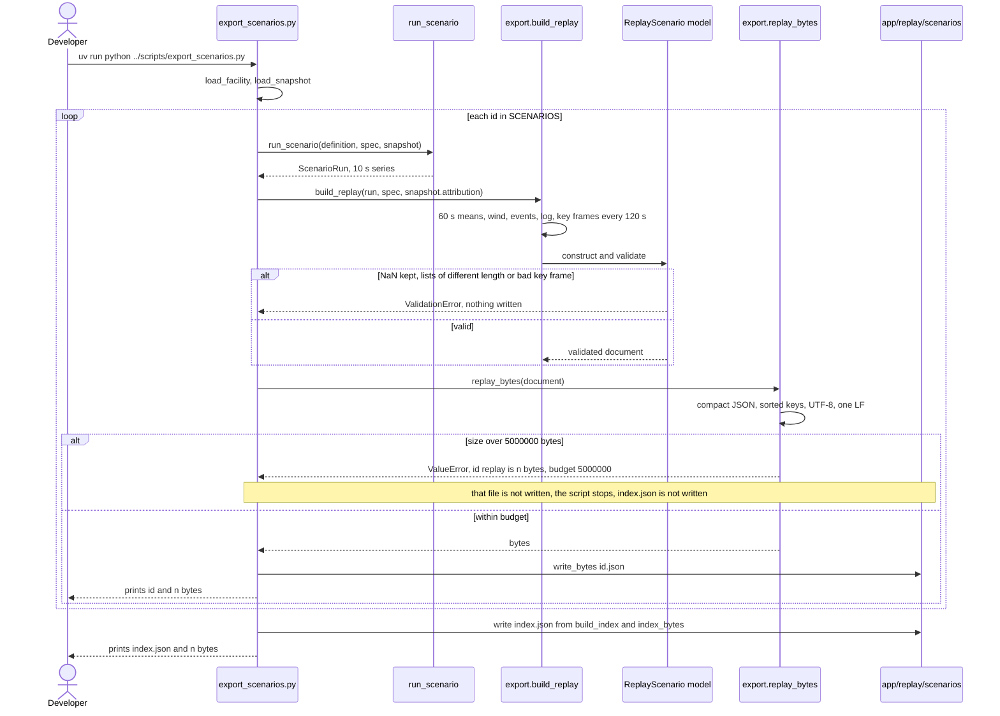
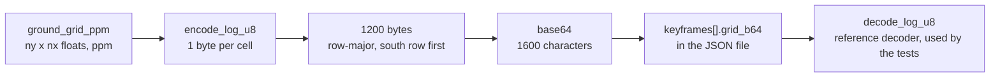
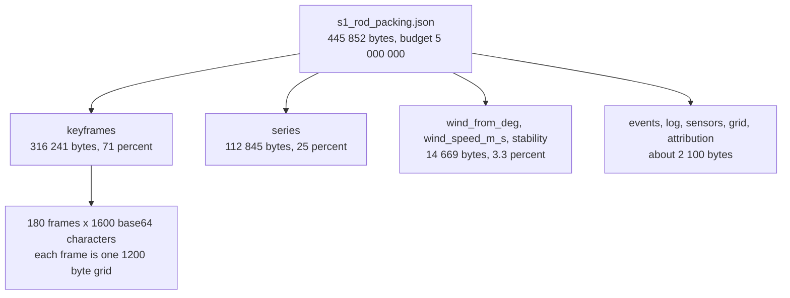

# Replay files

## Purpose and scope

One JSON file per scenario in `app/replay/scenarios/` (`s1_rod_packing.json`,
`s4_planned_blowdown.json`, `s5_sensor_drift.json`) plus `index.json`. The static replay build reads
them; they hold the simulated station only: sensor, instrument and wind series, detection events,
the station log and plume key frames. **They are generated. Never edit them by hand.**

This page documents the Phase 3 scenario files. Recorded agent traces, branches and the static
build are added to the replay data in later phases and are not described as implemented here.

Source of truth: `plumetrace.simulator.replay_schema` (format), `plumetrace.simulator.export`
(builder), `plumetrace.engineering.plume_field` (grid and byte code). The TypeScript types are
generated from the same models (`scripts/export_contract.py`, then `npm run gen:types`).

## How a file is made



*Export sequence: every scenario is simulated, validated, size-checked and written as bytes; an over-budget file stops the script before it writes anything for that id.*

The pipeline from weather to file is drawn in [SCENARIOS.md](SCENARIOS.md) (scenario run
pipeline). The export runs the simulation again; it does not read the database.

## Honest labelling

- `simulated` is always `true`: station KS-07 is fictional.
- The weather is **real** public data (Open-Meteo, CC BY 4.0). The station, the sensor readings,
  the instruments and the scenario are **synthetic**. `attribution` holds both: the Open-Meteo
  credit from the weather snapshot, then the fixed sentence "Station KS-07 is fictional and
  simulated; sensor, instrument and scenario data are synthetic. Only the weather is real."
- The file holds **no inversion result and no AI output**. Rate display rule (R1 to R4, owner
  decision 2026-11-14): when a later task adds an inversion result to a replay, a rate is stored
  only as an interval (p05, p50, p95 in kg/h) with the flags `inconclusive`, `rate_at_grid_edge`,
  the top candidate and its probability; a result that is inconclusive, has top `NONE` or sits at
  the grid edge is stored as "not quantified" with its reason; probabilities are model
  probabilities, not calibrated. No single point rate is ever stored for display.
- `keyframes[].sources[].rate_kg_h` is the **simulation input** (the truth used to draw the
  plume), not a measurement and not an estimate. The interface must not show it as a result: never
  as text, number, tooltip, aria label or log line, and never passed to an agent tool (Gate 3
  ruling).

## Format (schema version 1)

Every model rejects unknown fields and non-finite numbers (NaN, infinity). A file that loads
(`ReplayScenario.model_validate_json`) is therefore complete and consistent.

| Field | Type | Meaning |
|---|---|---|
| `schema_version` | `1` | Format version; any other value fails to load |
| `scenario_id` | string | For example `s1_rod_packing` |
| `title` | string | Display title |
| `sim_start_utc` | string | UTC time of scenario second 0, ISO 8601 ending in `Z` |
| `duration_s` | number | Scenario length in s |
| `step_s` | number | Sampling step, 60 s (`REPLAY_STEP_S`) |
| `sensors` | list | The 8 methane sensors: `id`, `x_m`, `y_m`, `z_m` (site metres: x east, y north, z up) |
| `series` | map tag to list | 60 s means. Keys: the 8 methane sensors (`AT-101` to `AT-108`, ppm) and the 9 instrument tags (`FT-250`, `TT-201P`, `TT-202P`, `TT-203P`, `FT-601`, `TE-601`, `PT-401`, `PT-402`, `FT-701`). A missing mean is `null` |
| `units` | map tag to string | `ppm`, `kg/h`, `degC`, `kPag`, `Sm3/h`; same keys as `series` |
| `wind_speed_m_s` | list | 60 s mean wind speed in m/s |
| `wind_from_deg` | list | 60 s circular mean wind direction in degrees (direction the wind blows from) |
| `stability` | list | Most frequent Pasquill class (A to F) in each 60 s sample |
| `events` | list | Detection events: `sensor_id`, `window_index`, `window_start_s`, `mean_ppm`, `baseline_ppm`, `downwind_of_site`. They come from the 10-minute detection windows, so `window_start_s` is a multiple of 600 s. The CUSUM value is not in the file |
| `log` | list | Station log: `t_s`, `kind`, `tag` (or `null`), `text` |
| `grid` | object | `x0_m`, `y0_m`, `dx_m`, `dy_m`, `nx`, `ny`, `encoding` (`log_u8_0.1_1000ppm`); shared by all key frames. Default 40 x 30 cells of 5 m, covering the 200 m x 150 m site |
| `keyframes` | list | One per 120 s (`KEYFRAME_STEP_S`), strictly increasing `t_s` |
| `attribution` | string | Data credit and the real-versus-synthetic label (above) |
| `simulated` | `true` | Always true |

A key frame has `t_s`, `wind_speed_m_s`, `wind_from_deg`, `stability` (the 60 s values at that
time), `sources` (`anchor_id`, `rate_kg_h` of the scenario sources active at `t_s`; empty before
a leak starts and after it ends) and `grid_b64`.

### Sampling

Sample `k` covers `[60 k, 60 (k + 1))` s and is the mean of the six 10 s simulator samples of that
minute (`window_means` with a 60 s window; a minute with fewer than half its samples valid is
`null`). Wind uses `window_wind` (mean speed, circular mean direction) and `window_mode_class`.
A 6 h scenario has 360 samples and 180 key frames; a 4 h scenario has 240 and 120. Key frame `j`
uses sample `2 j` of the wind and stability, and the 60 s mean air temperature of that minute.

A source is active at a key frame when `start_s <= t_s < end_s`. S1 has 120 active key frames (7200 s
to 21 480 s). S4 has 8 (7200 s to 8040 s, because 8100 s is exclusive). S5 has none.

### Key-frame grids

`grid_b64` is base64 (standard alphabet, padded) of `ny * nx` bytes, row-major (`y` then `x`, south
first, west first). Cell `(j, i)` is centred at `x0 + (i + 0.5) dx`, `y0 + (j + 0.5) dy` and at
1.5 m height. The value is the methane concentration above background from the sources active at
that time, with the truth physics (Pasquill-Gifford/Martin coefficients) and no building wake.
The default grid is 40 x 30 = 1200 cells, so a grid is 1200 bytes and 1600 base64 characters.

Worked example, the first active key frame of each scenario (decoded from the committed files):

| | S1 at 7200 s | S4 at 7200 s |
|---|---|---|
| Stability class | C | C |
| 60 s wind | 4.23 m/s from 31 degrees | 2.99 m/s from 11 degrees |
| Source | `VS-250.tip` | `VS-250.tip` |
| Cells above 0.1 ppm | 166 of 1200 | 252 of 1200 |
| Highest decoded cell | 1.5 ppm | 126.6 ppm |

The S4 plume is far stronger than the S1 plume: 933.67 kg/h for 15 minutes against 15 kg/h that
does not stop. This is the simulation truth that draws the visual; it is not a number shown to the
operator.

## The `log_u8` encoding (0.1 to 1000 ppm, four decades)

```
encode: byte = 0                                            if ppm < 0.1
        byte = clip(round(1 + 254 * log10(ppm / 0.1) / 4), 1, 255)   otherwise
decode: ppm  = 0                                            if byte == 0
        ppm  = 0.1 * 10 ** ((byte - 1) * 4 / 254)           otherwise
```



*Grid encoding path: a float grid becomes one byte per cell, then base64 text in the file. `decode_log_u8` is the Python reference decoder that the tests use. No frontend decoder or plume texture exists yet; drawing the plume from these grids is planned for Phase 4.*

| Byte | Meaning | Decoded ppm |
|---|---|---|
| 0 | below 0.1 ppm (also negative input) | 0 |
| 1 | 0.1 ppm | 0.1 |
| 64 | about 1 ppm | 0.982 |
| 128 | about 10 ppm | 10.0 |
| 192 | about 100 ppm | 101.8 |
| 255 | 1000 ppm or more (clamped) | 1000 |

Worked example, `encode_log_u8` of `[0.05, 0.1, 1, 10, 100, 1000, 5000]` gives the bytes
`[0, 1, 64, 128, 192, 255, 255]` and decodes to `[0, 0.1, 0.982, 10, 101.8, 1000, 1000]`.

Byte 1 is 0.1 ppm, byte 255 is 1000 ppm; larger values are clamped to 255. A value inside the
range decodes within half a step (a factor of 1.018, about 1.8 %). `decode_log_u8(data, ny, nx)`
raises `ValueError` when `len(data) != ny * nx`. `encode_log_u8` raises `ValueError` for NaN or
infinity.

Why logarithmic with one byte: concentrations near a leak and far downwind differ by orders of
magnitude, and one byte per cell keeps a 6 h file small. The range is a display range chosen for the
replay (Task 7 value), not a published constant.

Four laws are checked for every input by Hypothesis tests
(`app/backend/tests/engineering/test_plume_field_properties.py`):

1. **Round trip.** For any value from 0.1 to 1000 ppm, `decode(encode(x))` is within half a log
   step of `x` (`abs(log10(y / x))` at most `4 / 254 / 2` decades).
2. **Monotonic.** A larger concentration never gets a smaller byte.
3. **Clamping.** Below 0.1 ppm gives byte 0, which decodes to 0.0. Above 1000 ppm gives byte 255,
   which decodes to 1000 ppm.
4. **Byte count.** One byte per cell, so `len(encode(grid))` is `ny * nx`, and decode restores the
   `(ny, nx)` shape.

Test names: `test_round_trip_within_half_a_step`, `test_coding_is_monotonic`,
`test_out_of_range_values_clamp`, `test_byte_count_matches_the_grid`.

## index.json

`app/replay/scenarios/index.json` lists the scenario files the static build ships, so the replay
build needs no directory listing. It is generated with the scenario files (`scripts/export_scenarios.py`)
and never edited by hand.

```json
{"scenarios":[{"duration_h":6,"id":"s1_rod_packing","is_mvp":true,"title":"..."}, ...],"schema_version":1}
```

| Field | Type | Meaning |
|---|---|---|
| `schema_version` | `1` | Format version |
| `scenarios[].id` | string | Scenario id; the file is `<id>.json` |
| `scenarios[].title` | string | Display title |
| `scenarios[].duration_h` | int | Scenario length in hours |
| `scenarios[].is_mvp` | bool | `true` for every registered scenario in this phase |

Entries are sorted by `id`. The models are `ReplayIndexEntry` and `ReplayIndex`
(`plumetrace.simulator.replay_schema`, same `extra="forbid"` rule), built by
`plumetrace.simulator.export.build_index` and serialised by `index_bytes` (same byte format as
`replay_bytes`: compact JSON, sorted keys, UTF-8, one trailing LF; no size check). A test checks
that the live API's `ScenarioSummary` and `ReplayIndexEntry` have identical properties, so the
frontend uses one type for the live list and the replay list. Current size: 341 bytes.
The frontend reads it through `ReplaySource.listScenarios` (see FRONTEND.md, Data layer).

## Size budget

At most 5 MB per file (`MAX_REPLAY_BYTES = 5_000_000`; design section 10). `replay_bytes` raises
`ValueError("<id> replay is <n> bytes, budget 5000000")` over the budget and
`scripts/export_scenarios.py` then writes nothing for that scenario. Generated sizes (run 2026-11-15):
`s1_rod_packing` 445 852 bytes, `s4_planned_blowdown` 294 773 bytes, `s5_sensor_drift` 440 244 bytes.
All three use under 9 % of the budget.

The budget is checked on the **uncompressed** file. Design section 10 states "5 MB compressed per
scenario branch", so the check is stricter than the design, and a file that passes it has room
for gzip or brotli on top.

Where the bytes go in the S1 file (JSON characters of each top-level field, from the committed file):

| Part | Bytes | Share of 445 852 |
|---|---|---|
| `keyframes` (180 frames, each 1600 base64 characters plus 6 small fields) | 316 241 | 71 % |
| `series` (17 tags x 360 values) | 112 845 | 25 % |
| `wind_from_deg` | 6 661 | 1.5 % |
| `wind_speed_m_s` | 6 567 | 1.5 % |
| `stability` | 1 441 | 0.3 % |
| `events`, `log`, `sensors`, `grid`, `attribution`, headers, separators | about 2 100 | 0.5 % |

S4 (4 h): 207 787 bytes of key frames out of 294 773. S5 (6 h, no source): 311 055 of 440 244. The
key frames dominate, and a key frame costs the same whether or not a plume is in it (an empty grid is
1600 characters of `A`). The levers, if the budget is ever tight, are a longer key-frame step, a
smaller grid or a longer series step. Each of them changes the format, so each needs a new
`schema_version` and a frontend change.



*Where the bytes of the largest MVP file go: key frames are most of it.*

## Determinism and format of the bytes

The same scenario always gives the same bytes: compact JSON (`separators=(",", ":")`), sorted keys,
`ensure_ascii=False`, UTF-8, LF, one trailing newline. The simulation is seeded; no clock or
random source is read at export. A test regenerates each committed file and compares the bytes, a
second test scans them for keys (`secret_scan.py` patterns). The scripts write bytes, so Windows
never converts LF to CRLF.

## Regenerate

```bash
cd app
uv run python ../scripts/export_scenarios.py      # writes app/replay/scenarios/*.json and index.json, prints sizes
uv run python ../scripts/export_contract.py       # schema: facility + replay_scenario + replay_index
cd frontend && npm run gen:types                  # TypeScript types
```

Regenerate whenever the scenario files, the weather snapshot, the engineering core or the replay
schema change. Commit the regenerated files with the change that caused them. The Gate 3 fix round
regenerated only `s4_planned_blowdown.json` (the permit text changed) and proved that the S1 and S5
files stayed byte-identical.

## What is rejected on load

Unknown fields; `schema_version` other than 1; `simulated` other than `true`; NaN or infinity
anywhere; samples whose count does not fit `duration_s / step_s`; a series, wind or stability list
of a different length; `units` and `series` with different tags; key frames not in strictly
increasing time; a `grid_b64` that is not valid base64 or does not decode to `nx * ny` bytes; a
blank `attribution`.

## Edge cases and failure modes the tests pin

| Case | Behaviour | Test |
|---|---|---|
| Over budget | `ValueError` with the documented message; no file written | `simulator/test_export_edges.py::test_over_budget_raises_with_the_documented_message`, `test_export_script.py::test_unknown_scenario_and_over_budget_write_nothing` |
| Missing minute (too few valid samples) | `null` in the JSON, never `NaN` | `test_missing_window_becomes_none_not_nan` |
| Infinite reading | refused | `test_infinite_reading_is_refused` |
| Same run twice | identical bytes | `test_build_is_deterministic`, `test_bytes_are_compact_sorted_utf8_lf` |
| Sampling | each sample is the mean of six 10 s samples | `test_sampling_is_the_60_s_mean` |
| Key frames | follow the active sources and the 60 s wind | `test_keyframes_follow_the_sources_and_the_wind` |
| Labels | real weather and synthetic data both stated | `test_labels_real_weather_and_synthetic_data` |
| No inversion in the file | asserted | `test_file_holds_no_inversion_result` |
| Keys in the file | the scanner accepts the bytes and catches a planted key | `test_scanner_accepts_the_bytes_and_catches_a_planted_key` |
| Committed files | valid, small, clean and reproducible | `test_committed_replay_files_are_valid_small_clean_and_reproducible` |
| Bad schema content | rejected on load | `simulator/test_replay_schema_edges.py` |
| Codec shape or non-finite input | `ValueError` | `engineering/test_plume_field_edges.py`, `test_plume_field.py` |
| Export script writes one file per scenario | bytes as returned | `test_export_script.py::test_export_scenario_writes_the_replay_bytes` |

## Limits

- The key-frame step (120 s) and the grid (5 m cells) are coarse. The frontend interpolates between
  key frames (design section 10). A 60 s transient shorter than the step can fall between two frames.
- The grid has no building wake and no meander; it is the mean plume of the truth coefficients,
  while the sensor series carry the wake, the meander and the noise. The picture and the readings
  agree in shape, not cell by cell.
- The file has no agent trace and no inversion result. They come later and will need their own
  fields and a version decision.
- The 5 MB budget leaves room for the trace branches planned for later phases; the Phase 3 files
  use under 9 % of it.

## How to extend

- Any new field goes into `replay_schema.py` with `extra="forbid"` kept, into `build_replay`, the
  schema export and the generated TypeScript types in one change. A change of meaning bumps
  `schema_version`.
- Keep `keyframes[].sources[].rate_kg_h` out of every UI text, tooltip and agent input.
- Keep determinism: no clock, no random source, no dictionary order that is not sorted.
