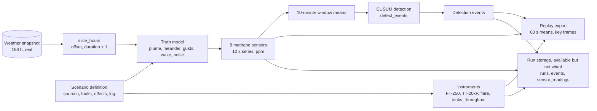
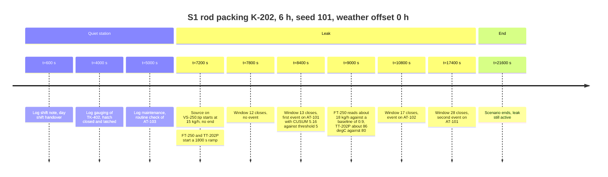
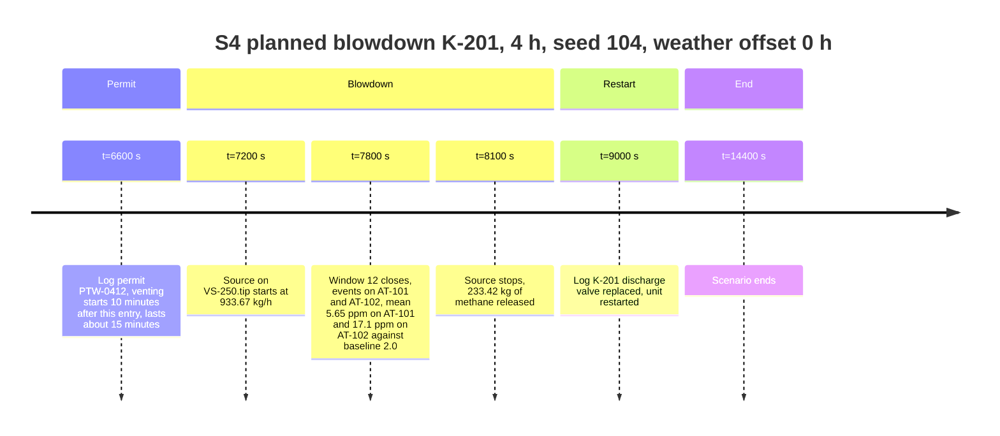
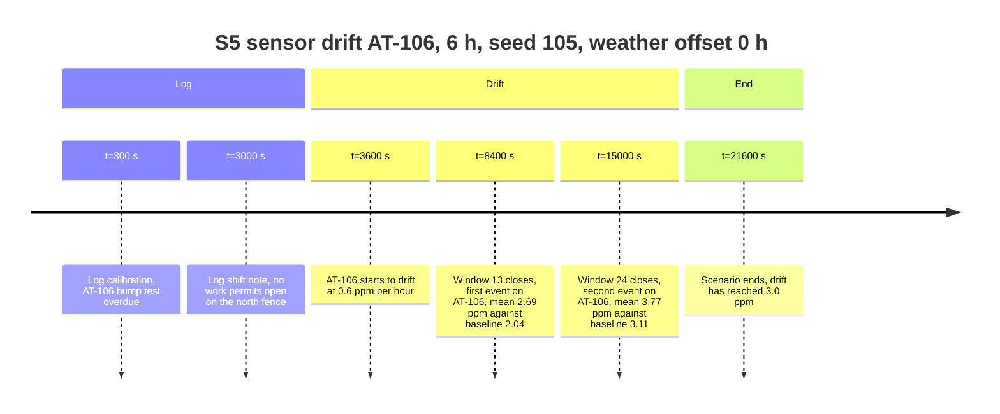
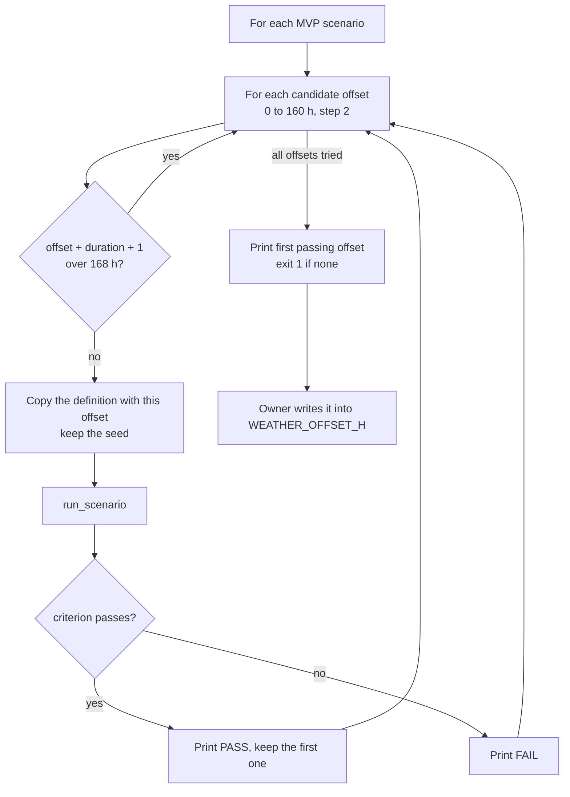

# Scenarios: S1, S4 and S5

## Purpose and scope

A scenario is a seeded, repeatable simulation script: which weather hours drive it, which true
sources and sensor faults exist, how the non-methane instruments react, what the station log says
and what the scenario is designed to show (design section 7). The three MVP scenarios are the demo
stories: a real leak (S1), a planned blowdown that looks like a leak (S4) and a sensor that drifts
(S5). They are definitions only. A scenario never contains an AI result.

The station and all three stories are **simulated**. The weather that drives them is real
([WEATHER.md](WEATHER.md)). The titles, the instrument signature, the rates and the log texts are
project values chosen for the story, with no cited source. Where a number comes from a physics tool
(the S4 blowdown mass), the page says so.

This page covers each scenario, how its weather window was selected, what the run produces, the
limits recorded at Gate 3 and how to add a scenario. The model and the runner are in
[SIMULATOR.md](SIMULATOR.md). The randomised families are in [VARIANTS.md](VARIANTS.md). The replay
file is in [REPLAY.md](REPLAY.md).

## Registry

`plumetrace.simulator.scenarios.SCENARIOS` is a read-only mapping (`MappingProxyType`) from id to
`ScenarioDefinition`. `get_scenario(id)` raises `KeyError("unknown scenario <id>")`.

| | S1 `s1_rod_packing` | S4 `s4_planned_blowdown` | S5 `s5_sensor_drift` |
|---|---|---|---|
| Title | K-202 rod-packing leak via vent stack VS-250 | Planned blowdown of K-201 vented to VS-250 | Sensor drift on AT-106 |
| Story | K-202 rod-packing leak, routed through the vent header to VS-250 | Planned blowdown of K-201 under permit PTW-0412, vented to VS-250 | Slow drift on AT-106; no methane released |
| Seed | 101 | 104 | 105 |
| Duration | 6 h (21 600 s) | 4 h (14 400 s) | 6 h (21 600 s) |
| `WEATHER_OFFSET_H` | 0 | 0 | 0 |
| Weather hours read | 7 (0 to 6) | 5 (0 to 4) | 7 (0 to 6) |
| Scenario second 0 (UTC) | 2025-07-14 00:00 | 2025-07-14 00:00 | 2025-07-14 00:00 |
| Source | `VS-250.tip`, 15.0 kg/h from 7200 s, no end | `VS-250.tip`, 933.67 kg/h from 7200 s to 8100 s | none |
| Fault | none | none | `AT-106`, 0.6 ppm/h from 3600 s |
| Instrument effects | `FT-250` offset +17.39 kg/h and `TT-202P` offset +6.0 degC, both ramped over 1800 s from 7200 s | none | none |
| Expected outcome | triage `leak`, top candidate `VS-250.tip`, unit `K-202`, rate interval 7.5 to 30.0 kg/h | triage `planned_venting`, no top candidate | triage `sensor_fault`, no top candidate |
| Detection events | 3 | 2 | 2 |
| Replay file | 445 852 bytes | 294 773 bytes | 440 244 bytes |

The detection events and the replay sizes are from a run on 2026-11-15 against the committed
snapshot. The values in the "Source", "Fault" and "Instrument effects" rows are in the three files
`scenarios/s1_rod_packing.py`, `s4_planned_blowdown.py` and `s5_sensor_drift.py`.



*Scenario run pipeline: weather and a definition become truth-model sensor series, instrument series and detection events, which feed the replay file. `save_scenario_run` can store a run in the database, but nothing outside the tests calls it yet.*

## S1: rod-packing leak on K-202

**What it is.** From 02:00 into the run (7200 s) a rod packing on K-202 leaks 15 kg/h of methane.
The gas goes into the common packing-vent header and out of the stack VS-250, so the plume source
is `VS-250.tip`, not the compressor. Two instruments carry the signature of a packing leak:
`FT-250` (vent header flow, whole gas) and `TT-202P` (packing-case temperature of K-202). The header
reads whole gas, so its rise is the methane rate divided by the methane mass fraction of the KS-07
gas: 15.0 kg/h / 0.8623 = +17.39 kg/h. The temperature rise of +6.0 degC is a project value. Both
ramp linearly over 1800 s, so they reach full effect at 9000 s.

**What it is designed to test** (intent from design section 7; the agents are built in Phase 5, not yet):
that the inversion names `VS-250.tip` from the detection windows, that evidence fusion attributes
the leak to K-202 and not K-201 or K-203 because only `TT-202P` runs hot, that the rate is given as
an interval, and that three distracting log lines (a shift handover, a tank gauging, a sensor
check) do not mislead the diagnosis.



*S1 timeline: the log entries come first, the leak starts at 7200 s, the first detection event is window 13 and the instrument signature is complete at 9000 s. Convention for all three timelines: an event is placed at the time its 10-minute window closes (window start plus 600 s), which is when its mean exists; the tables give the window start.*

Real values from the committed run:

| Event | Sensor | Window (start s) | Mean ppm | Baseline ppm | CUSUM | Downwind of site |
|---|---|---|---|---|---|---|
| 1 | AT-101 | 13 (7800) | 2.06 | 1.97 | 5.16 | yes |
| 2 | AT-102 | 17 (10200) | 2.49 | 2.00 | 7.72 | yes |
| 3 | AT-101 | 28 (16800) | 2.53 | 2.01 | 7.76 | yes |

The detector (rolling median baseline, one-sided CUSUM with `k` = 0.5 and `h` = 5 sigma, six-window refractory period) is described in [DETECTION.md](DETECTION.md).

The leak is small: the window means are about 0.1 to 0.5 ppm above the baseline. Event 1 is only
just above the CUSUM threshold (5.16 against `h_sigma` = 5.0), so the detection time depends on the
seed and the weather. The first event is one window after the leak start, not in window 12 itself.

FT-250 in the run (10 s samples at the given time, noise included): 0.53 kg/h at 7200 s, 9.58 at
8100 s (mid-ramp), 18.36 at 9000 s. The mean over the period before the leak is 0.91 kg/h and after
9000 s is 18.3 kg/h.

### Inversion on the first event (model estimate)

The inversion is not part of the scenario. The selection criterion runs it (see below) and the
Phase 3 evidence records its result. On the first event window of the committed run:

| Item | Value |
|---|---|
| Windows used | 5 (windows 12 to 16), background from windows 0 to 11 |
| Most probable hypothesis | `VS-250.tip` |
| Model probability | 0.91 |
| Second hypothesis | `K-203.engine_exhaust`, model probability 0.079 |
| Inconclusive | no |
| Rate at grid edge | no |
| Model estimate of the rate | 15–39 kg/h (median 24) |
| Simulated true rate (the scenario input, never a result) | 15.0 kg/h |

The model estimate is an interval and the probability is a model probability, not a measured
certainty. Their meaning and their limits are in
[`docs/benchmark-improvement.md`](../benchmark-improvement.md). The simulated true rate lies inside
the interval. The upper end of the interval (39 kg/h) is above the designed upper end of the
expected range (30.0 kg/h). The owner accepted that at Gate 3: `ExpectedOutcome.rate_min_kg_h` and
`rate_max_kg_h` are a design intent, not an acceptance band for the interval.

**Caveat.** The meander-aware correction models the same wind-direction process that the truth
model puts into the simulated data. The result is therefore optimistic and partly self-consistent
for a simulated station. It is not evidence of real-world accuracy, and the probabilities are not
calibrated. For information only: without the direction spread, the same windows give the same top
candidate (model probability 0.71) but a model estimate of 96–390 kg/h (median 200). That is a
scratch comparison, not a pipeline result.

## S4: planned blowdown of K-201

**What it is.** Permit PTW-0412 covers a planned blowdown of K-201 for discharge-valve maintenance.
The log entry at 6600 s says venting starts 10 minutes after the entry and lasts about 15 minutes.
At 7200 s a short, large release starts at `VS-250.tip` and stops at 8100 s. At 9000 s the log says
the valve was replaced and the unit restarted. Sensors rise sharply while no leak exists.

**The size is computed, not typed.** `BLOWDOWN_VOLUME_M3 = 8.0` goes through the engineering tool
`vented_mass` from the suction pressure (4.5 MPa absolute) at the operating gas temperature
(300 K) down to the site ambient pressure (98.9 kPa) at the same temperature, with the KS-07 gas
composition. The result is `S4_VENTED_CH4_KG` = 233.42 kg of methane. The source rate is that mass
divided by 0.25 h: 233.42 / 0.25 = 933.67 kg/h for 900 s, so the source releases exactly the
computed mass. The constant is exported for the tests. A `log_vented_volume` agent tool that computes
its own mass from the permit volume and never reads the scenario source is planned for Phase 5 (it
does not exist in the code yet).

**What it is designed to test** (intent from design section 7; the agents are built in Phase 5, not
yet): that the permit log entry is found and the event is dismissed as planned venting, while the
vented mass is still logged from the blowdown tool.



*S4 timeline: the permit is 600 s before the venting, the venting lasts 900 s and the restart entry is 900 s after it ends.*

Real values from the committed run:

| Event | Sensor | Window (start s) | Mean ppm | Baseline ppm | CUSUM |
|---|---|---|---|---|---|
| 1 | AT-101 | 12 (7200) | 5.65 | 1.96 | 36.5 |
| 2 | AT-102 | 12 (7200) | 17.14 | 1.95 | 151.4 |

Both events are in the first window of the blowdown. No event exists before 7200 s, so the permit
explains the only alarm. Eight plume key frames (7200 s to 8040 s, every 120 s) carry the source in
the replay file.

**FT-250 does not rise in S4.** The header meters the packing vent line only. The blowdown line
bypasses it, so S4 has no instrument signature at all. This is an assumption of the simulated
station, accepted at Gate 3 (see Limits). No prompt, evaluator or fake may expect an S4 FT-250
signature.

## S5: sensor drift on AT-106

**What it is.** From 3600 s the north-fence sensor AT-106 reads high by a linear drift of
0.6 ppm per hour. No methane is released and no instrument changes. The log says the last bump test
of AT-106 was on 2025-03-02 and is overdue, and that no permits are open on the north fence.

**What it is designed to test** (intent from design section 7; the agents are built in Phase 5, not yet): that a single sensor that alarms while no other sensor agrees, and
that is not downwind of the site, is diagnosed as a sensor fault and not as a leak.



*S5 timeline: the drift starts at 3600 s and raises two events on AT-106 only, the second after the six-window refractory period.*

Real values from the committed run:

| Event | Sensor | Window (start s) | Mean ppm | Baseline ppm | CUSUM | Downwind of site |
|---|---|---|---|---|---|---|
| 1 | AT-106 | 13 (7800) | 2.69 | 2.04 | 7.29 | no |
| 2 | AT-106 | 24 (14400) | 3.77 | 3.11 | 5.14 | no |

Only AT-106 raises events, and in neither is it downwind of the site centre. The second event comes 11 windows
after the first because the detector holds a sensor for six windows after an event and the rolling
baseline follows the slow drift. S5 has no source, so the replay file has no key frame with a
source.

## Window selection (how the weather windows were chosen)

The window is not guessed. `plumetrace.simulator.selection` holds one criterion per story, and
`scripts/select_scenario_windows.py` evaluates every candidate offset on the real weather. The
**first** passing offset is written into the scenario file by hand. The script reads only the
committed snapshot (no network) and prints `<scenario>: offset <h> h PASS|FAIL` for each candidate,
then `<scenario>: first passing offset <h> h`. The exit code is 1 when a scenario has no passing
offset.



*Selection loop: every fitting offset is run with the scenario's own seed and judged by the scenario's criterion.*

`CANDIDATE_OFFSETS_H` is every 2 h from 0 to 160 h, 81 candidates. All 81 fit the snapshot for the
three MVP scenarios.

| Scenario | Criterion (all must hold) | Why |
|---|---|---|
| S1 `s1_passes` | (a) a detection event on any methane sensor starts between 7200 s and 7200 + 5400 s; (b) mean window wind speed over windows 12 to 35 is at least 2.0 m/s; (c) the meander-aware inversion (Briggs rural, default constants) over windows 12 to `first_event.window_index + 3`, both ends included, with the background taken as the 5th percentile of each sensor over windows 0 to 11, ranks `VS-250.tip` first and is not inconclusive | (a) the leak must be seen soon after it starts; (b) calm air gives no usable plume; (c) the story needs the location to be found from the first event |
| S4 `s4_passes` | an event with window start between 7200 s and 8100 + 1200 s, and no event before 7200 s | the blowdown is seen during its window and nothing is seen before it, so the permit explains the only event |
| S5 `s5_passes` | at least one `AT-106` event and no event on any other sensor | only the drifting sensor may alarm |

### The meander argument

The adopted inversion is the meander-aware one (Gate 2). A plume whose direction wanders inside a
10-minute window is smeared sideways in the window mean. The inversion models this when it is given
the within-window wind-direction spread. `_s1_inversion_input` therefore passes
`wind_dir_sd_deg = window_direction_sd_deg(series.times_s, series.wind_from_deg)`:

- The spread is computed over the whole 10 s wind series, then cut to the same windows as the
  observations: one value per complete window (36 for 6 h).
- The window range `[12, first_event.window_index + 3]` includes both ends. With the first event in
  window 13 this is windows 12 to 16, five windows (`stop = window_index + 3 + 1`).
- The background is the 5th percentile of each sensor over windows 0 to 11, the windows before the
  leak.
- A window whose directions cancel exactly gives an infinite spread. `InversionInput` rejects it and
  `s1_passes` raises `ValueError` instead of hiding it (test
  `test_selection_edges.py::test_s1_infinite_direction_spread_is_rejected`).

The argument is applied in exactly one place, `selection.py::_s1_inversion_input`. The runner does
not call the inversion, and the replay export and the run storage hold no inversion result.

### Result on the committed snapshot

| Scenario | Passing offsets | First passing offset |
|---|---|---|
| S1 | 0, 2, 24, 26, 28, 34, 36, 122, 124, 128 h (10 of 81) | 0 h |
| S4 | 77 of 81 (fails at 74, 94, 116 and 118 h) | 0 h |
| S5 | all 81 | 0 h |

Every `WEATHER_OFFSET_H` is therefore 0, which is midnight UTC on 2025-07-14, about 05:00 at the
site longitude (the site is fictional). The S1 log text "Day shift handover" was kept as given. The
UI labels every clock with its zone ("UTC" or "UTC+5 station time"), and the owner accepted the
mismatch at Gate 3.

The S4 and S5 criteria are loose. They pass at almost every offset, so the selection does not
discriminate between windows for these two scenarios. The first passing offset is a default, not an
optimum. S1 is the only scenario where the choice of window matters.

## Edge cases and failure modes the tests pin

| Case | Behaviour | Test |
|---|---|---|
| Source on an unknown anchor, or on an anchor that is not an emission point | `KeyError("unknown anchor <id>")` | `test_scenario_runner_edges.py::test_non_emission_anchor_is_unknown` |
| Fault on an unknown sensor | `ValueError` naming the sensor | `test_unknown_fault_sensor_is_a_value_error_naming_it` |
| Scenario longer than the snapshot | `ValueError` naming the scenario and the hours needed; the boundary is exact | `test_too_long_scenario_names_the_scenario_and_the_hours_needed`, `test_weather_boundary_is_exact` |
| Same seed, same definition, same snapshot | identical arrays and events; another seed differs | `test_same_seed_same_everything_other_seed_differs` |
| Sensor noise and instrument noise share one generator | instruments are drawn after the sensors, so adding a source does not change the instrument series | `test_instruments_use_the_same_generator_after_the_sensors` |
| Refractory period | one event per sensor inside six windows after an event (in the S1 run, AT-101 events are 15 windows apart) | `test_one_event_per_sensor_inside_the_refractory_period` |
| Zero-rate source | changes nothing | `test_a_zero_rate_source_changes_nothing` |
| Unsorted log | rejected by the model | `test_scenario_runner.py::test_log_must_be_sorted` |
| Quiet station | no events | `test_quiet_station_raises_no_events` |
| S1 needs an event in the first 90 minutes after the leak start | otherwise the window fails | `test_selection_edges.py::test_s1_needs_an_event_in_the_first_90_minutes` |
| S1 window range | an event at window 21 uses windows 12 to 24 (13 windows): both ends included, `first window + 3` | `test_s1_window_range_is_cut_at_the_end_of_the_run` |
| S4 window edges | an event whose window starts from 7200 s to 9300 s counts (windows 12 to 15, last at 9000 s); one at 9600 s fails; any event before 7200 s fails | `test_s4_window_edges` |
| S5 other sensor alarms | fails | `test_s5_only_the_drifting_sensor` |
| Registry is read-only | assignment raises | `test_mvp_scenario_values.py::test_registry_is_read_only` |
| Values, ids, seeds, offsets | pinned digit for digit | `test_mvp_scenario_values.py`, `test_mvp_scenarios.py` |
| S4 mass | comes from the blowdown tool, not a typed number | `test_s4_vented_mass_comes_from_the_blowdown_tool` |

## Limits recorded at Gate 3 (2026-11-15)

- **S4 has no FT-250 signature.** The blowdown line bypasses the packing vent header (an assumption
  of the simulated station). S4 variants scale the plume rate (0.5 to 2.0) for detection diversity,
  while the mass a log tool reports stays the volume-based 233 kg of methane. No evaluator compares
  the two.
- **No production caller for run storage.** `save_scenario_run` and `generate_variants` are called
  by the tests only.
- **No production caller for run storage or variants.** `save_scenario_run` and `generate_variants`
  are called by the tests only.
- **Runs stay `status = 'running'`.** A saved scenario run keeps `finished_at` null. Phase 5 Task 10
  must end every run it creates in a terminal status ([DATABASE.md](DATABASE.md)).
- **Selection criteria are loose.** S4 and S5 pass almost everywhere; offset 0 is a default.
- **S1 upper bound.** The model estimate (15–39 kg/h) reaches above the designed 30.0 kg/h. The
  expected interval is a design check that the median lies inside, not an acceptance band.
- **Optimistic S1 result.** See the Gate 2 caveat above.
- **Undetectable variants are not filtered.** Some variants break their own story (for example no
  event at the right time). Phase 5 Task 11 (planned, not built) marks such a case
  `not_reproduced`, counts it per family and excludes it from the denominators ("n of 20
  evaluated"). The check never uses the inversion. See [VARIANTS.md](VARIANTS.md).
- **Replay `keyframes[].sources` is simulation truth.** It draws the plume. It is never rendered as
  a number, never passed to an agent tool and never shown as a result.
- **Clock mismatch.** Offset 0 is about 05:00 local while the S1 log says "Day shift handover";
  every UI clock carries a zone label.

## Rate display rule (R1 to R4)

Binding since Gate 2 for every inversion rate in code, UI and docs:

- **R1.** A rate is shown only as `p05–p95 kg/h (median p50)` at 2 significant figures, never the
  median alone. S1 gives "15–39 kg/h (median 24)".
- **R2.** The rate is not shown when the result is inconclusive, the top is `NONE` or
  `rate_at_grid_edge` is true. The UI then says "rate not quantified" and the reason.
- **R3.** Every inversion rate and probability carries the label "model estimate" or "model
  probability" and links to the benchmark page. Never "confidence", "certain" or "calibrated".
- **R4.** Benchmark numbers on public pages come only from the generated evidence of the adopted
  method.

`ExpectedOutcome` stores only an interval, so no single expected rate exists. The 15.0 kg/h in
`SourceSpec` is the simulation input (the truth), shown to nobody as an AI result.

## How to run

```bash
cd app
uv run python ../scripts/select_scenario_windows.py   # prints PASS/FAIL per offset, then the first passing offset
uv run pytest backend/tests/simulator -q               # scenario, runner, selection, variant and export tests
```

## How to add a scenario

1. Create `app/backend/plumetrace/simulator/scenarios/s<n>_<name>.py` with a `Final`
   `ScenarioDefinition`. The id must match `s<digits>_<lowercase words>`. Pick a seed that no other
   scenario uses. Set `WEATHER_OFFSET_H = 0` for now. Build sources from physics tools where a
   number has a physical meaning, as S4 does.
2. Register it in `scenarios/__init__.py` (`SCENARIOS`).
3. Add a criterion `s<n>_passes(run)` to `selection.py` and a line to `_criteria` in
   `scripts/select_scenario_windows.py`. Run the script and copy the first passing offset into
   `WEATHER_OFFSET_H` by hand.
4. Add the row to `app/supabase/seed.sql` (`plumetrace.scenarios` has a foreign key from
   `plumetrace.runs`, so `save_scenario_run` fails without it), then `db reset`.
5. Add the values and story tests next to `test_mvp_scenario_values.py` and `test_mvp_scenarios.py`
   and update the registry tests. The variant tests already run on any base.
6. Run `uv run python ../scripts/export_scenarios.py`, then `export_contract.py` and
   `npm run gen:types` if the schema changed. Commit the regenerated files with the change.
7. Update this page, [REPLAY.md](REPLAY.md) sizes and the evidence document.

`build_index` (`simulator/export.py`) and the scenario list route (`api/routes/scenarios.py`) both set
`is_mvp=True` for every registered scenario ("every registered scenario is part of the MVP set in
this phase"). A stretch scenario (S2, S3, S6) needs both lines changed, because the database row,
the index and the API list would otherwise disagree.

## Testing and evidence

`app/backend/tests/simulator/` (the files named above). The numbers on this page are
reproduced in [`docs/evidence/2026-11-phase-3-scenarios.md`](../evidence/2026-11-phase-3-scenarios.md),
with the throwaway snippet and its raw output. That evidence is local and synthetic, with real weather.
