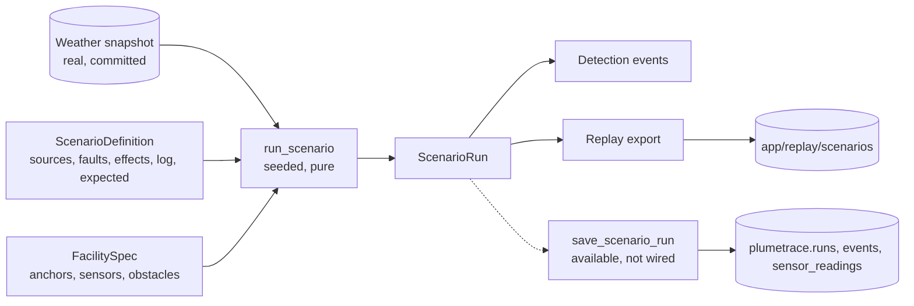
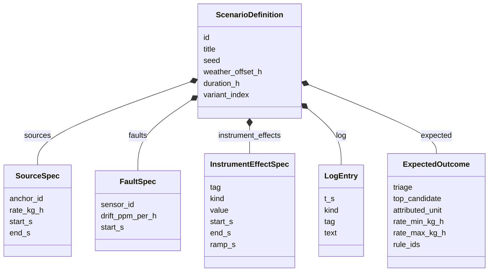
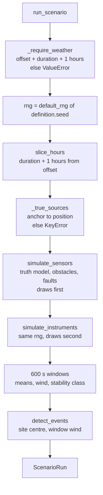

# Simulator and facility

## Purpose and scope

`plumetrace.simulator` runs the simulated station: it takes a scenario definition and the real
weather snapshot and produces what the station's instruments would read (methane sensors,
non-methane instruments), the detection events and the station log. Nothing in it is an AI result.
The station is **fictional and simulated**; the weather is real and attributed; the rates,
signatures and log texts are project values chosen for the demo stories. Source of truth for the
station: `app/backend/plumetrace/facility/data/ks07.yaml`; design reference: section 4 (facility,
instruments, gas composition), sections 7 and 8 (scenarios, real data).

This page is the hub. The facility tables are in the first half, the instruments, the scenario
model and the runner in the second. Each Phase 3 area has its own page:

| Page | What it covers |
|---|---|
| [FACILITY.md](FACILITY.md) | The facility model: YAML spec, loader, validation, emission candidates |
| [WEATHER.md](WEATHER.md) | Open-Meteo client, fetch script, committed snapshot, attribution, licence |
| [SCENARIOS.md](SCENARIOS.md) | S1, S4 and S5: timelines, values, events, window selection, limits, how to add one |
| [VARIANTS.md](VARIANTS.md) | The variant generator: draws, clamps, distractors, validation, Phase 5 use |
| [REPLAY.md](REPLAY.md) | Replay file format, plume grid encoding, size budget, export |
| [DATABASE.md](DATABASE.md) | `runs`, `events`, `sensor_readings`, `save_scenario_run` |

## How a scenario run works

*Simulator overview: one deterministic run feeds the replay files. `save_scenario_run` can store a run in the local database (dotted edge), but nothing outside the tests calls it yet. The simulator itself does no I/O.*

## Facility KS-07

Station KS-07 is a **fictional**, simulated compressor station (`site.fictional: true`). The
latitude and longitude (39.10, 61.30, Karakum desert region) are used only to fetch real weather.

### Coordinate convention

Metres. x = east, y = north, z = up. Origin = south-west fence corner. The site is 200 m (x) by
150 m (y). All positions in the YAML use this frame; `position_m` is `[x, y, z]`.

An equipment `position_m` is the **footprint centre at its base** (x, y = centre of the footprint, z = bottom of the box). `size_m` is the axis-aligned box (x, y, z) before rotation, centred on `position_m` in x and y and rising from it in z. Anchor and instrument positions are points.

### Modules

| Module (`plumetrace.facility.`) | Responsibility |
|---|---|
| `types` | Frozen Pydantic models (`Equipment`, `Anchor`, `PipeRoute`, `Instrument`, `Site`, `SiteBounds`, `OperatingConditions`) and the enums `EquipmentType`, `InstrumentKind`. Unknown fields are rejected. |
| `spec` | `FacilitySpec` and its validation rules; `equipment_by_tag`. |
| `loader` | `load_facility(path)` reads the YAML as UTF-8 with `yaml.safe_load` and validates it. |
| `candidates` | `emission_candidates(spec)` and `methane_sensors(spec)`, returning `plumetrace.engineering.geometry` types. |
| `components` | Procedural flange and valve placement and the component-count table. |
| `obstacles` | `facility_obstacles(spec)`: buildings and shelters as wake obstacles for the truth model. |

`facility` imports only `plumetrace.engineering` (checked by `check_structure.py`).

### Equipment (24 items)

| Tag | Type | Position (m) | Size (m) | Anchors |
|---|---|---|---|---|
| PIG-101 | pig_trap | (15, 75, 0) | (6, 1.2, 1.5) | `PIG-101.door` |
| V-100 | filter_separator | (30, 75, 0) | (2, 2, 6) | `V-100.psv` |
| V-211 | scrubber | (62, 57, 0) | (1.5, 1.5, 5) | `V-211.psv` |
| V-212 | scrubber | (62, 75, 0) | (1.5, 1.5, 5) | `V-212.psv` |
| V-213 | scrubber | (62, 93, 0) | (1.5, 1.5, 5) | `V-213.psv` |
| K-201 | recip_compressor | (75, 57, 0) | (12, 4, 3) | `K-201.packing`, `K-201.engine_exhaust` |
| K-202 | recip_compressor | (75, 75, 0) | (12, 4, 3) | `K-202.packing`, `K-202.engine_exhaust` |
| K-203 | recip_compressor | (75, 93, 0) | (12, 4, 3) | `K-203.packing`, `K-203.engine_exhaust` |
| E-231 | fin_fan_cooler | (95, 57, 0) | (8, 4, 5) | none |
| E-232 | fin_fan_cooler | (95, 75, 0) | (8, 4, 5) | none |
| E-233 | fin_fan_cooler | (95, 93, 0) | (8, 4, 5) | none |
| VS-250 | vent_stack | (85, 115, 0) | (0.4, 0.4, 12) | `VS-250.tip` |
| T-301 | teg_contactor | (120, 60, 0) | (1.5, 1.5, 15) | none |
| R-302 | teg_regenerator | (130, 50, 0) | (4, 2, 8) | `R-302.still_vent` |
| FG-501 | fuel_gas_skid | (110, 95, 0) | (4, 3, 2) | `FG-501.skid` |
| TK-401 | storage_tank | (150, 110, 0) | (6, 6, 7) | `TK-401.thief_hatch` |
| TK-402 | storage_tank | (165, 110, 0) | (6, 6, 7) | `TK-402.thief_hatch` |
| VRU-410 | vru | (157, 95, 0) | (4, 3, 2.5) | `VRU-410.skid` |
| V-602 | knockout_drum | (175, 30, 0) | (6, 2, 2.5) | `V-602.psv` |
| FL-601 | flare_stack | (185, 30, 0) | (1, 1, 30) | `FL-601.tip` |
| M-701 | meter_run | (175, 75, 0) | (10, 2, 1.5) | `M-701.meter` |
| PIG-702 | pig_trap | (190, 75, 0) | (6, 1.2, 1.5) | `PIG-702.door` |
| CR-901 | building | (30, 20, 0) | (15, 8, 4) | none |
| MCC-902 | building | (50, 20, 0) | (10, 6, 4) | none |

Compressors K-201, K-202 and K-203 are in shelters and vent to VS-250. CR-901 is the control room
and MCC-902 the motor control centre.

### Emission candidates (21)

Every anchor with `emission_point: true` is a candidate source for the inversion, sorted by id.

| Candidate id | Position (m) |
|---|---|
| `FG-501.skid` | (110, 95, 1.5) |
| `FL-601.tip` | (185, 30, 30) |
| `K-201.engine_exhaust` | (80, 57, 6) |
| `K-201.packing` | (73, 57, 1.5) |
| `K-202.engine_exhaust` | (80, 75, 6) |
| `K-202.packing` | (73, 75, 1.5) |
| `K-203.engine_exhaust` | (80, 93, 6) |
| `K-203.packing` | (73, 93, 1.5) |
| `M-701.meter` | (175, 75, 1) |
| `PIG-101.door` | (12, 75, 1) |
| `PIG-702.door` | (193, 75, 1) |
| `R-302.still_vent` | (130, 50, 8) |
| `TK-401.thief_hatch` | (150, 110, 7) |
| `TK-402.thief_hatch` | (165, 110, 7) |
| `V-100.psv` | (30, 75, 6) |
| `V-211.psv` | (62, 57, 5) |
| `V-212.psv` | (62, 75, 5) |
| `V-213.psv` | (62, 93, 5) |
| `V-602.psv` | (175, 30, 4) |
| `VRU-410.skid` | (157, 95, 1.5) |
| `VS-250.tip` | (85, 115, 12) |

### Instruments (18)

| Tag | Kind | Position (m) | Attaches to | Noise (ppm) |
|---|---|---|---|---|
| AT-101 | methane_point | (5, 5, 2) | - | 0.3 |
| AT-102 | methane_point | (100, 5, 2) | - | 0.3 |
| AT-103 | methane_point | (195, 5, 2) | - | 0.3 |
| AT-104 | methane_point | (195, 75, 2) | - | 0.3 |
| AT-105 | methane_point | (195, 145, 2) | - | 0.3 |
| AT-106 | methane_point | (100, 145, 2) | - | 0.3 |
| AT-107 | methane_point | (5, 145, 2) | - | 0.3 |
| AT-108 | methane_point | (110, 75, 2) | - | 0.3 |
| MET-01 | met_mast | (10, 140, 10) | - | - |
| FT-250 | flow | (85, 110, 1) | VS-250 | - |
| TT-201P | temperature | (73, 57, 1.5) | K-201 | - |
| TT-202P | temperature | (73, 75, 1.5) | K-202 | - |
| TT-203P | temperature | (73, 93, 1.5) | K-203 | - |
| FT-601 | flow | (178, 30, 1) | FL-601 | - |
| TE-601 | thermocouple | (185, 30, 29.5) | FL-601 | - |
| PT-401 | pressure | (150, 110, 7) | TK-401 | - |
| PT-402 | pressure | (165, 110, 7) | TK-402 | - |
| FT-701 | flow | (175, 75, 1) | M-701 | - |

The eight `methane_point` sensors (AT-101 to AT-108) feed `methane_sensors`; each must have
`noise_ppm`.

### Pipe routes (15)

| Id | Service | Size (in) | Waypoints |
|---|---|---|---|
| R-100 | gas | 24 | 3 |
| R-110 | gas | 20 | 2 |
| R-111 | gas | 12 | 3 |
| R-112 | gas | 12 | 3 |
| R-113 | gas | 12 | 3 |
| R-121 | gas | 10 | 3 |
| R-122 | gas | 10 | 3 |
| R-123 | gas | 10 | 3 |
| R-130 | gas | 20 | 2 |
| R-140 | gas | 20 | 3 |
| R-150 | gas | 20 | 4 |
| R-250 | vent | 2 | 5 |
| R-600 | flare | 12 | 4 |
| R-400 | condensate | 4 | 4 |
| R-500 | fuel_gas | 2 | 2 |

### Gas composition (mole fraction)

**Source:** none; illustrative pipeline-quality composition chosen by the owner at Gate 1 (2026-11-13), inside the design range CH4 0.90-0.95; not from a cited gas analysis; the station is simulated.

| Species | Fraction |
|---|---|
| CH4 | 0.930 |
| C2H6 | 0.035 |
| C3H8 | 0.008 |
| nC4H10 | 0.002 |
| CO2 | 0.010 |
| N2 | 0.015 |

### Operating conditions and site

| Quantity | Value |
|---|---|
| Suction pressure (absolute) | 4.5e+06 Pa |
| Discharge pressure (absolute) | 7e+06 Pa |
| Gas temperature | 300 K |
| Throughput | 41667 sm3/h |
| Ambient pressure (absolute) | 98900 Pa |
| Ground elevation | 200 m |

All pressures are absolute, not gauge: the Phase 2 Z factor and blowdown use absolute pressure. 98900 Pa matches the ISA (ISO 2533) value at 200 m (98.95 kPa).

### Procedural flanges and valves

`place_route_components(spec, spacing_m=FLANGE_SPACING_M)` (12 m) places, for each route in spec
order: a **flange** at every waypoint and at every multiple of the spacing measured along the
polyline (positions interpolated on the segment; points closer than 1e-6 m are merged), and a
**valve** at the first and last waypoint. Components are ordered by distance along the route, a
flange before a valve at equal distance. The result is deterministic; the 3D scene and the
candidate generation depend on that.

### Component counts

`component_counts.yaml` holds default component counts per equipment class; `counts_for(spec, table)`
maps each equipment tag to the counts of its class (types mapped to `null` get zeros).

**Source:** 40 CFR Part 98, Subpart W, Table W-1B "Default Average Component Counts for Major Onshore Natural Gas Production Equipment and Onshore Petroleum and Natural Gas Gathering and Boosting Equipment", CFR 2023 edition (govinfo package CFR-2023-title40-vol23), [75 FR 74488, Nov. 30, 2010, as amended at 80 FR 64298, Oct. 22, 2015]. The table was removed in the 2024 Subpart W revision (89 FR 42323-42325, May 14, 2024); it is the latest published set of default component counts. Accessed 2026-11-12.

**Column used:** Western U.S.

**Notes:** Production / gathering-and-boosting default counts are used as a documented proxy for a transmission compressor station, for which no default counts are published. The TEG regenerator is counted with the contactor as one dehydrator. Accepted by the owner at Gate 1 (2026-11-13) as a proxy. The numbers were transcribed from the CFR 2023 edition and are not yet verified against the primary text (see docs/OWNER_ACTIONS.md).

**Proxy:** not verified against the primary source.

| Class | Valves | Connectors | Open-ended lines | Pressure relief valves |
|---|---|---|---|---|
| wellheads | 11 | 36 | 1 | 0 |
| separators | 34 | 106 | 6 | 2 |
| meters_piping | 14 | 51 | 1 | 1 |
| compressors | 73 | 179 | 3 | 4 |
| in_line_heaters | 14 | 65 | 2 | 1 |
| dehydrators | 24 | 90 | 2 | 2 |

| Equipment type | Class |
|---|---|
| pig_trap | meters_piping |
| filter_separator | separators |
| scrubber | separators |
| recip_compressor | compressors |
| fin_fan_cooler | none (zeros) |
| vent_stack | none (zeros) |
| teg_contactor | dehydrators |
| teg_regenerator | none (zeros) |
| fuel_gas_skid | meters_piping |
| storage_tank | none (zeros) |
| vru | compressors |
| knockout_drum | separators |
| flare_stack | none (zeros) |
| meter_run | meters_piping |
| building | none (zeros) |

### Obstacles

`plumetrace.facility.obstacles.facility_obstacles(spec)` turns the spec into the list of
`WakeObstacle` objects that the truth model uses for building wakes (see "Truth model" in
`docs/reference/ENGINEERING.md`). Every equipment of type `building` and every equipment with
`shelter: true` is one obstacle, in spec order: centre = footprint centre (x, y), half width =
`max(size_x, size_y) / 2`, height = `size_z` for a building and `SHELTER_HEIGHT_M = 6.0` m for a
shelter (a Task 12 project value). A building that is also flagged as a shelter is listed once, as
a building. Rotation is ignored.

| Obstacle | Centre (x, y) m | Half width m | Height m | Wake length (3 x height) m |
|---|---|---|---|---|
| K-201 shelter | 75, 57 | 6.0 | 6.0 | 18 |
| K-202 shelter | 75, 75 | 6.0 | 6.0 | 18 |
| K-203 shelter | 75, 93 | 6.0 | 6.0 | 18 |
| CR-901 control room | 30, 20 | 7.5 | 4.0 | 12 |
| MCC-902 motor control centre | 50, 20 | 5.0 | 4.0 | 12 |

A receptor is in a wake when it is up to three heights downwind of the centre and within the half
width across the wind. The shelter height is not the real roof height of the compressor (the box
is 3 m high); it stands for the building envelope around the unit.

### Validation rules

`FacilitySpec` runs these checks in order; each failure names the offending item.

1. Tags are unique across equipment and instruments (`duplicate tag <tag>`).
2. Every anchor id starts with `<equipment tag>.` (`anchor <id> does not belong to equipment <tag>`).
3. Equipment, anchor, instrument positions and every pipe waypoint are inside the site bounds and
   not below ground (`<owner> position 
 is outside the site bounds`).
4. `vents_to` and `attaches_to` name existing equipment (`<tag> vents_to unknown tag <x>`).
5. The gas composition sums to 1 within 1e-6 (`gas_composition sums to <total>, expected 1`).

Unknown fields anywhere in the YAML are rejected, so a typo is an error. The Gate 1 owner review
of `ks07.yaml`, the gas composition, `component_counts.yaml` and the emission sources is listed
in `docs/OWNER_ACTIONS.md`.

### Gate 1 decisions (2026-11-13)

- **Location:** the site is fictional. The check against Carbon Mapper coverage is deferred to Phase 8 Task 4.
- **Emission candidates:** the 21 are kept. Packing (into the shelter) and `VS-250.tip` (via the header) are separate by design. Pneumatics and blowdown are not candidates: scenario S4 releases at `VS-250.tip` and `blowdown.py` quantifies it.
- **Methane sensors:** the eight are kept. `PIG-101.door` and `V-100.psv` are about 70-75 m from AT-101 and AT-107. The benchmark reports per-candidate results, and Gate 2 decides on any extra sensor.
- **Pipe ends:** the gaps at the ends of R-140 and R-500 (about 1.25 m and 0.5 m) are cosmetic and handled in Phase 4.

Gate 1 is signed off.

## Instruments

`plumetrace.simulator.instruments` produces the non-methane process readings that triage and
fusion use as evidence (design section 4). It is pure simulation: no network, no database, and
deterministic for a seed because the caller passes the `numpy` generator. The baselines are
**Task 3 values** (chosen for the simulation, not taken from a published source). The station is
simulated and so are these readings. The methane sensors are not here: they come from the truth
model (`plumetrace.engineering.truth_model`, see `docs/reference/ENGINEERING.md`).

### Tags

| Tag | Meaning | Unit | Baseline mean | Noise sd |
|---|---|---|---|---|
| `FT-250` | Packing vent header flow (VS-250), whole gas | kg/h | 0.9 | 0.25 |
| `TT-201P` | Packing case temperature, K-201 | degC | 80.0 | 0.5 |
| `TT-202P` | Packing case temperature, K-202 | degC | 80.0 | 0.5 |
| `TT-203P` | Packing case temperature, K-203 | degC | 80.0 | 0.5 |
| `FT-601` | Flare header flow (FL-601), whole gas | kg/h | 5.0 | 0.5 |
| `TE-601` | Flare pilot thermocouple | degC | 600.0 | 10.0 |
| `PT-401` | Tank TK-401 pressure | kPag | 2.0 | 0.05 |
| `PT-402` | Tank TK-402 pressure | kPag | 2.0 | 0.05 |
| `FT-701` | Throughput meter M-701 | Sm3/h | 41667.0 | 200.0 |

In the three MVP scenarios only S1 changes an instrument (`FT-250` and `TT-202P`). The flare, tank
and throughput tags carry baseline plus noise only. They are in the replay files and the database
so that later stretch scenarios (unlit flare, open thief hatch) can change them.

### Effect model

`simulate_instruments(times_s, effects, rng)` returns a dict of tag to series (float64, same
length as `times_s`, always finite). For every tag, in table order, it draws
`rng.normal(0, noise_sd, n)` (always, so a run with effects stays aligned with a run without),
starts from the mean, applies the effects on that tag in the order given, and adds the noise last.

An `InstrumentEffect` has a `tag`, a `kind`, a `value`, a window `[start_s, end_s)` (`end_s`
defaults to infinity) and `ramp_s`. Its weight is `w(t) = 0` before `start_s` or at/after
`end_s`, else `min(1, (t - start_s) / ramp_s)` (1 when `ramp_s == 0`).

| Kind | Result |
|---|---|
| `offset` | `value += w * effect.value` |
| `set` | `value = (1 - w) * value + w * effect.value` (noise is still added, so a pilot "out" reads about 30 degC plus noise) |

### Packing-leak signature

`packing_leak_effects(unit_tag, ch4_rate_kg_h, ch4_mass_fraction, start_s, ramp_s=1800)` gives
two ramped offsets for a leak on `K-20n`:

- `FT-250` rises by `ch4_rate_kg_h / ch4_mass_fraction`. The header meter reads **whole gas**, not
  methane, so the methane rate is divided by the methane mass fraction (15 kg/h CH4 at 0.8623 is
  +17.395 kg/h).
- `TT-20nP` rises by +6.0 degC (a Task 3 value). A leaking packing runs hot, and the temperature
  of the leaking unit is what separates K-201, K-202 and K-203.

Worked example, S1 (K-202, start 7200 s, ramp 1800 s). At 8100 s the weight is
`(8100 - 7200) / 1800 = 0.5`, so the mean level is `0.9 + 0.5 x 17.39 = 9.6 kg/h` for `FT-250` and
`80.0 + 0.5 x 6.0 = 83.0 degC` for `TT-202P`. In the committed run the 10 s samples at that time are
9.58 kg/h and 82.87 degC (noise included). From 9000 s the weight is 1: `FT-250` about 18.3 kg/h,
`TT-202P` about 86 degC, while `TT-201P` and `TT-203P` stay near 80 degC.

### What is rejected

| Situation | Result |
|---|---|
| Effect on a tag not in the table | `KeyError("unknown instrument <tag>")` |
| `times_s` empty, not 1-D or not finite | `ValueError` |
| Effect with a `kind` other than `offset`/`set`, non-finite `value` or `start_s`, NaN `end_s`, `end_s <= start_s`, or `ramp_s` negative or not finite | `ValueError` naming the tag; nothing is drawn from the generator |
| `packing_leak_effects` with a `unit_tag` that is not `K-201` to `K-203`, a non-positive or non-finite rate, a mass fraction outside (0, 1], a non-finite start or a bad ramp | `ValueError` |

The simulator never returns NaN. Sensor dropout is not modelled here. Tests:
`app/backend/tests/simulator/test_instruments.py` and `test_instruments_edges.py`.

## Scenarios: model and runner

`plumetrace.simulator.scenario` holds the scenario definition and `plumetrace.simulator.runner`
runs it. Both are pure simulation: no network, no database, deterministic for a seed. The station
and the scenarios are simulated. All models are frozen and reject unknown fields.

*Scenario model: one definition owns its sources, faults, instrument effects, log lines and the designed outcome.*

### Model (`scenario.py`)

| Model | Fields (unit) | Rejected |
|---|---|---|
| `SourceSpec` | `anchor_id`, `rate_kg_h` (kg/h, >= 0), `start_s` (s, >= 0), `end_s` (s, default infinity, exclusive) | non-finite rate or start, `end_s` not after `start_s` |
| `FaultSpec` | `sensor_id`, `drift_ppm_per_h` (ppm/h, may be negative), `start_s` (s, >= 0) | non-finite drift or start |
| `InstrumentEffectSpec` | `tag`, `kind` (`offset` or `set`), `value`, `start_s`, `end_s`, `ramp_s` (s); `to_effect()` gives the `InstrumentEffect` | tag not in `BASELINES`, non-finite value or start, `end_s` not after `start_s`, bad ramp |
| `LogEntry` | `t_s` (s, >= 0), `kind` (permit, gauging, maintenance, shift_note, calibration), `tag`, `text` | infinite time, blank text |
| `ExpectedOutcome` | `triage` (leak, sensor_fault, planned_venting), `top_candidate`, `attributed_unit`, `rate_min_kg_h`, `rate_max_kg_h`, `rule_ids` | one rate bound without the other, non-finite, negative or `min > max` |
| `ScenarioDefinition` | `id` (`s<digits>_<lowercase words>`), `title`, `seed` (>= 0), `weather_offset_h` (>= 0), `duration_h` (1-24), `sources`, `faults`, `instrument_effects`, `log`, `expected`, `variant_index` | unsorted `log`, any source, fault or effect start at or after the end, a log time after the end, a negative seed |

Time model: every `t_s`, `start_s` and `end_s` is seconds from the scenario start. Second 0 is
`snapshot.start_utc + weather_offset_h` hours (`ScenarioRun.sim_start_utc`). The step is
`DT_S = 10.0` s. Several effects on one instrument overlap freely and are applied in list order
(see "Effect model"); several faults on one sensor add up.

The expected rate is stored only as an interval, never a single number, so a UI that shows it
follows the rate display rule (interval, never a point value). The interval is the design intent,
not a model output.

### Runner (`runner.py`)

`run_scenario(definition, spec, snapshot)` does, in this order:

*Runner steps in order. The random generator is drawn in the order shown, which is why the instrument series do not depend on the sources.*

1. `rng = numpy.random.default_rng(definition.seed)`.
2. Slices `duration_h + 1` weather hours from `weather_offset_h` (`slice_hours`). A snapshot that
   is too short raises `ValueError` naming the scenario and the hours needed, for example
   `scenario s9_long_one needs 173 weather hours (...), snapshot has 168`.
3. Maps each source to a `TrueSource` at the emission-point anchor `anchor_id`; an unknown anchor
   raises `KeyError("unknown anchor <id>")`. A fault on an unknown sensor raises `ValueError`.
4. `simulate_sensors` with the default `TruthConfig`, the facility obstacles and the faults.
5. `simulate_instruments` with the same `rng`.
6. 10-minute window means, wind (mean speed, circular mean direction) and the most frequent
   stability class per window (`window_mode_class`).
7. `detect_events` on the absolute window means, with the site centre
   (`site_center_xy`, the centre of the site bounds, `(100, 75)` for KS-07) and the window wind
   directions. Detection holds a sensor for six windows after an event, so one sensor never has two
   events inside that period. The detector is described in [DETECTION.md](DETECTION.md).

Random-draw order: the generator draws first inside `simulate_sensors` (one block of
`steps x (2 + sensors)` standard normals, whatever the sources), then inside
`simulate_instruments` (one normal series per tag in `BASELINES` order). So the instrument series
do not change when a source is added. Same seed, same definition, same snapshot gives identical
arrays and events.

`ScenarioRun` holds the definition, `sim_start_utc`, the sensors, the 10 s `series`
(`TruthSeries`), the instrument series, the window arrays (start, means, wind speed, wind
direction, stability) and the events. For the meander-aware inversion (adopted at Gate 2) the
caller builds `wind_dir_sd_deg` from `series.times_s` and `series.wind_from_deg` with
`window_direction_sd_deg`, one value per window; the runner itself does not call the inversion.

Worked example, S1 on the committed snapshot: 6 h is 2160 steps of 10 s and 36 windows of 600 s;
the run has 8 methane sensors and 9 instruments; the three detection events are AT-101 window 13,
AT-102 window 17 and AT-101 window 28 ([SCENARIOS.md](SCENARIOS.md)).

### What is rejected

| Situation | Result |
|---|---|
| Invalid number, window or id in a model | `pydantic.ValidationError` (a `ValueError`) |
| Source on an unknown or non-emission anchor | `KeyError("unknown anchor <id>")` |
| Fault on an unknown sensor | `ValueError` naming it |
| Scenario longer than the weather snapshot | `ValueError` naming the scenario and the hours needed |

Tests: `app/backend/tests/simulator/test_scenario_model_edges.py`, `test_scenario_runner.py` and
`test_scenario_runner_edges.py` (see [SCENARIOS.md](SCENARIOS.md), "Edge cases").

## The MVP scenarios, weather and variants

The three demo stories (design section 7) live in `plumetrace.simulator.scenarios`
(`s1_rod_packing.py`, `s4_planned_blowdown.py`, `s5_sensor_drift.py`). They are documented in
[SCENARIOS.md](SCENARIOS.md): values, timelines, the events each produces, how the weather window of
each was selected, the S1 inversion as a model estimate, and the limits recorded at Gate 3. The
weather data path is in [WEATHER.md](WEATHER.md). The randomised families used by the Phase 5
evaluation are in [VARIANTS.md](VARIANTS.md).

## Replay export and saving a run

`plumetrace.simulator.export.build_replay(run, spec, attribution)` turns a scenario run into the
replay document (`plumetrace.simulator.replay_schema.ReplayScenario`), and `replay_bytes` writes it
as deterministic JSON (compact, sorted keys, UTF-8, LF, at most 5 MB, else `ValueError`).
`scripts/export_scenarios.py` runs every registered scenario and writes
`app/replay/scenarios/<id>.json` (generated, never edited by hand). The format, the grid
encoding, the size budget and how to regenerate are in [REPLAY.md](REPLAY.md).

- Series are 60 s means (sensors, the nine instruments, wind); key frames every 120 s are drawn with
  the **truth** coefficients (`TruthConfig().coeff`) and the 60 s wind at that time.
- The file carries `simulated: true`, the Open-Meteo credit (the weather is real public data) and
  the sentence that the station, sensors, instruments and scenario are synthetic.
- The replay holds no inversion result. The rate display rule (R1 to R4, see
  [SCENARIOS.md](SCENARIOS.md)) applies to any result added later: interval only, "not quantified"
  when inconclusive, top `NONE` or at the grid edge, "model estimate" and "model probability"
  wording. `keyframes[].sources[].rate_kg_h` is the simulation input used to draw the plume, never
  shown as a result.
- Sizes on 2026-11-15: S1 445 852 bytes, S4 294 773 bytes, S5 440 244 bytes.

`plumetrace.api.run_store.save_scenario_run` writes a scenario run (run row, detection events and 60 s
readings of every sensor and instrument) to the local database. It has no production caller yet
(tests only; the API and the agent graph are planned to call it in later phases); see "Saving scenario runs" in
[DATABASE.md](DATABASE.md). The numbers of the three MVP scenarios (selected offset and UTC start,
detection events, the S1 inversion on the event windows and the replay file sizes) are recorded in
`docs/evidence/2026-11-phase-3-scenarios.md`, with the throwaway snippet and its output. The inversion
there is shown as a model estimate interval with a model probability, as the rate display rule requires.
Re-saving a scenario run creates a new run (a new run id with its own rows). A saved run stays
`status = 'running'` with `finished_at` null: known and accepted at Gate 3; Phase 5 Task 10 ends every
run in a terminal status.

## Testing and evidence

`app/backend/tests/simulator/` covers the model, the runner, the instruments, the MVP scenarios, the
selection criteria, the variants and the export. Run `cd app && uv run pytest backend/tests/simulator -q`.
The Phase 3 numbers are in `docs/evidence/2026-11-phase-3-scenarios.md` (local / synthetic, with
real weather).

## How to extend

- A new scenario: step by step in [SCENARIOS.md](SCENARIOS.md), "How to add a scenario".
- A new instrument tag: add it to `BASELINES` (the order is the draw order, so append at the end),
  the pinned 17-tag count in `backend/tests/db/test_run_store.py` (360 readings x 17 tags) and the
  replay tests together. Units come from `BASELINES[tag].unit` in `run_store.readings_from_run` and
  `export._series_and_units`. Adding a tag at the end keeps the random draws of the earlier tags unchanged.
- Keep the simulator pure: no network, no database, one generator passed or seeded from the
  definition.
