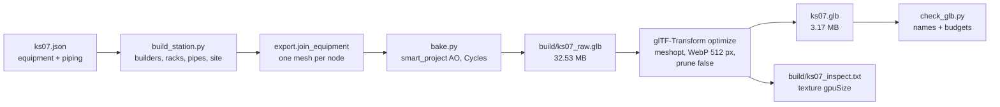
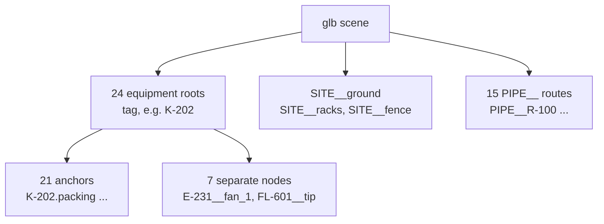

# Station model: piping, site, bake, export and budgets

## 1. Purpose and scope

This page documents the part of the Blender pipeline that turns the 24 built equipment items into
the one shipped glb, `app/frontend/public/models/ks07.glb`: the piping routes, the pipe racks, the
site (yard, terrain, pads, road, tank bund, fence), the ambient-occlusion bake, the export, the
glTF-Transform optimisation, and the budget check `scripts/check_glb.py`. The parts and the 15
equipment builders are in [BLENDER_EQUIPMENT.md](BLENDER_EQUIPMENT.md); the commands for a subset
build are in [scripts/blender/README.md](../../scripts/blender/README.md); the textures are in
[ASSETS.md](ASSETS.md); how the frontend loads the glb is in [FRONTEND.md](FRONTEND.md).

Built (Phase 4 Task 7, 2026-11-16): `piping_math.py`, `equipment/pipe_route.py`,
`equipment/pipe_rack.py`, `equipment/site.py`, `fence_math.py`, the bake of every group but the piping
(`uv.smart_project` unwrap, sizes from `layout.ao_resolution`), `scripts/build_station.sh`,
`check_glb.py` budgets and separate-node check, and the shipped glb of the full station. **Not built**
(later tasks): anything rendered by the frontend beyond the existing model, sun and camera (Tasks 8
and 9: `nodeIndex`, labels, the plume, the animated fans), the proper in-browser draw-call
confirmation (Task 8), and an integrated-GPU frame-rate run (owner action C6). The model is a
fictional, simulated station; nothing here claims it matches a real one.

## 2. How it works



*Caption: the chain run by `scripts/build_station.sh`; every box is built. The frontend loads the
result (not drawn here, see FRONTEND.md).*

`scripts/build_station.sh [low|high]` (Git Bash, repo root) runs, in order: the Blender 4.5.16 version
check (exit 2 otherwise), `export_contract.py` (regenerates `ks07.json`), `build_station.py` (the
whole station, no `--only`), `optimize`, `inspect` and `check_glb.py`. `set -euo pipefail`: the first
failing step stops it with a non-zero exit.



*Caption: the 70 named nodes of the shipped glb (24 + 21 + 7 + 3 + 15). After optimisation 21
unnamed child nodes also exist; they carry the meshes (each with its quantisation scale and translation).*

What `build_station.py` does with the whole station (`only is None`):

1. Builds the items and their shelters (Task 6), then `pipe_rack.build_racks`, one
   `pipe_route.build(route, ctx)` per spec `piping` entry, `site.build_fence`, and finally
   `site.build_ground(ctx, items, full=True)`. A `--only` run builds only the selected items and the
   ground (yard, terrain, pads, road): no racks, piping, fence or bund.
2. `materials.assign_all`, `export.add_anchors`, `export.join_equipment`: one mesh per group
   (`ctx.groups()`: roots, separate nodes). Piping and site groups use the same machinery as
   equipment, so each gets per-group material copies.
3. `bake.bake_all(ctx, level)`: for every group except names starting `PIPE__`, ground first, add the
   `AO` UV layer by `uv.smart_project`, bake AO with Cycles, wire the image into the glTF occlusion
   input. Image size = `layout.ao_resolution(type, level)` with the type of the item (a separate node
   uses its parent's; `SITE__ground` is `"ground"`, racks and fence `"site"`).
4. `export.export_glb`, then glTF-Transform and the checks.

## 3. Module-by-module reference

| Module | Interface | What it keeps |
|---|---|---|
| `piping_math.py` (pure) | `pipe_radius_m(size_in)`, `fillet_polyline(points, bend_radius_m, steps=6)`, `support_points(points, spacing_m=6.0, min_z_m=1.0)` | radius is `max(0.03, size_in * 0.0254 / 2)`; fillet keeps both endpoints, leaves turns under 1 degree alone, tangent distance `min(R tan(theta/2), 0.45 * shorter segment)`; supports every 6 m of path from the start, at least 1 m from both ends, only where the centre is at least 1 m high |
| `equipment/pipe_route.py` | `build(route, ctx)` | node `PIPE__<id>`: filleted poly curve with `bevel_depth = radius`, caps, taken as a mesh with `bpy.data.meshes.new_from_object`; bend radius `1.5 x diameter`; material by service; flanges at both ends; a valve 1.5 m from each end when `size_in >= 10`; a post and a crossbar (`paint_dark`) at each support point |
| `equipment/pipe_rack.py` | `build_racks(ctx)` | node `SITE__racks`: rack A at x 45 (y 57 to 93), rack B at x 105 (y 30 to 93); a frame every 6 m from the start (plus one at the end when it is off the 6 m grid: B ends at 93); columns 0.3 x 0.3 at x +-1.5 up to the beam, beam 3.3 x 0.3 x 0.3 at z 3.55 (top of steel 3.7 m) |
| `fence_math.py` (pure) | `fence_post_xy(width_m, depth_m, step_m, gate_y_m)` | multiples of the step below each side length plus the end point, so no post lies outside the yard and a corner appears once; posts strictly inside the gate gap on the west side are left out (233 posts for 200 x 150 m, 3 m, gap y 9 to 15) |
| `equipment/site.py` | `build_ground(ctx, items, full)`, `build_fence(ctx)` | `SITE__ground`: yard 200 x 150 m at z -0.02 (`gravel`, tile 4 m), terrain 600 x 600 m 0.05 m lower (`gravel_far`, tile 8 m, roughness 1.0), a concrete pad (L+1) x (W+1) x 0.2 m with top at z 0 under every item except `recip_compressor`, `pig_trap` and `building`, road x 0 to 200, y 9 to 15, top z 0.02 (`asphalt`), and (full build) the 0.25 m x 1 m tank bund x 144 to 171, y 103 to 117. `SITE__fence`: posts r 0.03 m, 2.2 m high every 3 m on the four bounds, rails r 0.02 m at z 0.3 and 2.1, gate gap at x 0, y 9 to 15 |
| `bake.py` | `bake_all(ctx, level) -> float` | Cycles CPU, 16 samples `low`, 128 `high`, AO distance 6 m, margin 8 px; `smart_project(angle_limit=66 degrees, island_margin=0.02, scale_to_bounds=True)`; no `PIPE__` group is baked |
| `layout.py` | `ao_resolution(type, level)` | 256 px on `low`; on `high` 1024 for `recip_compressor` and `ground`, else 512 |
| `naming.py` | `GROUND_TAG`, `RACKS_TAG`, `FENCE_TAG`, `PIPE_PREFIX`, `pipe_tag(id)` | the site and piping node names |
| `materials.py` | new keys `pipe_vent` (0.45, 0.47, 0.48), `pipe_condensate` (0.28, 0.20, 0.12), `pipe_fuel` (0.70, 0.55, 0.05), `asphalt` (0.06), `gravel_far`; `GRAVEL_FACTOR` | roughness 0.55 and metallic 0.3 on the pipes, 0.9 on asphalt, no texture maps; `gravel` and `gravel_far` multiply the diffuse map by `GRAVEL_FACTOR` (0.45) |
| `scripts/check_glb.py` | `triangle_count(gltf)`, `draw_call_estimate(gltf)`, `separate_node_names(spec, only)`; flags `--max-bytes`, `--max-triangles`, `--max-draw-calls` | triangle-list primitives only, instanced nodes multiplied by the instance count; the OK line is `glb OK: <n> nodes, <bytes> bytes, <tris> triangles, <calls> draw calls`; a budget failure prints `glb has <value> <unit>, budget <limit>` and returns 1; `missing nodes: [...]` covers tags, anchors and the seven separate nodes |
| `scripts/build_station.sh` | argument `low` or `high` | the chain above; `BLENDER` env var gives the Blender path |

Service to material: `gas` to `pipe_gas`; `vent` and `flare` to `pipe_vent`; `condensate` to
`pipe_condensate`; `fuel_gas` to `pipe_fuel`. Radius is only a visual size; no engineering number
comes from this geometry.

## 4. Worked example

Real values from `piping_math` run on the spec (2026-11-16): route `R-100` is a 24 inch gas line
with way points `(15, 75, 1)`, `(30, 75, 1)`, `(45, 75, 4)`. Radius `pipe_radius_m(24.0)` is 0.3048 m,
the bend radius 3 x 0.3048 m, and `fillet_polyline` turns the 3 way points into 9: the first and last
are unchanged and the corner at `(30, 75, 1)` becomes 7 points from `(29.909, 75, 1)` to
`(30.089, 75, 1.018)` (a turn of about 11 degrees, so a short arc). `support_points` gives 3 supports,
the first at `(21.0, 75.0, 1.0)`. Route `R-110` (20 inch, `(45, 57, 4)` to `(45, 93, 4)`, straight)
stays 2 points and gets 5 supports at y 63, 69, 75, 81, 87.

Final build (`scripts/build_station.sh high`, Blender 4.5.16, seed 20261113): `glb OK: 70 nodes,
3165648 bytes, 110484 triangles, 168 draw calls`, GPU texture memory 71.4 MB, bake 108.6 s. All
numbers, the 1024-pixel run that was over the texture budget, and the screenshots:
[../evidence/2026-11-ks07-glb.md](../evidence/2026-11-ks07-glb.md).

## 5. Edge cases and failure modes

| Case | What happens | Pinned by |
|---|---|---|
| A 2 inch line | radius stays 0.03 m | `tests/blender/test_piping_math.py::test_radius_has_a_visual_minimum` |
| Straight way points | polyline unchanged | `test_piping_math.py::test_fillet_ignores_collinear_points` |
| A corner next to a short segment | tangent distance capped at 0.45 of the segment | `test_piping_math.py::test_fillet_is_capped_by_a_short_segment` (written after the code) |
| Low or short runs | no supports below 1 m or within 1 m of an end | `test_piping_math.py::test_supports_only_on_elevated_runs` |
| Two nodes share a mesh, one is instanced | triangles 24 and 72, draw calls 2 | `tests/test_check_glb.py::test_triangles_and_draw_calls_of_shared_mesh`, `test_instanced_node_multiplies_triangles_not_draw_calls`, `test_unindexed_primitive_counts_positions` |
| Over a triangle or draw-call budget | `glb has N triangles, budget M`, exit 1 | `test_check_glb.py::test_triangle_and_draw_call_budgets` |
| An optimiser drops a fan or the flare tip | `missing nodes: ['E-231__fan_1', ...]`, exit 1 | `test_check_glb.py::test_separate_nodes_are_required` |
| `--prune true` deletes anchors | `missing nodes: [...]` | `test_check_glb.py::test_missing_anchor_fails` (the flag itself is not pinned) |
| Gravel multiplier outside 0.4 to 0.7, pipe material with a texture map, `lightmap_pack` back in `bake.py`, `ao_resolution` unwired, `--prune-leaves` or a lower budget in the script | the static tests fail | `tests/blender/test_site_and_bake.py` (written after the code) |
| Fence posts: side length not a multiple of the spacing (x 200 with 3 m) | posts stop at 198 and the end point 200, never past it; each corner has one post; neighbours at most 3 m apart; no post in the gate gap (x 0, y 9 to 15) | `tests/blender/test_site_and_bake.py::test_fence_posts_stay_inside_the_yard_and_hit_every_corner_once`, `test_fence_post_spacing_is_at_most_3_m_and_the_gate_stays_open` (seen red against the first maths: 235 posts, two at x 201) |
| `--only` build | no racks, piping, fence or bund; the seeded paint factors and handwheel angles differ from the full build | documented limit, not tested |
| Blender other than 4.5.16 | `Blender 4.5.16 required`, exit 2 | **no test** (needs Blender) |
| Geometry meeting, floating parts, supports through equipment, AO quality | looked at in the Blender and browser stills | **no automated test** (needs Blender); see the evidence file |
| Texture memory above 128 MB | `scripts/build_station.sh` does not fail on it (it is read from `build/ks07_inspect.txt` by hand) | **not checked by a script**; first fix is `--texture-size 512` (owner ruling C4) |

## 6. Design decisions, assumptions, limits

Sources: Phase 4 Task 7 plan, design section 9, the owner rulings of 2026-11-16 (C1 to C5, S311,
the plan corrections) recorded in the work-log row.

- **Plan corrections applied.** `export_texcoords=True`; `optimize --prune false` (the plan's
  `--prune-leaves false` does not exist in 4.5.1); the spike glb used `--texture-size 512`.
- **C4, texture size.** The shipped command uses `--texture-size 512`, not the plan's 1024, because
  1024 gave 163.6 MB of GPU textures. Limits unchanged (15 MB, 300 calls, 1.5 M triangles, 128 MB).
- **C5.** `check_glb.py` without `--only` reports 0 missing; `--instance false` was not needed.
- **C1 extended (plan-silent, mine).** The plan gives the new pipe materials a `metal_plate` normal
  map; ruling C1 removed the tread plate from `pipe_gas` and the paints, so `pipe_vent`,
  `pipe_condensate`, `pipe_fuel` and `asphalt` also have no texture maps. Reviewer confirmed (delegate note, 2026-11-16).
- **Delegate note (reviewer confirmed).** The C1 extension above (no texture maps on `pipe_vent`,
  `pipe_condensate`, `pipe_fuel` and `asphalt`) is confirmed. Wording: in the shipped glb the 21
  unnamed child nodes carry the meshes (each with its quantisation scale and translation), not
  only the transform.
- **Fence post maths (fix round).** Posts come from the pure `fence_math.fence_post_xy`, so the
  count and extent are tested without Blender; the first version put two posts 1 m outside the yard.
- **C2.** Yard and terrain gravel diffuse x 0.45. The outer terrain is its own key `gravel_far`
  because the plan wants it at roughness 1.0 while the yard uses the roughness map.
- **C3.** `smart_project` replaces `lightmap_pack`; `scale_to_bounds=True` and the 66 degree angle
  limit are my choices (the ruling names only `island_margin` about 0.02). One AO image
  (512 px after the optimiser) covers the 600 m terrain, the yard, the pads and the bund together,
  so ground contact shadows are coarse.
- **Plan-silent geometry (mine).** Fence rails at z 0.3 and 2.1; rails are one rod per side (five
  with the gate split), not one per post gap; rack columns stop at the beam underside and a frame
  closes rack B at y 93; valve body is axis aligned (X or Y) even on a sloping end segment;
  flanges are oriented to the end segment (a thin rod); the support crossbar is turned to the
  path heading; `SITE__*` and `PIPE__*` nodes are roots at the world origin with world-coordinate
  parts; the three site roots and the pipes draw one seeded paint factor each from `ctx.rng`, so
  Task 6 numbers shift slightly.
- **Routes follow the spec way points exactly,** so some pass through equipment (the 24 inch R-100
  starts at the centre of PIG-101; the 2 inch vent line R-250 crosses the K-20x shelters at z 2;
  R-400 enters the tank bund through its wall). Nothing was moved or clipped.
- **Pads.** Items other than compressors, pig traps and buildings get a pad; buildings have none
  (the plan lists them as having their own, but the building builder adds no pad).
- **Not claimed.** Integrated-GPU fps (C6, owner action), visual fidelity, or that 168 calls is what
  the browser draws (Task 8 measures it).

## 7. Configuration

No environment variable and no key. `BLENDER` (shell variable) is the Blender path; seed
`build_station.SEED = 20261113`; the tunable constants sit at the top of `site.py`, `pipe_rack.py`,
`pipe_route.py`, `bake.py` and `materials.py`.

## 8. How to run

```bash
export BLENDER="C:/Users/Nagdy/Tools/blender-4.5.16/blender-4.5.16-windows-x64/blender.exe"
scripts/build_station.sh high        # about 2 to 3 minutes; low: about 30 seconds
```

Expected last lines: `glb OK: 70 nodes, <bytes> bytes, 110484 triangles, 168 draw calls`. Then add
the `gpuSize` column of the TEXTURES table in `build/ks07_inspect.txt` (must stay at most 128 MB).
Tests (no Blender needed): `cd app && uv run pytest backend/tests/blender backend/tests/test_check_glb.py -q`.

## 9. How to extend

1. A new route: add it to the spec (`ks07.yaml`), regenerate the contract; the builder reads every
   `piping` entry, and a new service needs a key in `SERVICE_MATERIAL` and in `materials.SPECS`
   (no texture map on a pipe, ruling C1).
2. A new site object: add a function to `site.py` that adds parts to `GROUND_TAG` (joined into the
   ground, baked with it) or a new root with its own node name; keep the 300-line and 12-definition
   limits.
3. A budget that does not fit: first `--texture-size 512` (already used), then smaller AO for
   small footprints, then 24 segments for cylinders, then ask the owner. Never raise a limit.
4. Keep: item-local frames for equipment, world coordinates for the site parts, names from
   `naming.py`, no `random` module, no `metal_plate` on pipes or paint, `--prune false`.

## 10. Testing and evidence

- `tests/blender/test_piping_math.py` (4 plan tests red first: the module did not exist; the fifth
  was added after the code), `tests/test_check_glb.py` (5 new tests, red first:
  `AttributeError`), `tests/blender/test_site_and_bake.py` (static tests written after the code, plus the two fence-post tests on `fence_math`, red first in the fix round).
- Blender runs: `build_station.sh low` and `high`, the C3 subset builds, review stills.
- Evidence and screenshots: [../evidence/2026-11-ks07-glb.md](../evidence/2026-11-ks07-glb.md).
  Evidence label: generated-model measurements and screenshots, not a validation.

## 11. Related

- Code: [scripts/blender/](../../scripts/blender/), [scripts/build_station.sh](../../scripts/build_station.sh),
  [scripts/check_glb.py](../../scripts/check_glb.py).
- Pages: [BLENDER_EQUIPMENT.md](BLENDER_EQUIPMENT.md), [ASSETS.md](ASSETS.md), [FRONTEND.md](FRONTEND.md),
  [FACILITY.md](FACILITY.md).
- Work log: 2026-11-16 Phase 4 Task 7.

Changelog: 2026-11-16 created (Phase 4 Task 7).
