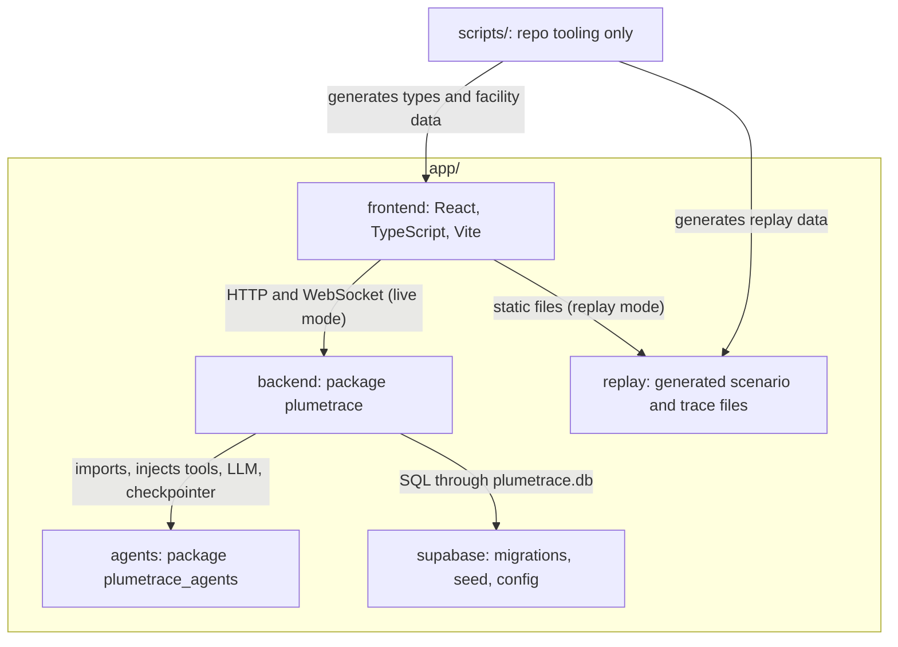
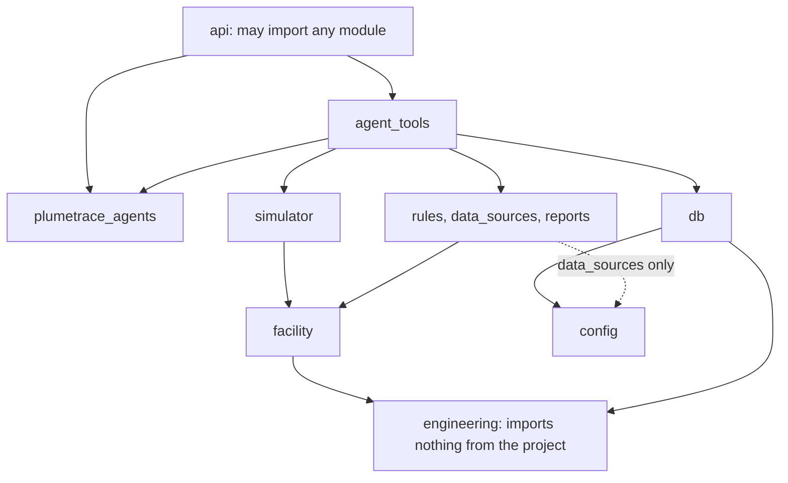
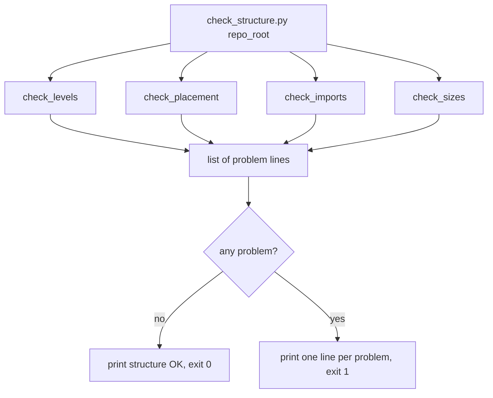

# Repository structure

The authoritative rules are in `.claude/skills/repo-structure/SKILL.md`; this page mirrors them for human readers.

## Purpose and scope

PlumeTrace allows exactly one home for each kind of file. The layout keeps three apps (backend,
agents, frontend) and a local database apart, fixes the direction in which code may import, and
limits file size so no module becomes a "god file". A script, `check_structure.py`, enforces all of
it, and `scripts/ci_local.py` runs that script on every commit.

This page shows the layout and the rules, explains how the checker works, and says how to add a
file or change a rule. The uv workspace and the tool settings are in
[WORKSPACE.md](WORKSPACE.md); the stages that run the checker are in [CHECKS.md](CHECKS.md).

### The apps and their boundaries



Caption: the frontend reaches the backend over HTTP and WebSocket or reads replay files; the
backend imports the agents package; only the backend touches the database; `scripts/` generates
files but is not imported by the apps.

## The tree

```text
PlumeTrace/
├── CLAUDE.md                      rules for all agents (authoritative)
├── README.md                      public entry point: problem, video, benchmark, setup link (no live link until the later deployment phase)
├── .gitignore   .env.example      (.env is local only, never committed)
├── .claude/skills/                project skills
│                                  (no .github/: GitHub Actions are not used — checks run locally
│                                   with scripts/ci_local.py and the git pre-commit hook)
├── .ux-profile.md                 visual profile + slop ban list read by UI skills
├── build/                         git-ignored scratch output (raw glb, bake caches)
├── scripts/                       repo-level tooling only (record traces, export schemas, render diagrams)
│   └── blender/                   bpy package that generates + bakes the 3D station (frontend-3d skill)
├── docs/                          all documentation (see project-documentation skill)
├── skills/                        LEGACY source copies from another project — ignored, never edited
└── app/
    ├── pyproject.toml  uv.lock    uv workspace root; members: backend, agents (one shared .venv)
    │
    ├── backend/                   FastAPI service + engineering + simulator   (package `plumetrace`)
    │   ├── pyproject.toml         depends on: plumetrace-agents (workspace), fastapi, psycopg, numpy …
    │   ├── plumetrace/
    │   │   ├── __init__.py
    │   │   ├── config.py          settings from env (pydantic-settings) — the ONLY place env is read
    │   │   ├── engineering/       PURE physics: units, constants, plume, inversion, flare, inventory,
    │   │   │                      mass_balance, reconciliation, aerial_survey
    │   │   ├── facility/          Station KS-07 spec (ks07.yaml) + typed loader
    │   │   ├── simulator/         instruments, weather, runner, scenarios/ (s1_*.py … s6_*.py)
    │   │   ├── rules/             (planned) rules_table.yaml (cited) + lookup
    │   │   ├── data_sources/      open_meteo.py (built), carbon_mapper.py (planned) (outbound HTTP lives only here)
    │   │   ├── db/                Supabase Postgres access: pool.py, runs, events, readings (built);
    │   │   │                      agent_steps, drafts, decisions, work_orders, reports (planned)
    │   │   ├── agent_tools/       (planned) implements plumetrace_agents' ToolProvider by calling engineering,
    │   │   │                      simulator, rules and db — the ONLY bridge from backend to agents' tools
    │   │   ├── reports/           (planned) work order / OGMP report / PDF rendering
    │   │   └── api/               main.py, routes/, run_store.py, scenario_cache.py, schemas.py (built);
    │   │                          ws.py, graph_runner.py, openai_llm.py, checkpointer.py (planned)
    │   ├── benchmark/             inversion benchmark (model-mismatch generators, runner, report)
    │   └── tests/                 mirrors plumetrace/: tests/engineering/test_plume.py …
    │
    ├── agents/                    LangGraph agents   (package `plumetrace_agents`)
    │   ├── pyproject.toml         depends on: langgraph, langgraph-checkpoint, langchain-core,
    │   │                          langsmith, pydantic — NOT on the backend (the backend owns
    │   │                          langchain-openai and langgraph-checkpoint-postgres and injects them)
    │   ├── plumetrace_agents/     (only __init__.py and py.typed are built; everything below is planned)
    │   │   ├── __init__.py        exports build_graph()
    │   │   ├── graph.py           build_graph(tools, llm, checkpointer) -> compiled StateGraph
    │   │   ├── state.py           PlumeTraceState (typed graph state)
    │   │   ├── routing.py         conditional-edge functions (after triage, after approval)
    │   │   ├── llm.py             AgentLLM protocol, message/turn models, ScriptedLLM fake
    │   │   ├── checkpoint.py      memory_checkpointer() for tests, CHECKPOINT_SCHEMA (backend builds PostgresSaver)
    │   │   ├── tracing.py         LangSmith run config: tags + metadata per run
    │   │   ├── export_trace.py    graph event stream -> replay JSON
    │   │   ├── nodes/             one module per node: detect_event, triage, locate_quantify,
    │   │   │                      compliance, draft_outputs, approval, redraft, escalate,
    │   │   │                      log_vented_volume, finalize
    │   │   ├── tools/             protocol.py (ToolProvider), recorder.py, registry.py (ToolSpec per
    │   │   │                      node), descriptions.py, fakes.py + fake_profiles.py (test provider)
    │   │   ├── schemas/           common.py, tool_call.py, tool_io_*.py (tool inputs/results),
    │   │   │                      outputs.py, drafts.py, decisions.py, provenance.py (number guard),
    │   │   │                      trace.py (replay trace format)
    │   │   └── prompts/           one .md prompt per LLM node (triage.md, compliance.md …)
    │   ├── evals/                 (planned) LangSmith dataset builder + evaluators
    │   └── tests/                 fake-LLM + fake-tools graph tests, every branch (today: the package smoke test)
    │
    ├── frontend/                  React + TS + Vite + R3F, built and previewed locally (static replay build)
    │   ├── package.json  lockfile  vite.config.ts  tsconfig*.json  index.html  components.json
    │   ├── vercel.json            build settings + security headers (CSP etc.), recorded for a later phase
    │   ├── public/                static assets; replay data copied in at build time
    │   │   ├── models/            ks07.glb — GENERATED by scripts/blender + glTF-Transform
    │   │   ├── textures/          Poly Haven CC0 textures (local), env/ HDRI, fonts/
    │   ├── e2e/                   (planned) Playwright specs
    │   └── src/
    │       ├── main.tsx
    │       ├── app/               shell, layout, providers
    │       ├── features/          station3d/ alarms/ trends/ scenarios/ (built);
    │       │                      agentPanel/ kpis/ approval/ reports/ (planned)
    │       │   └── <feature>/     index.ts, components/, hooks/, store.ts, *.test.tsx
    │       │                      (station3d has its own sub-layout: see the frontend-3d skill)
    │       ├── shared/            ui/ (shadcn), lib/, data/ (LiveSource, ReplaySource),
    │       │                      types/generated/, facility/
    │       └── styles/
    │
    ├── supabase/                  local Supabase (created by `supabase init` in app/)
    │   ├── config.toml
    │   ├── migrations/            YYYYMMDDHHMMSS_<name>.sql — schema `plumetrace`, RLS on every table
    │   └── seed.sql               facility + scenario reference rows only (no secrets)
    │
    └── replay/                    generated data for the static replay build — never hand-edited
        ├── scenarios/<scenario>.json
        └── traces/<scenario>/<branch>.json   (planned; only scenarios/ exists today)
```

The tree is the skill's layout with "(planned)" marks added on 2026-11-15 for parts that do not
exist yet. Built today (verified against the files): in `app/backend/plumetrace/` `config.py`,
`engineering/`, `facility/`, `simulator/`, `data_sources/open_meteo.py`, `db/` (`pool.py`,
`runs.py`, `events.py`, `readings.py`) and `api/` (`main.py`, `routes/`, `run_store.py`,
`scenario_cache.py`, `schemas.py`); `app/backend/benchmark/`; `app/agents/plumetrace_agents/`
with only `__init__.py` and `py.typed`; the frontend `src/features/` folders `alarms`, `scenarios`,
`station3d` and `trends`; `app/supabase/` with two migrations; `app/replay/scenarios/`. The
`rules/`, `agent_tools/` and `reports/` backend packages, all other agents modules, `evals/` and
`frontend/e2e/` do not exist yet.

The checker also allows these root entries: `LICENSE`, `.gitattributes`, `.vscode`, `.env` and
`.env.example`; and under `app/` the file `.python-version` and an optional `README.md`. Nothing is
deployed and nothing is planned for deployment (CLAUDE.md rule 27): the public replay build is
built and previewed locally.

## Dependency direction

```text
app/frontend ──HTTP/WS──▶ app/backend/plumetrace.api ──▶ plumetrace_agents (graph)
                                   │                         ▲
                                   ▼                         │ implements ToolProvider
              engineering ◀ facility ◀ simulator ◀ agent_tools ─┘
                    ▲            ▲         ▲            │
                 rules, data_sources, reports           ▼
                                                        db ──▶ Supabase Postgres (local)
```

- **`plumetrace_agents` never imports `plumetrace`.** Agents get tools, the LLM and the
  checkpointer injected through `build_graph(...)`. This keeps the graph testable with fakes and
  keeps a single direction: backend → agents.
- Inside `plumetrace` (backend):
  - `engineering` imports nothing else from the project.
  - `facility` → engineering only. `simulator` → engineering, facility.
  - `rules`, `reports` → engineering, facility only. `data_sources` → engineering, facility, config.
  - `db` → `config` and pure `engineering` data types only (no api, agent_tools, simulator).
  - Orchestration that combines simulator + db (e.g. saving a scenario run) lives in `api/`
    (`api/run_store.py`), which may import anything.
  - `agent_tools` → engineering, facility, simulator, rules, db, config, and
    `plumetrace_agents.tools/schemas`.
  - `api` → anything. Only `api` and `agent_tools` may import `plumetrace_agents`.
- Inside `plumetrace_agents`: `schemas` imports nothing internal except `schemas`; `llm` imports only
  `schemas`; `nodes` may import `schemas`, `state`, `tools`, `llm`, `prompts`; only `graph.py` wires
  nodes, routing, llm and checkpointer.
- Only `config.py` reads environment variables. Outbound network: `data_sources/` (public data)
  and `api/openai_llm.py` (OpenAI, via langchain-openai). Database access: only `db/` and the
  checkpointer built in `api/checkpointer.py`.
- The frontend talks only to the backend API (live mode) or to replay files (static replay build, local). It never
  connects to Supabase or OpenAI.

### Allowed imports inside the backend



Caption: an arrow means "may import". `engineering` is a leaf; `facility`, `simulator`, `rules`,
`data_sources` and `reports` build on it; only `api` and `agent_tools` may import
`plumetrace_agents`.

The diagram merges edges to keep it readable. The exact table is `BACKEND_ALLOWED` in
`structure_config.py`:

| Sub-package | May import (inside `plumetrace`) |
|---|---|
| `engineering` | nothing |
| `facility` | `engineering` |
| `simulator` | `engineering`, `facility` |
| `rules` | `engineering`, `facility` |
| `reports` | `engineering`, `facility` |
| `data_sources` | `engineering`, `facility`, `config` |
| `db` | `config`, `engineering` |
| `agent_tools` | `engineering`, `facility`, `simulator`, `rules`, `db`, `config` |
| `api` | anything |

Inside `plumetrace_agents` (`AGENTS_ALLOWED`; the sub-packages other than `__init__` do not exist
yet, the rules are in place first): `schemas` imports only `schemas`; `tools` imports `schemas` and
`tools`; `nodes` imports `schemas`, `state`, `tools`, `nodes`, `llm`, `prompts`; `state` imports
`schemas`; `routing` imports `schemas` and `state`; `llm` imports `schemas`; `export_trace` imports
`schemas` and `state`; `prompts`, `checkpoint` and `tracing` import nothing; `graph` and `__init__`
import anything. An import of `plumetrace` from anywhere in the agents package is always an error.

## No god files

### Hard limits (enforced by `check_structure.py`)

| What | Limit |
|---|---|
| Python source module (`.py`, not a test) | ≤ 300 lines |
| Python function / method | ≤ 50 lines |
| Python class | ≤ 200 lines |
| Top-level functions + classes in one Python module | ≤ 12 |
| Python test module | ≤ 500 lines |
| TypeScript / TSX source file | ≤ 250 lines |
| TypeScript / TSX test file | ≤ 400 lines |
| SQL migration | ≤ 300 lines |
| Agent prompt (`prompts/*.md`) | ≤ 200 lines |

Lines are physical lines including docstrings and comments, so full Google docstrings count —
that is intended: if docs push a file over the limit, the file does too much. Exempt from the
limits: generated paths (`app/frontend/src/shared/types/generated/`, `app/replay/`,
`app/frontend/public/models/`). Lockfiles and JSON/YAML data are not exempted by a rule: the size
check simply does not look at those file types.

## How the checker works



Caption: four independent checks each return a list of problems; the script prints them all, or
`structure OK`.

All files are in `.claude/skills/repo-structure/scripts/` and run as
`python -I .claude/skills/repo-structure/scripts/check_structure.py .` from the repository root.
The `-I` flag starts Python in isolated mode, so `check_structure.py` adds its own folder to
`sys.path` to import its siblings.

| Module | Function | What it does |
|---|---|---|
| `structure_config.py` | data only | `ALLOWED_CHILDREN`, `BANNED_NAMES`, `BANNED_DIRS`, `CACHE_DIRS`, `SKIP_TOP` (`.git`, `skills`, `.claude`), `BACKEND_ALLOWED`, `AGENTS_ALLOWED`, `LIMITS`, `SIZE_EXCEPTIONS` (empty), `GENERATED_PREFIXES` |
| `layout_checks.py` | `check_levels` | Every child of a structural folder must be in its allowlist (cache folders are always fine) |
| `layout_checks.py` | `check_placement` | `.py` only under `app/backend`, `app/agents`, `scripts`; `.ts` and `.tsx` only under `app/frontend`; `.sql` only under `app/supabase`; `.md` (other than `README.md`) only under `docs/` or the agent prompts folder; no banned names or folders |
| `import_checks.py` | `check_imports` | Parses every module with `ast`, collects `plumetrace` and `plumetrace_agents` imports, compares them with the allowlists; a syntax error is reported as `cannot parse <path>: <error>` |
| `size_checks.py` | `check_sizes` | Line limit per file type; for Python also function (50), class (200) and top-level definition (12, not in tests) limits; generated paths are exempt |

Folders that do not exist are skipped, so the checker works on a partial tree.

### Worked example

These changes were made in a scratch copy, outside the real repository, and the checker was run on
it. It printed one line per problem and exited 1:

```text
unexpected entry in repository root: .github
unexpected entry in app/: notes.md
unexpected entry in app/agents/plumetrace_agents/: y.py
Markdown file outside docs/ (or agent prompts): app/notes.md
catch-all module name not allowed: app/backend/plumetrace/engineering/utils.py
forbidden import: plumetrace.facility -> plumetrace.simulator (app/backend/plumetrace/facility/x.py)
forbidden import: plumetrace_agents must not import plumetrace (app/agents/plumetrace_agents/y.py)
god file: app/backend/plumetrace/engineering/big.py is 302 lines (limit 300); split it
```

The scratch changes were a `.github/` folder, a Markdown note under `app/`, an agents module
`y.py` that imports `plumetrace`, a `utils.py` and a 302-line module in `engineering`, and a
`facility` module that imports `plumetrace.simulator`. On the real repository the output is
`structure OK`.

### Edge cases and failure modes

| Case | Behaviour |
|---|---|
| A `.github/` folder | `unexpected entry in repository root: .github` (GitHub Actions are not used) |
| `README.md` anywhere | Allowed outside `docs/` (the Markdown rule exempts it) |
| Generated files (`app/frontend/src/shared/types/generated/`, `app/replay/`, `app/frontend/public/models/`) | Exempt from size limits |
| Cache and tool folders (`__pycache__`, `.venv`, `node_modules`, `dist`, `.temp`, `coverage` ...) | Ignored |
| Files under `skills/`, `.claude/`, `.git` | Not checked (the root `skills/` is legacy and ignored) |
| A test file | Uses the test limits (500 lines Python, 400 TS); the top-level definition limit does not apply |
| A package that does not exist yet | Skipped |
| Docstrings | Count as lines; a file that docs push over a limit should be split |

The checker has no unit tests of its own; the `structure` stage of `scripts/ci_local.py` exercises
it on every commit.

### How to add a file or change a rule

1. Find the file's home in the tree. If none fits, stop and ask the owner; do not create a folder.
2. Create the file with a Google-style docstring and, for source files, its test at the mirrored
   path under `tests/`.
3. Run `python -I .claude/skills/repo-structure/scripts/check_structure.py .` and expect
   `structure OK`.
4. To change the layout (new top-level folder, new package, new feature folder): get the owner's
   approval, then change the `repo-structure` skill, `structure_config.py` and this page in one
   change.
5. If a limit blocks you, split the file. A granted exception goes in `SIZE_EXCEPTIONS` with the
   reason and date; never raise a limit or compress code.
6. Moving or renaming a file updates every import, every doc link and this page in the same change.

## Related

- Code: `.claude/skills/repo-structure/` (skill and scripts), `scripts/ci_local.py`
- Pages: [CHECKS.md](CHECKS.md), [WORKSPACE.md](WORKSPACE.md), [FACILITY.md](FACILITY.md),
  [../LOCAL_DEVELOPMENT.md](../LOCAL_DEVELOPMENT.md)
