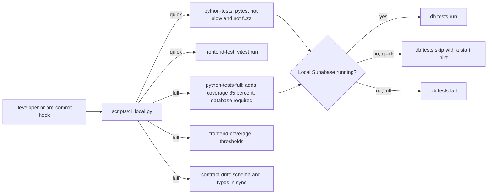

# Testing

Every change gets the test layers that fit it, written test-first. All checks run locally; there is
no GitHub Actions CI (owner decision 2026-11-13). This page is the readable copy of the
`testing-strategy` project skill. Layers that do not exist yet are marked "planned" with the phase
that adds them.

## How to run

From the repository root:

```bash
python scripts/install_git_hooks.py        # once per clone: installs .git/hooks/pre-commit
python scripts/ci_local.py                 # quick: the pre-commit hook runs this
python scripts/ci_local.py --full          # every stage; local Supabase must be running
python scripts/ci_local.py --only ruff,mypy
python scripts/ci_local.py --list
```

- `scripts/ci_local.py` runs the stages in a fixed order, stops a stage at its first failing command,
  prints a summary table and exits 1 if any stage failed. Later tasks add stages to `STAGES`.
- Quick mode runs `python-tests` (marker filter `not slow and not fuzz`) and `frontend-test`.
  Full mode replaces them with `python-tests-full` (adds coverage, sets `PLUMETRACE_REQUIRE_DB=1`),
  `frontend-coverage`, `frontend-build` and `contract-drift`.
- The hook runs the quick mode before every commit. Never commit with `--no-verify`.
- On Windows the runner prefers the `.cmd` shim for `npm`, because `shutil.which("npm")` returns the
  extensionless script that `CreateProcess` cannot start.

### From a test run to a stage



Caption: quick mode lets database tests skip, full mode requires them; the contract and coverage
checks run only in full mode.

## Layers

| Layer | Tool | Where | Proves | Stage |
|---|---|---|---|---|
| Unit | pytest | `app/backend/tests/**`, `app/agents/tests/**` | one function or class against hand-checked values | quick + full |
| Property-based / metamorphic | Hypothesis 6.170.14 | `app/backend/tests/engineering/test_properties.py`, `test_plume_field_properties.py` | laws that hold for every valid input | quick + full |
| Integration (database) | pytest + local Supabase, `db` marker | `app/backend/tests/db/**` | SQL, constraints, RLS, grants | quick (skips without DB) / full (fails without DB) |
| API | FastAPI `TestClient` | `app/backend/tests/api/test_api.py` (built: 6 tests; WebSocket protocol still planned) | status codes, error bodies (404 without echo), CORS, scenario summary against the replay index | quick + full |
| Graph branches | scripted LLM + fake tools (planned) | `app/agents/tests/graph/**` | every edge and branch of the graph | quick + full |
| Contract | `scripts/export_contract.py`, `npm run gen:types`, `git diff --exit-code` | stage `contract-drift` | backend models and frontend types never drift | full |
| API fuzzing | Schemathesis, `fuzz` marker (planned, Phase 6) | `app/backend/tests/security/` | no 500, responses match the schema | full |
| Security / abuse | pytest (planned) | `app/backend/tests/security/**` | limits, hostile input, replayed decisions | quick + full |
| Component | Vitest + Testing Library | `app/frontend/src/**/*.test.tsx` | rendering and interaction of one component | quick + full |
| Frontend coverage | `@vitest/coverage-v8` | `npm run test:coverage` | line and branch thresholds | full |
| Python coverage | pytest-cov | stage `python-tests-full` | total at least 85 % | full |
| End-to-end | Playwright (planned) | `app/frontend/e2e/**` | replay build and approval flows | full |
| Accessibility | axe with Playwright (planned) | e2e specs | no serious or critical violations | full |
| LLM evaluation | LangSmith (planned, Phase 5) | `app/agents/evals/**` | AI against baseline; paid | manual |

The check runner itself is covered by unit tests in `app/backend/tests/test_ci_local.py` (stage
selection by mode, unknown stage names, stop at the first failing command, failure summary, stage
environment).

`app/backend/tests/test_secret_scan.py` covers the secret scanner's skip rules (the only project path skipped is the Supabase CLI cache `app/supabase/.temp`; tool and cache folders and the `.env` file itself are skipped as well; other `.temp` folders are scanned) and `app/backend/tests/test_contract_types.py` covers the generated contract types.

## Which layers a change needs

| Change | Required layers |
|---|---|
| Physics or any pure calculation | unit with cited values, plus a property or metamorphic law for every formula with a law |
| Simulator or replay format | unit, determinism (same seed, same bytes), property tests for codecs |
| Database (migration, repository) | integration against the real DB; constraint violations; RLS and grants |
| API endpoint or WebSocket | API test for every status code, security tests, automatic fuzzing |
| Graph, node, routing, prompt | graph branch test with the scripted model for every touched branch; prompt change adds evaluation cases (paid, owner's yes) |
| Frontend component | component test (render, interaction, role names); data from props or stores |
| A user flow | Playwright e2e (replay); live-only flows also the live e2e |
| 3D scene | WebGL e2e and fps on the owner's machine |
| Security control | a test that fails when the control is removed |

## Current totals

`uv run pytest --collect-only -q` from `app/` collected 930 Python tests on 2026-11-15. Of these,
33 carry the `db` marker (`-m db`; they need local Supabase) and none carries the `slow` marker
(`-m slow` collects nothing yet, so quick and full mode run the same tests apart from the database
condition and coverage). The tests for the simulator, benchmark, Blender scripts, API and data
sources are described on the pages of those areas ([SIMULATOR.md](SIMULATOR.md),
[BENCHMARK.md](BENCHMARK.md), [API.md](API.md), [ENGINEERING.md](ENGINEERING.md),
[ASSETS.md](ASSETS.md)); this page covers the layers and the Phase 1 foundation tests.

## Foundation tests (Phase 1)

These tests prove the repository skeleton. Counts come from `uv run pytest --collect-only` on
2026-11-15.

| File | Tests | What it pins |
|---|---|---|
| `app/backend/tests/test_package.py` | 2 | Backend package installs, `__version__ == "0.1.0"`, agents package importable from the backend |
| `app/agents/tests/test_package.py` | 1 | Agents package installs with its version |
| `app/backend/tests/test_config.py` | 6 | Defaults without `.env`, environment override, secrets hidden in `repr`, `ConfigurationError` names `SUPABASE_DB_URL`, `.env` path is `REPO_ROOT / ".env"` |
| `app/backend/tests/test_db_pool.py` | 1 | `create_pool` without a URL raises before any connection (no database needed) |
| `app/backend/tests/db/test_schema.py` | 3 | RLS on every `plumetrace` table, no client policies, three MVP scenarios seeded (database needed) |
| `app/backend/tests/facility/` (5 test files) | 30 | Loader, validation errors that name the item, candidates, sensors, component placement and counts, wake obstacles |
| `app/backend/tests/test_export_contract.py` | 3 | Deterministic LF-only JSON, facility export, schema fields |
| `app/backend/tests/test_contract_types.py` | 4 | `prefixItems` rewrite, `Vec3` tuple shape, rewrite error, committed `contract.ts` has no `unknown` |
| `app/backend/tests/test_ci_local.py` | 5 | Stage selection by mode, unknown stage, stop at first failure, failure summary, stage environment |
| `app/backend/tests/test_secret_scan.py` | 3 | `app/supabase/.temp` is the only project path skipped (tool and cache folders and `.env` itself are also skipped); other `.temp` folders are scanned; key patterns reported without the value |
| `app/frontend/src/app/vercelConfig.test.ts` | 3 | Every security header and the SPA rewrite in `vercel.json` |

Details per area: [CONFIGURATION.md](CONFIGURATION.md), [FACILITY.md](FACILITY.md),
[CONTRACT.md](CONTRACT.md), [CHECKS.md](CHECKS.md), [WORKSPACE.md](WORKSPACE.md).

Not covered by a test of its own: `check_structure.py`, `check_env.py`, `env_set.py` and
`install_git_hooks.py` (run by the `structure` and `env` stages and by hand).

### Conventions seen in these tests

- Every test has a one-line docstring that states what it proves.
- A test that needs settings builds `Settings(_env_file=None)` and uses `monkeypatch` for variables,
  so it never reads the real root `.env`.
- A test that needs a script in `scripts/` or `.claude/skills/` loads it with
  `importlib.util.spec_from_file_location`, because those folders are not packages. Fake keys in
  tests are built at run time (`"sk-" + "Q7" * 12`) so the secret scanner does not flag the file.
- None of the tests above makes a paid call or a network call.

## Property-based tests

All property tests use `settings(max_examples=200, derandomize=True, deadline=None, database=None)`
(the codec file uses 300 examples):
the same inputs on every run, no per-example time limit, no example database (nothing is stored
or replayed between runs; Hypothesis may still create a gitignored `.hypothesis/constants` cache).

| File | Laws |
|---|---|
| `app/backend/tests/engineering/test_properties.py` | plume linear in rate; plume inversely proportional to wind speed; nothing upwind; crosswind mirror symmetry; rotation of scene and wind changes nothing; ppm round trip; circular mean rotates with the data; fusion is a probability and order-free; neutral evidence keeps the prior; unlit flare slips at least as much as lit; pipeline gas Z and CH4 mass fraction stay physical |
| `app/backend/tests/engineering/test_window_mode_class.py` | `window_mode_class` (per-window most frequent stability class) equals the old per-slice benchmark logic for every length, with ties and a partial last window (`LAW`: `max_examples=200`). The inversion tests (`test_inversion*.py`) do not use Hypothesis |
| `app/backend/tests/engineering/test_plume_field_properties.py` | plume grid codec (`encode_log_u8` / `decode_log_u8`): round trip within half a log step; monotonic coding; out-of-range values clamp to byte 0 and 255; one byte per cell and the grid shape is restored. Uses `max_examples=300` instead of 200 |

## Full-stack live e2e

Not built yet (planned). It will run browser, proxy, API, graph, Postgres and WebSocket with the
scripted model, so it costs nothing.

## API fuzzing

Not built yet (planned, Phase 6), marker `fuzz`, full mode only.

## Abuse tests

Not built yet (planned, Phase 6): rate limits, body limit, hostile ids, replayed decisions.

## Coverage

| Scope | Threshold | Set in |
|---|---|---|
| Python (`plumetrace`, `plumetrace_agents`), branch coverage on | total at least 85 % | stage `python-tests-full` (`--cov-fail-under=85`) |
| Frontend | lines, functions, statements at least 80 %; branches at least 70 % (the 3D scene is excluded and covered by WebGL e2e) | `npm run test:coverage` |

Coverage runs in full mode only. Never lower a threshold or add an exclusion to get green.

## Manual runs

WebGL visual checks, fps measurement and LLM evaluations are run by hand at the phase gates. The
evaluations are paid: they stay inside the OpenAI spend cap ($4.00 in total) and need the owner's
yes in chat before each run. No automated test makes a paid call.
