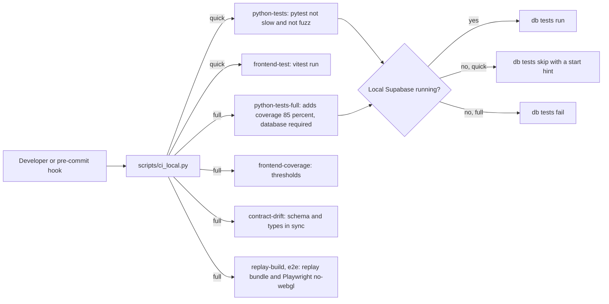
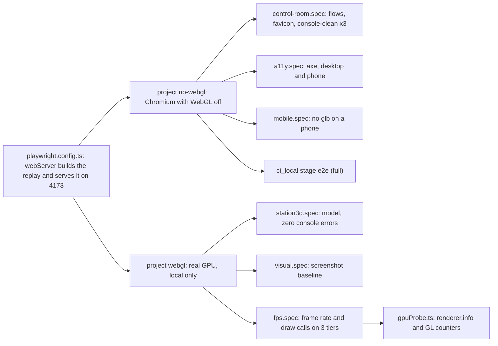
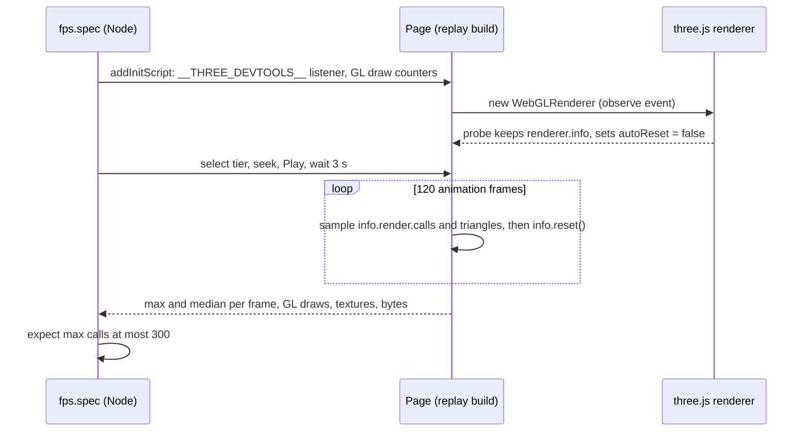

# Testing

Every change gets the test layers that fit it, written test-first. All checks run locally; there is
no GitHub Actions CI (owner decision 2026-11-13). This page is the readable copy of the
`testing-strategy` project skill. Layers that do not exist yet are marked "planned" with the phase
that adds them.

## How to run

From the repository root:

```bash
python scripts/install_git_hooks.py        # once per clone: installs .git/hooks/pre-commit
python scripts/ci_local.py                 # quick: the pre-commit hook runs this
python scripts/ci_local.py --full          # every stage; local Supabase must be running
python scripts/ci_local.py --only ruff,mypy
python scripts/ci_local.py --list
```

- `scripts/ci_local.py` runs the stages in a fixed order, stops a stage at its first failing command,
  prints a summary table and exits 1 if any stage failed. Later tasks add stages to `STAGES`.
- Quick mode runs `python-tests` (marker filter `not slow and not fuzz`) and `frontend-test`.
  Full mode replaces them with `python-tests-full` (adds coverage, sets `PLUMETRACE_REQUIRE_DB=1`),
  `frontend-coverage`, `frontend-build`, `replay-build` (replay build plus `check:replay-bundle`),
  `e2e` (Playwright, the `no-webgl` project) and `contract-drift`.
- The hook runs the quick mode before every commit. Never commit with `--no-verify`.
- On Windows the runner prefers the `.cmd` shim for `npm`, because `shutil.which("npm")` returns the
  extensionless script that `CreateProcess` cannot start.

### From a test run to a stage



Caption: quick mode lets database tests skip, full mode requires them; the contract, coverage,
replay-build and browser checks run only in full mode.

## Layers

| Layer | Tool | Where | Proves | Stage |
|---|---|---|---|---|
| Unit | pytest | `app/backend/tests/**`, `app/agents/tests/**` | one function or class against hand-checked values | quick + full |
| Property-based / metamorphic | Hypothesis 6.170.14 | `app/backend/tests/engineering/test_properties.py`, `test_plume_field_properties.py` | laws that hold for every valid input | quick + full |
| Integration (database) | pytest + local Supabase, `db` marker | `app/backend/tests/db/**` | SQL, constraints, RLS, grants | quick (skips without DB) / full (fails without DB) |
| API | FastAPI `TestClient` | `app/backend/tests/api/test_api.py` (built: 6 tests; WebSocket protocol still planned) | status codes, error bodies (404 without echo), CORS, scenario summary against the replay index | quick + full |
| Graph branches | scripted LLM + fake tools (planned) | `app/agents/tests/graph/**` | every edge and branch of the graph | quick + full |
| Contract | `scripts/export_contract.py`, `npm run gen:types`, `git diff --exit-code` | stage `contract-drift` | backend models and frontend types never drift | full |
| API fuzzing | Schemathesis, `fuzz` marker (planned, Phase 6) | `app/backend/tests/security/` | no 500, responses match the schema | full |
| Security / abuse | pytest (planned) | `app/backend/tests/security/**` | limits, hostile input, replayed decisions | quick + full |
| Component | Vitest + Testing Library | `app/frontend/src/**/*.test.tsx` | rendering and interaction of one component | quick + full |
| Frontend coverage | `@vitest/coverage-v8` | `npm run test:coverage` | line and branch thresholds | full |
| Python coverage | pytest-cov | stage `python-tests-full` | total at least 85 % | full |
| End-to-end (replay build) | Playwright 1.65.0, project `no-webgl` | `app/frontend/e2e/**` (12 tests, built) | control-room flows, console-clean run per scenario, no live API call, phone page | full (stage `e2e`) |
| End-to-end (3D, local) | Playwright, project `webgl` | `e2e/station3d.spec.ts`, `visual.spec.ts`, `fps.spec.ts` (11 tests, built) | model loads, zero console errors, visual baseline, draw-call budget on three tiers, frame rate | manual (`npm run e2e:local`, `e2e:fps`) |
| Accessibility | `@axe-core/playwright` 4.14.0 in `e2e/a11y.spec.ts` (built) | desktop control room and the phone page | no serious or critical violations (WCAG 2.0 A/AA, 2.1 AA tags) | full (stage `e2e`) |
| Full-stack live e2e | Playwright against the backend (planned, Phase 5) | not built | browser, proxy, API, graph and Postgres together | planned |
| LLM evaluation | LangSmith (planned, Phase 5) | `app/agents/evals/**` | AI against baseline; paid | manual |

The check runner itself is covered by unit tests in `app/backend/tests/test_ci_local.py` (stage
selection by mode, unknown stage names, stop at the first failing command, failure summary, stage
environment).

`app/backend/tests/test_secret_scan.py` covers the secret scanner's skip rules (the only project path skipped is the Supabase CLI cache `app/supabase/.temp`; tool and cache folders and the `.env` file itself are skipped as well; other `.temp` folders are scanned) and `app/backend/tests/test_contract_types.py` covers the generated contract types.

## Which layers a change needs

| Change | Required layers |
|---|---|
| Physics or any pure calculation | unit with cited values, plus a property or metamorphic law for every formula with a law |
| Simulator or replay format | unit, determinism (same seed, same bytes), property tests for codecs |
| Database (migration, repository) | integration against the real DB; constraint violations; RLS and grants |
| API endpoint or WebSocket | API test for every status code, security tests, automatic fuzzing |
| Graph, node, routing, prompt | graph branch test with the scripted model for every touched branch; prompt change adds evaluation cases (paid, owner's yes) |
| Frontend component | component test (render, interaction, role names); data from props or stores |
| A user flow | Playwright e2e (replay); live-only flows also the live e2e |
| 3D scene | WebGL e2e and fps on the owner's machine |
| Security control | a test that fails when the control is removed |

## Current totals

`uv run pytest --collect-only -q` from `app/` collected 930 Python tests on 2026-11-15. Of these,
33 carry the `db` marker (`-m db`; they need local Supabase) and none carries the `slow` marker
(`-m slow` collects nothing yet, so quick and full mode run the same tests apart from the database
condition and coverage). The tests for the simulator, benchmark, Blender scripts, API and data
sources are described on the pages of those areas ([SIMULATOR.md](SIMULATOR.md),
[BENCHMARK.md](BENCHMARK.md), [API.md](API.md), [ENGINEERING.md](ENGINEERING.md),
[ASSETS.md](ASSETS.md)); this page covers the layers and the Phase 1 foundation tests.

## Foundation tests (Phase 1)

These tests prove the repository skeleton. Counts come from `uv run pytest --collect-only` on
2026-11-15.

| File | Tests | What it pins |
|---|---|---|
| `app/backend/tests/test_package.py` | 2 | Backend package installs, `__version__ == "0.1.0"`, agents package importable from the backend |
| `app/agents/tests/test_package.py` | 1 | Agents package installs with its version |
| `app/backend/tests/test_config.py` | 6 | Defaults without `.env`, environment override, secrets hidden in `repr`, `ConfigurationError` names `SUPABASE_DB_URL`, `.env` path is `REPO_ROOT / ".env"` |
| `app/backend/tests/test_db_pool.py` | 1 | `create_pool` without a URL raises before any connection (no database needed) |
| `app/backend/tests/db/test_schema.py` | 3 | RLS on every `plumetrace` table, no client policies, three MVP scenarios seeded (database needed) |
| `app/backend/tests/facility/` (5 test files) | 30 | Loader, validation errors that name the item, candidates, sensors, component placement and counts, wake obstacles |
| `app/backend/tests/test_export_contract.py` | 3 | Deterministic LF-only JSON, facility export, schema fields |
| `app/backend/tests/test_contract_types.py` | 4 | `prefixItems` rewrite, `Vec3` tuple shape, rewrite error, committed `contract.ts` has no `unknown` |
| `app/backend/tests/test_ci_local.py` | 5 | Stage selection by mode, unknown stage, stop at first failure, failure summary, stage environment |
| `app/backend/tests/test_secret_scan.py` | 3 | `app/supabase/.temp` is the only project path skipped (tool and cache folders and `.env` itself are also skipped); other `.temp` folders are scanned; key patterns reported without the value |
| `app/frontend/src/app/vercelConfig.test.ts` | 3 | Every security header and the SPA rewrite in `vercel.json` |

Details per area: [CONFIGURATION.md](CONFIGURATION.md), [FACILITY.md](FACILITY.md),
[CONTRACT.md](CONTRACT.md), [CHECKS.md](CHECKS.md), [WORKSPACE.md](WORKSPACE.md).

Not covered by a test of its own: `check_structure.py`, `check_env.py`, `env_set.py` and
`install_git_hooks.py` (run by the `structure` and `env` stages and by hand).

### Conventions seen in these tests

- Every test has a one-line docstring that states what it proves.
- A test that needs settings builds `Settings(_env_file=None)` and uses `monkeypatch` for variables,
  so it never reads the real root `.env`.
- A test that needs a script in `scripts/` or `.claude/skills/` loads it with
  `importlib.util.spec_from_file_location`, because those folders are not packages. Fake keys in
  tests are built at run time (`"sk-" + "Q7" * 12`) so the secret scanner does not flag the file.
- None of the tests above makes a paid call or a network call.

## Property-based tests

All property tests use `settings(max_examples=200, derandomize=True, deadline=None, database=None)`
(the codec file uses 300 examples):
the same inputs on every run, no per-example time limit, no example database (nothing is stored
or replayed between runs; Hypothesis may still create a gitignored `.hypothesis/constants` cache).

| File | Laws |
|---|---|
| `app/backend/tests/engineering/test_properties.py` | plume linear in rate; plume inversely proportional to wind speed; nothing upwind; crosswind mirror symmetry; rotation of scene and wind changes nothing; ppm round trip; circular mean rotates with the data; fusion is a probability and order-free; neutral evidence keeps the prior; unlit flare slips at least as much as lit; pipeline gas Z and CH4 mass fraction stay physical |
| `app/backend/tests/engineering/test_window_mode_class.py` | `window_mode_class` (per-window most frequent stability class) equals the old per-slice benchmark logic for every length, with ties and a partial last window (`LAW`: `max_examples=200`). The inversion tests (`test_inversion*.py`) do not use Hypothesis |
| `app/backend/tests/engineering/test_plume_field_properties.py` | plume grid codec (`encode_log_u8` / `decode_log_u8`): round trip within half a log step; monotonic coding; out-of-range values clamp to byte 0 and 255; one byte per cell and the grid shape is restored. Uses `max_examples=300` instead of 200 |

## Browser tests (Playwright, Phase 4 Task 11)

### Purpose

The component tests run in jsdom, which has no layout, no WebGL and no real network. The browser
tests run the **replay build** (`vite build --mode replay`, served by `vite preview` on port 4173,
no backend) in a real Chromium and prove what jsdom cannot: the control-room flows end to end, that
the page stays clean (no console error or warning, no page error, no failed request) while it
runs, that the 3D scene loads, that the draw-call budget holds on every quality tier and that the
page has no serious or critical axe violation. **Built:** all of the specs below. **Not built:** the
live full-stack e2e (browser, API, graph, Postgres; planned for Phase 5) and a measurement on an
integrated GPU (owner action C6, before Gate 4).

### How the pieces fit



Caption: both projects share one replay build and the helpers in `scenarioDriver.ts`; only the
`no-webgl` project runs in `python scripts/ci_local.py --full`, the `webgl` project is a manual run
on the owner's machine (its output depends on the GPU).



Caption: the probe sums every render pass of one displayed frame (shadow, scene, bloom, SMAA)
because the renderer's own counter is turned off and reset by the probe once per frame.

### Module by module (`app/frontend/`)

| File | Responsibility |
|---|---|
| `playwright.config.ts` | Two projects, one `webServer` (`npm run build:replay && vite preview` on 4173, never reuses a running server), 1920 x 1080 viewport, screenshot tolerance `maxDiffPixelRatio` 0.02. Plan-exact |
| `e2e/scenarioDriver.ts` | `openScenario` (goto and wait for the enabled slider), `seekTo` (fill the `Simulation time` slider), `measureFps`, `watchProblems` (console error or warning, page error, failed request, HTTP 4xx or 5xx), `alarmTimes` (reads the replay JSON through the preview server) |
| `e2e/gpuProbe.ts` | `installGpuProbe`, `sampleFrames`, `describeGpu`: reads three.js `renderer.info` through the `__THREE_DEVTOOLS__` hook and counts WebGL draw calls and live `texStorage2D` bytes. The app is not changed |
| `e2e/control-room.spec.ts` | Plan flows (alarms, scenario switch, keyboard, fallback, no live API call) plus the favicon test and one console-clean test per scenario |
| `e2e/mobile.spec.ts`, `e2e/a11y.spec.ts` | Phone page (Chromium with iPhone 13 settings) never requests `.glb`; axe on the desktop and the phone page |
| `e2e/station3d.spec.ts` | Model loads with every node, equipment selection keeps the canvas alive, S1 runs with zero console errors |
| `e2e/visual.spec.ts` | One screenshot of the station view, review camera, S1 at +04:00, paused (baseline in `e2e/visual.spec.ts-snapshots/`) |
| `e2e/fps.spec.ts` | Frame rate on high (at least 58 fps, labelled with the GPU) and the draw-call budget for S1 +02:20 and the S4 blowdown peak on high, medium and low |

### Worked example (real values, 2026-11-17)

RTX 3050 Laptop GPU (ANGLE, Direct3D 11), Chromium 158.0.8127.18, the Playwright headless shell
(`chromium_headless_shell-1254`, read from the process list), viewport 1920 x 1080, REVIEW_CAMERA, clock
playing, 120 sampled frames per case:

| Case | Draw calls per frame (max) | GL draws (cross-check) | Triangles | `texStorage2D` bytes |
|---|---|---|---|---|
| S1 +02:20, high | 296 | 296 | 142,613 | 74.3 MiB |
| S1 +02:20, medium | 296 | 296 | 142,613 | 60.9 MiB |
| S1 +02:20, low | 121 | 121 | 55,514 | 49.3 MiB |
| S4 blowdown peak (7200 s), high / medium / low | 296 / 296 / 121 | 296 / 296 / 121 | 142,613 / 142,613 / 55,514 | 74.3 / 60.9-62.3 / 49.3 MiB |

The budget is 300 as rendered: the sum of `gl.info.render.calls` over every render call of one
displayed frame. The numbers equal the Task 9 measurement (296 / 296 / 121). Frame rate on high:
average 60.0 fps, 95th percentile frame 16.7 ms. The run sits at exactly 60, which points to a 60 Hz
frame cap in this browser build (not investigated), so it shows "at or above 58 fps", not headroom;
Task 9's 143.9 fps came from another browser launch on the 144 Hz display. This is a discrete GPU;
the integrated GPU is not measured (owner action C6).

### Edge cases and the test that pins each

| Case | Behaviour | Test |
|---|---|---|
| A console error or warning, page error, failed request or HTTP 4xx during a run | The test fails; there is no allow-list in the `no-webgl` project | `control-room.spec.ts` "console, page errors and requests stay clean" (x3 scenarios) |
| Alarm ticks at the same time (S4 7800 s) | No duplicate React key warning (production builds print none, so only this run catches it) | the same test, S4 |
| A static server answers `/favicon.ico` with 404 | A browser that asks logs a console error; the page declares an SVG icon instead. The headless shell never asks, so the test checks the cause | `control-room.spec.ts` "the page declares a favicon that is served" |
| Benign three.js deprecation warnings in the 3D scene | Exactly two texts are listed in `station3d.spec.ts` with a reason each; any other warning fails | `station3d.spec.ts` "the 3D scene runs S1 without console errors ..." (negative control: changing one listed text made it fail) |
| More than 300 draw calls in one frame | The test fails | `fps.spec.ts` "draw calls ..." (six cases) |
| Fewer than 58 fps | The test fails; the GPU name is printed next to the figure | `fps.spec.ts` "holds 58 fps on high" |
| The preview port is busy | `strictPort` and `reuseExistingServer: false` make the run fail instead of testing a stale build | `playwright.config.ts` |
| Visual output differs on another GPU | The screenshot is compared only in the manual `webgl` run (tolerance 2 % of pixels); `ci_local` never compares it | `visual.spec.ts` |

### How to run and extend

```bash
cd app/frontend
npm run e2e                  # no-webgl project (what ci_local --full runs)
npm run e2e:local            # both projects, owner's machine
npm run e2e:fps              # frame rate and draw-call spec only
npm run e2e:update-baseline  # rewrite the screenshot; look at the image before committing it
python ../../scripts/ci_local.py --full --only replay-build,e2e
```

Chromium for Playwright 1.65.0 is installed once with `npx playwright install chromium` (about 330
MiB downloaded, 770 MB on disk; never `--with-deps`). To add a flow, write it in `e2e/`, use
`scenarioDriver.ts`, and call `watchProblems` first when the test should also prove the page stays
clean. A spec that needs WebGL must be added to `testMatch` of the `webgl` project and to the
`testIgnore` of `no-webgl`.

### Links

[FRONTEND.md](FRONTEND.md) (scripts, 3D view), [PLUME.md](PLUME.md) (draw-call definition),
[ACCESSIBILITY.md](ACCESSIBILITY.md) (axe result), [CHECKS.md](CHECKS.md) (stages),
[../evidence/2026-11-phase-4-ui.md](../evidence/2026-11-phase-4-ui.md) (phase evidence).

## Full-stack live e2e

Not built yet (planned, Phase 5). It will run browser, proxy, API, graph, Postgres and WebSocket
with the scripted model, so it costs nothing.

## API fuzzing

Not built yet (planned, Phase 6), marker `fuzz`, full mode only.

## Abuse tests

Not built yet (planned, Phase 6): rate limits, body limit, hostile ids, replayed decisions.

## Coverage

| Scope | Threshold | Set in |
|---|---|---|
| Python (`plumetrace`, `plumetrace_agents`), branch coverage on | total at least 85 % | stage `python-tests-full` (`--cov-fail-under=85`) |
| Frontend | lines, functions, statements at least 80 %; branches at least 70 % (the 3D scene is excluded and covered by WebGL e2e) | `npm run test:coverage` |

Coverage runs in full mode only. Never lower a threshold or add an exclusion to get green.

## Manual runs

WebGL visual checks, fps measurement and LLM evaluations are run by hand at the phase gates. The
evaluations are paid: they stay inside the OpenAI spend cap ($4.00 in total) and need the owner's
yes in chat before each run. No automated test makes a paid call.
