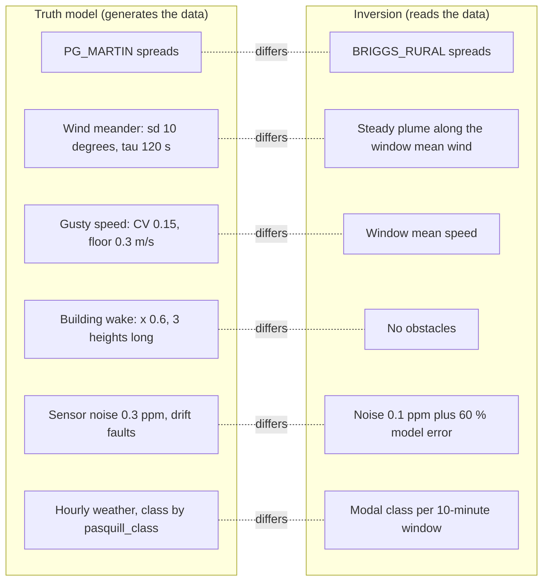
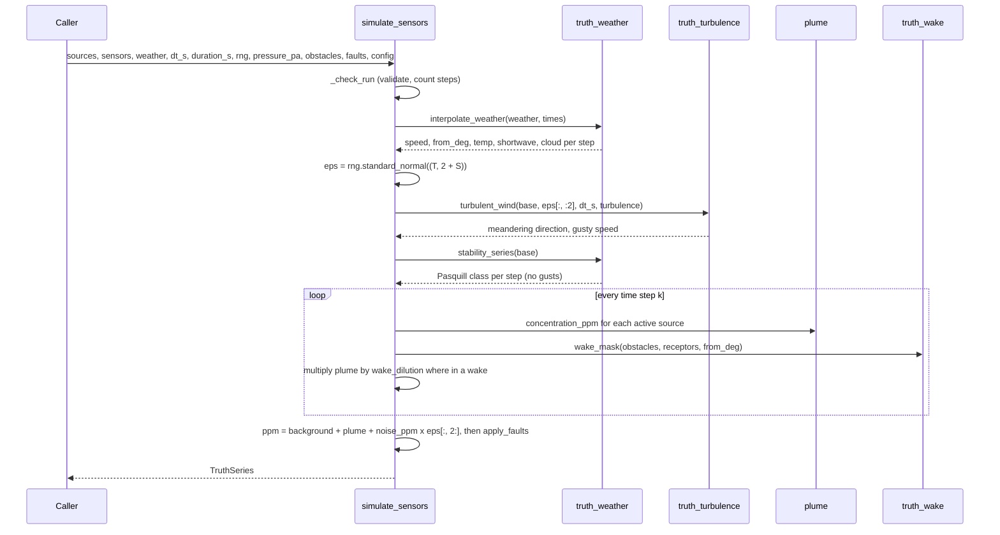
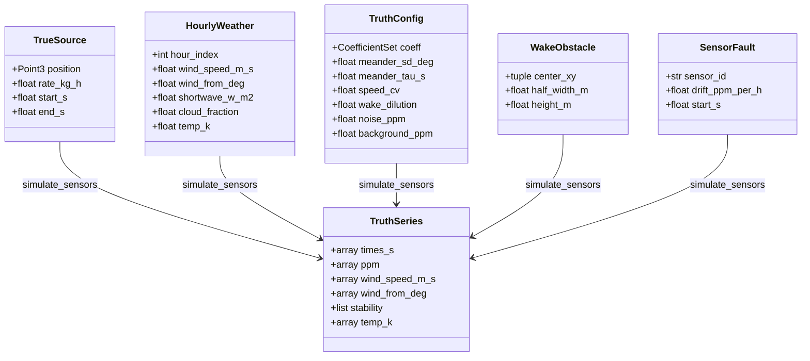

# Truth model: the deliberately different physics

How PlumeTrace generates synthetic methane sensor data that the inversion cannot solve by
construction. Modules `plumetrace.engineering.truth_model` (orchestration, `TruthConfig`,
`TrueSource`, `TruthSeries`, `simulate_sensors`), `truth_weather` (hourly weather, generator,
interpolation), `truth_turbulence` (AR(1) meander and gusts), `truth_wake` (building wake),
`truth_faults` (sensor drift) and `plumetrace.facility.obstacles` (turns the facility spec into wake
obstacles; it lives in `facility` because `engineering` may not import it). Contract reference:
[ENGINEERING.md](ENGINEERING.md) section "Truth model". Consumers: the scenario runner
([SIMULATOR.md](SIMULATOR.md)) and the benchmark ([BENCHMARK.md](BENCHMARK.md)).

Everything here is **synthetic**: a fictional station, simulated sensors and (in the benchmark)
synthetic weather. Real weather (Open-Meteo) enters only through `HourlyWeather` in the simulator.

## 1. Purpose and scope

The inversion fits data with Briggs rural coefficients and a steady, narrow plume. If the data were
made by the same model, the inversion would be "solved by construction": an **inverse crime**. The
truth model is the same Gaussian plume formula (`concentration_ppm`) with other settings, plus
noise and effects the inversion does not have. That makes the mismatch real but **partial**.

Does: simulate sensor readings for true sources, hourly weather, wind meander, gusts, building
wakes, sensor noise and drift faults, from one seeded random generator.

Does not: model plume rise, buoyant or dense-gas behaviour, terrain, or a non-Gaussian vertical
profile. A good benchmark result shows robustness to the listed mismatches only, not to every
real-world error.

## 2. What differs from the inversion

*Figure 1. Each ingredient of the truth model and what the inversion assumes in its place. The
meander-aware inversion adds a measured direction spread (a partial answer to the second row).*

| Ingredient | Parameter (default in `TruthConfig`) | Why it is there |
|---|---|---|
| Other dispersion coefficients | `coeff = PG_MARTIN` (inversion: `BRIGGS_RURAL`) | The two fits of the same curves differ. At 300 m, class D, the centreline excess is about 24 % higher with Martin: 4.17 ppm against 3.36 ppm for 36 kg/h, 4 m/s, 290 K, 98 900 Pa, source and receptor at 2 m ([DISPERSION.md](DISPERSION.md)). |
| Wind-direction meander | `meander_sd_deg = 10`, `meander_tau_s = 120` | Real wind direction wanders on the minute scale; the inversion sees window means. |
| Gusty speed | `speed_cv = 0.15`, same `meander_tau_s`, floor `MIN_SPEED_M_S = 0.3` | Speed varies around the hourly value. |
| Building wake | `wake_dilution = 0.6`; wake length 3 obstacle heights | Receptors close behind a building or shelter see less plume; the inversion has no obstacles. |
| Sensor noise | `noise_ppm = 0.3` | White Gaussian noise on every reading. |
| Drift faults | `SensorFault(sensor_id, drift_ppm_per_h, start_s)` | A fault adds `drift x max(0, t - start) / 3600` ppm to one sensor. |
| Own weather and stability | hourly weather, class by `pasquill_class` | Stability follows the hourly sun and cloud, not the inversion's window mode. |
| Background | `background_ppm = BACKGROUND_PPM` (1.95) | Added to every reading. |

The 0.3 m/s floor, the wake length of 3 heights, the 6 m shelter height and the 200 000-step cap
are Phase 2 Task 12 project values; no published source is claimed.

## 3. How it works

*Figure 2. `simulate_sensors`. All random numbers come from one call to the generator before the
loop.*

Per step `t = k x dt_s`, `k = 0 ... floor(duration_s / dt_s) - 1`:

1. **Weather.** `h = t / 3600`, `i = floor(h)`, `f = h - i`. Speed is linear between hour `i` and
   `i + 1`; direction is linear along the shortest arc; temperature, shortwave and cloud come from
   hour `i`. Hours past the list hold the last entry.
2. **Meander.** `phi = exp(-dt_s / meander_tau_s)`, `m_0 = sd x e_0`,
   `m_k = phi m_(k-1) + sqrt(1 - phi^2) x sd x e_k`. Direction = interpolated + `m_k`, wrapped to
   [0, 360). With `dt_s` = 10 s and `tau` = 120 s, `phi` = 0.9200 and `sqrt(1 - phi^2)` = 0.3918.
3. **Gusts.** The same AR(1) with stationary standard deviation `speed_cv` gives `r_k`;
   `speed = max(0.3, interpolated x (1 + r_k))`.
4. **Stability.** `pasquill_class(interpolated speed without gust, shortwave, cloud)`.
5. **Plume.** The sum over sources with `start_s <= t < end_s` of
   `concentration_ppm(rate / 3600, speed, direction, source, receptors, stability, coeff, temp,
   pressure)`.
6. **Wake.** A receptor is in an obstacle's wake when, in the wind frame centred on the obstacle,
   `0 < along <= 3 x height_m` and `|cross| <= half_width_m`. Its plume is multiplied by
   `wake_dilution` once, however many wakes it is in. For the 6 m shelter height the wake is 18 m
   long.
7. **Output.** `background_ppm + plume + noise_ppm x e` per sensor, plus the drift of each fault.
   Example: a fault of 0.5 ppm/h starting at 3600 s adds 0 ppm before 3600 s and 0.5 ppm at 7200 s.

### The data types

*Figure 3. Inputs and output of `simulate_sensors`. All are frozen and validated when constructed
(`HourlyWeather` is a Pydantic model, the others are frozen dataclasses). `TruthSeries.wind_from_deg`
and `wind_speed_m_s` are the meandering and gusty series actually used; the benchmark measures its
direction spread from `wind_from_deg`.*

## 4. Reproducibility: the random-draw order

All draws are made up front as `rng.standard_normal((T, 2 + S))`, which equals drawing step by
step: per step the meander value, the gust value, then one noise value per sensor in sensor order.
The draws are made even when `noise_ppm`, `meander_sd_deg` or `speed_cv` is 0, so a seed gives
aligned sequences whatever the configuration, and the generator advances by exactly `T x (2 + S)`
values. The same seed and inputs give a bit-identical series. The weather generator draws three
values per hour: speed normal, direction normal, cloud beta.

## 5. Synthetic weather (`synthetic_hourly_weather`)

`synthetic_hourly_weather(hours, start_hour_of_day, rng, prevailing_from_deg=250.0)`:

- speed `exp(ln 4 + 0.5 z)` clipped to 0.3 to 15 m/s;
- direction a mean-reverting walk `d = d + N(0, 20) - 0.2 x angular_diff(d, prevailing)` (hour 0 is
  already one step from the prevailing direction);
- cloud `beta(2, 5)`;
- shortwave `800 sin(pi (h - 6) / 12)` from 06 to 18 h local time times `(1 - 0.75 cloud)`, else 0;
- temperature 300 K if shortwave exceeds 10 W/m2, else 285 K.

All of these numbers are Task 12 values. The weather is deliberately simple (independent hourly
speeds and clouds, no seasons, no latitude): it is for tests and the benchmark, not a climate
model.

**Real weather.** The simulator builds one `HourlyWeather` per hour from Open-Meteo hourly data
(wind speed, direction, shortwave radiation, cloud cover, temperature), converted to m/s, degrees,
W/m2, a 0 to 1 fraction and K. `HourlyWeather` rejects non-finite or unphysical values at
construction (negative speed, cloud outside 0 to 1, temperature not above 0 K), so bad API data
fails at the boundary. A calm hour (0 m/s) is valid input: the speed floor of 0.3 m/s applies.

## 6. Failure behaviour

`ValueError` (never NaN) for: no sensors, repeated sensor ids, a fault on an unknown sensor, empty
weather, `dt_s` or `pressure_pa` not positive and finite, a duration that is not finite or shorter
than one step (zero steps is an error), more than 200 000 steps, an invalid `TruthConfig`,
`TrueSource`, `WakeObstacle` or `SensorFault` (checked at construction), and a reading that is not
finite (for example drifts that overflow). A source's `end_s` may be infinite. The step count is
`floor(duration_s / dt_s + 1e-9)` so that `0.3 / 0.1` still gives 3.

## 7. Limits

- It is the same Gaussian formula as the inversion with another coefficient set plus noise. It does
  not test plume rise, dense-gas or buoyant behaviour, terrain, or a non-Gaussian vertical profile.
- The meander the truth model adds is the kind of process the meander-aware correction models, so
  the benchmark gain of that correction is optimistic ([BENCHMARK.md](BENCHMARK.md)).
- Stability changes only at the hour boundaries of the weather (speed interpolates, sun and cloud
  do not), so a class can jump while the wind changes smoothly. The class uses no gusts.
- Meander and gusts share one correlation time and are stationary; the plume is evaluated as steady
  state at every step; there is no averaging-time dependence of the spread.
- The wake is a box rule: one fixed factor, three heights long, one width, no recirculation or
  plume lift. Only receptors are tested, not sources. A receptor inside the footprint (`along <= 0`
  from the centre) counts as outside. Rotation is ignored and the larger footprint side gives the
  width (a conservative square), see Obstacles in [SIMULATOR.md](SIMULATOR.md).
- Noise is white and Gaussian with one `noise_ppm` for all sensors (`Sensor.noise_ppm` is not
  used). Drift is linear and unbounded. There is no dropout (NaN), saturation or stuck value.
- Pressure is constant; temperature is constant within an hour. Distances are clipped to 10 to
  1000 m as in [DISPERSION.md](DISPERSION.md).
- A run is limited to 200 000 steps (about 23 days at 10 s).

## 8. Testing and evidence

`test_truth_model.py` (plan tests: determinism, the quiet Briggs configuration equals the plume
model, Martin differs from Briggs by more than 10 %, background and noise statistics, the source
window, linear drift, the 0.6 wake dilution, KS-07 obstacles, synthetic weather ranges; the noise
statistics test uses seed 0, and `test_noise_is_unbiased_pooled_over_50_seeds` checks the bias over
18 000 pooled samples, owner decision 2026-11-13), `test_truth_model_edges.py` (step count, every
set-up `ValueError`, draw order and generator advance, meander on draw 0 and gusts on draw 1
against the documented recursion), `test_truth_model_physics_edges.py` (stationary statistics of
meander and gusts, the speed floor, wrap-around, hold of the last hour, source windows, upwind
sensors, drift start and sign, wake boundaries), `test_truth_weather_edges.py` (`HourlyWeather`
validation, `angular_diff_deg`, generator draw order, day and night, interpolation) and
`tests/facility/test_obstacles_edges.py`. Run from `app/`: `uv run pytest backend/tests/engineering
-q`.

## 9. How to extend

- Add a mismatch ingredient as a field of `TruthConfig` with a default that keeps today's data
  bit-identical, draw its randomness from the existing array (or append columns at the end) so the
  draw order stays documented, and add a test for the draw order.
- Never copy a truth-model parameter into the inversion's input. The inversion must measure what it
  uses from the data (as `window_direction_sd_deg` does).
- Changing a default changes the benchmark cases and the replay files. The published benchmark
  numbers describe the code at revision `23b8703`; do not rerun a pre-registered seed.

## 10. Changelog

- 2026-11-15: page created (documentation pass for Phase 2).
