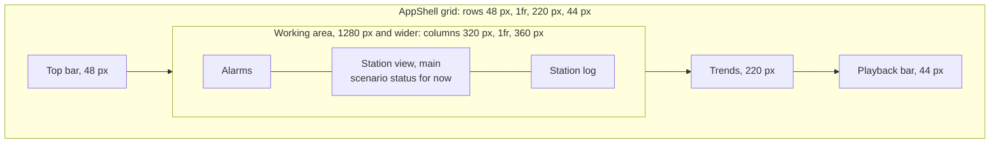
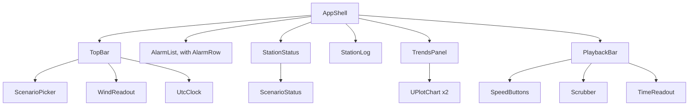
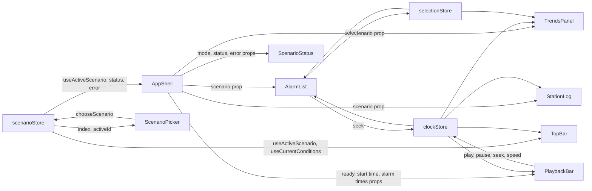

# Control-room panels

The panels of the PlumeTrace control room as built in Phase 4 Task 4: layout, components, the stores
each one reads, the alarm rule, the keyboard map and the display rules that bind every later UI task.

Related pages: [FRONTEND.md](FRONTEND.md) (overview, scripts, folder rules),
[DATA_LAYER.md](DATA_LAYER.md) (stores and data sources), [DESIGN_SYSTEM.md](DESIGN_SYSTEM.md)
(tokens, type, shadcn), [ACCESSIBILITY.md](ACCESSIBILITY.md). Design reference: design section 9;
visual rules: `.ux-profile.md`.

## Purpose and scope

The UI shows one simulated scenario of station KS-07 (fictional) against a playback clock: alarms
as detection windows close, the station log, methane and wind trends, and playback controls. It is
**not 3D yet**: the station area (`<main aria-label="Station view">`) shows only the scenario load
status until the Blender-baked scene arrives in Phase 4 Tasks 8 and 9. The `Simulated` label is
always visible. The panels show no leak rate and no AI output; the Phase 5 agent panels do not exist.

## Layout

Layout of `src/app/AppShell.tsx`, a CSS grid with `grid-rows-[48px_minmax(0,1fr)_220px_44px]`. The
working area is `grid-cols-[320px_minmax(0,1fr)_360px]` from 1280 px wide. Below 1280 px it is two
columns and the station log moves under the alarms in the left column. Panels are separated by 1 px
`border-border-1` lines: no gaps, no shadows (the shared `Panel` border is overridden per side).
Desktop only for now; the narrow or touch viewport page is Phase 4 Task 10.

## Component tree

Components rendered by `AppShell`. All panels sit inside the shared `Panel` primitive except the top
bar, the station status and the playback bar. `StationStatus` is a private component of
`AppShell.tsx`; `UtcClock`, `SpeedButtons`, `Scrubber` and `TimeReadout` are private to their files.

`AppShell` mounts three hooks once: `useScenarioBootstrap()` (resolves the data source, loads the
list, opens the first scenario, returns the mode), `usePlaybackLoop()` (the rAF clock) and
`usePlaybackKeys()` (the keyboard map). It passes the active scenario down as a prop to the panels
and computes the alarm tick times for the playback bar: `window_start_s + 600` for every event.

### What each component reads and writes

| Component | File | Reads | Writes | Re-renders |
|---|---|---|---|---|
| `TopBar` | `app/TopBar.tsx` | `useCurrentConditions()`, mode prop, `site.id` from `ks07.json` | none | once per simulated minute |
| `UtcClock` (in `TopBar`) | same | `useActiveScenario()`, clock `floor(tSeconds)` | none | once per simulated second |
| `ScenarioPicker` | `features/scenarios/components/ScenarioPicker.tsx` | scenario store `index`, `activeId` | `chooseScenario(id)` | on list or choice change |
| `WindReadout` | `app/WindReadout.tsx` | `conditions` prop | none | with its parent |
| `AlarmList`, `AlarmRow` | `features/alarms/components/` | scenario prop, clock minute, selection `selectedTag` | `select(sensor_id)`, `seek(close time)` | once per simulated minute |
| `StationLog` | `features/alarms/components/StationLog.tsx` | scenario prop, clock: count of entries with `t_s <= tSeconds` | none | when an entry appears |
| `TrendsPanel`, `UPlotChart` | `features/trends/components/` | scenario prop, clock minute and `useSampleIndex()`, selection `selectedTag`; the cursor reads `getState()` | none | once per simulated minute |
| `PlaybackBar` | `features/scenarios/components/PlaybackBar.tsx` | clock `playing`, `speed`, `durationS`, minute and whole second | `play`, `pause`, `setSpeed`, `seek` | speed, play state, minute; readout per second |
| `ScenarioStatus` | `features/scenarios/components/ScenarioStatus.tsx` | props: `mode`, `status`, `error` | `onRetry` prop | on status change |

Data flow between stores and panels. Only `TopBar` and `ScenarioPicker` read the scenario store
directly; `AppShell` reads it (through `useActiveScenario` and `StationStatus`) and passes the
scenario, status and error down as props. Panels read the clock and the selection themselves. The
labelled arrows back into a store are the only writes from panels (scenario choice, alarm row click,
playback controls).

## Panels

| Panel | Notes |
|---|---|
| Top bar | `PlumeTrace` (`h1`), `Station KS-07` (from `shared/facility/ks07.json`), scenario picker, mode label (`Live · local backend` or `Replay`, none until the source resolves), wind readout, UTC clock, `Simulated` label |
| Wind readout | `Wind 3.5 m/s from WSW (250°) · Stability D`; `Wind —` without data. Speed to one decimal, direction through `compass16` and rounded degrees |
| Alarms | See Alarm rule. Newest first; a row shows the badge `Methane rise` (`StatusBadge` tone `med`: all detection events are medium priority until Phase 5 triage assigns priorities), the sensor id, the UTC time the window closed, and `10-min mean .. ppm · baseline .. ppm · downwind of site` (or `not downwind of site`). Empty text: `No alarms in this period.` The list is `<ul aria-live="polite" aria-label="Alarm list">`; a selected row has `aria-current="true"` |
| Station log | `scenario.log` entries with `t_s <= t`, newest first: UTC time, kind label (`Permit`, `Gauging`, `Maintenance`, `Shift note`, `Calibration`; an unknown kind is shown as is), tag, text. Empty text: `No log entries yet.` |
| Trends | Methane per sensor and wind, history only; see Chart rules |
| Playback bar | Play or Pause button (icon only, `aria-label`), speeds `1×`, `10×`, `60×`, `120×` as a `radiogroup`, a range slider `Simulation time` (step 60 s) with a 2 px wide, 4 px high `--alarm-med` tick under the track at every alarm close time, and the readout `Elapsed +02:20 · 02:20:00 UTC`. Every control is disabled until the scenario is `ready` |
| Station status | The `ScenarioStatus` message inside the station view; see below |

### Alarm rule

An event is visible when `window_start_s + EVENT_WINDOW_S <= t`, with `EVENT_WINDOW_S = 600`
(`features/alarms/visibleEvents.ts`). A detection window is `[start, start + 600)`; its mean exists
only when it closes, so the alarm cannot appear earlier. Sorting: window start descending, ties by
sensor id (`localeCompare`). Every consumer compares with `<=` against `tSeconds`. The rule was
confirmed by the owner on 2026-11-15 (the plan's `visibleEvents(s, 1199)` expectation was a typo;
the test now pins `1199` gives 0 and `1200` gives 1 for the window starting at 600 s).

Worked example, S1 (`2025-07-14T00:00:00Z`, `duration_s` 21600). The replay holds three events:

| Sensor | `window_start_s` | Visible from `t` | Zone-labelled time | Row detail |
|---|---|---|---|---|
| `AT-101` | 7800 | 8400 s (+02:20) | `02:20:00 UTC` | `10-min mean 2.1 ppm · baseline 2.0 ppm · downwind of site` |
| `AT-102` | 10200 | 10800 s (+03:00) | `03:00:00 UTC` | mean 2.5 ppm, baseline 2.0 ppm |
| `AT-101` | 16800 | 17400 s (+04:50) | `04:50:00 UTC` | mean 2.5 ppm, baseline 2.0 ppm |

At `t = 8399` s the list shows `No alarms in this period.`; at `t = 8400` s it shows the `AT-101` row.
At `t = 10800` s the order is `AT-102` (window 10200) above `AT-101` (window 7800). The scrubber tick
for the first alarm sits at `8400 / 21600 = 38.9 %` of the track. Clicking the row selects `AT-101`
(the trends panel then draws it in the accent colour) and seeks the clock to 8400 s. The numbers come
from the replay (`events[0].mean_ppm` 2.062 and `baseline_ppm` 1.965, shown with `formatPpm`).

Update cadence: the alarm list and trends read the clock at whole-minute resolution
(`floor(t / 60) * 60`, a number selector), so they re-render once per simulated minute. Because
every window closes at a multiple of 600 s, minute resolution never delays an alarm. The station log
compares entries with the exact clock time (a count selector), so an entry written at 4000 s appears
at `t = 4000`, not at the next minute: tank gauging `TK-402` at `01:06:40 UTC`, shift note at
`00:10:00 UTC`, maintenance at `01:23:20 UTC` in S1. The UTC clock and the elapsed readout update once
per whole simulated second.

### Chart rules

- uPlot 1.6.32 (`uplot`, pinned). `UPlotChart` is a thin wrapper: it imports uPlot on first use
  (`import("uplot")` in the effect; uPlot reads `matchMedia` at load, which jsdom lacks, and the
  dynamic import keeps it out of the entry chunk), builds the instance in `useEffect`, rebuilds it
  only when the memoised `options` change, calls `setData(data, false)` and `redraw()` for new data,
  resizes with a `ResizeObserver`, destroys on unmount. `role="img"` with an `aria-label`.
- History only: `chartData.ts` sets every value after the current sample to `null` (`methaneData`,
  `windData`); the x axis (elapsed seconds, labelled `+HH:MM`, caption `x axis: elapsed time`) covers
  the whole scenario.
- Methane: one line per `scenario.sensors` id, linear y axis from 0 (to 1.1 times the largest value,
  or 1 without data). The selected sensor (if it is a methane sensor) and every sensor with a visible
  alarm are `--accent` 1.5 px and drawn last (`highlightLast`); all others `--text-3` 1 px. The
  legend is off; the panel header lists the highlighted ids (`Highlighted: AT-101`). Wind: speed
  (m/s, left axis, `--text-2` line) and direction (degrees, right axis 0 to 360, points only,
  `--text-3`; a wind from the north shows points near both 0 and 360).
- Cursor: a 1 px `--focus` vertical line at the start of the current sample, drawn in a `hooks.draw`
  plugin (`cursorPlugin.ts`), repainted with every redraw (once per simulated minute), never past the
  last x value.
- Colours are read once at mount from the CSS variables by `chartTheme.ts` (`getComputedStyle`),
  never typed as hex in TypeScript.
- Docs checked on 2026-11-15 (Context7): uPlot 1.6.32 (`scales.x.time`, `series`, `axes`,
  `hooks.draw`, `setData(data, resetScales)`, `setSize`, `destroy`; the type declarations in
  `node_modules/uplot` confirm `Axis.incrs/splits/values`, `Scale.Range`, `Series.paths`), React
  19.3.1 (effect cleanup, refs), Zustand v5.0.14 listed (repo pins 5.1.0; primitive selectors),
  Tailwind (arbitrary `min-[1280px]:` variant and `grid-cols-[...]`; the repo pins 4.3.5).

### Station status texts

`StationStatus` (in `AppShell.tsx`) passes `status = "error"` when the scenario **list** failed
(`indexStatus === "error"`), otherwise the scenario status. `ScenarioStatus` renders nothing when the
scenario is `ready`, and `role="status"` text otherwise. The text depends on `error.kind` only; the
developer message is never shown.

| Condition | Text |
|---|---|
| loading (or idle) | `Loading scenario…` |
| `unreachable`, live mode | heading `Backend not reachable`, `Start it from the app folder:`, the command `uv run uvicorn plumetrace.api.main:app --host 127.0.0.1 --port 8000 --reload`, button `Retry` |
| `unreachable`, replay mode | `Replay files could not be loaded.` and `Retry` |
| `not_found` | `Scenario not found.` |
| `invalid` | `Scenario file is invalid. Regenerate it with scripts/export_scenarios.py.` |
| error without a kind | `Scenario could not be loaded.` and `Retry` (it does not claim the backend is down) |

The panels around it stay on screen. The command is the one in
[LOCAL_DEVELOPMENT.md](../LOCAL_DEVELOPMENT.md#running-the-backend). Evidence screenshots:
`docs/evidence/2026-11-phase-4-panels.png` (S1 at +02:20, alarm AT-101 closed at 02:20:00 UTC,
1440x900) and `docs/evidence/2026-11-phase-4-panels-backend-down.png` (backend stopped).

## Keyboard map

Mounted once by `usePlaybackKeys()` on `window`. Ignored when the target is inside `input`, `select`,
`textarea` or `[contenteditable]`, and when Ctrl, Alt or Meta is held.

| Key | Action |
|---|---|
| `Space` | Play or pause (prevents page scroll). Not handled when a button has focus: the button activates itself, and handling it twice would toggle twice |
| `ArrowLeft` / `ArrowRight` | Seek -60 s / +60 s; with `Shift` -600 s / +600 s (clamped to the timeline) |

On the focused scrubber (an `input type="range"`) the browser's own arrow keys move it by its step of
60 s. In the scenario picker (`select`) the keys belong to the list. Other native controls: every
button is reachable with Tab; the radio group of speeds uses `role="radio"` buttons.

## Binding display rules

These come from owner decisions (Gate 2 on 2026-11-14, Gate 3 on 2026-11-15) and bind every later UI
task.

1. **Every clock carries a zone label or says Elapsed.** `formatUtc` always ends in ` UTC`. A
   station-local time would carry `UTC+5 station time`; none is shown yet. `formatClock` returns an
   elapsed duration (`+HH:MM`) and is always printed after the word `Elapsed` (readout, slider
   `aria-valuetext`) or on a labelled axis (`x axis: elapsed time`). The top bar shows `— UTC`
   without a scenario. S1 starts at 00:00 UTC, about 05:00 station time: never show a bare time.
   `src/app/clockLabels.test.tsx` finds every `HH:MM` in the top bar, alarms, log and playback bar and
   requires `UTC` after it or `Elapsed +` before it.
2. **Rate display R1 to R4** (owner decision at Gate 2, 2026-11-14). No view shows a leak rate today,
   and the rate-interval component is **deferred** (STATUS.md owner decision 2026-11-15). The first
   task that renders any inversion rate or probability must add it, with a test, before showing the
   number. R1: an interval `p05-p95 kg/h (median p50)` at 2 significant figures (`toPrecision(2)`),
   never the median alone. R2: suppression with a reason when the result is inconclusive, the top
   candidate is `NONE` or the rate is at the grid edge (`rate not quantified`,
   `outside model range`). R3: the fixed label `model estimate` for a rate and `model probability`
   for a probability, each with a link to the benchmark page ([benchmark.md](../benchmark.md)), and
   never the words "confidence", "certain" or "calibrated". R4 does not apply to the panels: the
   Phase 7 About page and README take benchmark numbers only from the generated evidence JSON of the
   adopted method (top-1, rate-in-interval, confident-wrong and inconclusive rates next to the
   published numbers). `formatRate` formats one number to one decimal;
   views must never call it directly. Guard: `src/app/viewGuards.test.ts` fails if any source file in
   `features/` or `app/` contains `formatRate`.
3. **`keyframes[].sources` is never rendered as text.** It is the simulation input for drawing the
   plume. Guards: `viewGuards.test.ts` fails on `keyframes`, `rate_kg_h` or `anchor_id` in
   `features/` or `app/` sources; `src/app/simulationTruth.test.tsx` renders every data view twice.
   With the real S1 file it finds no source anchor id, no `<rate> kg/h` string and no `kg/h` at all
   in the rendered HTML (`innerHTML`: text, attributes and labels). With a fixture whose source rate
   is `37.25` kg/h and anchor `VS-250.tip` it finds none of the needles `37.25`, `37.3`, `37.2` and
   `VS-250` in the DOM text or HTML.
4. **State is marker plus word.** Alarm priority and state use `StatusBadge` (a 6 px square marker and
   text), never colour alone. `--ch4-*` colours are never used for alarms; alarm colours are never
   used for concentration.
5. **Token rules.** The recorded rule (STATUS.md, from `FRONTEND.md` at Task 2): `--text-3` only on
   surface-0, never for a value, unit or label an operator must read. Exceptions in the code today,
   both non-essential: the disabled scenario picker text (`--text-3` on surface-2, 3.91:1) and the
   quiet chart strokes (graphics, not text). Empty and loading text uses `--text-2`. Numbers use `font-mono` or `tabular-nums` with their unit. See
   [DESIGN_SYSTEM.md](DESIGN_SYSTEM.md#rules-that-follow-from-the-contrast-numbers).
6. **Honest labelling.** The `Simulated` label is always visible; weather is real and attributed, the
   station and its data are synthetic (rule 10 in `CLAUDE.md`).
7. **Anti-slop gate.** Every UI task passes `python -I .claude/skills/frontend-design/scripts/check_slop.py app/frontend/src`
   (`no slop found`) and records a screenshot critique in `docs/WORK_LOG.md` (rule 22).

## Tests

| File | Pins |
|---|---|
| `app/AppShell.test.tsx` | product name, `Simulated`, regions `Alarms`, `Station log`, `Trends` and `main` `Station view` |
| `app/AppShell.wiring.test.tsx` | backend down shows the heading, the start command and an enabled `Retry`; the rAF loop is mounted (a 0.5 s frame at speed 60 advances the clock by 30 s) |
| `app/WindReadout.test.tsx` | wind text |
| `app/clockLabels.test.tsx` | every clock is zone-labelled or elapsed |
| `app/viewGuards.test.ts`, `app/simulationTruth.test.tsx` | no `formatRate`, no source rate or anchor in views |
| `features/alarms/visibleEvents.test.ts` | `1199` gives 0 events, `1200` gives 1, `1800` gives `AT-101`, `AT-102`, `AT-104` (newest window first, tie by sensor id); no scenario gives an empty list |
| `features/alarms/components/AlarmList*.test.tsx`, `StationLog.test.tsx` | empty state; row text; click selects and seeks to the close time; `aria-current`; "not downwind" wording; log at the exact second, newest first |
| `features/trends/chartData.test.ts`, `chartTheme.test.ts` | values after the current sample are hidden; only the selected methane sensor is highlighted; colours read from the CSS variables, empty strings when a token is missing |
| `features/scenarios/components/PlaybackBar*.test.tsx` | play and pause, speed radio group, disabled until ready, readout labels, one tick per alarm, slider range |
| `features/scenarios/components/ScenarioStatus*.test.tsx` | text per error kind, Retry |
| `features/scenarios/hooks/usePlaybackKeys.test.tsx` | Space, arrows, Shift, inputs ignored, button keeps Space, modifiers ignored, listener removed |

Latest recorded run (STATUS.md, Task 4.4, 2026-11-15): 125 frontend tests in 36 files, coverage
statements 90.7, branches 88.9, functions 92.2 and lines 92.9 percent (labelled in
`docs/WORK_LOG.md`, Task 4). Run from `app/frontend/`:
`npm run test`, `npm run lint`, `npm run typecheck`.

## Limits

- Known and accepted at Task 4: the clock readouts re-render per simulated second (two tiny
  components); the methane y axis shows two ticks at 220 px height; the alarm detail wraps at 320 px.
- Desktop only; below 1280 px the log moves under the alarms; narrow and touch viewports are Task 10.
- The station area shows no scene yet.

## How to add a panel

1. Create `src/features/<feature>/` (or reuse one) with `components/`, optional `hooks/` and an
   `index.ts` that exports only what `src/app` needs (the `frontend-structure` skill lists the
   allowed feature names).
2. Build it on `Panel` from `@/shared/ui/Panel`. Take the active scenario as a prop from `AppShell`
   (`useActiveScenario()`), or read a store through its hook.
3. Read time through a **primitive selector**: `useClockStore((s) => Math.floor(s.tSeconds / SAMPLE_STEP_S) * SAMPLE_STEP_S)`
   for minute resolution, or `useSampleIndex()`. Never poll or keep your own clock.
4. Use token classes only (`bg-surface-1`, `text-text-2`), a marker plus a word for any state, and
   zone-labelled times (`formatUtc`) or `Elapsed` (`formatClock`).
5. Do not read `keyframes`, call `formatRate` or print a rate. If the panel must show an inversion
   rate, add the rate-interval component first (rule 2 above).
6. Mount it in `AppShell.tsx` (grid cell) and keep the file at 250 lines or fewer (TS/TSX limit).
7. Test first: empty state, loaded state, interaction, and add the panel to `renderAllViews` in
   `simulationTruth.test.tsx` and to `clockLabels.test.tsx` if it shows a time.
8. Run `npm run lint`, `npm run typecheck`, `npm run test`, `check_slop.py` and the structure check;
   take a 1440x900 screenshot and record the critique in `docs/WORK_LOG.md`; update this page.

## Changelog

- 2026-11-15: Phase 4 Task 4 panels.
- 2026-11-15: documentation pass: layout and component diagrams, store matrix, alarm rule worked
  example with the real S1 events, status texts, binding rules with their guard tests.
