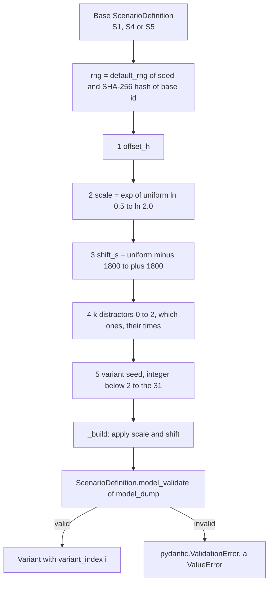
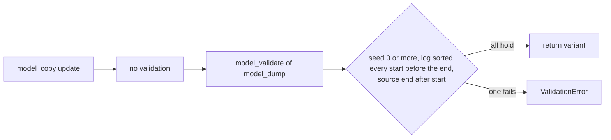
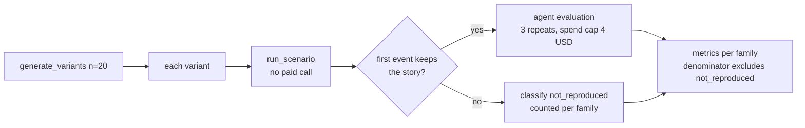

# Scenario variants

## Purpose and scope

`plumetrace.simulator.variants.generate_variants(base, n=20, seed=VARIANT_SEED)` turns one MVP
scenario into a family of randomised variants. The agent evaluation (Phase 5, design section 6)
runs the agents on every variant, so the result does not rest on one hand-picked story. A variant
changes the weather window, the leak rate, the timing, the distractor log lines and the noise seed.
It never changes what the scenario is about: the expected triage class, top candidate and unit stay
those of the base.

The station and every variant are simulated. The ranges and the distractor texts are Task 6 values
with no cited source. The module is pure and deterministic: the draws come only from a seeded
`numpy` generator, no clock, no network and no database. It never calls the inversion.

Status: the generator and its tests exist. **No production code calls it yet (tests only)**; the evaluation that
will use it is Phase 5 Task 11 (planned, not built). The scenarios it works on are in
[SCENARIOS.md](SCENARIOS.md).

## How it works



*Draw order of one variant: five draws in a fixed order, then the scale and the shift are applied and the result is validated again.*

The generator is `np.random.default_rng([seed, h])` where `h` is the first four bytes of the
SHA-256 of `base.id` as a big-endian integer. Python's salted `hash` is not used, so the result is
stable between processes, and two scenarios with the same seed draw differently. For each variant
`i` in `range(n)` the generator draws, in this order:

1. `offset_h = integers(0, 168 - duration_h - 1 + 1)`, so the whole run fits the 168 h snapshot.
2. `scale = exp(uniform(ln 0.5, ln 2.0))`.
3. `shift_s = uniform(-1800, 1800)`.
4. `k = integers(0, 3)`, then `choice(6, size=k, replace=False)`, then one
   `uniform(0, duration_h * 3600)` time per chosen distractor.
5. The variant seed `integers(2**31)`.

The same base, `n` and seed give identical variants, and the first `m` variants of a family do not
depend on `n` (tests `test_first_n_variants_do_not_depend_on_n`, `test_twenty_deterministic_variants`).

## What varies and why

| Parameter | Range | Why |
|---|---|---|
| `weather_offset_h` | integer, 0 to 168 - `duration_h` - 1 (161 for a 6 h scenario, 163 for S4) | different wind speed, direction and stability |
| rate scale | log-uniform in `RATE_SCALE_RANGE` = 0.5 to 2.0 | leak sizes from half to double the base rate; log-uniform so halving and doubling are equally likely |
| time shift | uniform in `TIME_SHIFT_RANGE_S` = -1800 s to +1800 s | the event does not always start at the same minute |
| distractor log entries | 0 to 2 of the six in `DISTRACTOR_LOG`, each at a random time inside the run | irrelevant but plausible lines the agent must ignore |
| `seed` | integer 0 to 2^31 - 1 | different sensor noise and wind-direction wander |

Constants: `VARIANTS_PER_SCENARIO = 20`, `VARIANT_SEED = 20261120`, `SNAPSHOT_HOURS = 168`. The owner
ruled at Gate 3 that `VARIANT_SEED`, `n` and the ranges are never changed.

### What the scale and the shift touch

| Element | Scale (0.5 to 2.0) | Shift (-1800 to +1800 s) | Clamp |
|---|---|---|---|
| Source `rate_kg_h` | multiplied | no | none |
| Source `start_s` | no | added | `max(0, ...)` |
| Source `end_s` | no | added; an infinite end stays infinite | `max(0, ...)` |
| `FT-250` offset effect `value` | multiplied (the header signature scales with the leak) | no (the value is not shifted) | none |
| Every instrument effect, `FT-250` and `TT-20xP` alike | `TT-20xP` is not scaled | `start_s` and `end_s` of each effect are added | none |
| Fault `start_s` | no | added | `max(0, ...)` |
| Base log entries (every one) | no | `t_s` added | clamped to 0 and the scenario length |
| Expected rate interval (when there is one) | both ends multiplied | no | none |
| Distractor log entries | no | no, they stay where they were drawn | none |

Gate 3 change (owner decision, 2026-11-15): the Task 6 plan moved only `permit` entries with the
shift. `_log` now moves **every** base log entry. Before the change the S4 "unit restarted" line
stayed at 9000 s, and in 7 of the 20 default S4 variants the blowdown was still venting when the log
said the unit restarted. The S4 permit text is also relative to its own entry ("venting starts 10
minutes after this entry and lasts about 15 minutes"), so it stays true when a variant moves the
entry. Now in every S4 variant the permit entry is exactly 600 s before the blowdown start and the
restart entry exactly 900 s after its end (50 seeds x 20 variants, test
`test_s4_permit_lead_and_restart_lag_hold_for_50_seeds_x_20_variants`). S1 and S5 base entries keep
their offset to the source or fault start, unless the clamp acts.

### Distractor list

| # | Kind | Tag | Text |
|---|---|---|---|
| 1 | `shift_note` | none | "Radio check with the dispatch centre completed." |
| 2 | `maintenance` | E-232 | "Fin-fan E-232 belt tension checked; no action needed." |
| 3 | `gauging` | TK-401 | "TK-401 gauged; hatch closed and latched." |
| 4 | `calibration` | AT-102 | "AT-102 bump test passed." |
| 5 | `shift_note` | none | "Contractor vehicle entered the site for scaffolding inspection." |
| 6 | `maintenance` | FG-501 | "Fuel gas filter differential pressure logged at 0.3 bar." |

## Ids, keys and expected outcomes

- A variant keeps the base `id`. The pair `(id, variant_index)` with `variant_index` 0 to `n - 1`
  is its unique, stable key. The same inputs always give the same key and content.
- The database stores only `variant_seed` (the variant's `seed`, set when `variant_index` is not
  null) in `plumetrace.runs`, not the index. See [DATABASE.md](DATABASE.md).
- The expected outcome comes from the scenario design, never from running the inversion. Triage
  class, top candidate and attributed unit are those of the base. The expected rate interval is the
  base interval times the variant's rate scale (for S1, 7.5 to 30.0 kg/h times 0.5 to 2.0). No
  variant stores a single point rate for display (rate rule R1 to R4). S4 and S5 have no expected
  rate.

## Validation

`model_copy(update=...)` does not validate. `_build` therefore re-validates every variant with
`ScenarioDefinition.model_validate(variant.model_dump())`, so every scenario rule also holds for a
variant. A shift that pushes a start to or past the end of the scenario, or collapses a source
window to zero length at t = 0, raises `pydantic.ValidationError` (a `ValueError`) instead of
returning an invalid scenario. A negative `n` raises `ValueError("n must be >= 0")`. The three MVP
scenarios give 20 valid variants each at the default seed.



*Why every variant is validated twice: the copy skips the model rules, the re-validation applies them.*

## Worked examples (default seed, variant 0 of each scenario)

Values read from the code on 2026-11-15.

| | S1 variant 0 | S4 variant 0 | S5 variant 0 |
|---|---|---|---|
| `weather_offset_h` | 83 | 116 | 45 |
| `seed` | 898201888 | 1148599598 | 1741852326 |
| Rate scale | 0.947 | 1.662 | none (no source) |
| Time shift | -718.2 s | -193.1 s | -887.8 s |
| Source | 14.21 kg/h from 6481.8 s, no end | 1552.09 kg/h from 7006.9 s to 7906.9 s | none |
| `FT-250` offset | 16.47 kg/h (17.39 x 0.947) from 6481.8 s | none | none |
| Expected interval | 7.1 to 28 kg/h | none | none |
| Fault start | none | none | 3600 s moves to 2712.2 s |
| Base log entries | 600 s moves to 0.0 s (clamp), 4000 s to 3281.8 s, 5000 s to 4281.8 s | permit 6600 s to 6406.9 s, restart 9000 s to 8806.9 s | 300 s moves to 0.0 s (clamp), 3000 s to 2112.2 s |
| Distractors | `maintenance` FG-501 at 840.0 s | `shift_note` at 9810.1 s | `maintenance` E-232 at 19270.5 s |

S1 variant 0 shows the clamp: the 600 s handover line cannot go below 0, so it lands at 0.0 s and
is no longer 600 s before anything. S4 variant 0 shows the Gate 3 rule: the permit is 6406.9 s,
600 s before the source at 7006.9 s, and the restart is 8806.9 s, 900 s after the source ends at
7906.9 s.

## How Phase 5 will use the families (planned, not built)



*Planned use in the Phase 5 evaluation: a variant whose first event breaks its own story is counted and excluded, not run.*

Rulings recorded at Gate 3 (STATUS.md, Owner decisions log, 2026-11-15), which Phase 5 Task 11 must
follow:

- **No generation filter.** The generator is not changed to avoid undetectable variants.
- **`not_reproduced`.** A variant is classified `not_reproduced` (no paid call, counted per family,
  excluded from the denominators and reported as "n of 20 evaluated") when its first detection
  event breaks the story: S1 first event start not in `[src.start_s, src.start_s + 5400]`; S4 first
  event not in `[src.start_s, src.end_s + 1200]`; S5 first event not on AT-106. The times are the
  variant's own shifted times. The check never uses the inversion.
- **Rate check.** `rate_in_interval` means the true rate (`variant.sources[0].rate_kg_h`) lies
  inside the model's p05 to p95 interval. `ExpectedOutcome.rate_min_kg_h` and `rate_max_kg_h` only
  check that the median lies inside; they are not an acceptance band.
- **S4 and FT-250.** No prompt, evaluator or fake may expect an S4 `FT-250` signature. S4 variants
  scale the plume rate, while the mass a log tool reports stays the volume-based
  `S4_VENTED_CH4_KG` (about 233 kg methane).

**How many variants hold their story?** A throwaway check on 2026-11-15 (not committed, and not the
Phase 5 rule itself) ran every one of the 20 default variants of each scenario against the committed
snapshot and applied the first-event test above literally. The story holds for 10 of 20 S1
variants, 4 of 20 S4 variants and 20 of 20 S5 variants. Many variants have no event at all in the
needed window. For example S4 variant 0 (offset 116 h) has no detection event. The base S4 also
fails its window criterion at 116 h, but the variant uses another seed, rate and shift, so the
cause is not established. The evaluation will therefore report small "n evaluated" for S1 and
especially S4. This is the expected consequence of the "no generation filter" ruling; the exact
count belongs to the Phase 5 evidence, not to this page.

## Edge cases and failure modes the tests pin

| Case | Behaviour | Test |
|---|---|---|
| Same base, `n`, seed | identical variants | `test_variants.py::test_twenty_deterministic_variants` |
| Other seed | other variants | `test_variants_edges.py::test_other_seed_gives_other_variants` |
| Same seed, another base id | other draws (hash of the id is mixed in) | `test_family_seed_is_mixed_with_the_base_id` |
| `n = 0`, negative `n` | empty list, `ValueError` | `test_zero_variants_and_negative_count` |
| Every variant valid, keys unique | `(id, variant_index)` | `test_every_variant_is_valid_and_keys_are_unique` |
| Weather window | whole run fits 168 h, also the longest scenario | `test_weather_window_fits_the_snapshot`, `test_weather_window_for_the_longest_scenario_fits` |
| Scale and shift ranges | stay inside their ranges | `test_rate_scale_and_time_shift_stay_in_their_ranges` |
| Rate and header flow | scale together | `test_rate_and_header_flow_scale_together` |
| Infinite source end | stays infinite; a finite end moves | `test_infinite_source_end_stays_infinite_and_finite_end_moves` |
| S5 | no rate, the fault start moves | `test_s5_has_no_rate_and_the_fault_moves` |
| Distractors and base entries | distractors from the list; base entries move with the shift | `test_distractors_from_the_list_and_base_entries_move_with_the_shift` |
| Log order | sorted with distractors | `test_logs_stay_sorted_with_distractors` |
| S4 permit lead and restart lag | exactly 600 s and 900 s, 50 seeds x 20 variants | `test_s4_permit_lead_and_restart_lag_hold_for_50_seeds_x_20_variants` |
| S4 base permit text | matches the source lead and duration | `test_s4_base_permit_text_matches_the_source_lead_and_duration` |
| S1 and S5 base entries | keep their offset to the event | `test_s1_and_s5_base_entries_keep_their_offset_to_the_event` |
| Permit stays inside the scenario | clamped | `test_permit_stays_inside_the_scenario` |
| Start pushed past the end | `ValidationError` | `test_variant_pushed_past_the_end_is_rejected` |
| Source window collapsed at t = 0 | `ValidationError` | `test_variant_with_a_collapsed_source_window_is_rejected` |
| Constants | pinned | `test_family_seed_is_the_task_value`, `test_distractor_log_has_the_six_plan_entries` |

## Limits

- A variant can have no detectable event, or an event that comes from noise before the source. The
  generator does not check (see the `not_reproduced` ruling above).
- `(id, variant_index)` is not stored in the database, only `variant_seed`.
- The 20 variants of a family share one week of weather, so the diversity is in the offset, not in
  the climate.
- Variants of S4 scale a computed blowdown rate, so the plume mass and the volume-based logged mass
  no longer match; this is accepted and documented above.

## How to run and extend

```bash
cd app
uv run pytest backend/tests/simulator/test_variants.py backend/tests/simulator/test_variants_edges.py -q
```

To add a parameter, add its draw **at the end** of `_draw` so earlier draws keep their values, and
document the position in the draw order above. Inserting a draw in the middle changes every variant
that exists in recorded evidence. Keep the re-validation in `_build`. Do not add an inversion call.
