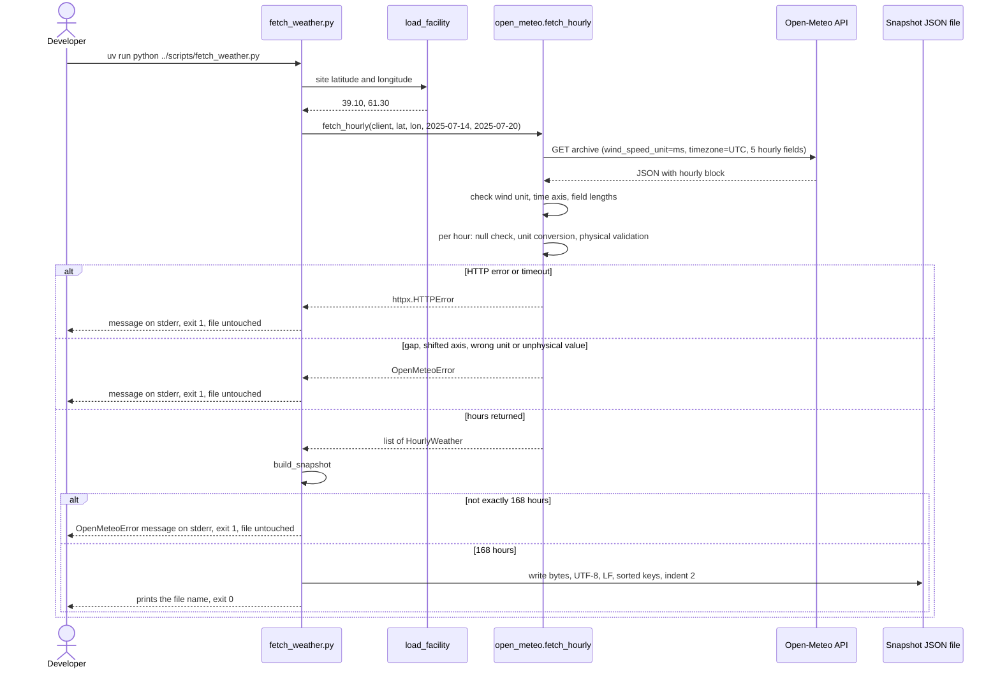

# Weather: Open-Meteo data path and the committed snapshot

## Purpose and scope

The plumes in PlumeTrace are driven by **real** hourly weather for the coordinates of the
fictional station KS-07 (design sections 7 and 8). The weather is fetched once from the public
Open-Meteo archive, committed as a snapshot file and read offline, so every scenario and every
replay file is reproducible without a network. The station, the sensors and the leaks are
simulated; only the weather is real, and it is labelled real and attributed (CLAUDE.md rule 10).

This page covers the outbound client, the fetch script, the snapshot file, how scenarios slice it,
what is rejected, the licence and how to refresh it. The wind and temperature are used by the truth
model in `docs/reference/ENGINEERING.md` (section "Truth model"). The outbound-network controls are
in [SECURITY.md](SECURITY.md#outbound-network). Scenarios that pick a window of the week are in
[SCENARIOS.md](SCENARIOS.md).

## How it works

Two paths exist. Only the first one touches the network, and only when a developer runs the script
by hand. Everything else reads the file.

```mermaid
flowchart LR
    API["Open-Meteo archive API<br/>ERA5 reanalysis"] -->|"one GET, 168 h"| Client["data_sources/open_meteo.py<br/>fetch_hourly"]
    Client -->|"list of HourlyWeather"| Script["scripts/fetch_weather.py<br/>build_snapshot"]
    Script -->|"write_json"| Snap[("weather_ks07_2025-07-14_2025-07-20.json<br/>committed")]
    Snap -->|"load_snapshot"| Weather["simulator/weather.py<br/>WeatherSnapshot"]
    Weather -->|"slice_hours offset, duration + 1"| Runner["simulator/runner.py<br/>run_scenario"]
    Runner --> Truth["truth model<br/>wind, stability, temperature"]
```



*Weather data path: one manual fetch writes the snapshot; every simulation reads the committed file.*

The fetch itself, with its failure branches:



*Fetch sequence: any failure leaves the existing snapshot unchanged and exits with code 1.*

## The source and the snapshot

| Item | Value |
|---|---|
| Source | Open-Meteo historical weather API (ERA5 reanalysis), `https://archive-api.open-meteo.com/v1/archive`, no API key |
| Verified against | The official Open-Meteo documentation and licence pages, 2026-11-14: endpoint, variable names, units, `wind_speed_unit` options (default `kmh`) and `timezone` (default GMT) |
| Location | `site.latitude_deg`, `site.longitude_deg` of KS-07 (39.10, 61.30). The site is fictional; the coordinates are used only to ask for weather |
| Period | 2025-07-14 to 2025-07-20 inclusive, UTC, 168 hours. `start_utc` is `2025-07-14T00:00:00Z` |
| Snapshot file | `app/backend/plumetrace/simulator/data/weather_ks07_2025-07-14_2025-07-20.json`. Generated, never hand-edited |
| File shape | `{"start_utc": "...Z", "attribution": "...", "hours": [ ... ]}`. Each hour holds `hour_index`, `wind_speed_m_s`, `wind_from_deg`, `shortwave_w_m2`, `cloud_fraction`, `temp_k` |
| Content of this week | Wind speed 0.4 to 8.78 m/s, mean 5.3 m/s over the 168 hours (read from the committed file) |
| Licence | CC BY 4.0 (API data). Free for non-commercial use within the published rate limits |
| Attribution text | `Weather data by Open-Meteo.com (CC BY 4.0), ERA5 reanalysis.` (constant `ATTRIBUTION`, stored in the snapshot and copied into every replay file). Open-Meteo asks for a link next to any place its data is shown; the UI must link the text to <https://open-meteo.com/> |

**Owner action.** The free tier is for non-commercial use. Confirming that this labelled-simulated
portfolio demo counts as non-commercial, and adding the ERA5 / Copernicus acknowledgement to
`ATTRIBUTION`, are open items before any public launch. They are tracked in
[OWNER_ACTIONS.md](../OWNER_ACTIONS.md) (entry "Open-Meteo licence"). This page does not change them.

### Fields and conversions

The request asks for `wind_speed_unit=ms` and `timezone=UTC`, so the wind needs no conversion. The
client refuses a response whose `hourly_units` says the wind is not in m/s (the API default is km/h).

| Open-Meteo variable | Unit as requested | `HourlyWeather` field | Conversion |
|---|---|---|---|
| `wind_speed_10m` | m/s | `wind_speed_m_s` | none |
| `wind_direction_10m` | degrees, direction the wind blows from | `wind_from_deg` | none |
| `shortwave_radiation` | W/m2 (mean of the preceding hour) | `shortwave_w_m2` | none |
| `cloud_cover` | percent | `cloud_fraction` | divide by 100 |
| `temperature_2m` | degrees C | `temp_k` | add 273.15 |

`hour_index` is the position in the series (0, 1, 2, ...). Example, hour 0 of the committed file:
wind 4.66 m/s from 4 degrees, no cloud, no radiation, 301.95 K (28.8 degC).

`HourlyWeather` rejects NaN and infinity, a negative wind or radiation, cloud outside 0 to 1 and a
temperature at or below 0 K. A calm hour (wind 0) is allowed by the weather model.

## Modules

| Module | Responsibility |
|---|---|
| `plumetrace.data_sources.open_meteo` | `fetch_hourly(client, lat, lon, start, end)`: one GET, validation, unit conversion. Constants `ARCHIVE_URL`, `HOURLY_FIELDS`, `TIMEOUT_S` (20 s), `ATTRIBUTION`; error `OpenMeteoError`. The caller owns the `httpx.Client`. The only network code for weather; TLS verification stays on (httpx default) |
| `plumetrace.simulator.weather` | `WeatherSnapshot` (`start_utc`, `hours`, `attribution`), `load_snapshot(path)` reads and validates the committed file, `slice_hours(snapshot, offset_h, hours)` returns re-indexed hours. No network code |
| `scripts/fetch_weather.py` | `build_snapshot`, `write_json`, `main`. Fetches the week and writes the snapshot (UTF-8, LF, sorted keys, indent 2, bytes written so Windows never converts LF to CRLF) |

### How a scenario uses the snapshot

A scenario needs `duration_h + 1` hours starting at `weather_offset_h`. The extra hour lets the
truth model interpolate the wind linearly between hour `i` and `i + 1` up to the last second of the
run (`interpolate_weather`). `run_scenario` calls `slice_hours` and the
slice is re-indexed from 0. Scenario second 0 maps to `snapshot.start_utc + weather_offset_h` hours
(`ScenarioRun.sim_start_utc`). With offset 0 that is 2025-07-14 00:00 UTC, about 05:00 at the site
longitude (the site is fictional; the UI must label every clock with its zone).

Example: S1 has `duration_h = 6` and offset 0, so it reads hours 0 to 6 (7 hours). The longest
allowed scenario is 24 h and then needs 25 hours, so its largest offset is 168 - 25 = 143 h
(`variants.SNAPSHOT_HOURS`, test `test_weather_window_for_the_longest_scenario_fits`).

## What is rejected

| Situation | Result | Test |
|---|---|---|
| `end` before `start` | `ValueError`, no request is sent | `data_sources/test_open_meteo_edges.py::test_end_before_start_is_rejected_without_a_request` |
| HTTP error, timeout | `httpx.HTTPError` subclass, raised to the caller | `test_http_errors_propagate`, `test_timeout_is_set_and_timeouts_propagate` |
| Body is not the expected JSON, or an API error body without `hourly` | `OpenMeteoError` | `test_malformed_body_is_an_open_meteo_error`, `test_api_error_body_is_an_open_meteo_error` |
| `null` value (a gap), missing field, field shorter than the time axis | `OpenMeteoError` naming the field (and the time) | `test_missing_values_are_rejected` (in `test_open_meteo.py`), `test_missing_field_is_rejected`, `test_array_length_mismatch_is_rejected` |
| Time axis empty, unparseable, not starting at `start` 00:00, or not hourly | `OpenMeteoError` | `test_empty_series_is_rejected`, `test_unparseable_time_is_rejected`, `test_series_must_start_at_the_start_date`, `test_time_axis_with_a_gap_is_rejected` |
| NaN, negative wind or radiation, cloud outside 0 to 100 % | `OpenMeteoError` naming the time | `test_non_finite_value_is_rejected`, `test_unphysical_value_is_rejected` |
| Wind unit other than m/s | `OpenMeteoError` | `test_wind_unit_other_than_ms_is_rejected` |
| Wrong number of hours (script: not 168) | the script exits 1 and writes nothing | `test_fetch_weather.py::test_main_fails_on_wrong_hour_count_and_writes_nothing` |
| HTTP failure in the script | message on stderr, exit 1, existing file kept | `test_main_reports_http_errors_and_keeps_the_old_file` |
| Null gap in the script | message on stderr, exit 1, existing file kept | `test_main_reports_null_gaps` |
| Snapshot with a `null`, a blank attribution, no hours, a naive `start_utc`, a missing key, malformed JSON or `hour_index` not 0..n-1 | `ValueError` from `load_snapshot` | `simulator/test_weather_edges.py` |
| `slice_hours` with a negative offset, fewer than 1 hour, or more hours than the snapshot has | `ValueError` (`snapshot has N hours, need M`) | `test_slice_rejects_nonsense_arguments`, `test_slice_to_the_exact_end_works` |
| Scenario longer than the snapshot | `ValueError` naming the scenario and the hours needed, for example `scenario s9_long_one needs 173 weather hours (...), snapshot has 168` | `simulator/test_scenario_runner_edges.py::test_too_long_scenario_names_the_scenario_and_the_hours_needed`, `test_weather_boundary_is_exact` |

There is no gap filling. A null in the API data stops the refresh; a null in the committed file
stops the load. The design choice is to fail visibly rather than invent weather.

## Configuration

No environment variable. The location comes from `ks07.yaml`, the period and the expected hour count
are constants in `scripts/fetch_weather.py` (`START`, `END`, `EXPECTED_HOURS`), the URL, field list,
timeout and attribution are constants in `open_meteo.py`.

## How to refresh

```bash
cd app && uv run python ../scripts/fetch_weather.py
```

This makes one real request to the public API (free, no key, no cost). Review the diff before
committing: the weather changes every scenario that uses these hours. After a refresh:

1. Rerun the window selection (`scripts/select_scenario_windows.py`, see [SCENARIOS.md](SCENARIOS.md)).
   A different week can change which offsets pass.
2. Regenerate the replay files (`scripts/export_scenarios.py`, see [REPLAY.md](REPLAY.md)).
3. Update the evidence numbers (detection events, sizes) that quote the old week.

To use another period, change `START`, `END`, `EXPECTED_HOURS` and `DEFAULT_SNAPSHOT_PATH`
together; the file name carries the dates.

## Limits

- One week in one season. The wind, the stability classes and the plume shapes of every scenario
  and every variant come from these 168 hours. A variant changes the offset, not the week.
- ERA5 is a reanalysis on a coarse grid. It is real but it is not a measurement at the site, and
  the site is fictional.
- The free tier and the attribution conditions are the owner action above.

## Testing and evidence

`app/backend/tests/data_sources/` (client, mock transport, no network), `app/backend/tests/simulator/test_weather.py`
and `test_weather_edges.py` (snapshot), `app/backend/tests/test_fetch_weather.py` (script). Run
`cd app && uv run pytest backend/tests/data_sources backend/tests/simulator/test_weather.py -q`.

## How to extend

- A new field (for example humidity): add it to `HOURLY_FIELDS`, `HourlyWeather`, the conversion in
  `_hour`, the snapshot loader and the tests together, then refresh the snapshot.
- A new data source goes in `data_sources/` and gets a row in SECURITY.md, "Outbound network", in
  the same change. No other module may open a connection.
- Keep the attribution constant and the snapshot's `attribution` key: replay files copy it.
